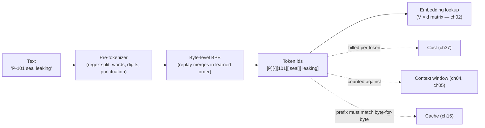
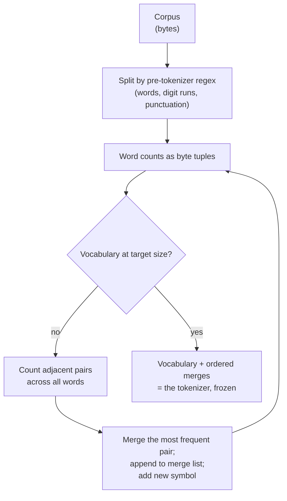

# Chapter 01 — Tokens and tokenizers

*Part I · Word budget 5,000–9,000 · Lab 01 · Verified as of September 2026 · Derived figures from `labs/ch01-tokens/derive.py`*

## 01.1 Intuition

The technician types "P-101 seal leaking, need a work order." The model never sees that sentence. It sees a list of integers — perhaps `[47, 12, 4013, 6321, 18432, 11, 1184, 264, 990, 1500]` (illustrative ids) — produced by a program called a tokenizer that was fixed before the model was trained and has not changed since. Every judgment the model makes about the plant's language passes through that program's choices: which strings are one unit and which are several, how numbers break apart, whether "P-101" is a thing or a letter, a dash, and a number.

The choices are economic before they are linguistic. A token is the unit the provider bills, the unit the context window holds, and the unit the cache matches. A procedure written in Portuguese costs about half again as many tokens as the same procedure in English (Petrov et al. 2023, primary), so it costs more to process, fills the window sooner, and fits fewer words into a retrieval chunk of fixed size. Equipment tags, standards numbers, and part codes fragment into several tokens each, so the dense reference text a maintenance agent relies on is the most expensive text the plant owns.

The choices are also where a class of model errors comes from. The model cannot count letters in a word it never saw as letters; it handles arithmetic unevenly because "1234" and "12345" may split differently (digit grouping per tokenizer, vendor); it treats a rare tag as a sequence of fragments that carry little meaning of their own. None of this is fixed by a better prompt. It is fixed by knowing what the tokenizer does and designing around it — which is what this chapter is for.

## 01.2 Mechanism

### What a tokenizer is

A tokenizer is a deterministic, reversible mapping between text and a sequence of integer ids drawn from a fixed vocabulary. Reversible: decoding the ids returns the original bytes exactly. Deterministic: the same text always yields the same ids. Fixed: the vocabulary and the rules are frozen before training and shipped with the model; a model cannot be given a new tokenizer without retraining its embedding layer (ch02), and in practice without retraining the model.

Three families are in use, and they differ in how they learn the vocabulary, not in what a token is once learned.

### Byte-pair encoding

BPE begins with a base alphabet and a corpus. In the modern byte-level form (Radford et al., GPT-2, 2019, primary), the base alphabet is the 256 possible byte values, so every string is representable and there is never an unknown token. Training then repeats one step: count every adjacent pair of symbols in the corpus, merge the most frequent pair into a new symbol, add it to the vocabulary, and record the merge. After $V - 256$ merges the vocabulary has $V$ entries and the merge list, in order, is the tokenizer (Sennrich, Haddow, and Birch 2016, primary, who introduced the method for machine translation).

Encoding new text replays the merges: split into bytes, then apply each merge in the order it was learned wherever its pair appears. A frequent word like "maintenance" ends as one token because its pairs merged early and often; a rare tag like "P-101" ends as several because its pairs never became frequent enough to merge across the dash and the digits.

Two refinements matter in production tokenizers. A **pre-tokenizer** splits text on a regular expression before BPE runs — at spaces, between letters and digits, at punctuation — so merges do not cross those boundaries; it is why a leading space is part of a word token (" pump" is one token; "pump" at the start of a string is a different one) and why digits are handled as their own runs (tiktoken and Llama 3 tokenizer documentation, vendor). And **special tokens** — end-of-text, message-role markers, tool-call delimiters — are reserved ids inserted by the harness, never produced by encoding user text; a harness that lets user text be tokenized as a special token has a prompt-injection path at the byte level (ch28).

### WordPiece and Unigram

**WordPiece** (Wu et al., Google's neural machine translation system, 2016, primary; used by BERT) merges the pair that most increases the likelihood of the corpus under the current vocabulary, rather than the most frequent pair — a small change in criterion with a similar result. **Unigram** (Kudo 2018, primary) works in the opposite direction: it starts from a large candidate vocabulary and prunes the entries whose removal least hurts a unigram language model's likelihood, and at encoding time it chooses the segmentation with the highest probability rather than replaying merges — which allows *subword regularization*, sampling among plausible segmentations during training to make the model robust to tokenization variants. **SentencePiece** (Kudo and Richardson 2018, primary) is the library that implements BPE and Unigram directly on raw text, treating whitespace as an ordinary symbol, which is why it suits languages without spaces and why Llama 2 and Gemma used it.

### Vocabulary size

The vocabulary size is a design trade. A larger vocabulary compresses text into fewer tokens — cheaper per document, longer effective context, faster generation per word — at the cost of a larger embedding matrix and output projection: $V \times d$ parameters each. The numbers in 01.3 show the cost: at Llama 3's 128,256 entries and a hidden size of 4,096, the input embeddings are 525 million parameters, and with an untied output projection the pair is 13% of an 8B model (derive.py, derived; architecture per Dubey et al. 2024, primary). Small models keep vocabularies small because that share grows as the rest of the model shrinks. Frontier models have moved to 200,000–262,000 because compression pays at scale.

| Model family | Method | Vocabulary | Notes |
|---|---|---|---|
| GPT-2 | Byte-level BPE | 50,257 | The byte-level scheme most later tokenizers follow |
| Llama 2 | SentencePiece BPE | 32,000 | Small vocabulary; digits split individually |
| GPT-3.5 / GPT-4 (cl100k) | Byte-level BPE | ~100,000 | tiktoken |
| Llama 3 | tiktoken-based BPE | 128,256 | 100K from tiktoken plus 28K added for non-English coverage (Dubey et al. 2024, primary) |
| GPT-4o / GPT-5 (o200k) | Byte-level BPE | ~200,000 | tiktoken |
| Llama 4 | BPE | 202,048 | vendor |
| Gemma / Gemini | SentencePiece | ~256,000–262,144 | vendor |

(Vocabulary sizes as reported in model cards and tokenizer releases, vendor, verified Sep 2026.)

### The multilingual tax

Tokenizers are trained on corpora dominated by English, so their merges compress English best. Petrov, La Malfa, Torr, and Bibi measured the effect across languages and tokenizers: with the GPT-4 tokenizer, Italian costs about 1.6× the tokens of English for the same content and Bulgarian about 2.6×; Portuguese and German carry roughly a 50% premium; across all languages studied the spread reaches about 15×, with some scripts fragmenting nearly to the byte (Petrov et al., NeurIPS 2023, primary). Later tokenizers with larger, more multilingual vocabularies narrow the gap; they do not close it.

For a Brazilian operator the tax lands in four places: the bill (every input and output token line, ch37); the context window (a Portuguese document fills it half again as fast); retrieval chunks sized in tokens (a 512-token chunk holds about 256 Portuguese words against 384 English ones, derive.py); and the cache minimum (a provider's 1,024-token minimum cacheable prefix is about 770 English words or 510 Portuguese ones, derive.py; minimum per Anthropic prompt-caching documentation, vendor).

**Figure 01.1 — From text to ids, and where the costs attach.**



*Takeaway: the tokenizer is fixed; the harness's leverage is in what text it sends and how it is ordered.*


### How the model sees a token

An id is a row index into the embedding matrix (ch02). Two ids that are adjacent in the vocabulary have no more in common than two that are far apart; the number carries no meaning, only the row does. What the row carries is learned during pre-training from every context in which the token appeared, which is why a frequent token like " pump" has a rich representation and a fragment like "101" has a representation that is an average over every context in which those digits occurred (mechanism per the embedding layer, ch02, primary) — page numbers, years, part codes, and pumps alike. The model then reassembles meaning across fragments with attention (ch04): "P", "-", "101" become "the pump called P-101" only because attention heads learn to bind adjacent fragments. That binding is reliable in short contexts and is exactly what degrades as the window fills, which is the mechanism behind the identifier failures in 01.5.

**Figure 01.2 — Training a byte-level BPE vocabulary.**



*Takeaway: the merge list is learned once from a corpus the plant did not choose; everything after is replay.*

### Choosing and measuring, not tuning

The plant does not choose its tokenizer; it comes with the model. What the plant chooses is which model, and the tokenizer is one criterion: for a Portuguese-heavy workload, a model whose vocabulary was built with substantial non-English data — Llama 3's 28,000 added tokens, the 256,000-entry vocabularies — costs measurably less per document than a 32,000-entry one, and the difference is measured in an afternoon with Lab 01's method on the plant's own text (Dubey et al. 2024, primary; the comparison is the reader's). Training a custom tokenizer is not an option short of training a model, and adding tokens to an existing vocabulary requires retraining the embedding rows and is rarely worth it for an operator; the leverage is in measurement and in the harness's use of tokens, not in the tokenizer.

### Numbers, code, and tags

Three kinds of text tokenize badly, and all three fill an industrial context.

**Numbers.** Tokenizers differ in how digits are split. Llama 2's tokenizer splits every digit into its own token; tiktoken's cl100k and o200k, and Llama 3's tokenizer, group digits into runs of up to three, so "1234" is two tokens and "123456" is two (tokenizer documentation, vendor; verify against the tokenizer in use). Neither gives the model a representation in which arithmetic is natural, which is one reason numerical work — unit conversions, tolerances, the pressure rating on a flange — belongs in a tool, not in generation (ch25).

**Code and structured text.** JSON, YAML, and code carry whitespace, brackets, and repeated keys that tokenize into many small pieces; indentation and formatting can add 20–40% to the token count of the same content as prose (illustrative range; measure on the artifacts in use). Compact serializations and stable key order reduce both the count and the variance.

**Tags and identifiers.** Equipment tags (P-101), standards references (ISO 14224, API 610), part numbers (SEAL-88), and document ids (MP-0417) fragment at every dash, digit boundary, and case change. A P&ID legend of 500 words can cost 900 tokens at 1.8 tokens per word (illustrative). The consequences for the harness: exact-match retrieval on tags needs keyword search alongside embeddings (ch20); the model's recall of a tag from far back in the context is a copying operation over several fragments (ch04); and tokens per document should be measured on the plant's own text, not estimated from English prose ratios.


### Output tokens and the cost of verbosity

The tokenizer prices output the same way it prices input, and output is billed at four to eight times the input rate (ch37; vendor pricing, Sep 2026). A work order of 400 tokens is the scenario's assumption (ch16, scenario); a model that adds a preamble, restates the request, and closes with a summary can double it, and the harness pays the doubling on every task. Two controls belong in the guides (ch18): a format that is the artifact and nothing else — the eight fields, not a letter containing them — and an explicit instruction against restatement. Constrained output (ch26) enforces the first mechanically. The measurement is output tokens per task by artifact class, tracked in the gateway; a rising trend with no change in the artifact is verbosity, and it is the cheapest cost line to fix.

### Tokenization of tool traffic

Tool schemas and tool results pass through the same tokenizer, and both are typically the largest contributors to the window after retrieved documents. A tool schema is JSON — keys, types, descriptions — and every tool the agent might use is in the prefix on every call; twenty tools at 150 tokens each is 3,000 tokens of the scenario's 4,000-token stable prefix (illustrative). That is why the prefix is cached, and why tools not needed for a task class are omitted from its prefix by the router (ch23). Tool results are the other side: a raw CMMS response of a hundred records is thousands of tokens of which the model needs a dozen. The loop (ch22) summarizes or references large results rather than passing them whole, and the code-execution pattern — the model writes code that filters the result inside the sandbox and returns only the filtered rows — keeps the bulk out of the window entirely (Anthropic, "Code execution with MCP," 2025, vendor).

### Reference implementation

A complete byte-level BPE trainer and encoder in about fifty lines. Lab 01 trains it on a small industrial corpus and shows the merges, the fragmentation of tags, and the vocabulary-size trade.

```python
from collections import Counter
import re

PRE_TOKENIZE = re.compile(r"\d+|[A-Za-z]+|\s+|[^\sA-Za-z\d]", re.UNICODE)

class BPE:
    """Byte-level BPE: base alphabet is the 256 byte values; merges learned by pair frequency."""
    def __init__(self):
        self.merges = []                      # ordered list of (a, b) byte-tuple pairs
        self.vocab = {bytes([i]): i for i in range(256)}

    def _words(self, text):
        return [tuple(bytes([b]) for b in w.encode("utf-8")) for w in PRE_TOKENIZE.findall(text)]

    def train(self, text, vocab_size):
        words = Counter(self._words(text))
        while len(self.vocab) < vocab_size:
            pairs = Counter()
            for w, n in words.items():
                for a, b in zip(w, w[1:]): pairs[(a, b)] += n
            if not pairs: break
            (a, b), _ = pairs.most_common(1)[0]
            self.merges.append((a, b)); self.vocab[a + b] = len(self.vocab)
            words = Counter({self._merge(w, a, b): n for w, n in words.items()})
        return self

    @staticmethod
    def _merge(word, a, b):
        out, i = [], 0
        while i < len(word):
            if i < len(word) - 1 and word[i] == a and word[i + 1] == b: out.append(a + b); i += 2
            else: out.append(word[i]); i += 1
        return tuple(out)

    def encode(self, text):
        ids = []
        for w in self._words(text):
            for a, b in self.merges: w = self._merge(w, a, b)
            ids.extend(self.vocab[t] for t in w)
        return ids

    def tokens(self, text):
        out = []
        for w in self._words(text):
            for a, b in self.merges: w = self._merge(w, a, b)
            out.extend(t.decode("utf-8", errors="replace") for t in w)
        return out
```

The pre-tokenizer regex is the part to look at: it keeps digit runs, letter runs, whitespace, and each punctuation mark separate, so no merge ever joins "P" to "-" to "101". That is a deliberate choice most production tokenizers make (tiktoken's pre-tokenization pattern, vendor), and it is why tags fragment.

### Tokenizer drift and glitch tokens

Two failure modes live in the tokenizer rather than the model. **Drift**: a new model version ships with a new tokenizer, and every token count the harness stored — chunk sizes, cache-minimum checks, budgets — is off; a harness records the tokenizer identity with every count and re-measures on upgrade. **Glitch tokens**: a vocabulary can contain entries that appeared often enough in the tokenizer's training corpus to be merged but rarely or never in the model's training data, so the model has no usable representation of them; prompting with such a token produces erratic output (Rumbelow and Watkins, "SolidGoldMagikarp," 2023, practitioner). The practical rule is that a harness never trusts a token count it did not compute with the tokenizer in use, and never assumes that a string's tokens carry meaning just because they exist.

### Tokens in the harness

Every later component counts tokens. Guides (ch18) are placed first and kept byte-identical so their tokens hit the cache. Retrieval (ch20) sizes chunks in tokens, per language. Context engineering (ch19) budgets the window in tokens per step. The gateway (ch23) records input, cached, output, and reasoning tokens per call and prices them (ch37). Memory (ch24) stores facts, not transcripts, partly because transcripts are tokens the window cannot afford. The tokenizer is the unit of account for all of it.

## 01.3 Worked numbers

All figures from `derive.py` (derived).

**Embedding matrices.** Vocabulary × hidden size, in parameters and FP16 megabytes:

| Model | Vocabulary | Hidden | Embedding parameters | FP16 |
|---|---|---|---|---|
| Llama 2 7B | 32,000 | 4,096 | 131M | 262 MB |
| Llama 3 8B | 128,256 | 4,096 | 525M | 1,051 MB |
| Llama 3 70B | 128,256 | 8,192 | 1,051M | 2,101 MB |
| Llama 3 405B | 128,256 | 16,384 | 2,101M | 4,203 MB |
| 256K-vocabulary model at 4,096 | 262,144 | 4,096 | 1,074M | 2,147 MB |

(Architecture per Dubey et al. 2024, primary; the last row is a Gemma-class vocabulary at an 8B hidden size, illustrative.) With input and output matrices untied, Llama 3 8B spends 13% of its parameters on vocabulary.

**Tokens per 1,000 words.** At the English rule of thumb of 0.75 words per token, 1,000 English words are about 1,333 tokens. Applying Petrov et al.'s ratios: Portuguese and German about 2,000, Italian 2,133, Bulgarian 3,466.

**What fits.** A 512-token retrieval chunk holds about 384 English words, 256 Portuguese, 148 Bulgarian. A 1,024-token cache minimum is about 770 English words or 510 Portuguese.

**The scenario's bill.** Configuration B of ch37 spends $180 a month on input tokens for the English version of the workload; the same workload in Portuguese, at 1.5×, spends $270 (derive.py; prices vendor, Sep 2026). The output line scales the same way. The tax is not large in money at this volume; it is large in the window and the chunk.

**A legend.** A 500-word P&ID legend at 1.8 tokens per word is 900 tokens (illustrative) — one legend is a fifth of the scenario's fresh input per query, which is the argument for retrieving legend entries by tag rather than including the legend.

## 01.4 Measurement

**Tokens per document class.** Using the tokenizer of the model in use — never an estimate — count tokens for a sample of each document class the agent reads: procedures, work orders, P&ID legends, equipment histories, standards excerpts, in each language in use. Report tokens per 1,000 words and tokens per document with the tokenizer's identity and version. This is the number the retrieval chunker, the cache-minimum check, and the cost model all need; Lab 01 shows the method with its own trainer, and the reader repeats it with the production tokenizer.

**Fragmentation of identifiers.** For the plant's tag, part, and document-id formats, count tokens per identifier; report the mean and the worst case. Identifiers above three tokens are candidates for a lookup tool rather than in-context recall.

**Cache-minimum compliance.** Share of requests whose stable prefix reaches the provider's minimum in tokens, per language.

**Drift check.** On every model upgrade, re-count a fixed sample with the new tokenizer; report the change per document class before changing any chunk size or budget.

What to record: tokenizer name and version (or the model version it ships with), sample sizes, language, document class, date.


### Reference output (Lab 01, this run)

What the lab prints when it reproduces; the plant's numbers replace these.

```text
V=  300: tokens/1000 words   4549; round trip True; tags {'P-101': 4, 'MP-0417': 6, 'SEAL-88': 7, 'ISO 14224': 9}; words {'pump': 4, 'seal': 2, 'permit': 2, 'bomba': 5, 'procedimento': 5}
V=  600: tokens/1000 words   2225; round trip True; tags {'P-101': 3, 'MP-0417': 3, 'SEAL-88': 3, 'ISO 14224': 3}; words {'pump': 1, 'seal': 1, 'permit': 1, 'bomba': 1, 'procedimento': 1}
V= 1200: tokens/1000 words   2225; round trip True; tags {'P-101': 3, 'MP-0417': 3, 'SEAL-88': 3, 'ISO 14224': 3}; words {'pump': 1, 'seal': 1, 'permit': 1, 'bomba': 1, 'procedimento': 1}
tokens per 1,000 words non-increasing with vocabulary: True
pre-tokenizer splits letter/digit/punctuation: True ['P', '-', '101', ' ', 'MP', '-', '0417']
Llama 3 8B embed params      chapter 525336576  derived 525336576  OK
Llama 3 8B embed share %     chapter 13.1  derived 13.1  OK
PT tokens/1000 words         chapter 2000  derived 2000  OK
PT words per 512-token chunk chapter 256  derived 256  OK
Lab 01: REPRODUCED
```

## 01.5 Failure

| Failure mode | Mechanism | Detection signal | Mitigation | Owning component |
|---|---|---|---|---|
| English ratio applied to Portuguese | Chunk sizes and budgets set from a 0.75 words-per-token estimate | Chunks overflow; cache prefix below minimum; bill 50% above plan | Measure tokens per class per language with the real tokenizer | This chapter; ch20; ch37 |
| Tag fragmentation | Identifiers split into many low-meaning tokens | Poor exact-match recall; embedding retrieval misses tags | Keyword search beside embeddings; lookup tools for identifiers | ch20; ch25 |
| Arithmetic in generation | Digits tokenized in runs; no numeric representation | Wrong unit conversions and totals | Numbers computed by tools; results inserted as text | ch25 |
| Prefix not byte-identical | A changed character early in the prompt changes every token after it | Cache-hit rate falls | Stable prefix first, unchanged; hit-rate alarm | ch18; ch37 |
| Tokenizer drift on upgrade | New model version, new tokenizer; stored counts stale | Chunk and budget errors after upgrade | Record tokenizer identity; re-measure on upgrade | This chapter; ch23 |
| Special-token injection | User text encoded as a reserved control token | Role or tool boundaries confused in the prompt | Harness inserts special tokens; user text encoded with them disallowed | ch28 |
| Glitch tokens | Vocabulary entries the model never learned | Erratic output on specific strings | Detect and escape known glitch tokens; never assume a token has meaning | This chapter |
| Formatting overhead | Verbose JSON or indentation in tool results | Token counts 20–40% above the content's | Compact serialization; stable key order; summaries into the window | ch19; ch25 |
| Counting with the wrong tokenizer | Client-side estimate from a different vocabulary | Budgets and caps off by a constant factor | Count with the model's tokenizer or the gateway's usage report | ch23 |
| Verbose output | Preambles, restatements, closings around the artifact | Output tokens per task rising with no change in the artifact | Format is the artifact; constrained output; instruction against restatement | ch18; ch26 |
| Tool schemas crowding the prefix | Every tool's schema in every call | Prefix growing with the tool count; cache minimum met but window crowded | Router selects the tool subset per task class; schemas concise | ch23; ch25 |
| Raw tool results in the window | Full CMMS responses passed whole | Tokens per step dominated by tool results | Summaries, references, or in-sandbox filtering | ch19; ch22; ch25 |

## 01.6 The frontier

**Strongest free treatments.** Sennrich, Haddow, and Birch (2016) introduced BPE for neural translation and are complete on the algorithm; Kudo (2018) and Kudo and Richardson (2018) do the same for Unigram and SentencePiece; Radford et al. (2019) established byte-level BPE. All stop at the method. Petrov, La Malfa, Torr, and Bibi (2023) measured the multilingual tax across tokenizers and languages and stop at the measurement — no chunking, caching, or cost consequences. The Hugging Face tokenizers documentation and Karpathy's minbpe are the clearest practical treatments and stop at training and using a tokenizer. Huyen's *AI Engineering* (2025) covers tokens in its foundations chapter as a cost and context unit and stops before per-language chunk sizing and identifier fragmentation. Rumbelow and Watkins (2023) documented glitch tokens.

**What this chapter adds.** The tokenizer as a unit of account followed into every harness component; the multilingual tax carried through to the chunk, the cache minimum, and the monthly bill for a Portuguese-speaking operator; identifier fragmentation as a first-class problem for industrial text with its consequences for retrieval and recall; a runnable trainer whose pre-tokenizer shows why tags fragment; and the measurement protocol that replaces estimates with counts. Open: per-document-class token counts for industrial Portuguese text are unpublished; Lab 01's method applied to the plant's corpus is the measurement.

## 01.7 Industrial application

**The plant's text.** The maintenance agent reads procedures in Portuguese with English standards references, work orders with tags and part numbers, P&ID legends dense with identifiers, and equipment histories written by technicians in a mix of both languages. Every class tokenizes differently and none tokenizes like English prose. The first measurement of the program is a token count per class per language with the production tokenizer, and the retrieval chunker is sized from it: about 256 Portuguese words per 512-token chunk, not 384 (derive.py).

**The P-101 query.** The technician's request is a dozen tokens. The retrieved procedure MP-0417, in Portuguese, is about 1.5× the tokens its English equivalent would be. The equipment history carries tags on every line, each a handful of fragments. The stable prefix — guides, tool schemas, reference chunks — must exceed the cache minimum in tokens, which it does at 4,000; the check is against tokens counted, not words estimated.

**What the tokenizer decides for the plant.** Which retrieval mode finds a tag (keyword, not only embedding); which computations leave the model (all numeric ones); how big a chunk is per language; whether a document id in the context can be recalled exactly from far back (only with attention's copying heads, ch04, and less reliably as the window fills); and what the input bill is in reais.

**OT boundary.** Nothing in tokenization touches control systems; the chapter's relevance to the boundary is that identifiers for control-system entities — instrument tags, loop numbers — fragment like any other, and a harness that cannot reliably recall a tag is another reason no tool reaches those systems (ch35).

## 01.8 Decision aids

**Token measurement worksheet (per document class, per language).**

| Class | Language | Sample size | Tokens per 1,000 words | Tokens per document (mean, p95) | Tokenizer id | Date |
|---|---|---|---|---|---|---|

**Chunk sizing rule.** Target tokens per chunk ÷ (tokens per 1,000 words for that language ÷ 1,000) = words per chunk. Set per language; never one size for all.

**Identifier policy.** Count tokens per identifier format; above three, provide a lookup tool and index the identifier as a keyword; never rely on in-context recall from more than a few thousand tokens back.

**Upgrade checklist.** Record the new tokenizer identity; re-count the fixed sample; adjust chunk sizes, cache-minimum checks, and per-task token budgets; re-run the golden set; then switch.

**Cache prefix check.** Count the stable prefix with the production tokenizer; confirm it exceeds the provider's minimum in every language; confirm it is byte-identical across requests.

**Output budget per artifact class.** Set from the artifact's fields, not from a guess: a work order is its eight fields plus a citation, about 400 tokens in the scenario; a test report is its verdict table; a decision summary is five lines. Alert when the p95 exceeds the budget by half (budgets are scenario values, illustrative).

## 01.9 Sources

| # | Claim or figure | Source | Tier | Verified | Link |
|---|---|---|---|---|---|
| 1 | BPE for subword units | Sennrich, Haddow, Birch, ACL 2016, arXiv 1508.07909 | primary | Sep 2026 | https://arxiv.org/abs/1508.07909 |
| 2 | Byte-level BPE; 50,257 vocabulary | Radford et al., "Language Models are Unsupervised Multitask Learners," 2019 | primary | Sep 2026 | https://cdn.openai.com/better-language-models/language_models_are_unsupervised_multitask_learners.pdf |
| 3 | Unigram tokenization; subword regularization | Kudo, ACL 2018, arXiv 1804.10959 | primary | Sep 2026 | https://arxiv.org/abs/1804.10959 |
| 4 | SentencePiece | Kudo & Richardson, EMNLP 2018, arXiv 1808.06226 | primary | Sep 2026 | https://arxiv.org/abs/1808.06226 |
| 5 | WordPiece | Wu et al., Google NMT, 2016, arXiv 1609.08144 | primary | Sep 2026 | https://arxiv.org/abs/1609.08144 |
| 6 | Multilingual tax: Italian ~1.6×, Bulgarian ~2.6×, Portuguese/German ~1.5×, spread ~15× | Petrov, La Malfa, Torr, Bibi, NeurIPS 2023, arXiv 2305.15425 | primary | Sep 2026 | https://arxiv.org/abs/2305.15425 |
| 7 | Llama 3: 128,256 vocabulary, tiktoken-based, 100K + 28K; hidden sizes | Dubey et al., "The Llama 3 Herd of Models," 2024, arXiv 2407.21783 | primary | Sep 2026 | https://arxiv.org/abs/2407.21783 |
| 8 | Vocabulary sizes for GPT-4, GPT-4o/5, Llama 2, Llama 4, Gemma | Model cards and tokenizer releases | vendor | Sep 2026 | https://huggingface.co/models |
| 9 | Digit grouping in tiktoken/Llama 3; single digits in Llama 2 | Tokenizer documentation and source | vendor | Sep 2026 | https://huggingface.co/docs/tokenizers |
| 10 | Cache minimum prefix 1,024 tokens (larger for some small models) | Anthropic prompt-caching documentation | vendor | Sep 2026 | https://www.anthropic.com/engineering |
| 11 | Glitch tokens | Rumbelow & Watkins, "SolidGoldMagikarp," LessWrong, Feb 2023 | practitioner | Sep 2026 | https://www.lesswrong.com/posts/aPeJE8bSo6rAFoLqg/solidgoldmagikarp-plus-prompt-generation |
| 12 | Embedding parameters and sizes; tokens per 1,000 words; words per chunk; cache minimum in words; scenario input cost | `labs/ch01-tokens/derive.py` | derived | Sep 2026 | labs/ch01-tokens/derive.py |
| 13 | 0.75 words per token in English; 1.8 tokens per word for a legend; 20–40% formatting overhead | Rules of thumb and estimates | illustrative | Sep 2026 | — |
| 14 | Per-class token counts for industrial Portuguese text | None published | open | Sep 2026 | — |