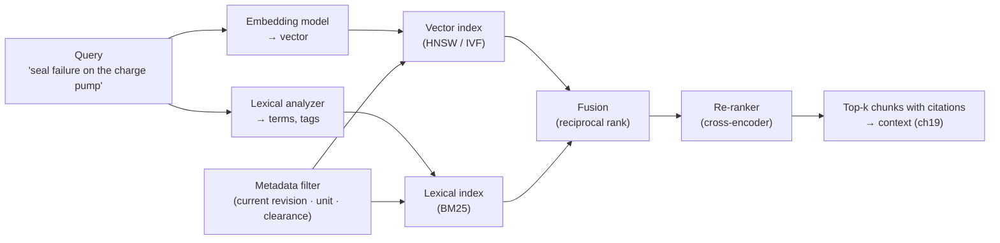
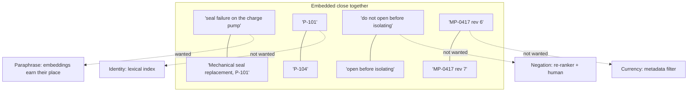

# Chapter 02 — Embeddings and representation

*Part I · Word budget 5,000–8,000 · Lab 02 · Verified as of September 2026 · Derived figures from `labs/ch02-embeddings/derive.py`*

## 02.1 Intuition

A technician asks the maintenance agent about a "seal failure on the charge pump." The procedure that answers it is titled "Mechanical seal replacement, P-101," and nowhere in it does the phrase "seal failure" or "charge pump" appear. A keyword search returns nothing. The agent finds it anyway, because both the question and the procedure were turned into points in a space where things that mean the same thing sit near each other, and the procedure is the nearest point to the question.

That space is what an embedding is: a list of a few hundred to a few thousand numbers that places a piece of text so that distance corresponds to similarity of meaning. It is the mechanism behind retrieval (ch20), behind the model's own first layer (a token's embedding is the row the model looks up, ch01), and behind every "find me things like this" feature the plant will be offered.

It is also imprecise in a specific way the plant must design around. The same geometry that places "seal failure" near "mechanical seal replacement" places "P-101" near "P-104," because to the embedding they are almost the same string with almost the same contexts. An embedding is a summary of meaning, and an equipment tag has no meaning to summarize — it is an identity. Retrieval that works by meaning alone will hand the agent the procedure for the wrong pump with a straight face. This chapter is about what embeddings capture, what they lose, what they cost to store and search, and why the retrieval layer of a plant's harness is never embeddings alone.

## 02.2 Mechanism

### From tokens to vectors

Inside the model, the embedding layer is a matrix of $V \times d$ numbers — one row of $d$ values per vocabulary entry (ch01). A token id selects its row, and that row is the token's representation at the model's input. The rows are learned during pre-training: tokens that appear in similar contexts end with similar rows, which is the distributional idea that word2vec made practical (Mikolov et al. 2013, primary) and that the transformer's first layer inherits. Nothing in the row is interpretable on its own; only the geometry among rows is.

A **text embedding** — the thing a retrieval system stores — is different from a token embedding. It is one vector for a whole passage, produced by a model trained so that passages with related meaning map to nearby vectors. The standard construction runs the passage through a transformer encoder and pools the final hidden states into one vector, then trains the encoder with a contrastive objective: pull a query's vector toward the vector of a passage that answers it, push it away from passages that do not (Reimers and Gurevych, Sentence-BERT, 2019, primary; Karpukhin et al., Dense Passage Retrieval, 2020, primary). Modern embedding models are large encoders or adapted decoders trained this way on hundreds of millions of pairs; the plant rents one by the token or self-hosts an open one.

### Similarity and its geometry

Two vectors are compared by cosine similarity — the cosine of the angle between them, which is their dot product after each is scaled to unit length:

$$\cos(a, b) = \frac{a \cdot b}{\|a\|\,\|b\|}.$$

A value near one means the passages are close in the model's space; near zero, unrelated. The scale is not absolute: a cosine of 0.8 means something different for every model, and thresholds are set by measuring on a golden set (ch12), never copied from another deployment.

High dimension changes intuition in one way that matters. Random unit vectors in $d$ dimensions have cosine similarities concentrated near zero with standard deviation about $1/\sqrt{d}$ — 0.05 at 384 dimensions, 0.03 at 1,024, 0.02 at 3,072 (derive.py, derived; the lab reproduces it). Unrelated passages therefore all look equally unrelated, and the useful signal lives in a thin band above that noise floor; a query that is itself near the floor — a bare tag, a number, a two-word fragment — has no neighbours it prefers, and the nearest ones are arbitrary. That is the mechanism behind the tag problem.

### Dimension, storage, and search

Embedding dimension is a cost lever. Common sizes run from 384 to 3,072, and storage is linear in both dimension and chunk count: a million chunks at 1,024 dimensions is 4.1 GB in 32-bit floats, 1.0 GB at 8 bits (derive.py). Some models are trained so that a prefix of the vector is itself a usable embedding — Matryoshka representation learning (Kusupati et al. 2022, primary), exposed by providers as a "dimensions" parameter — so a 3,072-dimensional embedding can be stored at 768 dimensions for a 75% storage saving and a measured, usually small, loss in retrieval quality (provider documentation, vendor).

Search is the other cost. A brute-force comparison of one query against every chunk is $N \times d$ multiply-adds — 250 million for the scenario's 240,000 chunks at 1,024 dimensions, about 50 ms at ten billion operations a second (derive.py, illustrative rate), acceptable for a single query and not for a hundred concurrent ones. Approximate nearest-neighbour indexes trade a little recall for a large speed-up: HNSW builds a navigable graph over the vectors and answers in logarithmic time (Malkov and Yashunin 2018, primary); inverted-file and product-quantization indexes cluster and compress (Johnson, Douze, and Jégou, FAISS, 2017, primary). The recall an index gives up is measured against brute force on the golden set, and it is a number the plant should know, because an index tuned for speed can silently drop the one chunk that mattered.

### What embeddings capture, and what they lose

An embedding captures topic, paraphrase, and — in a good model — the kind of answer a passage gives. It loses four things an industrial corpus is full of.

**Identity.** Tags, part numbers, document ids. To the model they are near-identical strings; to the plant they are different equipment. Embedding retrieval alone confuses them.

**Negation and small edits.** "Do not open the valve before isolating" and "Open the valve before isolating" embed close together; the geometry is dominated by the shared content words. Procedures are made of exactly such sentences.

**Numbers.** A tolerance of 0.05 mm and one of 0.5 mm sit at almost the same point. Numeric constraints are retrieved by their surrounding text, not by their value.

**Currency and provenance.** An embedding of revision 6 and of revision 7 of the same procedure are nearly the same vector. Which is current is metadata, not meaning.

The design consequence is the hybrid retrieval of ch20: a lexical index (BM25 or equivalent; Robertson and Zaragoza 2009, primary) for identity and exact terms, an embedding index for meaning, metadata filters for revision, unit, and clearance applied before either, and a re-ranker — a cross-encoder that reads the query and each candidate together — to order the survivors (Nogueira and Cho, 2019, primary). Anthropic's contextual-retrieval work reports the same conclusion from measurement: adding a lexical index to embeddings and prepending each chunk with a short generated summary of its place in the document cut the top-20 retrieval failure rate by 49%, and adding a re-ranker by 67% (Anthropic, "Introducing Contextual Retrieval," September 2024, vendor). The number is vendor-measured on vendor data; the direction is the field's.

**Figure 02.1 — Two representations, one retrieval layer.**



*Takeaway: meaning comes from the vector, identity from the terms, currency from metadata; none of the three suffices alone.*


### Chunks: the unit that gets embedded

A passage embedding summarizes whatever it is given, and the ingestion pipeline (ch20) decides what that is. The unit is the *chunk*, and three decisions about it shape retrieval more than the choice of model. **Size**: a chunk must hold enough to answer a question — a procedure step with its warning, a table row with its header — and no more than the window budget allows; sizes are set in tokens per language (ch01), typically 300–800 tokens with overlap, and measured on the golden set rather than copied. **Boundaries**: a chunk that splits a warning from the step it warns about, or a table from its header, embeds two fragments neither of which means what the whole meant; boundaries follow the document's structure — headings, steps, tables — not a fixed count. **Context**: a chunk embedded alone loses where it came from; prepending a short statement of the document, section, and equipment it belongs to — Anthropic's contextual-retrieval measurement quantified the gain (Anthropic 2024, vendor) — gives the vector the provenance the geometry would otherwise lose. The chunk's metadata (document id, revision, equipment tags, unit, clearance) is stored beside the vector and filtered before search; it is never expected to survive inside the vector.

### Queries are not passages

The question and the passage are different kinds of text, and embedding models are trained with that asymmetry: a question is short, a passage is long, and the contrastive objective pulls the two together across the gap. Two practices follow. Some models expect an instruction prefix on the query ("Represent this question for retrieving procedures:") and perform worse without it — the provider's documentation says which (vendor). And a bare tag or a two-word fragment as a query sits near the noise floor with no neighbours it prefers; the harness rewrites queries before embedding them — expanding a tag with its equipment type, adding the task's intent from intake (ch17), generating a hypothetical answer to embed in place of the question — and measures each rewrite on the golden set. Query rewriting is cheap, a small-model step in the router's routine class (ch23), and it moves recall more than model choice does on short industrial queries (the ordering is this chapter's assessment; practitioner).

### Interpreting the space

The dimensions of an embedding have no names; a plant cannot read a vector. What it can do is measure relations. Clustering the corpus's vectors reveals the document families the model perceives, and a family that mixes pumps and compressors is a warning that the model does not separate what the plant separates. Projecting the golden questions' vectors against the chunks that answer them shows how far the answering chunk sits from the nearest wrong one — the margin — and a margin near the noise floor is a query type that needs the lexical index or a rewrite. Neither analysis needs the model's internals; both need the golden set, and both belong in the retrieval component's measurement (ch20), reported when the model or the corpus changes.


### Embeddings for things other than retrieval

The same vectors serve three other jobs in the harness, each with the same limits. **Routing** (ch23): a query's embedding compared against cluster centroids for task classes is the semantic router — fast and cheap, and wrong for exactly the queries whose meaning is in an identifier. **Semantic caching** (ch37): returning a stored answer when a new query embeds close to an old one; the false-hit failure is the tag problem again, two queries about different pumps embedding as one. **Memory** (ch24): long-term facts indexed by embedding and retrieved per step; a fact about P-101 retrieved for a question about P-104 is memory poisoning by geometry. In all three, the mitigation is the one this chapter keeps returning to: identity through exact terms and metadata, meaning through the vector, and a golden set that measures the failure separately from the success.

### Drift and monitoring

An embedding index degrades without any component failing. New document families arrive that the model places poorly; new terminology enters the corpus; the model version is upgraded by a provider without the index being rebuilt. Three signals catch it, all from the observability records (ch29): recall@k on the golden questions re-run weekly against the live index; the share of retrievals whose top result scores below the threshold (rising means queries the model cannot place); and the reviewers' rejections coded "wrong document" or "wrong equipment" at the gate (ch31). A rising rejection code with a flat golden-set recall means the golden set no longer represents the questions — the steering loop (ch16) adds the new questions and the measurement resumes.

### Embeddings inside the model

The token embedding (ch01) is only the input. Each transformer layer rewrites every token's vector — the *residual stream* — by adding what attention gathered from other tokens (ch04) and what the feed-forward block computed from the vector itself (ch03). By the final layer, the vector at position $t$ is a representation of the whole context as it bears on predicting token $t+1$. That is why the last hidden state of a sentence can serve as its embedding, and why embedding models are often transformers with a pooling step on top. It is also why a token's meaning is contextual: the row for "seal" is the same in "mechanical seal" and "seal of approval," and the layers are what tell them apart.

### Reference implementation

A complete retrieval layer in miniature. The embedding here is a hashed character-trigram vector — a lexical stand-in, deterministic and dependency-free, labelled as such — chosen because it exhibits the geometry this chapter describes (paraphrase-tolerant, identity-blind) without a model. Lab 02 runs it beside a lexical index and a metadata filter and shows where each succeeds.

```python
import math, re
from collections import Counter, defaultdict

TOKEN = re.compile(r"[A-Za-z]+|\d+|[^\sA-Za-z\d]")

def embed(text: str, dims: int = 512) -> list:
    """Hashed character-trigram embedding: a lexical stand-in for a learned model (labelled substitute)."""
    v = [0.0] * dims
    s = f" {text.lower()} "
    for i in range(len(s) - 2):
        v[hash(s[i:i+3]) % dims] += 1.0
    n = math.sqrt(sum(x * x for x in v)) or 1.0
    return [x / n for x in v]

def cosine(a: list, b: list) -> float:
    return sum(x * y for x, y in zip(a, b))

class LexicalIndex:
    """BM25-style scoring over exact terms; identifiers survive intact."""
    def __init__(self, k1=1.5, b=0.75):
        self.k1, self.b, self.docs, self.df, self.avg = k1, b, {}, Counter(), 0.0
    def add(self, doc_id: str, text: str):
        terms = TOKEN.findall(text.lower()); self.docs[doc_id] = Counter(terms)
        for t in set(terms): self.df[t] += 1
        self.avg = sum(sum(c.values()) for c in self.docs.values()) / len(self.docs)
    def score(self, query: str) -> dict:
        q = TOKEN.findall(query.lower()); N = len(self.docs); out = {}
        for d, tf in self.docs.items():
            L = sum(tf.values()); s = 0.0
            for t in q:
                if t not in tf: continue
                idf = math.log(1 + (N - self.df[t] + 0.5) / (self.df[t] + 0.5))
                s += idf * tf[t] * (self.k1 + 1) / (tf[t] + self.k1 * (1 - self.b + self.b * L / self.avg))
            out[d] = s
        return out

class Retriever:
    def __init__(self):
        self.vectors, self.meta, self.lex = {}, {}, LexicalIndex()
    def add(self, doc_id: str, text: str, **meta):
        self.vectors[doc_id] = embed(text); self.meta[doc_id] = meta; self.lex.add(doc_id, text)
    def search(self, query: str, k: int = 3, filters: dict = None, mode: str = "hybrid") -> list:
        allowed = [d for d, m in self.meta.items() if all(m.get(f) == v for f, v in (filters or {}).items())]
        qv = embed(query); vec = {d: cosine(qv, self.vectors[d]) for d in allowed}
        lex = {d: s for d, s in self.lex.score(query).items() if d in allowed}
        if mode == "vector": ranked = sorted(allowed, key=lambda d: -vec[d])
        elif mode == "lexical": ranked = sorted(allowed, key=lambda d: -lex.get(d, 0.0))
        else:                                                    # reciprocal-rank fusion
            rv = {d: i for i, d in enumerate(sorted(allowed, key=lambda d: -vec[d]))}
            rl = {d: i for i, d in enumerate(sorted(allowed, key=lambda d: -lex.get(d, 0.0)))}
            ranked = sorted(allowed, key=lambda d: -(1 / (60 + rv[d]) + 1 / (60 + rl[d])))
        return ranked[:k]
```

The `filters` argument runs before either index, which is the order that makes currency and clearance deterministic; the fusion is reciprocal-rank, which needs no calibration between two incomparable scores. What the code does not include is the re-ranker, because a cross-encoder is a model; the lab notes where it would sit.

### Choosing and operating an embedding model

Four questions decide the model. Language: the plant's Portuguese and its bilingual technical text need a multilingual model, and public leaderboards report per-language scores (MTEB, Muennighoff et al. 2022, primary; scores are analyst-tier evidence for the plant's own text). Domain: technical maintenance language is far from the web text most models are trained on, and the golden set is the only measure that counts. Dimension and cost: per-token embedding prices are low — re-embedding the scenario's 240,000 chunks costs about $16 at $0.13 per million tokens, and a month's query embeddings about a dollar (derive.py; rate illustrative of large-model pricing, vendor) — so quality, not price, decides. Residency: an open model self-hosted inside the perimeter when the text may not leave (ch36).

Two operational rules follow from the geometry. **Version the model with the index**: vectors from two embedding models are not comparable, so a model change means a full re-index, and a query embedded with a different model than the index returns noise. **Re-embed on content change**: a revised chunk's old vector points at old content; the ingestion pipeline (ch20) re-embeds on every revision and updates the metadata in the same transaction.

**Figure 02.2 — What the geometry sees.**



*Takeaway: one of the four closenesses is the feature; the other three are the failure modes the rest of the retrieval layer exists for.*

## 02.3 Worked numbers

All figures from `derive.py` (derived).

**Index size.** Chunks × dimensions × bytes per value:

| Chunks | 384 dims | 1,024 dims | 3,072 dims |
|---|---|---|---|
| 100,000 | 0.15 GB (fp32) / 0.04 GB (int8) | 0.41 / 0.10 | 1.23 / 0.31 |
| 1,000,000 | 1.54 / 0.38 | 4.10 / 1.02 | 12.29 / 3.07 |

The scenario's corpus — 20,000 documents at about twelve chunks each, 240,000 chunks (illustrative) — is under 1 GB at 1,024 dimensions in fp32. Embedding storage is not the constraint at plant scale; search latency and re-index time are.

**The noise floor.** Standard deviation of cosine similarity between random unit vectors: 0.71 at 2 dimensions, 0.18 at 32, 0.05 at 384, 0.03 at 1,024, 0.02 at 3,072 — matching $1/\sqrt{d}$ to two decimals (derive.py; the lab reproduces the curve). Similarity thresholds set without measuring this floor for the model in use are guesses.

**Brute force.** 240,000 × 1,024 = 246 million multiply-adds per query; about 50 ms at ten billion operations a second (illustrative). An approximate index brings it to milliseconds at a recall the golden set measures.

**Cost of the embedding line.** Re-embedding the whole corpus at 512 tokens per chunk and $0.13 per million tokens: about $16. A month of query embeddings at three retrievals per query and 50 tokens each: 9 million tokens, about $1. Against ch37's anatomy, embeddings are a rounding error; the vector database and the ingestion pipeline are the retrieval line's real cost.

## 02.4 Measurement

**Retrieval quality on the golden set.** For each golden question, the chunk or chunks that answer it (labelled by the reviewers). Report recall@k and precision@k for the vector index alone, the lexical index alone, and the hybrid, at $k$ of 5 and 20, with Wilson intervals; report separately for tag-bearing queries and paraphrase queries, because the two modes win on different halves. Lab 02 does this on a synthetic corpus; the reader's set is real questions from the approval queue.

**Index recall against brute force.** For an approximate index, the share of top-k results that match exhaustive search on the golden queries; set the index's parameters to hold it above a chosen floor.

**The noise floor for the model in use.** Cosine distribution between unrelated chunks of the plant's own corpus; the retrieval threshold sits above its upper tail.

**Latency** per query at the concurrency the agent produces (three retrievals per query, ch16 scenario), p50 and p99.

**Staleness.** Chunks whose vector predates their content's last revision; the target is zero after every ingestion run.

**Margin by query type.** For each golden question, the cosine gap between the answering chunk and the nearest non-answering one; report the distribution per query type. A margin inside the noise floor for a type is that type's signal to route through the lexical index or a rewrite, and it is the most useful single chart the retrieval component produces.

What to record: embedding model and version, dimension, index type and parameters, corpus version, golden-set version, date.


### Reference output (Lab 02, this run)

What the lab prints when it reproduces; the plant's numbers replace these.

```text
random-vector cosine std at d=32: 0.1814 vs 1/sqrt(d)=0.1768 OK
random-vector cosine std at d=384: 0.0511 vs 1/sqrt(d)=0.0510 OK
random-vector cosine std at d=1024: 0.0311 vs 1/sqrt(d)=0.0312 OK
paraphrase+tag queries recall@3: vector 0.95 lexical 1.00 hybrid 1.00
tag-only queries recall@1:       vector 0.85 lexical 1.00 hybrid 1.00
vector top-3 for 'procedure for P-101': ['MP-101-en-r7', 'MP-105-en-r7', 'MP-108-en-r7']
without revision filter: ['MP-101-en-r6', 'MP-101-en-r7', 'MP-102-en-r6', 'MP-102-en-r7']
with current-revision filter: ['MP-101-en-r7', 'MP-102-en-r7', 'MP-103-en-r7', 'MP-104-en-r7']
tag confusion under vector-only retrieval observed: True
Lab 02: REPRODUCED
```

## 02.5 Failure

| Failure mode | Mechanism | Detection signal | Mitigation | Owning component |
|---|---|---|---|---|
| Wrong pump | Tags embed near each other; vector search returns P-104's procedure for P-101 | Tag-query recall low; reviewers reject on equipment mismatch | Lexical index for identifiers; metadata filter on equipment; hybrid fusion | This chapter; ch20 |
| Negation inverted | Prohibitions and permissions embed close | Golden questions with "not" retrieve the opposite instruction | Re-ranker reads query and chunk together; safety sensor on isolation language (ch26) | ch20; ch26 |
| Stale revision | Revision 6 and 7 vectors nearly identical | Cited revision not current | Metadata filter on current revision before search; re-embed on revision | ch20 |
| Threshold copied | Similarity cutoff taken from another deployment | Too many or too few chunks returned | Measure the noise floor and set from the golden set | This chapter |
| Model changed, index not | Query embedded with a different model than the index | Recall collapses after an upgrade | Version model with index; full re-index on change | ch20 |
| Index recall unmeasured | ANN parameters tuned for speed | The answering chunk missing from top-k at random | Measure against brute force; hold recall above a floor | This chapter |
| Domain mismatch | Web-trained model on technical Portuguese | Paraphrase recall low on the plant's text | Evaluate candidate models on the golden set; prefer multilingual technical performers | This chapter |
| Numeric constraints missed | Values do not shape the vector | Questions about tolerances and ratings retrieve the wrong passage | Lexical index on numbers and units; structured extraction for values | ch20; ch25 |
| Chunk without context | A chunk embedded without its section and document | Retrieval returns fragments the model cannot place | Contextual prefix per chunk at ingestion | ch20 |
| Vector store as the only truth | Text stored only in the index | Corpus cannot be re-indexed or audited | Canonical text in the document store; index derived | ch20; ch29 |
| Bare-tag query | A short identifier query near the noise floor with no preferred neighbours | Arbitrary top results for tag-only questions | Query rewriting with equipment type and intent; lexical index | This chapter; ch20 |
| Semantic-cache false hit | Two queries about different equipment embed as one | Stored answer returned for the wrong pump | Exact-term and metadata match required before a cache hit | ch37 |
| Silent index drift | New terminology or a provider model upgrade | Golden recall falling; below-threshold share rising | Weekly golden recall; model version pinned with the index | This chapter; ch29 |

The recurring modes above appear, with their owning components and golden cases, in the failure catalogue (ch33).

## 02.6 The frontier

**Strongest free treatments.** Mikolov et al. (2013) established distributed word representations; Reimers and Gurevych (2019) and Karpukhin et al. (2020) established sentence and passage embeddings trained contrastively for retrieval; all stop at the method and the benchmark. Malkov and Yashunin (2018) and the FAISS paper (2017) are complete on approximate search and stop there. Robertson and Zaragoza (2009) is the reference on BM25. Kusupati et al. (2022) established Matryoshka embeddings. The MTEB benchmark (2022) is the standard comparison of embedding models and stops at public datasets. Anthropic's contextual-retrieval post (2024) measured hybrid retrieval and contextual chunk prefixes on its own data and stops there. Provider embedding documentation covers dimensions, pricing, and limits and stops at the product. Huyen's *AI Engineering* (2025) treats embeddings and retrieval in its RAG chapter for general applications and stops before identity, negation, and currency as first-class industrial failures.

**What this chapter adds.** The geometry that explains both the success and the failures — the $1/\sqrt{d}$ noise floor and the four things a summary of meaning cannot hold; the hybrid layer as the consequence rather than a preference; the storage, search, and cost arithmetic at plant scale; a runnable retriever whose substitute embedding exhibits the geometry; the operating rules for versioning and re-embedding; and a measurement protocol split by query type. Open: per-language retrieval quality on industrial technical text is unpublished for current embedding models; Lab 02's protocol on the plant's golden set is the measurement.

## 02.7 Industrial application

**The P-101 query, three ways.** "Seal failure on the charge pump": the vector index finds the seal-replacement procedure because the meaning matches; the lexical index finds nothing, because the words do not; the hybrid returns the procedure. "Procedure for P-101": the lexical index finds every document tagged P-101; the vector index returns P-101 and P-104 procedures interleaved; the hybrid, with the metadata filter on equipment, returns only P-101's. "Torque for the gland bolts on MP-0417": the metadata filter restricts to MP-0417 at its current revision; the lexical index finds "torque" and "gland"; the re-ranker puts the torque table first; the value itself is extracted by a tool, not read from the vector (ch25).

**The corpus.** Twenty thousand documents in Portuguese and English, tagged with equipment, unit, revision, and clearance at ingestion (ch20); 240,000 chunks; under 1 GB of vectors; a full re-index in an afternoon and $16 of embedding tokens (derive.py). The embedding model is multilingual, evaluated on the plant's golden set against two alternatives before selection, self-hosted because the procedures do not leave the perimeter.

**What the plant should ask a vendor.** Show recall@5 on tag-bearing queries separately from paraphrase queries. Show the metadata filters applied before search. Show what happens to the index when the embedding model is upgraded. A vendor who answers the first with a single aggregate number has not measured the failure that matters.

**OT boundary.** The index holds procedures and histories, never live process data; the historian is read through the broker at query time (ch35), and its values are not embedded, because values do not embed.

## 02.8 Decision aids

**Embedding model selection.**

| Criterion | Test |
|---|---|
| Language | Per-language score on a public benchmark; then recall on the plant's Portuguese golden questions |
| Domain | Recall on the plant's technical golden questions vs the two best alternatives |
| Dimension | Storage and latency at the corpus size; Matryoshka truncation measured, not assumed |
| Residency | Self-hostable if text may not leave the perimeter |
| Versioning | The index records the model version; upgrade means re-index |

**Retrieval-mode rule.** Identifiers, numbers, exact phrases → lexical must participate. Paraphrase and topic → vector must participate. Currency, unit, clearance → metadata filter first, always. Ordering among survivors → re-ranker.

**Threshold rule.** Measure the cosine distribution between unrelated chunks of the plant's corpus with the model in use; set the retrieval cutoff above its 99th percentile; re-measure on model change.

**Index parameter rule.** Choose ANN parameters by recall against brute force on the golden queries, at the latency the agent needs; record the recall.

**Chunking checklist.** Sized in tokens per language; boundaries on document structure (steps, headings, tables); a contextual prefix naming document, section, and equipment; metadata (document id, revision, tags, unit, clearance) stored beside the vector; re-embedded on every revision in the same transaction as the metadata update.

**Query-rewrite checklist.** Instruction prefix if the model expects one; identifiers expanded with equipment type; task intent from intake appended; each rewrite measured on the golden set before adoption; rewrites run on the routine model class.

## 02.9 Sources

| # | Claim or figure | Source | Tier | Verified | Link |
|---|---|---|---|---|---|
| 1 | Distributed word representations | Mikolov et al., 2013, arXiv 1301.3781 | primary | Sep 2026 | https://arxiv.org/abs/1301.3781 |
| 2 | Sentence embeddings by contrastive training | Reimers & Gurevych, Sentence-BERT, EMNLP 2019, arXiv 1908.10084 | primary | Sep 2026 | https://arxiv.org/abs/1908.10084 |
| 3 | Dense passage retrieval | Karpukhin et al., EMNLP 2020, arXiv 2004.04906 | primary | Sep 2026 | https://arxiv.org/abs/2004.04906 |
| 4 | HNSW approximate search | Malkov & Yashunin, 2018, arXiv 1603.09320 | primary | Sep 2026 | https://arxiv.org/abs/1603.09320 |
| 5 | FAISS; IVF and product quantization | Johnson, Douze, Jégou, 2017, arXiv 1702.08734 | primary | Sep 2026 | https://arxiv.org/abs/1702.08734 |
| 6 | BM25 | Robertson & Zaragoza, "The Probabilistic Relevance Framework," 2009 | primary | Sep 2026 | https://doi.org/10.1561/1500000019 |
| 7 | Cross-encoder re-ranking | Nogueira & Cho, "Passage Re-ranking with BERT," 2019, arXiv 1901.04085 | primary | Sep 2026 | https://arxiv.org/abs/1901.04085 |
| 8 | Matryoshka representation learning; truncatable dimensions | Kusupati et al., NeurIPS 2022, arXiv 2205.13147; provider docs | primary / vendor | Sep 2026 | https://arxiv.org/abs/2205.13147 |
| 9 | MTEB benchmark | Muennighoff et al., 2022, arXiv 2210.07316 | primary (benchmark) | Sep 2026 | https://arxiv.org/abs/2210.07316 |
| 10 | Hybrid + contextual chunks: −49% top-20 retrieval failures; −67% with re-ranking | Anthropic, "Introducing Contextual Retrieval," Sep 2024 | vendor | Sep 2026 | https://www.anthropic.com/news/contextual-retrieval |
| 11 | Index sizes; noise-floor curve; brute-force cost; embedding-line costs | `labs/ch02-embeddings/derive.py` | derived | Sep 2026 | labs/ch02-embeddings/derive.py |
| 12 | 20,000 documents × 12 chunks; $0.13/M embedding rate; 10 GFLOP/s; three retrievals per query | Scenario and illustrative rates | illustrative / scenario | Sep 2026 | — |
| 13 | Per-language retrieval quality on industrial technical text | None published | open | Sep 2026 | — |