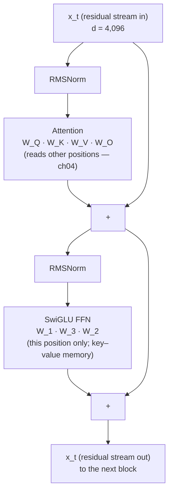
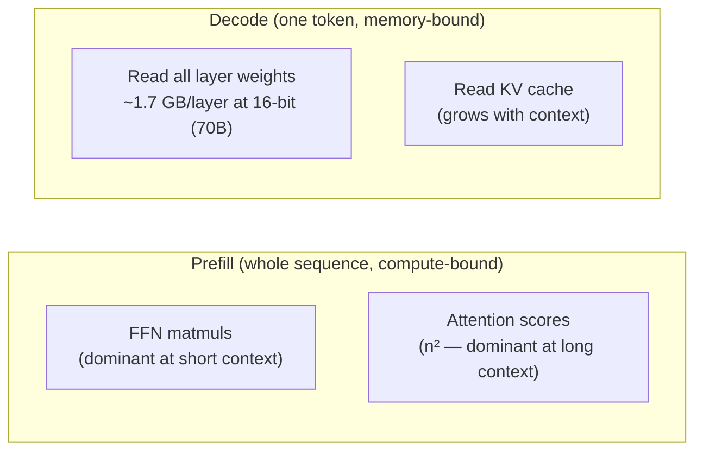
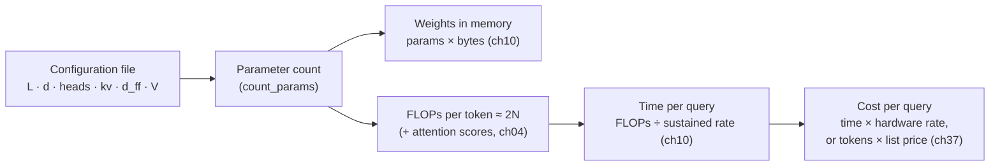

# Chapter 03 — The transformer block

*Part I · Word budget 5,000–8,000 · Lab 03 · Verified as of September 2026 · Derived figures from `labs/ch03-transformer-block/derive.py`*

## 03.1 Intuition

Everything a language model does, it does by running the same small program eighty or a hundred times in a row. The program is the transformer block. It takes a vector for every token in the window, lets each token gather what it needs from the others, lets each token think about what it has gathered, and hands the updated vectors to the next copy of the program. After the last copy, one vector — the one at the last position — is turned into a probability for every possible next token.

The block has two parts and one habit. The first part is attention: each token asks a question of every earlier token and pulls in what answers it (ch04 treats it in full). The second part is a feed-forward network: each token, alone, passes its vector through two large matrices and a non-linearity — the part of the model where most of its parameters live and, the evidence says, most of what it knows. The habit is that neither part replaces the token's vector; each adds to it. The vector that enters the first block is still there, underneath, at the last — a running sum the field calls the residual stream — and every block writes into it rather than over it.

For the plant the block is worth understanding for three reasons. It is where the numbers come from: the parameter count, the compute per token, and therefore the price of a query are sums over blocks that anyone can redo with the model's configuration file — 03.3 does it for three published models and lands within a tenth of a percent of the vendor's figures. It is where the model's knowledge lives, which is why the model "knows" general engineering and does not know the plant, and why retrieval (ch20) exists. And it is where interpretability has found the circuits — copying heads, factual lookups — whose failures the harness is built to catch.

## 03.2 Mechanism

### The residual stream

Let $x_t \in \mathbb{R}^d$ be the vector at position $t$ entering a block; $d$ is the model dimension (4,096 for Llama 3 8B; Dubey et al. 2024, primary). The block computes

$$x' = x + \mathrm{Attn}(\mathrm{Norm}(x)),\qquad x'' = x' + \mathrm{FFN}(\mathrm{Norm}(x')),$$

and passes $x''$ to the next block. The additions are the residual connections (He et al. 2016, primary); the sequence of $x$ vectors through the layers is the residual stream (Elhage et al., "A Mathematical Framework for Transformer Circuits," 2021, primary). Two consequences follow from the additive form. Gradients flow through the identity path, which is what makes hundred-layer models trainable. And every block reads from and writes to a shared vector, so the stream is a communication channel: a head in layer 5 can write a feature that a head in layer 20 reads, and the token's final representation is the sum of everything every block chose to add.

### Normalization

The Norm inside each sub-block rescales the vector so its magnitude is controlled before the expensive computation. The original transformer normalized after the addition (post-norm); modern decoders normalize before it (pre-norm), which stabilizes training at depth (Xiong et al. 2020, primary). Llama uses RMSNorm, which divides by the root-mean-square of the vector's components and multiplies by a learned scale, dropping the mean-centring of LayerNorm at no measured cost (Zhang and Sennrich 2019, primary; Ba, Kiros, Hinton 2016, primary, for LayerNorm). Each norm carries $d$ learned parameters — negligible against the matrices, present in the accounting.

### The attention sub-block

Attention projects the normalized vector into queries, keys, and values, computes per-head weighted sums over earlier positions, concatenates the heads, and projects back to $d$ (ch04 gives the derivation, the masks, and the efficient kernels). Its parameters are four matrices: $W_Q$ of $d \times h\,d_h$, $W_K$ and $W_V$ of $d \times h_{kv}\,d_h$, and $W_O$ of $h\,d_h \times d$, where $h$ is the number of query heads, $h_{kv}$ the number of key/value heads, and $d_h$ the head dimension. With grouped-query attention $h_{kv} < h$ and the K and V matrices are correspondingly narrower — the term that makes the KV cache small (ch04).

### The feed-forward sub-block

The FFN is applied to each position independently — no token sees another here. The original form was two matrices with a ReLU between them at a hidden width of $4d$ (Vaswani et al. 2017, primary). Llama and most current models use a gated variant, SwiGLU (Shazeer, "GLU Variants Improve Transformer," 2020, primary):

$$\mathrm{FFN}(x) = W_2\big(\mathrm{SiLU}(W_1 x) \odot W_3 x\big),$$

three matrices — $W_1, W_3$ of $d \times d_{ff}$ and $W_2$ of $d_{ff} \times d$ — at a hidden width $d_{ff}$ chosen so the parameter count is about that of the two-matrix $4d$ form: 14,336 for Llama 3 8B, 28,672 for 70B, 53,248 for 405B (Dubey et al. 2024, primary). The gate $\odot$ lets the network choose which hidden units fire for this token, which is part of why the FFN behaves like a memory.

### What the feed-forward block is for

Geva, Schuster, Berant, and Levy showed that the FFN's first matrix acts as a set of keys and its second as the corresponding values: each row of $W_1$ detects a pattern in the input vector, and when it fires, the matching row of $W_2$ is added to the residual stream — a key–value memory with thousands of entries per layer (Geva et al., "Transformer Feed-Forward Layers Are Key-Value Memories," 2021, primary). Lower layers store shallow patterns; upper layers store patterns that predict the next token. That is the mechanism behind two facts the harness lives with: the model's factual knowledge is stored in the FFNs — about four-fifths of the parameters, per 03.3 — and it is stored as patterns learned from the pre-training corpus, which did not include the plant. Retrieval puts the plant's facts into the context so attention can fetch them; nothing in the FFN will supply them.

### What attention heads are for

Attention moves information between positions, and interpretability has named some of what it moves. The clearest circuit is the induction head — a pair of heads across layers that together implement "the last time I saw this token, it was followed by that one, so predict that one" — which forms abruptly during training and accounts for most of a small model's in-context learning (Olsson et al., "In-context Learning and Induction Heads," 2022, primary). Copying a tag or a procedure number from earlier in the context is this circuit's job, and its weight on the right token is what dilutes as the window fills (ch04, ch05). Larger-scale work has found that the residual stream represents far more features than it has dimensions by superposing them, and that many can be isolated as interpretable directions — a specific bridge, a specific kind of error, a specific concept — with dictionary-learning methods (Templeton et al., "Scaling Monosemanticity," Anthropic, 2024, primary). For the harness, the operational reading is that the model's internal representations are structured enough to study and too entangled to rely on; verification (ch26) is outside the model for that reason.

**Figure 03.1 — One block, and the stream that runs through it.**



*Takeaway: attention is the only place tokens interact; the FFN is where four-fifths of the parameters — and the stored knowledge — sit; the stream carries both forward by addition.*

### The stack, the embedding, and the output

A model is: an embedding matrix ($V \times d$, ch01) that turns ids into the first $x$; $L$ blocks; a final norm; and an output projection ($d \times V$, the "unembedding") that turns the last position's vector into a score for every vocabulary entry, which softmax turns into probabilities. Some models tie the output projection to the embedding matrix to save parameters; Llama 3 does not (Dubey et al. 2024, primary), which is why 03.3 counts both. Position information enters not as a separate vector but inside attention, as rotary embeddings applied to queries and keys (ch05).

### Reference implementation

A complete decoder block in NumPy — attention with grouped-query heads and a causal mask, SwiGLU, RMSNorm, residuals — plus a parameter counter that takes a model configuration. Lab 03 runs the block forward and reproduces the published parameter totals from the configurations.

```python
import numpy as np

def rmsnorm(x, w, eps=1e-5):
    return x / np.sqrt((x * x).mean(-1, keepdims=True) + eps) * w

def silu(z):
    return z / (1.0 + np.exp(-z))

def attention(x, Wq, Wk, Wv, Wo, heads, kv_heads, hd):
    n, d = x.shape
    q = (x @ Wq).reshape(n, heads, hd).transpose(1, 0, 2)          # (h, n, hd)
    k = (x @ Wk).reshape(n, kv_heads, hd).transpose(1, 0, 2)       # (h_kv, n, hd)
    v = (x @ Wv).reshape(n, kv_heads, hd).transpose(1, 0, 2)
    k = np.repeat(k, heads // kv_heads, axis=0); v = np.repeat(v, heads // kv_heads, axis=0)   # GQA broadcast
    s = q @ k.transpose(0, 2, 1) / np.sqrt(hd)
    s = np.where(np.triu(np.ones((n, n), bool), 1), -np.inf, s)     # causal mask
    s -= s.max(-1, keepdims=True); w = np.exp(s); w /= w.sum(-1, keepdims=True)
    out = (w @ v).transpose(1, 0, 2).reshape(n, heads * hd)
    return out @ Wo

def ffn(x, W1, W3, W2):
    return (silu(x @ W1) * (x @ W3)) @ W2

def block(x, p):
    """One pre-norm decoder block: x + Attn(Norm(x)); then + FFN(Norm(.))."""
    h = x + attention(rmsnorm(x, p["n1"]), p["Wq"], p["Wk"], p["Wv"], p["Wo"], p["heads"], p["kv_heads"], p["hd"])
    return h + ffn(rmsnorm(h, p["n2"]), p["W1"], p["W3"], p["W2"])

def init_block(d, heads, kv_heads, hd, dff, rng):
    s = lambda *shape: rng.standard_normal(shape).astype(np.float32) * 0.02
    return dict(heads=heads, kv_heads=kv_heads, hd=hd, n1=np.ones(d, np.float32), n2=np.ones(d, np.float32),
                Wq=s(d, heads * hd), Wk=s(d, kv_heads * hd), Wv=s(d, kv_heads * hd), Wo=s(heads * hd, d),
                W1=s(d, dff), W3=s(d, dff), W2=s(dff, d))

def count_params(L, d, heads, kv_heads, hd, dff, V, tied=False):
    attn = d * heads * hd + 2 * d * kv_heads * hd + heads * hd * d
    layer = attn + 3 * d * dff + 2 * d
    embed = V * d; unembed = 0 if tied else V * d
    return {"attention_per_layer": attn, "ffn_per_layer": 3 * d * dff, "layer": layer,
            "layers": L * layer, "embedding": embed, "unembedding": unembed, "total": L * layer + embed + unembed + d}
```

The block is the whole architecture except positions and the vocabulary matrices; `count_params` is the arithmetic of 03.3 (derive.py, derived). Both are in the lab, where the block runs on random weights to check shapes and the counter runs on the Llama 3 configurations to check the totals.


### Training the block, briefly

The block is trained by next-token prediction (ch07, ch08): for every position, the output projection's probabilities are compared to the actual next token, the cross-entropy loss is summed over the sequence, and gradients flow back through every block to every matrix. Two properties of the block matter for training and show up later in serving. **Parallelism**: because attention with a causal mask lets every position be computed at once from the input sequence, a whole document is one forward pass during training — the same parallelism that makes prefill fast at inference and decode slow (ch04, ch10). **Precision**: the matrices are trained in mixed precision — 16-bit storage with 32-bit accumulation (Micikevicius et al., "Mixed Precision Training," 2018, primary) — and served at 16, 8, or 4 bits after quantization (ch11); the block's arithmetic is unchanged by precision, only its error, which is why the golden set is the judge of any precision change.

### Reading a configuration file

Every open-weight model ships a configuration file with the six integers and a few more, under names that vary by family. The Llama family's file names them `num_hidden_layers`, `hidden_size`, `num_attention_heads`, `num_key_value_heads`, `intermediate_size`, `vocab_size`, and a flag for tied embeddings; the head dimension is `hidden_size / num_attention_heads` unless stated (Hugging Face Transformers configuration documentation, vendor). Three things to check before trusting the count: whether the output projection is tied to the embedding (halves the vocabulary share); whether the FFN is gated (three matrices) or plain (two) — the configuration names the activation, and a gated activation means three; and whether the model is a mixture of experts, in which case `intermediate_size` is per expert and the count multiplies by the expert count while the per-token compute does not (ch06). A count that reconciles to the published total is the confirmation that the file has been read correctly, and Lab 03 is that check.

### Depth, width, and what the sizes mean

A model's size is set by four numbers — layers $L$, width $d$, FFN width $d_{ff}$, vocabulary $V$ — and the heads only partition $d$. Parameters grow with $L \cdot d^2$ (the matrices) plus $V \cdot d$ (the vocabulary), so doubling width quadruples the per-layer cost while doubling depth doubles it; the published families keep $d_{ff} \approx 3.5d$ and add both depth and width together as they scale (Dubey et al. 2024, primary). The compute to process one token is about twice the parameter count in floating-point operations — one multiply and one add per parameter — before attention's context-dependent term (Kaplan et al. 2020, primary; the convention counts non-embedding parameters, and 03.3 gives both figures). That "2N" rule is the bridge from the configuration file to the token price: a model's FLOPs per token, times tokens, divided by the hardware's sustained rate, is the time, and the time on rented hardware is the cost (ch10, ch37).


### Where the layers differ

The blocks are identical in shape and different in what they learn. Probing studies find that early layers handle local structure — token identity, syntax, adjacency — middle layers build the representations that carry meaning across the sequence, and late layers specialize toward predicting the next token (Tenney et al., "BERT Rediscovers the Classical NLP Pipeline," 2019, primary, for encoders; the decoder pattern is consistent in the interpretability sources above). The practical consequence is for the two ideas a plant will be offered that touch layers directly. **Early exit and layer pruning** — skipping late layers for easy tokens or removing layers to shrink a model — trade the late layers' prediction refinement for speed, and the trade is measured on the golden set, never assumed (ch11). **Adapter fine-tuning** — LoRA and its relatives — inserts small trainable matrices beside the block's existing ones, usually in attention and sometimes in the FFN, and leaves the originals frozen (ch08); understanding that the FFN is the memory explains why adapters change behaviour more reliably than they add facts.


### Latency inside the block

Where the time goes inside one block is the question that decides serving design (ch10), and the answer differs between the two phases. In prefill, every matrix multiply runs over the whole sequence at once and the block is compute-bound: the FFN's three matrices are the largest multiplies and dominate at short context, attention's score computation overtakes them as context grows (ch04's crossover near $2d$ tokens). In decode, the block processes one token and every matrix is read from memory to multiply a single vector; the time is set by the bytes of weights read — the whole layer, every token — plus the KV cache read, and the arithmetic is nearly idle. The block's parameter accounting is therefore also its decode-bandwidth accounting: 855.7 million parameters per layer at two bytes is 1.7 GB per layer per token, 137 GB for the 70B model, read from memory for every generated token unless batching amortizes it (derive.py, derived; bandwidth consequences in ch04 and ch10). This is why the FFN — four-fifths of the bytes — is the block's decode cost, and why mixture-of-experts, which reads only a few experts' FFN weights per token, changes decode economics more than attention variants do (ch06).

**Figure 03.3 — Where the block spends its time.**



*Takeaway: the same block is compute-bound in one phase and memory-bound in the other; the parameter count predicts both.*

### Variants the plant will meet

Three departures from the block above appear in current models, each treated in its own chapter. **Mixture-of-experts** replaces the single FFN with many and a router that picks a few per token, so the parameter count grows without the per-token compute growing (ch06). **Attention variants** — grouped-query, multi-head latent, sliding-window — change $W_K$, $W_V$, and the mask (ch04). **Hybrid layers** replace attention in some blocks with linear or state-space operators to cut the quadratic term (ch04). None changes the residual stream, the pre-norm structure, or the FFN's role; a reader who has this chapter's block can read any of them as a substitution.

**Figure 03.2 — From configuration to cost.**



*Takeaway: every number on the invoice is a function of six integers in a configuration file.*

## 03.3 Worked numbers

All figures from `derive.py` (derived); configurations from the Llama 3 paper's architecture table (Dubey et al. 2024, primary).

**Per-layer accounting.**

| Model | $d$ | heads / kv | $d_{ff}$ | Attention per layer | FFN per layer | Layer total | Attention share |
|---|---|---|---|---|---|---|---|
| Llama 3 8B | 4,096 | 32 / 8 | 14,336 | 41.9M | 176.2M | 218.1M | 19.2% |
| Llama 3 70B | 8,192 | 64 / 8 | 28,672 | 151.0M | 704.6M | 855.7M | 17.6% |
| Llama 3 405B | 16,384 | 128 / 8 | 53,248 | 570.4M | 2,617.2M | 3,187.7M | 17.9% |

The FFN holds 81–82% of every layer; attention under a fifth (derive.py, derived). The eight KV heads are visible in the attention column: $W_K$ and $W_V$ together are a quarter of $W_Q$ plus $W_O$ at 8B and a sixteenth at 405B.

**Totals against the published figures.**

| Model | Layers | Layers total | Embedding + unembedding | Total | Published | Difference |
|---|---|---|---|---|---|---|
| Llama 3 8B | 32 | 6.98B | 1.05B (13.1%) | 8.03B | 8.03B | 0.00% |
| Llama 3 70B | 80 | 68.45B | 2.10B (3.0%) | 70.55B | 70.6B | −0.07% |
| Llama 3 405B | 126 | 401.65B | 4.20B (1.0%) | 405.85B | 405.9B | −0.01% |

Six integers per model reproduce the vendor's parameter count to within a tenth of a percent, and the remainder is the norms (derive.py, derived). The vocabulary share falls from 13% to 1% as the model grows — the reason small models keep small vocabularies (ch01).

**FLOPs per token.** At twice the non-embedding parameters: 14.0 GFLOP for 8B, 136.9 for 70B, 803.3 for 405B; including the vocabulary matrices, 16.1, 141.1, and 811.7. Attention's score arithmetic is on top and depends on context length (ch04 puts it at under 10% of prefill at 8K for 70B and over half at 128K).

**What the scenario's fallback costs per token.** The on-site 70B model spends about 137 GFLOP per token before attention scores; at a sustained 400 TFLOP/s (illustrative, ch04) that is 0.34 ms of compute per token, which is not the binding constraint — the decode bandwidth of ch04 and ch10 is.

## 03.4 Measurement

**Parameter reconciliation.** For any model the plant considers, take the configuration file, run `count_params`, and compare to the vendor's stated count; a discrepancy above a percent means the architecture differs from the block described here (tied embeddings, a different FFN, extra components) and the reader should find out how before sizing hardware. Lab 03 does it for three models.

**FLOPs and time per token.** Compute $2N$ from the count; measure tokens per second on the target hardware at batch 1 and at the intended batch; the ratio of measured to $2N$-implied throughput is the hardware's effective utilization, and it is the number that turns the configuration into a cost (ch10).

**Memory.** Parameters × bytes per parameter at the serving precision, plus the KV cache from ch04's formula; compare to measured GPU memory after load and after a long prefill.

**Shape check.** Run one block forward on random weights with the model's dimensions and confirm the output shape equals the input's; a cheap test that catches configuration errors before anything expensive.

**Bytes per token in decode.** From the accounting, weights read per generated token equal the non-embedding parameter count times bytes per parameter, plus the KV cache (ch04); compare to the hardware's memory bandwidth to get the floor on decode time at batch 1, then compare to the measured decode rate. A measured rate far below the floor is a serving-stack problem; one near it is the hardware.

What to record: configuration values used, source and version of the configuration file, precision, hardware, measured throughput, date.


### Reference output (Lab 03, this run)

What the lab prints when it reproduces; the plant's numbers replace these.

```text
forward shape in/out: (16, 4096) (16, 4096)
block is identity when sub-blocks contribute zero (residual stream): True
block adds a non-zero update with real weights: True
causal mask holds: True
Llama 3 8B    counted    8.030B  published   8.03B  diff +0.00%  matches derive.py: True
Llama 3 70B   counted   70.554B  published  70.60B  diff -0.07%  matches derive.py: True
Llama 3 405B  counted  405.853B  published 405.90B  diff -0.01%  matches derive.py: True
FFN share of layer (70B): 82.4 %
Lab 03: REPRODUCED
```

## 03.5 Failure

| Failure mode | Mechanism | Detection signal | Mitigation | Owning component |
|---|---|---|---|---|
| Knowledge expected from the weights | Plant facts assumed to be in the FFN memories | Confident wrong answers about site specifics | Retrieval with citations; cite-or-abstain | ch20; ch26 |
| Size read as capability | Parameter count used as a proxy for quality on the plant's tasks | Golden-set results uncorrelated with size | Golden set decides; size decides cost | ch12; ch23 |
| Configuration misread | Tied embeddings or a different FFN assumed | Count off by percent; memory sizing wrong | Reconcile count against published total | This chapter; ch10 |
| Attention share overestimated | Attention assumed to dominate parameters and compute at short context | Wrong optimization target | Per-layer accounting; attention share ~18% of parameters | This chapter; ch04 |
| Depth or width changed without re-evaluation | A distilled or pruned variant adopted on the vendor's word | Task regressions | Golden set before and after; accounting of what changed | ch11; ch12 |
| Internal features relied on | Interpretability results used as a guarantee of behaviour | Untested claims about what the model "represents" | Verification outside the model regardless | ch26 |
| Precision mismatch in accounting | Parameter count in one precision, memory measured in another | Memory estimate wrong by 2× or 4× | Bytes per parameter stated with every figure | ch10; ch11 |
| MoE counted as dense | `intermediate_size` per expert multiplied by nothing, or by experts for compute | Parameter count or compute estimate off by the expert count | Count experts × FFN for parameters; active experts × FFN for compute | ch06 |
| Layer pruning on the vendor's word | Late layers removed for speed without task evidence | Regressions on next-token-sensitive tasks (exact recall, formatting) | Golden set before and after; keep the removed layers' share in the accounting | ch11; ch12 |
| Facts written into the FFN by fine-tuning | Plant documents fine-tuned into the memories | Stale answers after the next revision; no citation possible | Retrieval for facts; fine-tuning for behaviour only | ch08; ch20 |

## 03.6 The frontier

**Strongest free treatments.** Vaswani et al. (2017) define the block and stop at the encoder–decoder for translation. Karpathy's "Let's build GPT" and nanoGPT are the clearest minimal implementations and stop at training a small model. Elhage et al. (2021), Geva et al. (2021), Olsson et al. (2022), and Templeton et al. (2024) are the interpretability sources — the residual stream, FFNs as memories, induction heads, features — and stop at the science. The Llama 3 paper (2024) publishes the configurations and stops at the architecture table. Kaplan et al. (2020) give the $2N$ convention and stop at scaling. Alammar's "The Illustrated Transformer" gives the pictures and stops before parameters and cost. Huyen's *AI Engineering* (2025) describes the architecture for engineers and stops before reconciling a configuration to a published count or carrying it to a price.

**What this chapter adds.** The block written so that a reader can count it: an accounting that reproduces three vendor totals within a tenth of a percent from six integers each; the FFN's four-fifths share placed against the interpretability result that it is where knowledge lives, which is the mechanical argument for retrieval; the copying circuit named as the thing that dilutes; the path from configuration to FLOPs to time to cost; and a runnable block and counter. Open: no published per-layer reconciliation exists for the closed frontier models, whose configurations are not disclosed, and the chapter does not estimate them.

## 03.7 Industrial application

**Sizing the on-site fallback from its configuration.** The plant's self-hosted 70B-class model (ch16) is 70.55B parameters by the accounting: 141 GB of weights in 16-bit, 71 GB in 8-bit, 35 GB in 4-bit (derive.py; precision arithmetic, ch11). Two 80 GB GPUs hold the 16-bit weights with about 20 GB left for the KV cache; one GPU holds the 8-bit weights with room for the cache at the scenario's context. The choice between them is a golden-set question — does 8-bit hold quality on the plant's tasks (ch11) — and a cost question (ch37), and the accounting is what makes it a question with numbers.

**Why the model does not know the plant.** The 70B model's FFNs hold about 56 billion parameters of patterns learned from public text (derive.py: 80 × 704.6M). None of them is the current revision of MP-0417 or the approved parts list for P-101. The retrieval layer (ch20) supplies those as context; attention fetches them (ch04); the sensors check the result (ch26). A vendor who proposes to "fine-tune the model on the plant's documents" is proposing to write the plant's facts into the FFN memories — possible, slow, unauditable, and stale at the next revision (ch08). The block's structure is the argument for retrieval.

**What the plant's engineers can now check.** Any model's configuration file against its claimed size; any vendor's memory requirement against parameters × bytes; any throughput claim against $2N$ and the hardware's rated rate. Three checks, one afternoon, and the conversation with the vendor changes.

**OT boundary.** Nothing in the block touches the boundary; the chapter's relevance to it is that the model's knowledge of control systems, if any, is public-text patterns in the FFN — not the plant's — which is one more reason no tool reaches them (ch35).

## 03.8 Decision aids

**Configuration-to-cost worksheet.**

| Input | Value | Source |
|---|---|---|
| $L$, $d$, heads, kv heads, $d_h$, $d_{ff}$, $V$, tied? | | Configuration file |
| Parameter count (`count_params`) | | Derived |
| Published count and difference | | Model card |
| Weights at serving precision (GB) | | params × bytes |
| KV cache per token (ch04) | | Derived |
| FLOPs per token ($2N$) | | Derived |
| Measured tokens/s on target hardware | | Lab 10 |
| Effective utilization | | measured ÷ ($2N$-implied) |

**Layer-count sanity rule.** For a dense model, $d_{ff}$ between $2.7d$ and $4d$ and depth between 30 and 130 layers describe every published family in this chapter's sources; a configuration outside those ranges is either a different architecture or a misread file, and the count reconciliation says which (ranges from the configurations cited; primary).

**Where-does-it-live rule.** A fact the model must have that is specific to the plant, changes, or must be cited → context via retrieval, never the weights. A behaviour the model must have that is stable and general → guides first, fine-tuning only with golden-set evidence (ch08).

**Precision table (weights only; add the KV cache from ch04).** Bytes per parameter: 2 (16-bit), 1 (8-bit), 0.5 (4-bit). Llama 3 70B: 141 / 71 / 35 GB; 8B: 16 / 8 / 4 GB; 405B: 812 / 406 / 203 GB (derive.py; precision arithmetic).

**Vendor-claim checks.** Parameter count reconciles to the configuration; memory requirement equals parameters × bytes plus cache; throughput claim is consistent with $2N$ at a stated utilization; "knows your documents" means retrieval, or it means fine-tuning and the vendor should say which.

## 03.9 Sources

| # | Claim or figure | Source | Tier | Verified | Link |
|---|---|---|---|---|---|
| 1 | The transformer block; original FFN at $4d$ with ReLU | Vaswani et al., NeurIPS 2017 | primary | Sep 2026 | https://arxiv.org/abs/1706.03762 |
| 2 | Residual connections | He et al., CVPR 2016 | primary | Sep 2026 | https://arxiv.org/abs/1512.03385 |
| 3 | Residual stream as a communication channel | Elhage et al., "A Mathematical Framework for Transformer Circuits," Anthropic, 2021 | primary | Sep 2026 | https://www.anthropic.com/engineering |
| 4 | Pre-norm stabilizes deep transformers | Xiong et al., ICML 2020, arXiv 2002.04745 | primary | Sep 2026 | https://arxiv.org/abs/2002.04745 |
| 5 | LayerNorm; RMSNorm | Ba, Kiros, Hinton 2016, arXiv 1607.06450; Zhang & Sennrich, NeurIPS 2019, arXiv 1910.07467 | primary | Sep 2026 | https://arxiv.org/abs/1607.06450 |
| 6 | SwiGLU | Shazeer, "GLU Variants Improve Transformer," 2020, arXiv 2002.05202 | primary | Sep 2026 | https://arxiv.org/abs/2002.05202 |
| 7 | FFN layers as key–value memories | Geva et al., EMNLP 2021, arXiv 2012.14913 | primary | Sep 2026 | https://arxiv.org/abs/2012.14913 |
| 8 | Induction heads | Olsson et al., Anthropic, 2022 | primary | Sep 2026 | https://www.anthropic.com/engineering |
| 9 | Superposition; interpretable features at scale | Templeton et al., "Scaling Monosemanticity," Anthropic, 2024 | primary | Sep 2026 | https://www.anthropic.com/engineering |
| 10 | Llama 3 configurations; untied output projection; published sizes | Dubey et al., 2024, arXiv 2407.21783, Table 3 and model cards | primary / vendor | Sep 2026 | https://arxiv.org/abs/2407.21783 |
| 11 | FLOPs per token ≈ $2N$ | Kaplan et al., "Scaling Laws for Neural Language Models," 2020, arXiv 2001.08361 | primary | Sep 2026 | https://arxiv.org/abs/2001.08361 |
| 12 | Per-layer and total parameter counts; shares; FLOPs per token; weight sizes by precision | `labs/ch03-transformer-block/derive.py` | derived | Sep 2026 | labs/ch03-transformer-block/derive.py |
| 13 | 400 TFLOP/s sustained; 20 GB cache headroom | Illustrative (ch04) | illustrative | Sep 2026 | — |
| 14 | Configurations of closed frontier models | Not disclosed | open | Sep 2026 | — |