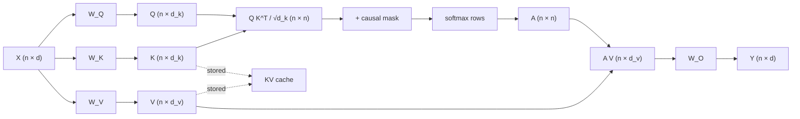

# Chapter 04 — Attention in depth

*Part I · Word budget 8,000–10,000 · Lab 04 · Verified as of September 2026*

## 04.1 Intuition

A maintenance technician types "P-101 seal leaking, need a work order." Three thousand tokens earlier in the same context sits the pump's equipment history, and somewhere in the retrieved procedure the phrase "mechanical seal replacement requires a hot-work permit when the pump handled hydrocarbons." For the model to draft a correct work order, the token that eventually produces "hot work" must be able to reach back to "hydrocarbons," to "P-101," and to "seal," weigh them, and ignore the thousands of tokens that do not matter. Attention is the mechanism that does the reaching.

Every token in the window asks a question about every earlier token. The question is a vector, the Query. Every earlier token offers a description of itself, the Key, and a package of content, the Value. When a Query matches a Key strongly, the corresponding Value is pulled into the token's new representation; when the match is weak, the Value is ignored. The result for "hot" is a blend of the Values of the tokens most relevant to it, and that blend — not the word "hot" — is what the next layer sees.

Two properties follow directly from this picture and drive the rest of the chapter. First, every token must compare itself with every earlier token, so the work grows with the square of the number of tokens: doubling the context quadruples the comparisons. Second, the model must keep every earlier token's Key and Value available for as long as the sequence continues, because a token generated ten thousand positions later may need them. Storing those Keys and Values is the KV cache. Its size and the quadratic cost of the comparisons are the two constraints under which every serving decision in this book is made.

Everything that follows — scaling factors, multiple heads, causal masks, FlashAttention, grouped queries, latent compression, sliding windows — is either a way to make the comparison better or a way to make it cheaper.

## 04.2 Mechanism

### The projections

Let the input to a layer be a matrix $X \in \mathbb{R}^{n \times d}$: $n$ tokens, each a row of $d$ numbers (the model dimension, 4,096 for Llama 3 8B; Dubey et al. 2024, primary). Three learned matrices produce the three views of every token:

$$Q = X W_Q,\quad K = X W_K,\quad V = X W_V,\qquad W_Q, W_K \in \mathbb{R}^{d \times d_k},\; W_V \in \mathbb{R}^{d \times d_v}.$$

Rows of $Q$ are what each token is looking for, rows of $K$ are what each token advertises, rows of $V$ are what each token contributes. In the original transformer $d_k = d_v = 64$ per head (Vaswani et al. 2017, primary); in Llama 3 every size uses a head dimension of 128 (Dubey et al. 2024, primary).

### Scaled dot-product attention

$$\mathrm{Attention}(Q,K,V) = \mathrm{softmax}\!\left(\frac{QK^{\top}}{\sqrt{d_k}} + M\right) V.$$

$QK^{\top}$ is an $n \times n$ matrix of raw scores: entry $(i,j)$ is the dot product of token $i$'s Query with token $j$'s Key. Softmax over each row turns the scores into weights that sum to one. Multiplying by $V$ takes the weighted sum of Values. $M$ is the mask, below.

The division by $\sqrt{d_k}$ is not cosmetic. If the components of $q$ and $k$ are independent with zero mean and unit variance, their dot product has variance $d_k$; at $d_k = 128$ the raw scores would have a standard deviation of about 11, pushing softmax into a regime where one weight is near one and the gradient is near zero (Vaswani et al. 2017 §3.2.1, primary). Dividing by $\sqrt{d_k}$ restores unit variance.


### What softmax attention computes

Attention is a weighted average, and the weights are a distribution over positions. Two views make its behavior predictable. The first is temperature: the scaling factor $1/\sqrt{d_k}$ is a fixed temperature, and any change in the magnitude of Queries and Keys changes how peaked the distribution is. Large scores give a near-one-hot distribution — the token copies one Value — and small scores give a near-uniform one — the token averages everything. Trained models use both regimes in different heads; the copying heads are what make exact retrieval from context possible, and they are the heads that fail first when the context grows, because a fixed score gap yields a smaller top weight when it competes with more entries (the dilution failure in 04.5; mechanism follows from the softmax definition, primary).

The second view is that attention is a soft key–value lookup. A hash table returns one value for an exact key match; attention returns a blend of all values weighted by key similarity. That is why it generalizes — a query for "seal failure" can pull a value stored under "mechanical seal leak" — and why it is imprecise: nothing forces a single match, so two similar Keys share the weight. The model learns to make Keys discriminative where precision matters; it cannot make them discriminative across a hundred thousand competitors.

### Gradients and why the mask is exact

Softmax is differentiable, so gradients flow from the output back to every Query, Key, and Value that received non-zero weight. Masked positions receive weight $e^{-\infty} = 0$ and therefore zero gradient; causal training is exact, not approximate. This is also why the mask must be applied to the scores before softmax, never to the weights after it: masking after normalization leaves the remaining weights summing to less than one and shifts every output.

### The causal mask

A decoder must not let token $i$ see tokens after it, or training would leak the answer. The mask $M$ is an $n \times n$ matrix with $0$ on and below the diagonal and $-\infty$ above it; after softmax the masked positions receive weight exactly zero. In practice the mask is never materialized; fused kernels skip the upper triangle, which halves the work.

### Multi-head attention

One attention computation learns one kind of relationship. Multi-head attention runs $h$ of them in parallel on lower-dimensional projections and concatenates the results:

$$\mathrm{head}_i = \mathrm{Attention}(XW_Q^{(i)}, XW_K^{(i)}, XW_V^{(i)}),\qquad \mathrm{MHA}(X) = [\mathrm{head}_1;\dots;\mathrm{head}_h]\,W_O.$$

With $h$ heads of dimension $d_k = d/h$, the total parameter count is the same as one head of dimension $d$: four matrices of $d \times d$, so $4d^2$ per layer. The base transformer used $h = 8$, $d = 512$, $d_k = 64$ (Vaswani et al. 2017, primary); Llama 3 70B uses 64 query heads of dimension 128 over $d = 8{,}192$ (Dubey et al. 2024, primary). Different heads learn different things — one attends to the previous token, one to matching brackets, one to the subject of the sentence — and the output projection $W_O$ mixes them.

**Figure 04.1 — Data flow of one attention layer (one head shown).**



*Takeaway: the $n \times n$ score matrix is the quadratic term; the Keys and Values are what the cache stores.*


### Parameter and arithmetic accounting for one real layer

Llama 3 70B has $d = 8{,}192$, 64 Query heads and 8 KV heads of dimension 128, and a feed-forward width of 28,672 (Dubey et al. 2024 Table 3, primary). Per layer:

| Block | Matrices | Parameters | Share of layer |
|---|---|---|---|
| $W_Q$ | 8,192 × 8,192 | 67.1M | 7.8% |
| $W_K$, $W_V$ (GQA: 8 heads × 128) | 2 × 8,192 × 1,024 | 16.8M | 2.0% |
| $W_O$ | 8,192 × 8,192 | 67.1M | 7.8% |
| Attention total | | 151.0M | 17.6% |
| Feed-forward (SwiGLU, three matrices) | 3 × 8,192 × 28,672 | 704.6M | 82.4% |
| Layer total | | 855.6M | |

Eighty layers give 68.4B, and the embedding and output matrices account for the rest of the 70B (derived from the table above, primary arithmetic). Two facts follow. Attention holds under a fifth of the parameters, so the "knowledge" of the model lives mostly in the feed-forward blocks (ch03). And GQA is visible in the parameter count: $W_K$ and $W_V$ are eight times narrower than $W_Q$, which is why the cache is eight times smaller.

The arithmetic per token follows the parameters: multiplying a token through the layer costs about 2 × 855.6M = 1.7 GFLOP, and through all 80 layers about 137 GFLOP, or roughly 2 × parameters — before attention scores (derived, primary arithmetic). The scores are the only cost that depends on how many other tokens there are, which is the subject of 04.3.

### Reference implementation

The following is complete and runs as written; it is the core of Lab 04.

```python
import numpy as np

def attention(Q, K, V, causal=True):
    """Q: (h, n, dk)  K, V: (h_kv, n, dk)  -> (h, n, dk). Supports GQA when h_kv divides h."""
    h, n, dk = Q.shape
    h_kv = K.shape[0]
    group = h // h_kv                      # query heads per KV head (1 = MHA, h = MQA)
    K = np.repeat(K, group, axis=0)        # broadcast shared KV heads
    V = np.repeat(V, group, axis=0)
    scores = Q @ K.transpose(0, 2, 1) / np.sqrt(dk)          # (h, n, n)
    if causal:
        mask = np.triu(np.ones((n, n), dtype=bool), k=1)
        scores = np.where(mask, -np.inf, scores)
    scores -= scores.max(axis=-1, keepdims=True)              # numerical stability
    w = np.exp(scores)
    w /= w.sum(axis=-1, keepdims=True)
    return w @ V                                              # (h, n, dk)
```

The `np.repeat` lines are the entire difference between multi-head, grouped-query, and multi-query attention: the model stores $h_{kv}$ Key/Value heads and each is reused by $h / h_{kv}$ Query heads.


### What the heads learn

Mechanistic-interpretability work has identified named circuits inside attention. The clearest is the induction head: a pair of heads across two layers where the first copies information about the previous token into each position and the second attends from the current token to the token that followed its earlier occurrence, implementing "the last time I saw A it was followed by B, so predict B." Olsson and colleagues showed these heads form abruptly during training and account for most of a small model's in-context learning ability (Olsson et al., "In-context Learning and Induction Heads," 2022, primary). For a harness engineer the relevance is concrete: exact recall of a tag or a procedure number from earlier in the context is done by copying heads of this kind, and their weight on the right token is exactly what dilutes as the window fills.

### Alternatives that give up the quadratic term

Two families replace softmax attention with something linear in $n$. Linear attention rewrites the softmax kernel as a feature map so the $n \times n$ product never forms, at the cost of the sharp, near-one-hot lookups that copying requires (Katharopoulos et al., "Transformers are RNNs," 2020, primary). Selective state-space models — Mamba is the reference — carry a fixed-size state through the sequence like a recurrent network with input-dependent gating, giving constant memory per sequence and linear time (Gu and Dao, "Mamba," 2023, primary). Both trade exact retrieval for efficiency, and the production pattern as of this edition is hybrid: most layers attention, some layers linear or state-space, so the model keeps copying heads where it needs them and drops the quadratic cost where it does not. For the reader's decisions the consequence is the same as for sliding windows: a model that advertises a very long context at low cost has given something up, and a golden set with exact-recall questions will show what.

### Where the quadratic cost lives

For one layer and one head, forming $QK^{\top}$ costs $n^2 d_k$ multiply-adds and forming $AV$ costs another $n^2 d_k$. Summed over heads, attention scores cost about $2 n^2 d$ multiply-adds per layer, while the projections cost $4 n d^2$ and the feed-forward block costs on the order of $8$–$16\, n d^2$ depending on the MLP width. Attention is the only term with $n^2$. At short context ($n \ll d$) the $n d^2$ terms dominate and attention is a minority of compute; at long context the $n^2 d$ term overtakes them. The crossover is at $n \approx 2d$ to $4d$ — for $d = 8{,}192$ that is a context of roughly 16K to 32K tokens (derived from the formulas above; illustrative crossover, exact value depends on MLP width).

Memory is the sharper constraint. A naive implementation materializes the $n \times n$ score matrix per head; at $n = 128{,}000$ that is 16.4 billion entries per head per layer. Nobody does this. The fix is FlashAttention.

### FlashAttention: exact attention without the $n \times n$ matrix

Dao, Fu, Ermon, Rudra, and Ré observed that attention on a GPU is bound not by arithmetic but by traffic between high-bandwidth memory (HBM — the GPU's large, slow main memory, tens of gigabytes) and the on-chip SRAM (small, fast memory next to the compute units, tens of megabytes) where computation happens (Dao et al. 2022, primary). Standard attention writes the $n \times n$ scores to HBM, reads them back for softmax, writes the weights, reads them again for the multiplication by $V$. FlashAttention never writes the score matrix. It tiles $Q$, $K$, $V$ into blocks that fit in SRAM, computes each block's contribution, and maintains a running softmax across blocks using the identity

$$\mathrm{softmax}(x) \text{ over } [x_1; x_2] \;=\; \text{rescale}\big(\mathrm{softmax}(x_1),\, \mathrm{softmax}(x_2)\big)\quad\text{with}\quad m = \max(m_1, m_2),\; \ell = e^{m_1 - m}\ell_1 + e^{m_2 - m}\ell_2,$$

where $m$ is the running maximum and $\ell$ the running normalizer. The output is exact — no approximation — and memory becomes linear in $n$ because only the running statistics and the output block are kept.


The paper states the IO complexity that explains the speedups. Standard attention performs $\Theta(Nd + N^2)$ accesses to HBM for sequence length $N$ and head dimension $d$; FlashAttention performs $\Theta(N^2 d^2 M^{-1})$ where $M$ is the SRAM size, which is smaller by a factor of up to $M/d^2$ — typically 5–20× for the head dimensions and SRAM sizes in use — and the authors prove no exact attention algorithm can asymptotically do fewer accesses over all SRAM sizes (Dao et al. 2022 §3, primary). The backward pass does not store the $N \times N$ weights either; it recomputes them block by block from the saved running statistics, trading arithmetic for memory — the same trade the whole design makes.

FlashAttention-2 kept the algorithm and changed the work distribution: fewer non-matrix-multiply operations (which run at a fraction of Tensor Core throughput), parallelization over sequence length as well as batch and heads so long sequences with small batches keep every streaming multiprocessor busy, and a partition of work between warps that removes shared-memory round trips for the softmax rescaling (Dao 2023, primary). FlashAttention-3 exploits Hopper's asynchronous Tensor Cores and the Tensor Memory Accelerator: producer warps (a warp is a group of 32 threads scheduled together) load tiles through the Tensor Memory Accelerator — a hardware unit that moves data without occupying compute threads — while consumer warps compute, and two consumer groups alternate so one's softmax overlaps the other's matrix multiply; FP8 is made accurate enough by block quantization and an incoherent rotation of Q and K that spreads outliers (Shah et al. 2024, primary).

**Figure 04.2 — FlashAttention tiling for one query block.**

```mermaid
sequenceDiagram
    participant HBM as GPU HBM
    participant SRAM as SRAM (on-chip)
    participant ACC as Running (m, ℓ, O)
    HBM->>SRAM: load Q block
    loop for each K/V block j
        HBM->>SRAM: load K_j, V_j
        SRAM->>SRAM: S_j = Q K_j^T / √d_k ; apply mask
        SRAM->>ACC: m_new = max(m, rowmax S_j)
        SRAM->>ACC: ℓ = e^(m−m_new)·ℓ + rowsum e^(S_j − m_new)
        SRAM->>ACC: O = e^(m−m_new)·O + e^(S_j − m_new) V_j
    end
    ACC->>HBM: write O / ℓ (final output block)
```

*Takeaway: the score matrix never touches HBM; each K/V block is read once per query block.*

The reported effects, all on the authors' own benchmarks: the original FlashAttention gave a 15% end-to-end speedup on BERT-large in the MLPerf 1.1 setting, 3× on GPT-2 at sequence length 1K, and 2.4× on the long-range arena, with memory linear in sequence length (Dao et al. 2022 abstract, primary). FlashAttention-2 rewrote the kernel for better parallelism across sequence length and better work partitioning between warps, reaching about 2× over the first version, 50–73% of A100 peak FLOPs/s, up to 230 TFLOPs/s in the attention kernel, and 225 TFLOPs/s or 72% model-FLOPs utilization when training a GPT-style model end to end; it is up to 9× faster than a standard PyTorch implementation (Dao 2023, primary; CRFM blog July 2023, vendor). FlashAttention-3 targets Hopper: warp specialization overlaps data movement with computation, block-wise matmul and softmax are interleaved, and FP8 is used with incoherent processing to limit error; the result is 1.5–2.0× over FlashAttention-2 in FP16, up to 740 TFLOPs/s or 75% of H100 peak, and close to 1.2 PFLOPs/s in FP8 with 2.6× lower error than a baseline FP8 attention — against 35% utilization for FlashAttention-2 on the same GPU (Shah et al. 2024, primary; Together AI blog July 2024, vendor).

These are kernel numbers. They change how fast attention runs; they do not change how much cache a sequence needs, and they do not change the $n^2$ arithmetic — they make it cheaper per operation and remove the memory blow-up. In PyTorch 2.x, `torch.nn.functional.scaled_dot_product_attention` selects a FlashAttention, memory-efficient, or math backend automatically; in Hugging Face Transformers the choice is `attn_implementation="flash_attention_2"` or `"sdpa"` (PyTorch and HF documentation, verified Sep 2026, vendor).

### Multi-query and grouped-query attention

During decode the model generates one token at a time and must read the entire KV cache for every new token. Shazeer showed that the read is the bottleneck and proposed sharing a single Key/Value head across all Query heads — multi-query attention (MQA) — cutting the cache by a factor of $h$ at some cost in quality (Shazeer 2019, primary). Ainslie and colleagues proposed the middle ground, grouped-query attention (GQA): $h_{kv}$ Key/Value heads, each shared by a group of $h/h_{kv}$ Query heads, and a recipe to convert an existing multi-head checkpoint by mean-pooling its KV heads and uptraining with about 5% of the original pre-training compute. On T5-XXL, GQA with 8 KV heads reached quality close to full multi-head attention at inference speed close to MQA (Ainslie et al. 2023, primary).

The production adoption is universal among open-weight decoders: Llama 2 70B uses 64 Query heads and 8 KV heads (Touvron et al. 2023, primary); all three Llama 3 sizes use 8 KV heads (Dubey et al. 2024, primary); Mistral 7B uses 32 Query heads and 8 KV heads (Jiang et al. 2023, primary). The cache shrinks by $h / h_{kv}$ — 8× for Llama 3 70B — and the attention arithmetic is unchanged because Keys and Values are broadcast, not recomputed.


The uptraining recipe is the practical point. Converting an existing multi-head checkpoint means replacing each group of $h/h_{kv}$ Key heads with their mean, doing the same for Value heads, and continuing pre-training briefly; the paper found that about 5% of the original pre-training compute recovers the quality, and that mean-pooling beats taking the first head or random initialization (Ainslie et al. 2023 §3.1, primary). GQA loses less than MQA because each KV head still serves a small group, so the model keeps most of its head diversity; MQA collapses all diversity into one head and the paper's curves show the quality gap widening accordingly (Ainslie et al. 2023 Fig. 3, primary).

Cache quantization is orthogonal to head reduction. Keys and Values can be stored in FP8 or INT8 with per-block scales, halving or quartering the bytes per token on top of GQA; the quality cost is model- and task-dependent and belongs on the golden set before adoption (ch11 treats cache and weight quantization together; no figure is given here because the measurement is the reader's).

### Multi-head latent attention

GQA reduces the number of KV heads. DeepSeek-V2 reduces the size of what each token stores. Multi-head latent attention (MLA) projects the input into a low-rank latent vector $c_t = X_t W_{DKV}$ of dimension $d_c$, caches only $c_t$, and reconstructs Keys and Values for all heads from it at attention time with up-projection matrices that can be folded into $W_Q$ and $W_O$ so the full Keys and Values are never materialized. Rotary position embedding does not commute with that folding, so a small decoupled key of dimension $d_h^R$ carries position separately and is cached alongside $c_t$. In DeepSeek-V2, $d_c = 512$ and $d_h^R = 64$, so the cache per token per layer is $576$ scalars, against $128 \text{ heads} \times 128 = 16{,}384$ for standard multi-head attention with the same heads; the paper reports a 93.3% reduction in KV cache and a 5.76× increase in maximum generation throughput relative to the dense DeepSeek 67B (DeepSeek-AI 2024 §2.1, primary). MLA is an architecture decision made before training; it cannot be retrofitted to a GQA checkpoint the way GQA can be retrofitted to MHA.


The absorption that makes MLA cheap at inference is worth writing down. With down-projection $W_{DKV}$ and up-projections $W_{UK}$, $W_{UV}$, the Key for head $i$ is $k_t^{(i)} = c_t W_{UK}^{(i)}$ and the score against a Query is $q_t^{(i)} \cdot (c_s W_{UK}^{(i)})^{\top} = (q_t^{(i)} W_{UK}^{(i)\top}) \cdot c_s^{\top}$. The bracketed term is a modified Query; it can be computed once per step, so scores are taken directly against the cached latent $c_s$ and the Keys never exist in memory. The same rearrangement folds $W_{UV}$ into the output projection. Rotary embedding breaks the trick because it inserts a position-dependent rotation between the Query and $W_{UK}$, which is why MLA carries a small separate rotary Key of dimension $d_h^R$ per token (DeepSeek-AI 2024 §2.1.3, primary).

### Attention sinks and streaming

One more property of trained decoders matters for long-running agents. Xiao and colleagues observed that models place disproportionate attention weight on the first few tokens regardless of content — "attention sinks" that absorb weight the softmax must put somewhere — and that a sliding-window cache which evicts those tokens collapses, while a cache that keeps the first few tokens plus a recent window streams stably for millions of tokens (Xiao et al. 2023, primary). The engineering consequence is that any cache-eviction policy must exempt the sink tokens, and that a system prompt at position zero is, incidentally, in the best-attended place in the window.

### Why prefix caching works

Because attention is causal, the Keys and Values of a prefix depend only on the prefix. If two requests share the first 4,000 tokens byte for byte (the scenario's prefix size, ch16), the second request can reuse the first's cached Keys and Values for those positions and run prefill only on what follows. Provider prompt caching and vLLM's automatic prefix caching are this observation implemented at scale (ch10, ch15). The rule that follows — stable content first, byte-identical, variable content last — is not a style preference; a single changed token at position 1,000 changes the Keys of every token after it, because each token's representation was computed by attending to the changed one (follows from causal attention, primary).

### Sliding-window and sparse attention

Both change which tokens can attend to which. Sliding-window attention restricts each token to the previous $w$ tokens, so the score computation costs $n \cdot w$ instead of $n^2$ and the cache can be a rolling buffer of $w$ entries; information still propagates further than $w$ because each layer extends the receptive field by $w$, so after $L$ layers a token can be influenced by tokens up to $L \cdot w$ positions back (Beltagy et al. 2020, primary; Jiang et al. 2023, primary). Mistral 7B used $w = 4{,}096$ with 32 layers, and its rolling-buffer cache therefore never exceeds 4,096 entries per layer regardless of sequence length: 32 layers × 8 KV heads × 128 × 2 × 2 bytes = 128 KB per token, times 4,096, is a 0.5 GB ceiling per sequence (Jiang et al. 2023, primary; arithmetic derived). Sparse transformers use fixed or strided patterns that give each token a subset of positions with cost $O(n\sqrt{n})$ (Child et al. 2019, primary). Neither is free: a token outside the window is reachable only through intermediate tokens, and retrieval-style tasks that need one exact token from far back degrade. Production models mix local and global layers rather than choosing one.

### Summary of the levers

| Lever | What it changes | Cost it reduces | What it costs |
|---|---|---|---|
| Causal mask (fused) | Skips upper triangle | Half the score arithmetic | Nothing |
| FlashAttention 1–3 | Kernel; tiling and online softmax | Memory (quadratic → linear); HBM traffic; wall time | Exact; no quality cost; hardware-specific tuning |
| MQA / GQA | Number of KV heads | KV cache by $h/h_{kv}$; decode bandwidth | Small quality loss; GQA-8 near MHA on T5 (primary) |
| MLA | Dimension of what is cached | KV cache by ~28× per layer vs same-head MHA (derived from DeepSeek-V2 dimensions, primary) | Must be trained in; extra projections |
| Sliding window | Which tokens attend | $n^2 \to n w$; bounded cache | Distant exact retrieval |
| Sparse patterns | Which tokens attend | $n^2 \to n\sqrt{n}$ | Pattern-dependent blind spots |

## 04.3 Worked numbers

### KV cache per token

The formula:

$$\text{bytes per token} = L \times h_{kv} \times d_{head} \times 2 \times b,$$

with $L$ layers, $h_{kv}$ KV heads, $d_{head}$ the head dimension, the factor 2 for Key and Value, and $b$ bytes per element (2 for FP16/BF16, 1 for FP8; primary arithmetic).

Llama 3, from the architecture table in the model paper (Dubey et al. 2024 Table 3, primary):

| Model | Layers | Query heads | KV heads | Head dim | KV bytes/token (FP16) | Without GQA (KV heads = query heads) |
|---|---|---|---|---|---|---|
| Llama 3 8B | 32 | 32 | 8 | 128 | 32×8×128×2×2 = 131,072 B = **128 KB** | 512 KB |
| Llama 3 70B | 80 | 64 | 8 | 128 | 80×8×128×2×2 = 327,680 B = **320 KB** | 2,560 KB |
| Llama 3 405B | 126 | 128 | 8 | 128 | 126×8×128×2×2 = 516,096 B = **504 KB** | 8,064 KB |

The rightmost column is the counterfactual: without GQA, serving Llama 3 70B at 32K context would need 86 GB of cache for one sequence — more than an 80 GB GPU (derived; the model itself is 140 GB in FP16 at 70B parameters × 2 bytes, primary arithmetic). With GQA it needs 10.7 GB, and a batch of eight 32K sequences needs 86 GB, which is the same number arrived at differently: GQA bought the operator an 8× larger batch at the same context (derived from the table above).

For DeepSeek-V2, the per-layer, per-token figure is 576 scalars against 16,384 for multi-head attention with its 128 heads of dimension 128 — 3.5% of the MHA cache per layer, or a 28.4× reduction (derived from DeepSeek-AI 2024 §2.1 dimensions, primary). The paper's headline 93.3% reduction is measured against DeepSeek 67B, a different model with different depth and head count, so the two figures are not the same comparison; the chapter uses the per-layer ratio because it follows from stated dimensions (DeepSeek-AI 2024, primary).

### Attention arithmetic at three context lengths

For Llama 3 70B with $d = 8{,}192$ and $L = 80$ (Dubey et al. 2024, primary), the score arithmetic for a full-sequence prefill is approximately $2 n^2 d$ multiply-adds per layer (the $QK^{\top}$ and $AV$ products; the causal mask halves it, so use $n^2 d$):

| Context $n$ | $n^2 d$ per layer | × 80 layers | Relative to $n = 8$K |
|---|---|---|---|
| 8,192 | 5.5 × 10¹¹ | 4.4 × 10¹³ | 1× |
| 32,768 | 8.8 × 10¹² | 7.0 × 10¹⁴ | 16× |
| 131,072 | 1.4 × 10¹⁴ | 1.1 × 10¹⁶ | 256× |

Sixteen times the context is 256 times the attention arithmetic (derived from the formula; primary arithmetic). For comparison, the non-attention arithmetic of the same prefill — projections and MLP at roughly $12 n d^2$ per layer, using the Llama 3 SwiGLU width — is 5.3 × 10¹⁴ at $n = 8$K and grows only linearly, to 8.4 × 10¹⁵ at 128K (derived; the MLP multiplier is approximate, illustrative to one significant figure). At 8K attention is 8% of prefill arithmetic; at 32K it is 25%; at 128K it is 57% (derived from the two formulas). This is the arithmetic behind the advice in chapter 05 to retrieve rather than to fill the window.


### Prefill time on real hardware

Total prefill arithmetic for Llama 3 70B at 8K tokens is the per-token cost from 04.2 (about 137 GFLOP through all layers) times 8,192 tokens, about 1.1 × 10¹⁵ FLOP, plus the attention scores from the table above (4.4 × 10¹³ multiply-adds, or 8.8 × 10¹³ FLOP) — attention is under 10% of prefill at this length (derived, primary arithmetic). Prefill time is then total FLOP divided by the sustained throughput the reader measures on their own node; at an illustrative 400 TFLOPs/s — below FlashAttention-3's 740 TFLOPs/s kernel peak because the rest of the model does not reach it (peak from Shah et al. 2024, primary) — the prefill takes about 3 seconds, and the reader should substitute their measured figure. At 128K, the same calculation gives about 1.8 × 10¹⁶ FLOP of non-attention work and 2.2 × 10¹⁶ FLOP of attention scores after masking (the 1.1 × 10¹⁶ multiply-adds in the table, times two), roughly 100 seconds at the same sustained rate — and 56% of it is attention (derived; illustrative sustained throughput). Sixteen times the tokens, thirty-three times the time, because the quadratic term has arrived.

### Decode bandwidth

Each generated token reads the full cache once. For Llama 3 70B at 32K context the cache is 10.7 GB (derived above); at an H100's roughly 3.35 TB/s of HBM bandwidth, reading it takes about 3 ms per token before any weight is read — and the weights, 140 GB in FP16, take another 42 ms per token for an unbatched decode (H100 SXM bandwidth from NVIDIA's datasheet, vendor; arithmetic derived). Batching amortizes the weight read across sequences but not the cache read, which is per sequence. That asymmetry is why GQA and MLA matter more for serving than FlashAttention does: FlashAttention makes prefill fast; cache size sets how many sequences decode at once.

## 04.4 Measurement

Three quantities are worth measuring on your own hardware; each is cheap.

**Attention time versus sequence length.** Instrument the attention call alone (not the full model) and time it at $n = 256, 512, \dots, 8{,}192$ with fixed $d_{head}$ and heads. Fit $\log t$ against $\log n$; the slope is the empirical exponent. A naive implementation gives a slope near 2; FlashAttention gives a slope near 2 in arithmetic but a much smaller constant and linear memory. Report the slope with its 95% confidence interval from at least five repetitions per point; a single run is noise. Lab 04 does this on CPU with the reference implementation above and reproduces the exponent.

**KV cache bytes per token.** Do not estimate it; compute it from the model's configuration file (`num_hidden_layers`, `num_key_value_heads`, `head_dim` or `hidden_size / num_attention_heads`, and the cache dtype) and then confirm it by measuring GPU memory before and after prefill of a known sequence length in your serving stack. The two numbers should agree to within the paging granularity of the stack (PagedAttention allocates in fixed blocks, so measured memory is rounded up; Kwon et al. 2023, primary). Lab 04 computes the figure for the three Llama 3 sizes and checks it against the table in 04.3.

**Attention share of end-to-end latency.** This is the number the literature does not give you (see 04.6). Profile one prefill and one hundred decode steps at 8K, 32K, and the longest context you intend to serve; record time in attention kernels versus everything else. Use the profiler your stack exposes (PyTorch profiler, vLLM's built-in metrics, NVIDIA Nsight). Report the share at each length with the batch size, dtype, and kernel version, because all three change it. Sample size: three runs per configuration is enough for the share; the variance is low once the GPU is warm.


**A profiling protocol that survives review.** Fix the model, dtype, and kernel; warm the GPU with ten discarded requests; then for each context length run one prefill and one hundred decode steps three times and record the median. Report a table with columns: context, batch, prefill ms, decode ms/token, attention share of prefill, attention share of decode, cache GB, and the kernel the framework reports having used. Attach the framework's own profiler export. A review that cannot see the kernel name will assume the math fallback.

**Reading the results.** Prefill time should grow faster than linearly once context passes about $2d$ tokens; if it grows linearly all the way, attention is not the bottleneck on that stack at those lengths and the operator should stop optimizing it. Decode time per token should grow roughly linearly with context because of the cache read (04.3); if it does not, the cache is being read less than once per token — which means the stack is doing something the operator should understand, such as quantizing or evicting.

What to record for every measurement: GPU model and driver, framework and kernel version (FlashAttention 2 or 3, SDPA backend; kernel names per PyTorch and FlashAttention documentation, vendor), dtype, batch size, sequence length, and a timestamp. Attention numbers without these are not comparable to anyone else's.


### Reference output (Lab 04, this run)

What the lab prints when it reproduces; the plant's numbers replace these.

```text
n=  256  median attention time      1.6 ms
n=  512  median attention time      5.6 ms
n= 1024  median attention time     19.7 ms
n= 2048  median attention time     69.0 ms
n= 4096  median attention time    358.1 ms
fitted exponent (slope of log t vs log n): 1.92   max |residual| 0.16
chapter states: quadratic (exponent 2).  REPRODUCED (tolerance 1.7–2.3)
KV cache bytes per token (FP16, 2 bytes):
  Llama 3 8B      131,072 B =    128 KB   without GQA    512 KB   chapter   131,072  OK
  Llama 3 70B     327,680 B =    320 KB   without GQA   2560 KB   chapter   327,680  OK
  Llama 3 405B    516,096 B =    504 KB   without GQA   8064 KB   chapter   516,096  OK
GQA (8 query heads, 2 KV heads) equals MHA with broadcast KV: True
results/run.json written
```

## 04.5 Failure

| Failure mode | Mechanism | Detection signal | Mitigation | Owning component |
|---|---|---|---|---|
| Out-of-memory at long context | KV cache grows linearly per sequence; batch × context × bytes/token exceeds GPU memory | Serving stack refuses requests or evicts sequences; measured cache per token above budget | Size the cache from the formula before choosing context and batch; prefer GQA/MLA models; quantize the cache to FP8 | Model layer (ch23); inference (ch10) |
| Attention dilution | At long context, softmax weight spreads over many weakly relevant tokens; the one relevant token gets a small weight | Accuracy on retrieval-style questions falls with context length even when the answer is present (NoLiMa, ch05) | Retrieve a small set of relevant chunks instead of filling the window; keep windows dense | Context engineering (ch19) |
| Position-dependent recall | Tokens in the middle of a long context are attended to less than tokens at the edges | "Lost in the middle" pattern on needle tests | Place the most important material first or last; retrieve rather than preload | Context engineering (ch19) |
| Window blind spot | Sliding-window models cannot attend directly beyond $w$ tokens; information must relay through intermediate layers | Exact-match retrieval from far back fails while nearby retrieval works | Use a model with global layers or full attention for retrieval-heavy tasks | Model layer (ch23) |
| Numerical overflow in softmax | Large raw scores exponentiate to infinity | NaN outputs; sudden garbage after a long prefix | Subtract the row maximum before exponentiating (the reference code does this); use fused kernels | Inference (ch10) |
| Silent kernel fallback | The requested FlashAttention backend is unavailable for the dtype, head dimension, or mask, and the framework falls back to the math path | Memory rises quadratically with context; throughput collapses at long context | Assert the backend at startup; log the selected kernel; test at the longest intended context | Inference (ch10); observability (ch29) |
| Cache fragmentation | Contiguous cache allocation wastes memory between sequences of different lengths | Effective utilization of KV memory far below capacity — prior systems used 20.4–38.2% (Kwon et al. 2023, primary) | Serve with a paged-cache stack (vLLM, TensorRT-LLM) | Inference (ch10) |
| Quality loss from KV-head reduction | MQA or aggressive GQA loses head diversity | Golden-set regression on multi-hop or exact-recall tasks after switching models | Prefer GQA-8 or MLA over MQA; run the golden set before adopting a model | Evaluation (ch12) |

## 04.6 The frontier

**Strongest free treatments.** Three do different jobs. Vaswani, Shazeer, Parmar, Uszkoreit, Jones, Gomez, Kaiser, and Polosukhin, "Attention Is All You Need" (2017), defines the mechanism used above in two pages of notation and gives the variance argument for the scaling factor; it stops at training an encoder-decoder for translation and says nothing about caching Keys and Values or about the cost of serving a decoder. Dao, Fu, Ermon, Rudra, and Ré, "FlashAttention" (2022), with the 2023 and 2024 sequels by Dao and by Shah and colleagues, is the definitive source on making exact attention fast; the papers report kernel throughput and end-to-end training speedups on the authors' hardware and stop there — they do not tell an operator how much context a given GPU can serve at a given batch, because that is a cache question, not a kernel question. Ainslie, Lee-Thorp, de Jong, Zemlyanskiy, Lebrón, and Sanghai, "GQA" (2023), establishes the KV-head trade-off with quality and speed curves on T5-XXL and the uptraining recipe; it stops at encoder-decoder summarization and question answering and does not measure decoder-only models or agentic tasks.

Among the tutorials, Alammar's "The Illustrated Transformer" (2018) gives the clearest picture of Q/K/V and multi-head and stops before any cost; Karpathy's "Let's build GPT" (2023) gives the cleanest minimal causal-attention code and stops at training; Weng's "The Transformer Family v2" (2023) surveys the variants and stops at the survey; Huyen's *AI Engineering* (2025) explains attention for engineers and, in its inference chapter, names the KV cache and the memory wall, but does not carry one model from its architecture table to bytes per token to a serving decision.

**What this chapter adds.** One continuous line from the formula to the operator's decision: the mechanism with runnable code that switches between MHA, GQA, and MQA in two lines; the KV-cache formula applied to the three Llama 3 sizes with the no-GQA counterfactual; attention arithmetic at three context lengths against the non-attention arithmetic, which makes the retrieve-versus-fill decision numerical; the decode-bandwidth asymmetry that explains why cache size, not kernel speed, sets batch; a failure table with detection signals; and a lab that reproduces the exponent and the cache figures. Two things remain open and are stated as such in 04.4 and 04.9: no independent published breakdown of attention's share of end-to-end decode latency on current serving stacks at 32K–128K, and no published measurement of the quality cost of GQA, MQA, or MLA on agentic tool-calling tasks.

## 04.7 Industrial application

The refinery maintenance agent (ch16 for the full scenario) serves 2,000 queries a day, each with about 6,000 input tokens — 4,000 of them a stable prefix of guides, tool schemas, and reference chunks — and 400 output tokens, with a self-hosted Llama-3-70B-class fallback on site for when the API path is unavailable or a query touches data that may not leave the network (scenario parameters fixed in ch16; volume and token sizes are the scenario's stated assumptions, illustrative).

**Sizing the on-site fallback.** At 6,000 tokens of context, the cache per sequence is 6,000 × 320 KB = 2.0 GB (derived from 04.3). Two H100 80 GB GPUs hold the 140 GB of FP16 weights with about 20 GB to spare across the pair, which is room for roughly ten concurrent sequences at that context before cache eviction begins (derived; illustrative headroom, since framework overhead and paging granularity consume part of it). Ten concurrent sequences at a few seconds each is far above 2,000 queries a day, so the fallback is adequately sized — and the arithmetic shows exactly how far: if the maintenance planners later ask to load entire equipment manuals into the context instead of retrieving from them, 32K tokens per query would make the cache 10.7 GB per sequence and cut concurrency to one or two. The correct response is retrieval (ch20), not a larger context; the table in 04.3 is the argument.

**Choosing the fallback model.** The decision aid in 04.8 applies: 8 KV heads (GQA), FlashAttention support in the serving stack, and a golden-set check on multi-hop procedure questions, because the plant's queries are exactly the retrieval-style work where attention dilution and window blind spots show first. A sliding-window-only model would be a poor choice for this workload; a full-attention GQA model at 8K context with good retrieval is the right shape.


**Three questions the plant will ask, answered from this chapter.** Can the on-site model take a whole 300-page manual in one request? Only at a cost the arithmetic makes explicit: a manual of that size is on the order of 150,000 tokens, past the model's supported context and, even at 128K, a 43 GB cache per sequence and a prefill measured in tens of seconds (04.3; token estimate illustrative at 500 tokens per page). Should the fallback be an FP8-cache configuration? If concurrency is the binding constraint and the golden set passes at FP8, yes; it halves the cache. Does any of this change when the query goes to the API instead? The provider absorbs the cache arithmetic, but the reader pays for it in the output-token price and in the prompt-caching discount that rewards exactly the prefix discipline described above.

**The OT boundary.** None of this touches control systems. The agent reads historian data through a read-only broker and writes only to the CMMS under approval (ch35). Attention arithmetic decides how the on-site GPUs are provisioned; it does not decide what the agent may do.

**Prefix caching and attention.** The 4,000-token stable prefix is the same for every query, so its Keys and Values can be computed once and reused — this is what provider-side prompt caching and vLLM's prefix caching do (ch15, ch10). For the on-site fallback, that means each query's prefill is 2,000 new tokens against a cached 4,000, which is why the prefix must be byte-identical and placed first: a single changed token invalidates every cached Key and Value after it, because each token's Key was computed from its own content and position.

## 04.8 Decision aids

**KV-cache sizing formula (compute before choosing context and batch).**

$$\text{cache}_{\text{GB}} = \frac{L \times h_{kv} \times d_{head} \times 2 \times b \times n \times B}{10^9},$$

with $n$ tokens per sequence and $B$ concurrent sequences. Subtract from GPU memory after weights; keep 10–20% headroom for framework overhead (illustrative headroom; measure your stack). The companion toolkit computes this from a model's configuration values.

**Reference table (FP16 cache, GB = 10⁹ bytes, from the formula; derived from Dubey et al. 2024 architecture, primary):**

| Model | 8K × 1 seq | 8K × 8 seq | 32K × 1 seq | 32K × 8 seq | 128K × 1 seq |
|---|---|---|---|---|---|
| Llama 3 8B (128 KB/token) | 1.1 | 8.6 | 4.3 | 34.4 | 17.2 |
| Llama 3 70B (320 KB/token) | 2.7 | 21.5 | 10.7 | 85.9 | 42.9 |
| Llama 3 405B (504 KB/token) | 4.2 | 33.8 | 16.9 | 135.3 | 67.6 |

**Model-selection checklist for self-hosted serving.**

| Check | Pass condition | Why |
|---|---|---|
| KV heads | GQA with ≤ 8 KV heads, or MLA | Cache size sets concurrency |
| Head dimension | 64 or 128 | Fused kernels are tuned for these |
| Kernel support | Serving stack logs FlashAttention-2/3 or SDPA-flash selected at the intended dtype and context | Silent fallback to the math path is a common failure |
| Attention pattern | Full attention (or mixed local/global) for retrieval-heavy workloads | Sliding-window-only models have blind spots beyond $w$ |
| Cache dtype | FP8 cache supported if concurrency is the constraint | Halves bytes per token |
| Golden set | Multi-hop and exact-recall procedure questions pass at the intended context | GQA/MQA quality cost shows here first |

**Retrieve-or-fill rule.** If the tokens a query needs can be retrieved as a few thousand tokens, retrieve. Filling the window past roughly $2d$ tokens moves attention from a minority to a majority of prefill compute (04.3), multiplies cache per sequence linearly, and degrades recall of the one token that matters (04.5). Fill only when the task needs the whole document at once and retrieval demonstrably fails on the golden set.

## 04.9 Sources

| # | Claim or figure | Source | Tier | Verified | Link |
|---|---|---|---|---|---|
| 1 | Scaled dot-product attention; 1/√d_k variance argument; h=8, d_model=512, d_k=64 | Vaswani et al., "Attention Is All You Need," NeurIPS 2017, §3.2 | primary | Sep 2026 | https://arxiv.org/abs/1706.03762 |
| 2 | Multi-query attention; decode bandwidth argument | Shazeer, "Fast Transformer Decoding," 2019, arXiv 1911.02150 | primary | Sep 2026 | https://arxiv.org/abs/1911.02150 |
| 3 | GQA; uptraining with ~5% compute; GQA-8 on T5-XXL near MHA quality at near-MQA speed | Ainslie et al., "GQA," EMNLP 2023, arXiv 2305.13245 | primary | Sep 2026 | https://arxiv.org/abs/2305.13245 |
| 4 | Llama 2 70B: 64 query heads, 8 KV heads | Touvron et al., "Llama 2," 2023, arXiv 2307.09288 | primary | Sep 2026 | https://arxiv.org/abs/2307.09288 |
| 5 | Llama 3 8B/70B/405B layers, heads, KV heads, model dimension, head dim 128 | Dubey et al., "The Llama 3 Herd of Models," 2024, arXiv 2407.21783, Table 3 | primary | Sep 2026 | https://arxiv.org/abs/2407.21783 |
| 6 | FlashAttention: 15% BERT-large MLPerf 1.1; 3× GPT-2 at 1K; 2.4× LRA; linear memory | Dao et al., NeurIPS 2022, arXiv 2205.14135, abstract | primary | Sep 2026 | https://arxiv.org/abs/2205.14135 |
| 7 | FlashAttention-2: ~2× over v1; 50–73% of A100 peak; 230 TFLOPs/s kernel; 225 TFLOPs/s (72% MFU) end-to-end; up to 9× vs PyTorch; 335 TFLOPs/s on H100 | Dao, 2023, arXiv 2307.08691; Stanford CRFM blog 17 Jul 2023 | primary / vendor | Sep 2026 | https://arxiv.org/abs/2307.08691 |
| 8 | FlashAttention-3: 1.5–2.0× over FA2; 740 TFLOPs/s = 75% H100; FP8 ~1.2 PFLOPs/s with 2.6× lower error; FA2 at 35% on H100 | Shah et al., 2024, arXiv 2407.08608; Together AI blog 11 Jul 2024 | primary / vendor | Sep 2026 | https://arxiv.org/abs/2407.08608 |
| 9 | Sparse transformers O(n√n) | Child et al., 2019, arXiv 1904.10509 | primary | Sep 2026 | https://arxiv.org/abs/1904.10509 |
| 10 | Sliding-window attention; receptive field grows by w per layer | Beltagy et al., "Longformer," 2020, arXiv 2004.05150 | primary | Sep 2026 | https://arxiv.org/abs/2004.05150 |
| 11 | Mistral 7B: window 4,096; 32 layers; 32 heads; 8 KV heads; rolling buffer | Jiang et al., "Mistral 7B," 2023, arXiv 2310.06825 | primary | Sep 2026 | https://arxiv.org/abs/2310.06825 |
| 12 | MLA: d_c=512, d_h^R=64, 128 heads × 128; 93.3% KV reduction and 5.76× throughput vs DeepSeek 67B | DeepSeek-AI, "DeepSeek-V2," 2024, arXiv 2405.04434, §2.1 and abstract | primary | Sep 2026 | https://arxiv.org/abs/2405.04434 |
| 12a | Induction heads implement in-context copying | Olsson et al., "In-context Learning and Induction Heads," Anthropic 2022 | primary | Sep 2026 | https://www.anthropic.com/engineering |
| 12b | Linear attention; selective state-space models | Katharopoulos et al. 2020, arXiv 2006.16236; Gu & Dao, "Mamba," 2023, arXiv 2312.00752 | primary | Sep 2026 | https://arxiv.org/abs/2006.16236 |
| 13 | Prior serving systems use 20.4–38.2% of KV memory; paged cache | Kwon et al., "PagedAttention," SOSP 2023 | primary | Sep 2026 | https://arxiv.org/abs/2309.06180 |
| 13a | Attention sinks; StreamingLLM keeps initial tokens plus a window | Xiao et al., "Efficient Streaming Language Models with Attention Sinks," 2023, arXiv 2309.17453 | primary | Sep 2026 | https://arxiv.org/abs/2309.17453 |
| 14 | H100 SXM HBM bandwidth ~3.35 TB/s | NVIDIA H100 datasheet | vendor | Sep 2026 | https://www.nvidia.com/en-us/data-center/h100/ |
| 15 | SDPA backend selection; HF `attn_implementation` | PyTorch 2.x docs; Hugging Face Transformers docs | vendor | Sep 2026 | https://huggingface.co/docs/tokenizers |
| 16 | KV bytes/token for Llama 3 sizes; no-GQA counterfactual; cache-per-sequence table; attention vs MLP arithmetic at 8K/32K/128K; decode read times | Derived in this chapter from sources 5 and 14 | primary arithmetic; MLP multiplier illustrative | Sep 2026 | — |
| 17 | Crossover context ~2d–4d; fallback headroom of ~10 sequences | Derived; illustrative | illustrative | Sep 2026 | — |
| 18 | Attention share of end-to-end decode latency at 32K–128K on production stacks; GQA/MLA quality on agentic tasks | No independent published measurement found | open | Sep 2026 | — |