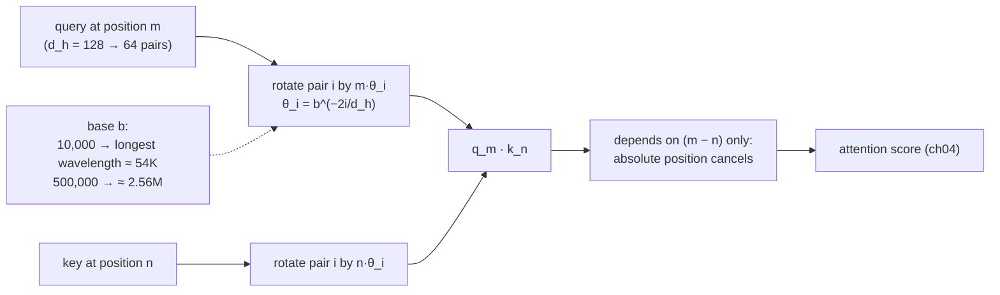
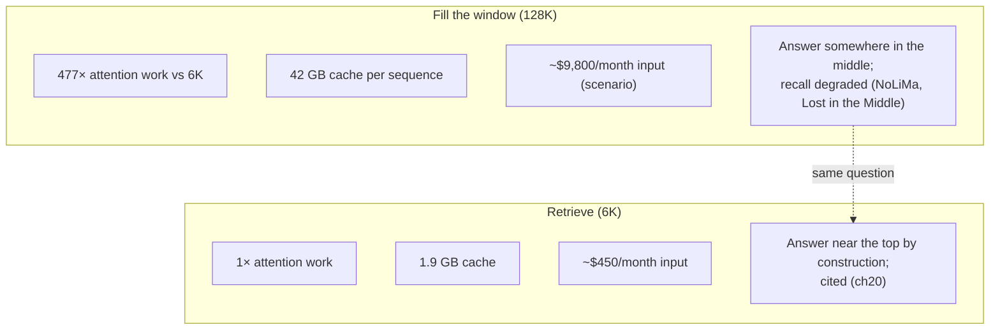

# Chapter 05 — Positional encoding and long context

*Part I · Word budget 5,000–8,000 · Lab 05 · Verified as of September 2026 · Derived figures from `labs/ch05-position-long-context/derive.py`*

## 05.1 Intuition

Attention has no idea where anything is. It compares every token's query with every other token's key and takes a weighted sum; shuffle the tokens and the sums come out the same. "Close the valve then vent the line" and "vent the line then close the valve" would be identical to a transformer with no notion of position — and in a procedure, the order is the procedure. Positional encoding is how order gets in.

The way it gets in has consequences the plant will feel long after it stops thinking about it. Every model has a context length it was trained at — 8,000 tokens, 128,000, a million (advertised windows per model cards, vendor) — and the positional scheme is what determines whether a model can read past it, how gracefully it fails when it does, and how well it uses the length it advertises. That last point is the practical one. A model sold with a 128,000-token window does not read 128,000 tokens the way it reads 8,000; the benchmark evidence in this chapter shows accuracy on retrieval-style questions falling by a third or more before the window is a quarter full (Modarressi et al. 2025, primary), and the mechanism is not a bug to be fixed but the geometry of attention spreading over more competitors.

For the maintenance agent the decision this chapter supports is one it faces every day: when the planner wants the whole manual in the context instead of the six thousand tokens retrieval would supply, what does that cost and what does it lose. The arithmetic says four hundred times the attention work, twenty times the cache, twenty times the input bill, and a measured drop in the model's ability to find the one line that matters. Retrieval is not a workaround for small windows; it is the right design at any window, and this chapter is the argument.

## 05.2 Mechanism

### Absolute encodings

The original transformer added a fixed vector to each token's embedding: sinusoids of geometrically spaced wavelengths, one pair of dimensions per frequency, so that position $t$ has a unique pattern and nearby positions have similar ones (Vaswani et al. 2017, primary). GPT-2 and BERT replaced the sinusoids with a learned vector per position, which works exactly up to the training length and not one token past it — there is no vector for position 1,025 in a model trained to 1,024 (Radford et al. 2019; Devlin et al. 2019, primary). Both schemes tell the model where a token is; neither tells attention how far apart two tokens are, which is the quantity that matters for "the noun this pronoun refers to" or "the step before this one."

### Rotary position embedding

RoPE (Su et al., "RoFormer," 2021, primary) encodes position where attention uses it: in the query and key vectors, as a rotation. The head dimension $d_h$ is split into $d_h/2$ pairs; pair $i$ is rotated by angle $t\,\theta_i$ for a token at position $t$, with

$$\theta_i = b^{-2i/d_h},\qquad i = 0, \dots, d_h/2 - 1,$$

and $b$ the base, 10,000 in the original (Su et al. 2021, primary). The first pair rotates fast — one full turn every $2\pi \approx 6.3$ positions — and the last pair slowly; at $d_h = 128$ and base 10,000 the longest wavelength is about 54,000 positions (derive.py, derived). The property that makes this the standard is algebraic: the dot product of a rotated query at position $m$ with a rotated key at position $n$ depends only on the original vectors and on $m - n$. Relative distance enters attention directly; absolute position cancels. Lab 05 checks the identity numerically.

Two consequences follow. Tokens far apart interact through the slow pairs, tokens near each other through all pairs, so the model has both a local and a long-range sense of distance in one mechanism. And the scheme extrapolates poorly past the training length by default: positions the model never saw during training produce rotation angles it never saw, and attention scores between distant tokens become noise. Extending the window is therefore a matter of changing the rotation, which the next section covers.


### Why relative position is the right quantity

Language is built from relations at a distance — a pronoun and its noun, a step and the warning three lines above it, a closing bracket and its opening one — and the same relation should be recognized wherever in the document it occurs. A model that encodes absolute position must learn "noun at 40, pronoun at 47" and "noun at 4,040, pronoun at 4,047" separately; a model that encodes relative position learns "seven back" once (positions illustrative). RoPE's dot-product property gives attention exactly that (Su et al. 2021, primary), and it is the reason a model trained on documents that start at position zero can read a document whose relevant span starts at position 30,000: the span's internal geometry is the same. What it does not give is the ability to compare distances it never trained on, which is the whole content of the extension problem.

### Attention sinks and the first position

One more positional effect is empirical rather than designed. Trained decoders place a large share of attention weight on the first token — and often on the first few — regardless of their content, because softmax must put its weight somewhere and the model learns to park unused weight at a fixed place; Xiao and colleagues named these tokens attention sinks and showed that a cache which evicts them collapses while one that keeps them plus a sliding window streams stably (Xiao et al., "Efficient Streaming Language Models with Attention Sinks," 2023, primary). Two harness consequences: any context-eviction policy keeps the first tokens; and the system prompt at position zero sits, incidentally, in the best-attended place in the window — one reason the stable prefix belongs at the start beyond the cache.

### Multimodal and structured positions

Positions are one-dimensional in text and are not in what an industrial agent reads. A table has row and column position; a P&ID has spatial position; a document has section structure. Models that read images assign positions to patches in two dimensions, extending the rotary scheme to a 2D variant (ch14 treats vision inputs). For text-only agents the practical rule is that structure the tokenizer flattens — a table serialized row by row, a form field by field — should be serialized in the order the model will need it, with headers repeated near the values they label, because the model's only sense of "same column" is distance and pattern.

### ALiBi

Attention with linear biases (Press, Smith, and Lewis, 2022, primary) drops positional vectors altogether and subtracts a penalty proportional to distance from each attention score, with a different slope per head — a strong preference for nearby tokens in some heads, a weak one in others. It extrapolates to longer sequences more gracefully than learned or unmodified rotary schemes because the penalty is defined at every distance, at the cost of a built-in recency bias that limits long-range retrieval. Most current open decoders use RoPE; ALiBi survives in some encoders and smaller models.

### Extending the window

Three techniques let a model trained at length $L$ serve length $L' > L$.

**Position interpolation** scales every position by $L / L'$ so the longest sequence maps onto the trained range; a model trained at 8,192 serving 32,768 sees positions at a quarter of their true value (Chen et al., "Extending Context Window of Large Language Models via Positional Interpolation," 2023, primary). It works with brief fine-tuning and it compresses the fast pairs, blurring the model's sense of adjacent positions.

**Base scaling** — the "NTK-aware" family — instead raises the base $b$ so the slow pairs stretch to cover the new length while the fast pairs stay nearly unchanged; for a scale factor $s$ the base becomes $b \cdot s^{d_h / (d_h - 2)}$, about 40,900 for $s = 4$ and 167,000 for $s = 16$ from a base of 10,000 (derive.py, derived; bloc97 2023 and Peng et al., "YaRN," 2023, primary). YaRN combines base scaling with attention-temperature adjustment and is the method behind many 128K windows. Llama 3.1 trained at a base of 500,000 and then extended in stages to 128K (Dubey et al. 2024, primary); at that base the longest wavelength is over 2.5 million positions and fifteen of the sixty-four pairs have wavelengths beyond 131,072 — pairs that never complete a turn inside the window and act, in effect, as absolute position (derive.py, derived).

**Continued training at length** — the method the frontier uses — trains on long sequences after base scaling so the model sees the extended positions rather than merely tolerating them. It is expensive and it is what separates a window that works from one that is merely accepted by the API.

**Figure 05.1 — RoPE: position enters as rotation, distance survives the dot product.**



*Takeaway: the base sets how far the model can tell distances apart; extending the window means changing the rotation and then training on it.*

### Advertised length is not effective length

A window the API accepts is not a window the model uses well. Three benchmarks measure the gap, each in a different way.

**Needle-in-a-haystack** places one fact in a long filler text and asks for it; it measures whether the model can find a literal match, and current models pass it at their full advertised length, which is why it is no longer informative on its own (practitioner benchmark; Kamradt 2023).

**RULER** (Hsieh et al., 2024, primary) generalizes the needle to multiple needles, multi-hop tracing, aggregation, and question answering over long inputs, and found that many models with advertised windows of 32K or more fell below a satisfactory threshold well before those lengths — the advertised and effective lengths diverge, and the paper defines effective length as the longest at which a model holds a set fraction of its short-context score.

**NoLiMa** (Modarressi et al., ICML 2025, primary) removes the literal match: the question and the relevant passage share no keywords, so the model must retrieve by meaning. At 32K tokens, eleven of thirteen models fell below half their short-context accuracy; GPT-4o went from a 99.3% baseline to 69.7% at 32K and 56% at 128K — 70% and 56% of baseline (derive.py, derived from the paper's figures); its effective length at the paper's 85% threshold was 8K, and Llama 3.1 70B's was 2K. The mechanism the authors identify is attention's: without a lexical hook, the relevant token's score has to beat every competitor's, and the number of competitors grows with the window.

**Lost in the middle** (Liu et al., 2023, primary) measured where in the context a fact is easiest to find: at the beginning and the end, with a U-shaped dip in the middle that deepens as the context grows. The positional scheme and the training data both contribute — documents start with the important part, so the model learns to look there — and the practical rule is that anything the model must use goes first or last, never in the middle of a long block.

### Why the window fills badly

Three effects compound as the context grows, and ch04 gives the arithmetic for the first. Attention dilution: the softmax over more positions spreads weight thinner, and a fixed score gap yields a smaller top weight — the copying heads that do exact recall are the first to suffer. Distraction: with a long history in the window, the model leans on what it has already done rather than reasoning afresh; the Gemini 2.5 team observed their agent, past roughly 100K tokens, repeating actions from its history rather than planning (Gemini 2.5 Technical Report, 2025, primary). Position preference: the U-shape above, so the fact that matters is exactly as findable as where it happened to land. None of these is fixed by a longer window; all are fixed by putting less in it.

### Retrieval versus long context

The alternative to a long window is a short one filled with the right things (ch19, ch20). The comparison is arithmetic. For the 70B model, attention score work at 128K is 477 times that at 6K; the KV cache is 42 GB per sequence against 1.9 GB; the monthly input bill for the scenario's 60,000 queries is about $9,800 if every query fills 128K against $450 if it retrieves 6K (derive.py; prices vendor, Sep 2026). And the retrieved 6K has the answering passage in it by construction, near the top, where the model finds it best, while the 128K fill relies on a mechanism the benchmarks show degrading. Long context earns its place in two cases: when the task needs the whole document at once — a contract to be summarized, a log to be scanned for a pattern retrieval cannot name — and when retrieval has been measured to fail on the golden set. The default is retrieval.

**Figure 05.2 — Where the answer is, and what it costs to find it.**



*Takeaway: the window is a budget the harness spends on the right tokens, not a container to fill.*


### What a million tokens buys, and does not

Vendors now advertise windows of a million tokens and more (model cards, vendor, verified Sep 2026). Everything in this chapter applies at that scale with larger numbers: attention work grows with the square, so a million-token prefill is sixty-four times the work of 128K; the cache for one sequence at the 70B model's 320 KB per token would be 320 GB, more than any single GPU holds (derive.py arithmetic extended; ch04); and the effective-length measurements that exist stop far short of a million because the degradation is already severe by 128K. What a million-token window does buy is convenience for one-off tasks on documents that cannot be chunked sensibly — a full contract, a year of logs — at a price per query that the arithmetic makes visible. It does not change the agent's design: per-step assembly, retrieval, and compaction remain the mechanism, and the long window is a tool the router (ch23) selects for a task class, not the default.

### Compaction is a positional decision

When the loop rebuilds the window each step (ch22), it decides what occupies which positions, and three positional facts govern the rebuild. The prefix stays byte-identical at the start for the cache and the sinks. The running summary of prior steps — the compaction — replaces the raw history and sits after the prefix, short enough that the retrieved chunks that follow are still in the model's well-attended early region rather than the middle. And the current instruction closes the window. A compaction that grows step by step until the retrieved chunks are pushed into the middle third of the window has recreated the lost-in-the-middle failure inside a harness that was built to avoid it; the metric is retrieved-chunk position as a fraction of window, tracked per step (ch29).

### Reference implementation

Rotary embedding in NumPy, with the relative-position identity as a testable function. Lab 05 runs it, checks the identity, tabulates wavelengths, and computes the extension parameters.

```python
import numpy as np

def rope_angles(hd: int, base: float, positions: np.ndarray) -> np.ndarray:
    """Rotation angles, shape (len(positions), hd // 2): angle[t, i] = t * base^(-2i/hd)."""
    i = np.arange(hd // 2)
    theta = base ** (-2.0 * i / hd)
    return positions[:, None] * theta[None, :]

def apply_rope(x: np.ndarray, positions: np.ndarray, base: float = 10_000.0) -> np.ndarray:
    """Rotate each consecutive pair of dimensions of x (n, hd) by its position-dependent angle."""
    n, hd = x.shape
    ang = rope_angles(hd, base, positions)
    c, s = np.cos(ang), np.sin(ang)
    x1, x2 = x[:, 0::2], x[:, 1::2]
    out = np.empty_like(x)
    out[:, 0::2] = x1 * c - x2 * s
    out[:, 1::2] = x1 * s + x2 * c
    return out

def relative_score(q: np.ndarray, k: np.ndarray, m: int, n: int, base: float = 10_000.0) -> float:
    """Dot product of q rotated to position m with k rotated to position n; depends only on m - n."""
    qm = apply_rope(q[None, :], np.array([m], dtype=float), base)[0]
    kn = apply_rope(k[None, :], np.array([n], dtype=float), base)[0]
    return float(qm @ kn)

def wavelengths(hd: int, base: float) -> np.ndarray:
    return 2 * np.pi / (base ** (-2.0 * np.arange(hd // 2) / hd))

def ntk_base(base: float, scale: float, hd: int) -> float:
    """NTK-aware base for extending a window by a factor `scale`."""
    return base * scale ** (hd / (hd - 2))
```

The identity `relative_score(q, k, m, n) == relative_score(q, k, m + s, n + s)` for any shift `s` is the whole point of the scheme, and the lab asserts it to floating-point precision.

### Positions in the harness

The harness never sets a position; it decides what occupies them. Four rules follow from this chapter. The stable prefix — guides, tool schemas — sits at the start, where the model attends best and where the cache matches (ch18, ch37). The current step's retrieved chunks sit after it, few and relevant (ch20). The instruction that says what to do with them sits last, at the other well-attended end (ch19). And the window is rebuilt per step with the old history compacted, so the total stays inside the model's *effective* length as measured on the plant's golden set — not its advertised one (ch22).

## 05.3 Worked numbers

All figures from `derive.py` (derived).

**RoPE wavelengths at $d_h = 128$.**

| Base | Shortest wavelength | Longest wavelength | Pairs longer than 8,192 | Pairs longer than 131,072 |
|---|---|---|---|---|
| 10,000 | 6.3 positions | 54,410 | 14 of 64 | 0 |
| 500,000 | 6.3 positions | 2,559,196 | 29 of 64 | 15 |

At base 10,000, no pair has a wavelength beyond 128K, so every pair completes at least one turn inside a 128K window and distant positions alias. At base 500,000, fifteen pairs never complete a turn in 128K and carry near-absolute position; the change of base is what made Llama 3.1's 128K window trainable (Dubey et al. 2024, primary).

**Extension arithmetic.** Position interpolation from 8K to 32K scales positions by 0.25; to 128K by 0.0625, compressing adjacent positions to a sixteenth of their spacing. NTK-aware base scaling from 10,000: 40,890 for a 4× extension, 167,199 for 16×.

**Effective versus advertised.** GPT-4o's NoLiMa score at 32K is 70% of its short-context baseline, and at 128K 56%; under the paper's 85% criterion its effective length is 8K against an advertised 128K, and Llama 3.1 70B's is 2K (Modarressi et al. 2025, primary; ratios derived).

**Fill versus retrieve for the scenario.** Attention score work: 2.4 × 10¹³ multiply-adds at 6K against 1.1 × 10¹⁶ at 128K across the 70B model's 80 layers — 477×. Cache: 1.9 GB against 42 GB per sequence. Input bill at the frontier fresh-input price, 60,000 queries a month: $450 against $9,830.

## 05.4 Measurement

**Effective length on the plant's questions.** Build a NoLiMa-style set from the golden questions (ch12): the answering chunk embedded in filler drawn from the plant's own documents at 2K, 8K, 32K, and the longest length intended, with the question phrased without the chunk's keywords. Report accuracy per length per model with Wilson intervals and the effective length at an 85% criterion. This is the measurement that replaces the vendor's advertised window, and it costs tokens times lengths times questions — a few hundred dollars for a hundred questions at four lengths (illustrative). Lab 05's protocol specifies it; the run needs a model.

**Position sensitivity.** The same set with the answering chunk at the start, middle, and end; report the U-shape's depth per model. It tells the harness whether "instruction last" matters for this model.

**Rotation identity and wavelengths.** For a self-hosted model, read the base and head dimension from the configuration, compute the wavelength table, and confirm the extension method the vendor claims matches the base; Lab 05 does this on CPU.

**Window used versus quality.** From the observability records (ch29), tokens per step against sensor pass rate per step; a falling pass rate as the window grows is the effective-length limit showing in production.

What to record: model and version, base and head dimension, advertised and measured effective length, filler source, criterion, date.


### Reference output (Lab 05, this run)

What the lab prints when it reproduces; the plant's numbers replace these.

```text
relative-position identity: max |score(m,n) − score(m+s,n+s)| = 4.16e-11
score changes when m − n changes: True
base 10000 longest           chapter 54410  computed 54410  OK
base 10000 pairs > 8192      chapter 14  computed 14  OK
base 10000 pairs > 131072    chapter 0  computed 0  OK
base 500000 longest          chapter 2559196  computed 2559196  OK
base 500000 pairs > 8192     chapter 29  computed 29  OK
base 500000 pairs > 131072   chapter 15  computed 15  OK
NTK base for scale  4:            chapter 40890  computed 40890  OK
NTK base for scale 16:            chapter 167199  computed 167199  OK
ratio 128K/6K attention      chapter 477  derived 477  OK
KV GB at 128K                chapter 41.9  derived 41.9  OK
monthly $ fill               chapter 9830  derived 9830  OK
monthly $ retrieve           chapter 450  derived 450  OK
```

## 05.5 Failure

| Failure mode | Mechanism | Detection signal | Mitigation | Owning component |
|---|---|---|---|---|
| Advertised length trusted | Window filled to the API limit | Recall on retrieval-style questions falls with context | Measure effective length; budget the window below it | This chapter; ch19 |
| Answer in the middle | Position preference; U-shaped recall | Facts placed mid-context missed | Retrieved chunks near the top; instruction last | ch19 |
| Extrapolation past training | Positions beyond the trained range; rotation angles unseen | Output degrades sharply past a length | Serve within trained length; use a model extended by training, not by API acceptance | ch23 |
| Interpolation blur | Positions compressed; adjacent tokens indistinct | Errors on order-sensitive content (procedure steps) | Prefer base scaling with continued training; test step-order questions | This chapter |
| Fill instead of retrieve | Whole manuals in the context | Cost and latency up; recall down | Retrieval by default; fill only where measured to be needed | ch20 |
| Distraction | Long history in the window; model repeats past actions | Re-plans that copy earlier steps; loops | Per-step context assembly; compaction | ch19; ch22 |
| Needle test as proof | Vendor cites a literal-match needle result | Semantic retrieval fails at length | NoLiMa-style test without keyword overlap | This chapter; ch12 |
| Base misread | Configuration base assumed 10,000 | Wrong extension parameters; wrong effective length | Read the base from the configuration; compute wavelengths | This chapter |
| Language ignored | Effective length measured in English only | Portuguese documents fill the window faster (ch01) and degrade sooner | Measure per language | ch01; this chapter |
| Sink tokens evicted | Context management drops the first tokens to make room | Output quality collapses after eviction | Keep the first tokens in any eviction policy | ch19 |
| Structure flattened badly | Tables serialized so headers are far from values | Wrong column read; unit and value mismatched | Serialize in use order; repeat headers near values | ch20; ch25 |
| Window budget set in English | Per-step budget copied across languages | Portuguese steps exceed effective length | Budget per language from measured effective length | ch01; ch19 |

## 05.6 The frontier

**Strongest free treatments.** Su et al. (2021) define RoPE and its relative-position property and stop at the method. Press, Smith, and Lewis (2022) define ALiBi. Chen et al. (2023), the NTK-aware posts (2023), and Peng et al. (YaRN, 2023) establish the extension methods and stop at perplexity and needle results. Hsieh et al. (RULER, 2024) and Modarressi et al. (NoLiMa, 2025) measure effective length and stop at the benchmark. Liu et al. (2023) measure position sensitivity. The Gemini 2.5 report (2025) documents distraction in an agent. The Llama 3 paper (2024) gives the base and the staged extension. Weng's "The Transformer Family v2" surveys the encodings. Huyen's *AI Engineering* (2025) discusses context length as a cost and quality trade for RAG and stops before the wavelength arithmetic and the effective-length measurement protocol.

**What this chapter adds.** The rotation written so its relative-position property can be tested; the wavelength table that explains why a base change was needed for 128K; the extension methods with their parameters computed; the three benchmark families placed by what each measures and what each misses; the fill-versus-retrieve arithmetic for a real workload; the positional rules the harness follows; and a measurement protocol that produces the plant's own effective length per language. Open: effective length on Portuguese industrial text is unmeasured in the literature; the protocol in 05.4 is the measurement.

## 05.7 Industrial application

**The planner's request.** "Put the whole pump manual in so the agent never misses anything." The manual is about 150,000 tokens in Portuguese (illustrative, ch04) — past the on-site model's window, and at 128K it would be 477 times the attention work, 42 GB of cache, and a 20× input bill against retrieval, for a model whose measured effective length on semantic questions is a small fraction of 128K. Retrieval supplies the six thousand tokens the question needs, near the top, cited; the golden set is where the planner's fear — "it will miss something" — is tested, and the two-scaffold protocol (ch16) is how.

**The on-site model's numbers.** From its configuration: base 500,000, head dimension 128, trained at 8K then extended to 128K (Dubey et al. 2024, primary). The wavelength table says the extension is by base, not interpolation; the effective length is the plant's to measure, per language, before any context budget is set. The harness's per-step budget (ch22) is then set below that measured figure, not at the advertised one.

**Where the instruction goes.** At the end. The retrieved procedure goes first after the prefix. The technician's original request is repeated in the instruction so it is at the well-attended end too. These are free and they are the difference between a model that finds the permit clause and one that does not.

**OT boundary.** Nothing here touches it; the chapter's relevance is that no window is long enough to hold the state of a control system, and the agent does not read one (ch35).

## 05.8 Decision aids

**Context budget rule.** Per-step window ≤ measured effective length at the plant's 85% criterion, per language; retrieved content ≤ a third of the budget; history compacted to fit the rest.

**Fill-or-retrieve test.** Fill only if: the task needs the whole document at once *and* retrieval fails on the golden set *and* the document fits inside the measured effective length. Otherwise retrieve.

**Model window check (self-hosted).** Read base and head dimension; compute the wavelength table; confirm the extension method; measure effective length per language; record all four with the model version.

**Placement rule.** Prefix first; retrieved chunks next, most relevant first; instruction and the repeated request last; nothing important in the middle of a long block.


**Effective-length measurement protocol (Lab 05b, needs a model).** Inputs: 100 golden questions with their answering chunk; filler from the plant's own documents; lengths 2K, 8K, 32K, and the intended maximum; positions start, middle, end. Method: for each question, length, and position, build the context, ask, score deterministically; three runs per cell. Output: accuracy per length with Wilson intervals; effective length at 85%; U-depth per length; per language. Cost gate: prints tokens × price before running.

**Vendor questions.** Advertised length and the method used to reach it; effective length on a no-keyword-overlap benchmark, with the criterion; position-sensitivity results; per-language results if claimed.

## 05.9 Sources

| # | Claim or figure | Source | Tier | Verified | Link |
|---|---|---|---|---|---|
| 1 | Sinusoidal absolute encoding | Vaswani et al., NeurIPS 2017 | primary | Sep 2026 | https://arxiv.org/abs/1706.03762 |
| 2 | Learned absolute positions | Radford et al. 2019; Devlin et al. 2019 | primary | Sep 2026 | https://arxiv.org/abs/2306.00978 |
| 3 | RoPE; relative-position property | Su et al., "RoFormer," 2021, arXiv 2104.09864 | primary | Sep 2026 | https://arxiv.org/abs/2104.09864 |
| 4 | ALiBi | Press, Smith, Lewis, ICLR 2022, arXiv 2108.12409 | primary | Sep 2026 | https://arxiv.org/abs/2108.12409 |
| 5 | Position interpolation | Chen et al., 2023, arXiv 2306.15595 | primary | Sep 2026 | https://arxiv.org/abs/2306.15595 |
| 6 | NTK-aware base scaling; YaRN | bloc97, 2023 (community post); Peng et al., 2023, arXiv 2309.00071 | practitioner / primary | Sep 2026 | https://arxiv.org/abs/2309.00071 |
| 7 | Llama 3.1: base 500,000; staged extension to 128K | Dubey et al., 2024, arXiv 2407.21783 | primary | Sep 2026 | https://arxiv.org/abs/2407.21783 |
| 8 | RULER: effective vs advertised length | Hsieh et al., 2024, arXiv 2404.06654 | primary | Sep 2026 | https://arxiv.org/abs/2404.06654 |
| 9 | NoLiMa: 11/13 below 50% at 32K; GPT-4o 99.3 → 69.7 → 56; effective 8K / 2K at 85% | Modarressi et al., ICML 2025, arXiv 2502.05167 | primary | Sep 2026 | https://arxiv.org/abs/2502.05167 |
| 10 | Lost in the middle | Liu et al., 2023, arXiv 2307.03172 | primary | Sep 2026 | https://arxiv.org/abs/2307.03172 |
| 11 | Agent distraction beyond ~100K | Gemini 2.5 Technical Report, 2025, arXiv 2507.06261 | primary | Sep 2026 | https://arxiv.org/abs/2507.06261 |
| 12 | Needle-in-a-haystack | Kamradt, 2023 | practitioner | Sep 2026 | https://github.com/gkamradt/LLMTest_NeedleInAHaystack |
| 13 | Wavelengths; extension parameters; attention, cache, and bill at 6K vs 128K; NoLiMa ratios | `labs/ch05-position-long-context/derive.py` | derived | Sep 2026 | labs/ch05-position-long-context/derive.py |
| 14 | 150,000-token manual; a few hundred dollars for the measurement | Illustrative | illustrative | Sep 2026 | — |
| 15 | Effective length on Portuguese industrial text | None published | open | Sep 2026 | — |