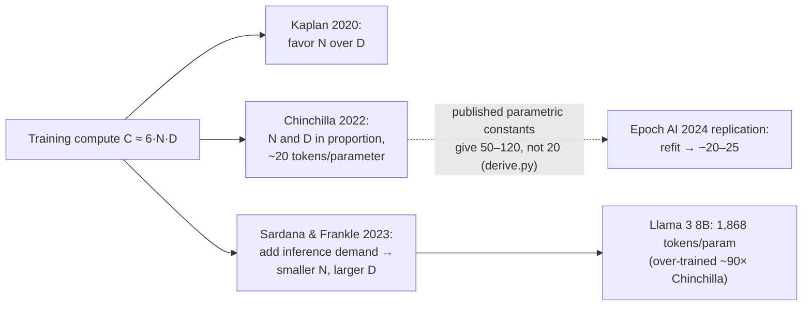
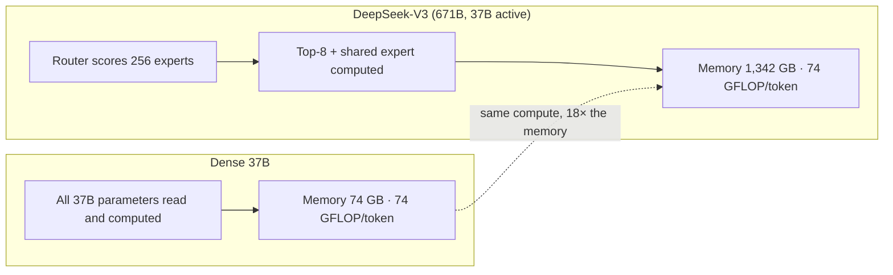

# Chapter 06 — Scale: parameters, MoE, scaling laws

*Part I · Word budget 5,000–8,000 · Lab 06 · Verified as of September 2026 · Derived figures from `labs/ch06-scale/derive.py`*

## 06.1 Intuition

Three numbers describe a language model's scale: how many parameters it has, how many tokens it was trained on, and how much compute that training took. For a decade the field's rule was that bigger was better and the third number was whatever the first two implied. Then two results changed how the numbers relate. The first said that for a fixed training budget there is a best split between parameters and data — and that the largest models of 2020–2021 had been trained on far too little data for their size (Hoffmann et al. 2022, primary). The second, driven by the cost of running models rather than training them, said that the best split for training is not the best split for serving: a smaller model trained on far more data than the training optimum is cheaper every time it answers a query, and models are trained to be run.

A third idea sits beside these. A mixture-of-experts model has many parameters and uses few of them per token; it stores like a large model and computes like a small one. For a plant that self-hosts, that distinction is the difference between a model that fits on one GPU and one that needs a rack.

This chapter gives the arithmetic behind all three, with the one that the plant will use most often first: from a compute budget or a parameter count, what to expect, and from a vendor's claim of scale, what it means for memory, speed, and cost. It also reports something the free treatments tend to omit: the most-cited scaling fit, taken at its published constants, does not reproduce the paper's own headline ratio, and a replication found out why.

## 06.2 Mechanism

### Training compute

Training a dense transformer costs about six floating-point operations per parameter per training token: two for the forward pass (ch03's $2N$ per token) and four for the backward pass (Kaplan et al. 2020, primary). For $N$ parameters and $D$ tokens,

$$C \approx 6\,N\,D.$$

The rule reconciles with a disclosed figure: Llama 3.1 405B at 405.9B parameters and 15.6 trillion tokens gives $3.80 \times 10^{25}$ FLOPs, matching Meta's reported $3.8 \times 10^{25}$ to the stated precision (derive.py, derived; Dubey et al. 2024, primary). GPT-3 at 175B parameters and 300B tokens is $3.2 \times 10^{23}$; Chinchilla at 70B and 1.4T is $5.9 \times 10^{23}$; DeepSeek-V3's 671B total parameters and 14.8T tokens would be $6.0 \times 10^{25}$ by this rule — but only 37B of its parameters are active per token, and the rule with the active count gives $3.3 \times 10^{24}$, which is the order the reported 2.8 million GPU-hours implies (derive.py; DeepSeek-AI 2024, primary). The $6ND$ rule counts parameters that do work; for a mixture of experts that is the active set.

### Scaling laws

Kaplan and colleagues found that test loss falls as a smooth power law in each of parameters, data, and compute when the other two are not the bottleneck, and read from their fits that parameters should grow faster than data as compute grows (Kaplan et al. 2020, primary). Hoffmann and colleagues at DeepMind trained over 400 models from 70 million to 16 billion parameters on 5 to 500 billion tokens and reached a different allocation: for compute-optimal training, parameters and tokens should scale in equal proportion, at roughly twenty tokens per parameter (Hoffmann et al., "Training Compute-Optimal Large Language Models," 2022, primary). Their demonstration was Chinchilla — 70B parameters on 1.4T tokens — which outperformed Gopher, 280B parameters on 300B tokens, at similar compute. GPT-3's 1.7 tokens per parameter was, by this rule, a model ten times too large for its data.

The paper offers three ways of arriving at the ratio. Two fit the empirical optimum directly. The third fits a parametric form,

$$L(N, D) = E + \frac{A}{N^{\alpha}} + \frac{B}{D^{\beta}},$$

with published constants $E = 1.69$, $A = 406.4$, $B = 410.7$, $\alpha = 0.34$, $\beta = 0.28$ (Hoffmann et al. 2022, primary). A reader who minimizes this form under $6ND = C$ — Lab 06 does — finds an optimal ratio that is not twenty and not constant: about 50 tokens per parameter at $10^{21}$ FLOPs, 78 at $10^{23}$, and 123 at $10^{25}$ (derive.py, derived). The published constants of the third approach do not reproduce the headline of the first two. Epoch AI reconstructed the paper's data from its figures, refit the parametric form, and found that the published fit was inconsistent with the data at the paper's own confidence level; their refit brought the third approach into agreement with the others at roughly 20 to 25 tokens per parameter (Besiroglu et al., "Chinchilla Scaling: A replication attempt," 2024, analyst). The lesson is the one this book keeps: a fit is a claim about data, and a claim that cannot be recomputed from what is published is a claim to check.


### Where the constants come from

A scaling law is a fit to points, and the points are models someone trained. Kaplan's fits came from models up to 1.5B parameters trained on up to 23B tokens; Chinchilla's from 400 models up to 16B parameters and 500B tokens (Kaplan et al. 2020; Hoffmann et al. 2022, primary). Both extrapolate by two to three orders of magnitude to the models the plant will use, and both were fit on English-dominant web corpora with the loss measured on held-out text of the same kind. Three consequences for a reader. The laws are strongest where the data is — small models, moderate compute — and weakest exactly where the claims are boldest. The exponents shift with the data mixture, the tokenizer, and the architecture, so a law fit for one family is a guide, not a prediction, for another. And the "loss" the laws predict is next-token cross-entropy on text like the training text; a plant's Portuguese procedures and tag-dense histories are not that text, which is one more reason the golden set is the arbiter.

### Data as the binding constraint

Chinchilla's ratio has a corollary the field reached within a year: at twenty tokens per parameter, a trillion-parameter dense model wants twenty trillion tokens of training text, and estimates of the public high-quality text available run in the tens of trillions of tokens (Villalobos et al., "Will we run out of data?" Epoch AI, 2022–2024, analyst). Two responses followed. Training on data more than once — repeated epochs — with diminishing but non-zero returns up to a few passes (Muennighoff et al., "Scaling Data-Constrained Language Models," 2023, primary). And synthetic data: text generated by models, filtered, and fed back, which the larger labs now use at scale for reasoning and code (vendor reports, ch07). For the plant the corollary is indirect but real: the frontier's constraint is data, which is why the over-training of small models on the same corpus is the pattern — the corpus is the scarce asset and the model size is the free variable — and why the plant's own documents, small as they are, are worth more in a retrieval index than as a fine-tuning set (ch08, ch20).

### Emergence and its measurement

Some capabilities appear to switch on at scale: a model that scores at chance on a task at one size scores well two sizes up. Wei and colleagues catalogued such jumps (Wei et al., "Emergent Abilities of Large Language Models," 2022, primary); Schaeffer, Miranda, and Koyejo showed that many disappear when the task is scored with a continuous metric rather than exact match — the underlying ability improves smoothly and the threshold is an artifact of the scoring (Schaeffer et al., "Are Emergent Abilities of Large Language Models a Mirage?" 2023, primary). The operational reading is that a vendor's claim that "the next size unlocks" a capability is a claim about a metric, and the plant's golden set should score continuously enough — partial credit per criterion, not pass/fail per task — to see whether the ability is arriving or has arrived (ch12).

### Over-training for inference

Chinchilla's optimum minimizes loss for a fixed training budget and says nothing about the cost of running the model afterwards. Every query costs about $2N$ FLOPs, so a model half the size costs half as much to serve, for its whole life. Sardana and Frankle made the accounting explicit: include the expected inference demand in the objective, and the optimal model is smaller than Chinchilla's and trained on more tokens, with the gap growing as expected usage grows (Sardana and Frankle, "Beyond Chinchilla-Optimal," 2023, primary). The industry moved this way before the paper: Llama 3 8B was trained on about 15 trillion tokens — 1,868 tokens per parameter, ninety times the Chinchilla ratio — and Llama 3 70B on the same corpus at 212 per parameter (derive.py; Dubey et al. 2024, primary). At the 8B model's compute, the parametric fit's optimum would have been a 36B model on 3.4T tokens, with a fitted loss of 1.923 against 1.948 for the 8B — a small loss difference for a model 4.4 times cheaper to serve (derive.py, derived from the published fit; the fit's constants carry the caveat above).

For the plant this is the mechanism behind the small-model economics of ch11 and ch23: capable small models exist because their makers spent training compute to save the plant's inference compute, and the golden set is where the loss difference is measured on tasks that matter.

**Figure 06.1 — The three budgets and the three optima.**



*Takeaway: the best model to train is not the best model to run; every vendor now trains for running.*

### Mixture of experts

A dense block applies one feed-forward network to every token (ch03). A mixture-of-experts block replaces it with $E$ feed-forward networks — the experts — and a small router that computes, for each token, a score per expert and sends the token to the top $k$ (Shazeer et al., "Outrageously Large Neural Networks," 2017, primary; Fedus, Zoph, and Shazeer, "Switch Transformers," 2022, primary). The block's parameters grow by a factor of $E$; the compute per token grows by $k / 1$ against one dense FFN of the same width, and since $k \ll E$, the model holds far more knowledge than it computes with on any one token.

| Model | Total parameters | Active per token | Experts (active / total) | Total ÷ active |
|---|---|---|---|---|
| Mixtral 8×7B | 46.7B | 12.9B | 2 / 8 | 3.6 |
| Llama 4 Scout | 109B | 17B | 1 / 16 (+ shared) | 6.4 |
| Qwen3-235B-A22B | 235B | 22B | 8 / 128 | 10.7 |
| Llama 4 Maverick | 400B | 17B | 1 / 128 (+ shared) | 23.5 |
| DeepSeek-V3 | 671B | 37B | 8 / 256 (+ 1 shared) | 18.1 |

(Parameter counts and routing per model cards and technical reports, vendor / primary; ratios derive.py.)

Three engineering facts follow. **Memory follows total, compute follows active.** DeepSeek-V3 needs 1,342 GB of 16-bit weights — eighteen times a dense 37B model's 74 GB — while its forward pass costs about 74 GFLOP per token, the same as that dense 37B (derive.py, derived). A plant cannot serve it on one GPU whatever its per-token cost. **Routing must balance.** If the router sends most tokens to a few experts, those experts overfit and the rest go untrained; training adds an auxiliary load-balancing loss (Fedus et al. 2022, primary) or, in DeepSeek-V3, a bias term adjusted online without a loss term (DeepSeek-AI 2024, primary); at 256 experts and top-8 routing, balanced load is 3.1% of tokens per expert (derive.py). **Experts are parallelized across devices.** Serving a large MoE spreads experts over GPUs and routes tokens between them each layer, so interconnect bandwidth, not GPU compute, often bounds throughput — a constraint the plant's two-GPU fallback cannot meet, which is why its fallback is dense (ch16).

A shared expert — one FFN every token passes through in addition to its routed experts — appears in several recent designs to hold common knowledge and let the routed experts specialize (DeepSeek-AI 2024, primary).


### Scale in the harness

The harness meets scale as a routing decision, a memory budget, and a bill. The router (ch23) sends routine steps to a small over-trained model and hard steps to a frontier model; the arithmetic of this chapter is why the small model is good enough for the routine share — it was trained on the same trillions of tokens as its larger siblings — and why it costs a ninth as much per token. The self-host decision (ch37) is a memory question this chapter answers from total parameters and a compute question it answers from active ones. And the fine-tuning decision (ch08) inherits the data-constraint corollary: the plant's corpus is small against any training set and large against any context window, so it belongs in the retrieval index.

One more consequence for the harness is temporal. Scaling laws describe families, and families ship new members every few months; a model chosen today is superseded by a smaller one of equal quality within a year, because the makers keep over-training. The harness that pins its model version (ch23), re-runs the golden set on the new candidate, and swaps on evidence is the harness that collects that dividend; one that hard-codes a model name collects nothing.

### What scale does not buy

Two limits the numbers do not show. Scaling laws predict loss on the pre-training distribution, and a lower loss is a better next-token predictor of web text, not a better maintenance planner; the correlation between scale and the plant's golden set is real and loose (ch12). And scale in parameters is not scale in reliability: the pass^k arithmetic of ch16 is unchanged by model size, and the harness does what scale does not.

### Reference implementation

The compute-optimal allocation under the parametric fit, the $6ND$ accounting, and the MoE memory–compute split, in twenty lines. Lab 06 runs it and reports the ratio the published constants imply.

```python
import math

E, A, B, ALPHA, BETA = 1.69, 406.4, 410.7, 0.34, 0.28   # Hoffmann et al. 2022, Approach 3, as published

def chinchilla_loss(N: float, D: float) -> float:
    return E + A / N ** ALPHA + B / D ** BETA

def compute_optimal(C: float, grid: int = 2000):
    """Minimize the parametric loss subject to 6·N·D = C. Returns (loss, N, D, tokens_per_param)."""
    best = None
    for i in range(grid):
        N = 10 ** (6 + 8 * i / (grid - 1)); D = C / (6 * N)
        l = chinchilla_loss(N, D)
        if best is None or l < best[0]:
            best = (l, N, D, D / N)
    return best

def train_flops(N_active: float, D: float) -> float:
    return 6 * N_active * D

def moe_split(total_params: float, active_params: float, bytes_per_param: float = 2.0):
    """Memory follows total; compute follows active."""
    return {"memory_GB": total_params * bytes_per_param / 1e9,
            "flops_per_token": 2 * active_params,
            "total_over_active": total_params / active_params}
```

### Reading a scale claim

A vendor states "a 400B-parameter model." The reader asks: total or active? If mixture-of-experts, how many experts and how many active? Trained on how many tokens — the ratio to parameters says whether it was trained for loss or for serving? What does $6ND$ give, and does it match the disclosed compute? What is the memory at the serving precision, and does that fit the plant's hardware? Each answer is a line in 06.3's tables, and a vendor who cannot supply them has described a model by one number that means less than it sounds.

**Figure 06.2 — Dense versus mixture of experts, per token.**



*Takeaway: a mixture of experts is a small model's per-token cost with a large model's footprint and knowledge.*

## 06.3 Worked numbers

All figures from `derive.py` (derived).

**Training compute and tokens per parameter for documented runs.**

| Run | Parameters (active) | Tokens | Tokens per parameter | $6ND$ FLOPs | Disclosed |
|---|---|---|---|---|---|
| GPT-3 175B | 175B | 300B | 1.7 | 3.2 × 10²³ | — |
| Chinchilla 70B | 70B | 1.4T | 20.0 | 5.9 × 10²³ | — |
| Llama 3 8B | 8.03B | ~15T | 1,868 | 7.2 × 10²³ | — |
| Llama 3 70B | 70.6B | ~15T | 212 | 6.4 × 10²⁴ | — |
| Llama 3.1 405B | 405.9B | 15.6T | 38 | 3.80 × 10²⁵ | 3.8 × 10²⁵ (Meta) |
| DeepSeek-V3 | 37B active (671B total) | 14.8T | 400 (22 on total) | 3.3 × 10²⁴ | 2.79M H800 GPU-hours |

(Parameter and token figures from the cited papers and cards, primary; Meta's compute from Dubey et al. 2024; DeepSeek's GPU-hours from its technical report.)

**The parametric fit at its published constants.** Optimal tokens per parameter at $10^{21}$, $10^{23}$, $10^{25}$ FLOPs: 50, 78, 123 — against the paper's headline of about 20 from its other two approaches, and against Epoch AI's refit at 20–25. The fit applied to Gopher and Chinchilla gives losses of 1.993 and 1.937, in the direction the paper reports.

**Over-training.** At Llama 3 8B's training compute of $7.2 \times 10^{23}$, the fit's optimum is a 36B model on 3.4T tokens at a fitted loss of 1.923; the 8B on 15T has a fitted loss of 1.948. The optimum would cost 4.4× as much per query to serve.

**MoE memory and compute.**

| Model | 16-bit memory | FLOPs per token | Total ÷ active |
|---|---|---|---|
| Mixtral 8×7B | 93 GB | 26 GFLOP | 3.6 |
| Llama 4 Scout | 218 GB | 34 GFLOP | 6.4 |
| Qwen3-235B-A22B | 470 GB | 44 GFLOP | 10.7 |
| Llama 4 Maverick | 800 GB | 34 GFLOP | 23.5 |
| DeepSeek-V3 | 1,342 GB | 74 GFLOP | 18.1 |

None of the four largest fits on a single 80 GB GPU at any common precision; Mixtral fits on two at 16-bit and one at 8-bit (derive.py, derived). The plant's two-GPU fallback is a dense 70B by this table, not a mixture of experts.

## 06.4 Measurement

**Reconcile the claim.** For any model considered: total and active parameters from the configuration (ch03's counter extended by expert count); tokens trained from the report; $6ND$ against disclosed compute or GPU-hours; memory at serving precision against the hardware. Lab 06 does the arithmetic; the reader supplies the configuration.

**Loss is not the metric.** Where a vendor cites a scaling-law position for a model, ask for the golden-set result; scaling laws predict pre-training loss, and the plant's tasks are measured directly (ch12). Score continuously per criterion so a capability that is arriving shows as a trend, not a jump.

**Inference-optimal check.** For two candidate models at similar golden-set quality, compare $2N_{\text{active}}$ per token and memory; the smaller, more-trained one serves cheaper, and ch37's anatomy prices the difference.

**MoE serving test.** If a mixture of experts is proposed for self-hosting, measure tokens per second at the intended batch on the intended hardware with the intended expert-parallel layout; interconnect, not FLOPs, is the likely limit.

What to record: total and active parameters, expert count and top-$k$, tokens trained, disclosed compute, serving precision and memory, hardware and interconnect, date.


### Reference output (Lab 06, this run)

What the lab prints when it reproduces; the plant's numbers replace these.

```text
Llama 3.1 405B 6ND = 3.799e+25 vs Meta 3.8e25: -0.02%
C=1e+21: optimal tokens/param   50.0 (chapter 50.0)  N=1.83e+09 D=9.12e+10  OK
C=1e+23: optimal tokens/param   77.6 (chapter 77.6)  N=1.47e+10 D=1.14e+12  OK
C=1e+25: optimal tokens/param  122.7 (chapter 122.7)  N=1.17e+11 D=1.43e+13  OK
→ published Approach-3 constants imply 50–123, not ~20; see Epoch AI 2024 replication (chapter 06.2)
at Llama 3 8B compute 7.23e+23: fit-optimal N=3.55e+10 D=3.39e+12 loss 1.923; 8B on 15T loss 1.948; serve-cost ratio 4.4x
DeepSeek-V3        memory   1342 GB    74 GFLOP/token  ratio  18.1  OK
Mixtral 8x7B       memory     93 GB    26 GFLOP/token  ratio   3.6  OK
Llama 4 Maverick   memory    800 GB    34 GFLOP/token  ratio  23.5  OK
GPT-3        tokens/param     1.7 (chapter 1.7) OK
Chinchilla   tokens/param    20.0 (chapter 20.0) OK
Llama 3 8B   tokens/param  1868.0 (chapter 1868.0) OK
Lab 06: REPRODUCED
```

## 06.5 Failure

| Failure mode | Mechanism | Detection signal | Mitigation | Owning component |
|---|---|---|---|---|
| Total read as active | MoE parameter count taken as compute cost | Per-token cost estimate off by the total ÷ active ratio | Ask total and active; compute from active, memory from total | This chapter; ch23 |
| Active read as memory | MoE assumed to fit where a dense model of its active size fits | Out of memory at load | Memory from total parameters × bytes | This chapter; ch10 |
| Chinchilla ratio applied to serving | A model chosen at 20 tokens per parameter as "optimal" | Higher serving cost than an over-trained smaller model of equal quality | Inference-optimal reasoning; golden set decides quality | This chapter; ch11 |
| Published fit taken on faith | Parametric constants used without recomputation | Allocation off by 3–6× | Recompute; prefer the empirical approaches and the replication | This chapter |
| Scale as quality | Parameter count used as the quality metric | Golden-set results uncorrelated with size | Golden set; scale sets cost | ch12 |
| Expert imbalance in fine-tuning | Adapters trained without load balancing collapse routing | A few experts receive most tokens; quality drops | Keep balancing during any MoE fine-tuning; measure expert load | ch08 |
| MoE on the wrong hardware | Experts spread across GPUs over slow interconnect | Throughput far below FLOPs-implied | Measure on the layout; prefer dense for small deployments | This chapter; ch10 |
| Compute claim unreconciled | Vendor GPU-hours inconsistent with $6ND$ | Discrepancy above a factor of two | Ask what the count includes (failed runs, ablations, active vs total) | This chapter |
| Emergence claimed on a threshold metric | Pass/fail scoring hides a smooth trend | Capability appears to switch on between sizes | Score the golden set continuously per criterion | ch12 |
| Model pinned past its useful life | Hard-coded model while smaller equals arrive | Cost per task static while the market's falls | Version pinning with scheduled candidate runs | ch23 |

## 06.6 The frontier

**Strongest free treatments.** Kaplan et al. (2020) and Hoffmann et al. (2022) are the scaling-law sources and stop at their fits and their demonstration models. Besiroglu et al. (Epoch AI, 2024) is the replication and stops at the refit. Sardana and Frankle (2023) add inference to the objective and stop at the theory. Shazeer et al. (2017), Fedus, Zoph, and Shazeer (2022), and the DeepSeek-V3 and Mixtral reports establish mixture-of-experts mechanics and stop at their models. The Llama 3 paper discloses tokens and compute. Huyen's *AI Engineering* (2025) discusses scale and model selection for engineers and stops before recomputing a fit or splitting MoE memory from compute.

**What this chapter adds.** The $6ND$ rule reconciled against a disclosed figure to the stated precision; the parametric fit recomputed at its published constants, with the discrepancy from the headline stated and the replication credited; over-training quantified for a real model with the serving-cost consequence; the MoE memory-versus-compute table for five models and what it means for a two-GPU site; a runnable allocation and accounting; and the questions that turn a scale claim into numbers. Open: the replication's refit constants are not reproduced here — the reader who needs the corrected fit should take them from the replication — and no scaling law exists for the plant's golden set, which is the point of having one.

## 06.7 Industrial application

**Choosing the on-site fallback.** The candidates are a dense 70B, a dense 8B over-trained on 15T tokens, and a mixture of experts. The MoE fails the memory test at two GPUs. The 8B serves at a ninth of the 70B's per-token compute and a ninth of its memory; whether it holds quality on the plant's work-order tasks is the golden set's question, and the over-training arithmetic says the answer is closer than the parameter counts suggest. The 70B is the safe choice; the 8B is the cheap one; the measurement decides (ch11, ch12).

**Reading the API tier.** The frontier models the agent calls by API are, by the vendors' hints and by the routing tables of ch23, mixtures of experts or dense models of undisclosed size; the plant cannot reconcile their claims and does not need to — it pays per token, and the token price already reflects the vendor's active-parameter cost. Scale matters to the plant's own hardware, not to the API bill.

**The vendor conversation.** "Our 400B model" becomes: 400B total, 17B active, 128 experts, one active plus a shared expert, 800 GB at 16-bit, 34 GFLOP per token, trained on how many tokens (derive.py; Llama 4 Maverick figures, vendor). The plant's question after that is which of its tasks the model does better than the 70B it can host, and the answer is a golden-set run, not a parameter count.

**OT boundary.** Unchanged; scale does not create a path to a control system, and a larger model with more knowledge of control systems is not a reason to give it one (ch35).

## 06.8 Decision aids

**Scale-claim worksheet.**

| Question | Answer | Consequence |
|---|---|---|
| Total parameters | | Memory = total × bytes |
| Active parameters per token | | Compute = 2 × active per token |
| Experts: count, top-$k$, shared | | Interconnect need; balancing |
| Tokens trained; tokens per parameter | | Trained for loss (~20) or serving (≫20) |
| $6ND$ vs disclosed compute | | Reconciles, or ask what is included |
| Memory at serving precision vs hardware | | Fits, or does not |
| Golden-set result | | The only quality number that counts |

**Inference-optimal rule.** Between two models of equal golden-set quality, choose the one with fewer active parameters; between two of equal size, the one trained on more tokens.

**MoE self-host rule.** Serve a mixture of experts on site only if the total-parameter memory fits the hardware with the KV cache and the expert layout has been measured for throughput on that interconnect; otherwise a dense model of the active size.

**Fit-checking rule.** Any published scaling constant is recomputed before it enters a plan; a fit that does not reproduce its own headline is reported as such.

**Candidate-model cadence.** Quarterly: list the models released since the last review with total and active parameters, tokens trained, and memory at serving precision; run the golden set on any that fit the hardware at lower active parameters than the current choice; swap on a result that holds quality within the confidence interval at lower cost per task (ch23, ch37). The cadence is what turns the industry's over-training into the plant's savings.

## 06.9 Sources

| # | Claim or figure | Source | Tier | Verified | Link |
|---|---|---|---|---|---|
| 1 | $6ND$ training compute; power-law scaling; favor parameters | Kaplan et al., 2020, arXiv 2001.08361 | primary | Sep 2026 | https://arxiv.org/abs/2001.08361 |
| 2 | Chinchilla: ~20 tokens per parameter; 70B/1.4T beats 280B/300B; parametric fit constants | Hoffmann et al., 2022, arXiv 2203.15556 | primary | Sep 2026 | https://arxiv.org/abs/2203.15556 |
| 3 | Replication: published fit inconsistent; refit ~20–25 | Besiroglu et al., Epoch AI, 2024, arXiv 2404.10102 | analyst | Sep 2026 | https://arxiv.org/abs/2404.10102 |
| 4 | Inference-aware optimum: smaller N, larger D | Sardana & Frankle, 2023, arXiv 2401.00448 | primary | Sep 2026 | https://arxiv.org/abs/2401.00448 |
| 5 | Mixture of experts; load-balancing loss | Shazeer et al., 2017, arXiv 1701.06538; Fedus, Zoph, Shazeer, 2022, arXiv 2101.03961 | primary | Sep 2026 | https://arxiv.org/abs/1701.06538 |
| 6 | DeepSeek-V3: 671B / 37B active; 256 + 1 shared experts; auxiliary-loss-free balancing; 14.8T tokens; 2.79M GPU-hours | DeepSeek-AI, 2024, arXiv 2412.19437 | primary | Sep 2026 | https://arxiv.org/abs/2412.19437 |
| 7 | Llama 3 tokens (~15T; 15.6T for 405B); 3.8 × 10²⁵ FLOPs | Dubey et al., 2024, arXiv 2407.21783 | primary | Sep 2026 | https://arxiv.org/abs/2407.21783 |
| 8 | GPT-3 175B on 300B tokens | Brown et al., 2020, arXiv 2005.14165 | primary | Sep 2026 | https://arxiv.org/abs/2005.14165 |
| 9 | Mixtral, Llama 4, Qwen3 parameter and expert counts | Model cards and reports | vendor | Sep 2026 | https://huggingface.co/models |
| 10 | Optimal ratios under the published fit; over-training comparison; MoE memory and compute; balanced expert share | `labs/ch06-scale/derive.py` | derived | Sep 2026 | labs/ch06-scale/derive.py |
| 10a | Data stock estimates | Villalobos et al., Epoch AI, 2022–2024 | analyst | Sep 2026 | https://epoch.ai/ |
| 10b | Repeated-epoch returns | Muennighoff et al., 2023, arXiv 2305.16264 | primary | Sep 2026 | https://arxiv.org/abs/2305.16264 |
| 10c | Emergent abilities; mirage under continuous metrics | Wei et al., 2022, arXiv 2206.07682; Schaeffer, Miranda, Koyejo, 2023, arXiv 2304.15004 | primary | Sep 2026 | https://arxiv.org/abs/2206.07682 |
| 11 | Corrected fit constants from the replication | Not reproduced here | open | Sep 2026 | — |