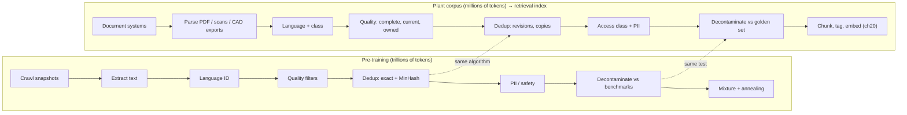
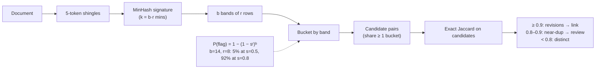

# Chapter 07 — Pre-training data and pipelines

*Part I · Word budget 5,000–8,000 · Lab 07 · Verified as of September 2026 · Derived figures from `labs/ch07-data/derive.py`*

## 07.1 Intuition

A model is what it read. Fifteen trillion tokens of text went into Llama 3, and every fact it appears to know, every style it can imitate, every bias it carries, and every gap in its knowledge of the plant trace back to what was in that corpus and what was not (Dubey et al. 2024, primary). The architecture (ch03) decides how the model computes; the data decides what it computes about. And the data was not found — it was made, by a pipeline that took raw web crawls and threw most of them away.

That pipeline is the part of model-building most like a plant's own work. It filters by quality, removes duplicates, tracks where every document came from, and decides what mixture goes in. The tools are statistical rather than mechanical, but the disciplines are document control's: provenance, deduplication, revision, and access. This chapter explains the pipeline for two reasons. First, so the reader can interpret what a model knows and does not — why it writes fluent English about centrifugal pumps and has never seen the plant's procedure numbering — and why the answer to that gap is retrieval, not more training. Second, because the same pipeline, at a millionth of the scale, is what the plant runs on its own corpus before any of it reaches a retrieval index (ch20), and the plant's version has the same failure modes: duplicates that bias, stale revisions that mislead, contamination that fakes an evaluation, and documents nobody can trace.

The arithmetic in this chapter puts the plant's corpus in proportion (derive.py, derived; corpus size illustrative). Twenty thousand documents at six thousand tokens is 120 million tokens — a millionth of a percent of a pre-training corpus, and one and a half hundredths of a token per parameter if it were fine-tuned into an 8B model. As training data it is nothing; as a retrieval index it is everything the plant needs the agent to know.

## 07.2 Mechanism

### The corpus and the crawl

The raw material is the public web, captured in periodic crawls: Common Crawl publishes snapshots several times a year, each tens of terabytes of compressed HTML, and a modern pre-training corpus starts from dozens of them — FineWeb from 96 (Penedo et al., "The FineWeb Datasets," 2024, primary). Added to the web are curated sources: code from public repositories, books and papers where licensing allows, reference works, forums, and, increasingly, text generated by other models and filtered (ch06's data constraint). The Pile (Gao et al. 2020, primary) and Dolma (Soldaini et al. 2024, primary) are the documented open examples; the frontier labs disclose mixtures at the level of categories, not sources.

### The pipeline, stage by stage

Every published pipeline runs the same sequence, in roughly the same order, because each stage removes what would corrupt the next (Penedo et al. 2023, RefinedWeb, primary; Penedo et al. 2024, primary; Soldaini et al. 2024, primary).

**Extraction.** HTML to text: strip navigation, boilerplate, and markup, keep the main content. The choice of extractor changes downstream quality measurably — FineWeb's authors report a different extractor as one of their larger single improvements (Penedo et al. 2024, primary).

**Language identification.** A fast classifier assigns a language and a confidence; documents below a threshold are dropped. This stage decides the multilingual share of the corpus and therefore how well the model reads Portuguese (ch01's tax has its origin here).

**Quality filtering.** Heuristic rules remove documents that are not prose: too short, too long, too many symbols, too few sentence-ending punctuation marks, too high a fraction of lines that look like lists or navigation. The Gopher rules (Rae et al. 2021, primary) and C4's (Raffel et al. 2020, primary) are the reference sets; FineWeb added rules derived from its own ablations. Model-based quality classifiers — small models trained to predict "educational" or "high quality" — select the subset used for the best-performing versions (FineWeb-Edu; Penedo et al. 2024, primary).

**Deduplication.** Exact duplicates are removed by hashing whole documents; near-duplicates — the same article on a hundred sites, the same boilerplate with a different date — by MinHash with locality-sensitive hashing. Lee and colleagues showed that deduplication improves the model at fixed compute and cuts the rate at which the model emits memorized training text by an order of magnitude (Lee et al., "Deduplicating Training Data Makes Language Models Better," 2022, primary). The mechanism below is the same the plant will use.

**Personal data and safety.** Patterns for personal identifiers — emails, phone numbers, addresses — are redacted or the documents dropped; sources with a high share of harmful content are removed by classifier or by domain list. The rules vary by lab and are one of the least-documented stages.

**Decontamination.** Documents that overlap with evaluation benchmarks are removed so the benchmark measures generalization rather than recall. The test is n-gram overlap — a document containing a 13-token span from a benchmark item is flagged (Brown et al. 2020, primary, for GPT-3's procedure) — and it is imperfect in both directions, which is the origin of the contamination problem in ch12.

**Mixture and ordering.** The retained sources are weighted: Llama 3's mix was about half general knowledge, a quarter mathematics and reasoning, 17% code, and 8% multilingual text, set by ablations at small scale (Dubey et al. 2024, primary). Training then orders the data — a final "annealing" phase on the highest-quality subset is now standard — and may repeat scarce high-value sources for several epochs, with returns that diminish after about four passes (Muennighoff et al. 2023, primary).

**Figure 07.1 — The pre-training pipeline, and the plant's version of it.**



*Takeaway: the plant runs the same stages on its own documents; the scale differs by a million and the failure modes do not.*


### Parsing the plant's formats

The web pipeline's extraction stage has an industrial counterpart that is harder, not easier. Procedures arrive as PDFs — some born digital, some scanned; work orders as exports from the CMMS with fields, not prose; equipment histories as free text typed by technicians in two languages; drawings as CAD exports or raster images with legends. Each needs its own parser, and each parser fails in its own way: a scanned procedure yields optical-character-recognition text with digits and tags mangled (P-101 becomes P-1O1); a table extracted from a PDF loses its column structure; a CMMS export puts the description in one field and the equipment tag in another, and a chunk that has one without the other is unretrievable by the other. The pipeline's first measurement is therefore parse quality per format — a sample of parsed documents read against their originals by someone who knows them — before any filter runs, because a filter that sees garbled text will reject or accept it for the wrong reasons.

### Quality is a per-class judgment

Web quality heuristics encode "looks like well-formed prose," which is the wrong test for most of what a plant reads. A work order is a form; a legend is a list; a history entry is a sentence fragment with a tag and a date. Applying Gopher's rules — minimum length, symbol ratio, sentence-ending punctuation — to these classes rejects the documents that matter most. The plant's quality stage asks a different question per class: is the document complete (all required fields), current (a revision flag that document control maintains), owned (a named owner), and readable (parse quality above the sampled threshold). A document that fails any of the four is held for document control, not dropped, because in a plant an incomplete procedure is a finding, not noise.

### Access classification is a pipeline stage

The web pipeline's PII stage has a stricter counterpart: every document carries an access class from document control — who may read it — and the class travels with every chunk into the index, where the retrieval layer filters on it before search (ch20, ch28). The pipeline enforces two rules. A document without a class is refused, like one without an owner. And personal data inside documents — technicians' names on work orders, contractor details in histories — is either redacted at ingestion for classes that do not need it or retained under the retention rules of ch29, because the index is a copy of the data and inherits its obligations (ch36).

### MinHash and locality-sensitive hashing

Near-duplicate detection at scale cannot compare every pair. MinHash (Broder 1997, primary) turns a document into a short signature whose agreement between two documents estimates their Jaccard similarity — the share of n-gram shingles they have in common. Each of $k$ hash functions is applied to every shingle and the minimum kept; two documents agree on a given minimum with probability equal to their Jaccard similarity. Locality-sensitive hashing then groups the signature into $b$ bands of $r$ rows and buckets documents by band; two documents land in the same bucket for at least one band — and are compared — with probability

$$P(\text{flag}) = 1 - (1 - s^{r})^{b},$$

for similarity $s$. The curve is a threshold around $s \approx (1/b)^{1/r}$: with 14 bands of 8 rows, a pair at similarity 0.5 is flagged 5% of the time and a pair at 0.8 is flagged 92% of the time; with 20 bands of 5, the threshold moves to about 0.55 and a pair at 0.7 is flagged 97% of the time (derive.py, derived). The plant tunes $b$ and $r$ to the question it is asking: revisions of one procedure sit at similarity above 0.9 and should be linked, not deleted; two procedures that share a template sit near 0.5 and are different documents.

### Reference implementation

Shingling, MinHash, LSH banding, and an n-gram contamination check, complete. Lab 07 runs them on a synthetic corpus with seeded near-duplicates and a golden set with seeded leaks.

```python
import hashlib, re
from collections import defaultdict

TOKEN = re.compile(r"\w+")

def shingles(text: str, n: int = 5) -> set:
    toks = TOKEN.findall(text.lower())
    return {" ".join(toks[i:i + n]) for i in range(max(0, len(toks) - n + 1))}

def _h(s: str, seed: int) -> int:
    return int(hashlib.blake2b(f"{seed}:{s}".encode(), digest_size=8).hexdigest(), 16)

def minhash(sh: set, k: int = 112) -> list:
    return [min(_h(s, i) for s in sh) if sh else 0 for i in range(k)]

def jaccard(a: set, b: set) -> float:
    return len(a & b) / len(a | b) if a or b else 0.0

def lsh_candidates(sigs: dict, b: int = 14, r: int = 8) -> set:
    """Pairs of doc ids sharing at least one band. sigs: id -> signature of length b*r."""
    buckets = defaultdict(list)
    for doc, sig in sigs.items():
        for band in range(b):
            key = (band, tuple(sig[band * r:(band + 1) * r]))
            buckets[key].append(doc)
    pairs = set()
    for docs in buckets.values():
        for i in range(len(docs)):
            for j in range(i + 1, len(docs)):
                pairs.add(tuple(sorted((docs[i], docs[j]))))
    return pairs

def near_duplicates(corpus: dict, threshold: float = 0.8, b: int = 14, r: int = 8) -> list:
    """Return (doc_a, doc_b, jaccard) for candidate pairs whose exact Jaccard >= threshold."""
    sh = {d: shingles(t) for d, t in corpus.items()}
    sigs = {d: minhash(s, b * r) for d, s in sh.items()}
    out = []
    for a, c in lsh_candidates(sigs, b, r):
        j = jaccard(sh[a], sh[c])
        if j >= threshold:
            out.append((a, c, round(j, 3)))
    return out

def contamination(corpus: dict, golden: dict, n: int = 13) -> dict:
    """For each golden item, the corpus documents containing any of its n-grams."""
    index = defaultdict(set)
    for d, t in corpus.items():
        toks = TOKEN.findall(t.lower())
        for i in range(len(toks) - n + 1):
            index[" ".join(toks[i:i + n])].add(d)
    hits = {}
    for g, t in golden.items():
        toks = TOKEN.findall(t.lower()); found = set()
        for i in range(len(toks) - n + 1):
            found |= index.get(" ".join(toks[i:i + n]), set())
        if found:
            hits[g] = sorted(found)
    return hits
```

The two functions the plant will run weekly are `near_duplicates` on every ingestion batch and `contamination` on every golden-set version: the first keeps the index from voting twice for one document, the second keeps the evaluation honest.


### Ingestion as a durable workflow

The plant's pipeline runs on the control plane (ch21) for the same reasons the agent does. A batch is a workflow; each stage is an activity with a recorded result; a parser that crashes on document 8,412 resumes there, not at document one (document number illustrative); and a re-run after a rule change re-executes only the stages the change touched. The per-stage counts of 07.4 are the workflow's history read as a table. Two properties matter for the index. Ingestion is idempotent per document and revision — the same document ingested twice produces one chunk set, keyed by document id and revision — so a re-run cannot duplicate what deduplication removed. And chunk creation and metadata writing are one transaction, so the index never holds a chunk whose provenance is still arriving.

### The plant's corpus over time

A pre-training corpus is built once per model; the plant's corpus changes every day. Procedures are revised, work orders close, histories grow, and the index must follow. The mechanism is incremental ingestion keyed by revision: document control's change feed triggers the pipeline for the changed documents only; the old revision's chunks are marked superseded, not deleted, so the history is retrievable and the current flag is unambiguous; and the near-duplicate stage runs the new revision against its lineage, not the whole corpus. The measurement is currency — chunks whose source has a newer revision — and the target is zero after each run. A corpus that is re-ingested whole every quarter is current for a day and stale for ninety.

### Provenance and the record of a corpus

A pre-training corpus is documented, when it is documented, by a datasheet: sources, dates, filters applied, counts at each stage, licenses, known gaps (Gebru et al., "Datasheets for Datasets," 2021, primary). The open corpora ship them; the frontier labs publish category-level summaries. For the plant the equivalent is document control's own metadata — owner, revision, effective date, classification — carried through every stage of the ingestion pipeline and stored beside every chunk (ch20). A chunk without provenance cannot be cited, cannot be retired when its source is revised, and cannot be excluded when its source is reclassified; provenance is the field the whole retrieval layer depends on.

### What the corpus leaves out

The pre-training corpus is public text, mostly English, mostly recent, filtered toward prose. It contains general engineering — the physics of a centrifugal pump, the idea of a mechanical seal, the format of a work order — and it contains none of the plant's own documents, procedure numbers, equipment tags, or history, unless they were posted publicly. It under-represents Portuguese technical writing, scanned documents, tables, and drawings. It contains whatever biases and errors the filtered web contains, at the frequencies the filters allowed. Knowing this is how the reader interprets a model's behavior: fluency on general topics is the corpus speaking; confident detail about the plant is the model guessing; and the cure for the second is the plant's corpus in the context (ch20), not in the weights (ch08).

### Memorization and the plant's data

Language models memorize some of their training data verbatim, more so for text repeated many times, and can be prompted to emit it (Carlini et al., "Extracting Training Data from Large Language Models," 2021, primary). Deduplication reduces the effect by an order of magnitude (Lee et al. 2022, primary). For the plant this has two edges. A model the plant did not train cannot have memorized the plant's documents unless they were public — a reassurance. And a model the plant *does* fine-tune on its documents can memorize them and emit them to anyone who asks, including through a prompt injection — a reason fine-tuning on confidential documents is a data-protection decision before it is an engineering one (ch08, ch36).

### Synthetic data and the loop

The labs now generate part of their training text with models: solutions to problems, rewrites of documents into cleaner prose, instruction–response pairs. The technique fills the data constraint (ch06) and raises a risk the literature has named: models trained on the output of models drift toward the modes of their teachers and lose the tails, a degradation that compounds across generations if unfiltered (Shumailov et al., "The Curse of Recursion," 2023, primary). The labs filter; the reader cannot verify how well. For the plant the point is narrower: synthetic data for a fine-tune or a golden set is useful and must be labelled as synthetic, filtered by the same sensors as real data (ch26), and never mixed with real records in the retrieval index.

**Figure 07.2 — Locality-sensitive hashing as a threshold on similarity.**



*Takeaway: the band count and row count are a dial on what counts as the same document; the plant sets it per document class.*

## 07.3 Worked numbers

All figures from `derive.py` (derived).

**LSH flagging probability.**

| Bands × rows | s = 0.5 | s = 0.7 | s = 0.8 | s = 0.9 | Threshold ≈ |
|---|---|---|---|---|---|
| 14 × 8 | 0.05 | 0.57 | 0.92 | 1.00 | 0.72 |
| 20 × 5 | 0.47 | 0.98 | 1.00 | 1.00 | 0.55 |
| 50 × 2 | 1.00 | 1.00 | 1.00 | 1.00 | 0.14 |

The 14 × 8 setting flags revisions and copies while leaving templated but distinct procedures alone; 50 × 2 flags nearly everything and pushes the work onto the exact Jaccard step (derive.py, derived).

**The plant's corpus in proportion.** Twenty thousand documents at 6,000 tokens: 120 million tokens (scenario, illustrative). That is 0.0008% of a 15-trillion-token pre-training corpus, and 0.015 tokens per parameter against an 8B model — a fine-tune on it would show the model each document once per 67 parameters, which is not how facts are learned (ch06's ratio for pre-training is thousands of tokens per parameter). The corpus is retrieval material.

**Contamination.** If each golden-set item leaks into the corpus independently with probability 0.1%, a hundred-item golden set is entirely clean with probability 0.905; at 1%, 0.366. A golden set that has never been checked has, at plausible leak rates, better than even odds of containing at least one contaminated item — and one is enough to inflate a score.

**Document classes.** The scenario corpus: 3,000 procedures, 12,000 work orders, 4,000 equipment histories, 1,000 drawings and legends (illustrative). Work orders dominate the count and are the class most prone to near-duplication — templated, repeated, revised — and the class where deduplication changes retrieval most.

## 07.4 Measurement

**Removal at each stage.** For every ingestion run, documents in and out per stage: parse failures, language rejections, quality rejections, exact duplicates, near-duplicates by similarity band, access-class exclusions. A stage that removes nothing is not running; one that removes half is misconfigured or has found something.

**Near-duplicate precision and recall.** On a labelled sample — pairs marked "same document," "revision," "distinct" by document control — report the share of flagged pairs that are true duplicates and the share of true duplicates flagged, at the chosen $b$ and $r$. Lab 07 does this on a synthetic corpus with seeded duplicates.

**Contamination.** Every golden-set version against the current corpus, at 13-gram overlap; report hits by golden item and by corpus document. A hit is either a leak to remove from the corpus or a golden item to retire.

**Provenance completeness.** Share of chunks with owner, revision, effective date, and classification; the target is 100% and the index refuses chunks without them.

**Parse quality per format.** On the sampled documents, the share of identifiers (tags, procedure numbers, part numbers) that match the equipment and document registers exactly; a format below the threshold gets a parser fix before its documents are indexed.

**Currency.** Share of chunks whose source has a newer revision; the target is zero after every ingestion run (ch20).

What to record: pipeline version, filter rules and thresholds, $b$ and $r$, golden-set version, counts per stage, date.


### Reference output (Lab 07, this run)

What the lab prints when it reproduces; the plant's numbers replace these.

```text
LSH 14x8 flag rate at Jaccard 0.5: simulated 0.06  formula 0.053  OK
LSH 14x8 flag rate at Jaccard 0.7: simulated 0.57  formula 0.565  OK
LSH 14x8 flag rate at Jaccard 0.8: simulated 0.93  formula 0.924  OK
LSH 14x8 flag rate at Jaccard 0.9: simulated 1.00  formula 1.000  OK
revision pairs recalled at ≥0.8: 1.000 (300/300); templated pairs flagged: 0
contamination: leaked ['q11', 'q37', 'q38', 'q41', 'q48']; detected ['q11', 'q37', 'q38', 'q41', 'q48']; false hits []
Lab 07: REPRODUCED
```

## 07.5 Failure

| Failure mode | Mechanism | Detection signal | Mitigation | Owning component |
|---|---|---|---|---|
| Duplicates vote | Ten copies of one procedure dominate retrieval and any statistic | The same document fills the top-k; counts inflated | Near-duplicate detection per batch; link revisions, keep one current | This chapter; ch20 |
| Revisions deleted as duplicates | Similarity threshold too low; revision 6 removed with revision 7 | History lost; cannot answer "what did it say before" | Link revisions above 0.9; delete only exact copies | This chapter |
| Contaminated golden set | Golden items or their answers present in the corpus | Scores above what the task warrants; no failures on items that exist verbatim | 13-gram contamination check per version | This chapter; ch12 |
| Missing provenance | Chunks indexed without owner, revision, class | Cannot cite, retire, or exclude | Index refuses chunks without metadata | ch20 |
| Parse failures silent | Scanned PDFs and CAD exports yield empty or garbled text | Documents "present" but unretrievable | Per-stage counts; sample review of parsed text | This chapter |
| Quality filters tuned for web | Web heuristics reject tables, forms, and short procedures | Class-specific rejection rates high | Filters per document class; sample what is rejected | This chapter |
| Language misidentified | Bilingual documents classed as one language | Retrieval chunks sized for the wrong language | Per-chunk language; mixed-language handling | ch01; ch20 |
| Model expected to know the plant | Pre-training corpus assumed to include site documents | Confident wrong specifics | Retrieval; cite-or-abstain | ch20; ch26 |
| Fine-tune on confidential documents | Memorization; extraction through prompting or injection | Confidential text in outputs | Retrieval with access filters instead; data-protection review before any fine-tune | ch08; ch28; ch36 |
| Synthetic mixed with real | Generated records indexed beside real ones | Citations to documents that do not exist | Label and segregate synthetic data | ch20; ch12 |
| Whole-corpus re-ingestion | Index rebuilt on a schedule instead of on change | Currency near zero right after a rebuild, then decaying | Incremental ingestion keyed by revision from the change feed | This chapter; ch21 |
| Fields separated from tags | CMMS export chunks the description without the equipment tag | Work orders unretrievable by equipment | Per-format parser joins fields into one chunk with tags in metadata | This chapter; ch20 |
| OCR errors in identifiers | Scanned procedures with mangled tags | Tag queries miss scanned documents | Parse-quality sampling per format; identifier validation against the register | This chapter; ch26 |

## 07.6 The frontier

**Strongest free treatments.** The RefinedWeb, FineWeb, and Dolma papers (2023–2024) document web-scale pipelines stage by stage with ablations and are the definitive sources; they stop at pre-training corpora. Lee et al. (2022) establish deduplication's effect; Broder (1997) the algorithm. Gebru et al. (2021) define datasheets. Carlini et al. (2021) and Shumailov et al. (2023) establish memorization and recursion. The Llama 3 paper discloses the mixture. Huyen's *AI Engineering* (2025) has a dataset-engineering chapter oriented to fine-tuning data and stops before mapping the pipeline onto an enterprise document corpus and its retrieval index.

**What this chapter adds.** The pipeline read as document control — provenance, deduplication, revision, access — with the plant's ingestion as the same stages at a millionth of the scale; the LSH threshold arithmetic tuned to the difference between a revision and a copy; the plant's corpus put in proportion to a pre-training corpus and to a parameter count, which settles the fine-tune-versus-retrieve question numerically; the contamination arithmetic; runnable MinHash, LSH, and contamination code; and the memorization consequence for fine-tuning on confidential documents. Open: no published study of near-duplicate structure in industrial document corpora; Lab 07's protocol on the plant's own corpus is the measurement.

**Related chapters.** ch14 (Multimodality).

## 07.7 Industrial application

**The first ingestion run.** Document control exports the 3,000 procedures, 12,000 work orders, 4,000 histories, and 1,000 legends. Parsing fails on 4% of the procedures — scanned revisions from before the document system (illustrative) — and the failures are listed, not silently dropped. Near-duplicate detection at 14 × 8 links 2,100 procedure revisions into 700 lineages and flags 3,400 work orders as near-copies of templates (illustrative); the lineages keep every revision with one marked current, and the work-order copies are kept as records but excluded from the procedure index. The contamination check finds two golden-set questions whose answering sentences appear verbatim in a training-and-onboarding document; the document stays, the two questions are rewritten. Provenance completeness is 100% because the index refused 140 chunks that arrived without an owner (illustrative), and document control fixed them.

**What the model brought, and what it did not.** The model knows what a mechanical seal is and how a work order reads. It has never seen MP-0417, P-101, the site's hazard classes, or the approved parts list, and the pipeline above is how those reach it — through the index, with provenance, at query time.

**The vendor who offers to "train on your documents."** The arithmetic of 07.3 is the answer: 0.015 tokens per parameter is not training, and a fine-tune that did take would be a memorization and data-protection problem. The offer the plant should accept is ingestion into a retrieval index with the pipeline of this chapter, and the acceptance test is the per-stage count table and the provenance completeness figure.

**OT boundary.** The ingestion pipeline reads document systems, never control systems; historian data enters the agent's context by query through the broker, not by indexing (ch35).

## 07.8 Decision aids

**Ingestion checklist (per batch).** Per-stage counts recorded; parse failures listed by document; language and class per document; quality rules per class; exact and near-duplicate detection run with $b$, $r$ stated; revisions linked, one current; access class and PII handling applied; contamination against the current golden set; provenance complete or chunk refused.

**Similarity dial (starting values; measure on labelled pairs).**

| Document class | Bands × rows | Link above | Review band | Distinct below |
|---|---|---|---|---|
| Procedures | 14 × 8 | 0.90 (revision) | 0.80–0.90 | 0.80 |
| Work orders | 20 × 5 | 0.95 (copy) | 0.70–0.95 | 0.70 |
| Histories | 14 × 8 | 0.95 | 0.85–0.95 | 0.85 |

**Fine-tune-or-retrieve test.** Tokens in the corpus divided by parameters in the model: below one, the corpus is retrieval material; changing facts, confidential content, or citation requirements settle it regardless (ch08).

**Ingestion service levels (starting values).** Change-feed to index: under one hour for procedure revisions, under one day for work orders and histories; parse-quality sample: 2% of each batch per format, read by document control; currency after each run: zero chunks superseded; provenance completeness: 100%, enforced by refusal (values illustrative; set from the plant's document-control cadence).

**Golden-set hygiene.** Contamination check on every version; a hit retires the item or removes the leak; synthetic items labelled; the check recorded with the golden-set version.

## 07.9 Sources

| # | Claim or figure | Source | Tier | Verified | Link |
|---|---|---|---|---|---|
| 1 | Llama 3: ~15T tokens; mixture ~50/25/17/8; annealing | Dubey et al., 2024, arXiv 2407.21783 | primary | Sep 2026 | https://arxiv.org/abs/2407.21783 |
| 2 | FineWeb: 96 snapshots, 15T tokens; extractor and filter ablations; FineWeb-Edu | Penedo et al., 2024, arXiv 2406.17557 | primary | Sep 2026 | https://arxiv.org/abs/2406.17557 |
| 3 | RefinedWeb pipeline | Penedo et al., 2023, arXiv 2306.01116 | primary | Sep 2026 | https://arxiv.org/abs/2306.01116 |
| 4 | Dolma; The Pile | Soldaini et al., 2024, arXiv 2402.00159; Gao et al., 2020, arXiv 2101.00027 | primary | Sep 2026 | https://arxiv.org/abs/2402.00159 |
| 5 | Gopher and C4 filtering rules | Rae et al., 2021, arXiv 2112.11446; Raffel et al., 2020, arXiv 1910.10683 | primary | Sep 2026 | https://arxiv.org/abs/2112.11446 |
| 6 | Deduplication improves models; ~10× less memorized emission | Lee et al., 2022, arXiv 2107.06499 | primary | Sep 2026 | https://arxiv.org/abs/2107.06499 |
| 7 | MinHash | Broder, "On the resemblance and containment of documents," 1997 | primary | Sep 2026 | https://doi.org/10.1109/SEQUEN.1997.666900 |
| 8 | 13-gram decontamination | Brown et al., 2020, arXiv 2005.14165 | primary | Sep 2026 | https://arxiv.org/abs/2005.14165 |
| 9 | Repeated epochs: returns diminish after ~4 | Muennighoff et al., 2023, arXiv 2305.16264 | primary | Sep 2026 | https://arxiv.org/abs/2305.16264 |
| 10 | Datasheets for datasets | Gebru et al., CACM 2021 | primary | Sep 2026 | https://doi.org/10.1145/3458723 |
| 11 | Training-data extraction | Carlini et al., 2021, arXiv 2012.07805 | primary | Sep 2026 | https://arxiv.org/abs/2012.07805 |
| 12 | Recursion on model-generated data | Shumailov et al., 2023, arXiv 2305.17493 | primary | Sep 2026 | https://arxiv.org/abs/2305.17493 |
| 13 | LSH probabilities and thresholds; corpus proportions; contamination probabilities | `labs/ch07-data/derive.py` | derived | Sep 2026 | labs/ch07-data/derive.py |
| 14 | Scenario corpus counts; ingestion-run figures; leak rates | Illustrative | illustrative | Sep 2026 | — |
| 15 | Near-duplicate structure of industrial corpora | None published | open | Sep 2026 | — |