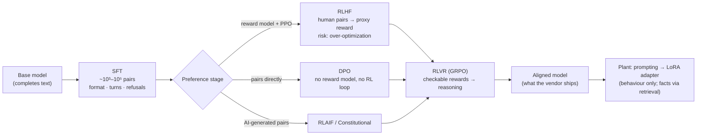
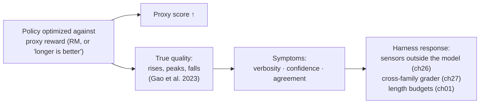

# Chapter 08 — Post-training

*Part I · Word budget 5,000–9,000 · Lab 08 · Verified as of September 2026 · Derived figures from `labs/ch08-post-training/derive.py`*

## 08.1 Intuition

A model that has finished pre-training completes text. Ask it "Draft a work order for the seal leak on P-101" and it may produce a second, similar request, because in its corpus a request is usually followed by another request rather than by a fulfilment. It has the knowledge and the fluency; it does not have the habit of being an assistant. Post-training is where the habit is installed — where a document-completer becomes something that answers, follows a format, refuses what it should, and stops when it is done.

The methods are few and the sequence is now standard. Show the model examples of the behaviour wanted (supervised fine-tuning). Then show it pairs of answers and which was preferred, and push it toward the preferred ones — either by training a separate judge of quality and optimizing against it (reinforcement learning from human feedback), by folding the judge into the training objective (direct preference optimization), or by replacing human preference with checkable outcomes such as a test passing (reinforcement learning from verifiable rewards). Each step changes behaviour; none reliably adds facts, which is the sentence the plant needs most.

For the plant, post-training is mostly something the vendor did. What the plant decides is whether to do a small amount of its own — an adapter that teaches the model the site's work-order format or tone — and the decision turns on three things this chapter makes numerical: what an adapter costs (hours on one GPU), what it can change (behaviour, not knowledge), and what it risks (memorizing confidential text; drifting from the vendor's safety behaviour). The plant's corpus at 120 million tokens is retrieval material (ch07); an adapter trained on a few thousand curated examples of *how the plant writes* is the one fine-tune worth considering, and only after prompting has been exhausted.

## 08.2 Mechanism

### Supervised fine-tuning

SFT continues training on curated instruction–response pairs with the same next-token loss as pre-training, but only on the response tokens. The pairs are few — thousands to hundreds of thousands — and quality dominates quantity: LIMA reached competitive instruction-following with 1,000 carefully written examples (Zhou et al., "LIMA," 2023, primary), and InstructGPT's SFT stage used about 13,000 prompts (Ouyang et al. 2022, primary). SFT teaches format, the notion of a turn, refusal patterns, and tone; it is where a model learns that a request is followed by a fulfilment. It is also where behaviours are most cheaply changed by the plant, because an adapter trained on a few hundred site examples is SFT at small scale.

### Reinforcement learning from human feedback

RLHF (Christiano et al. 2017; Stiennon et al. 2020; Ouyang et al. 2022, primary) has three stages. Humans compare pairs of model responses and pick the better one. A **reward model** — a copy of the language model with a scalar head — is trained to predict those preferences. The policy is then optimized with proximal policy optimization to produce responses the reward model scores highly, under a penalty on the divergence from the SFT model so it does not drift into gibberish the reward model happens to like. InstructGPT's result was the field's turning point: a 1.3B-parameter model trained this way was preferred by humans over the 175B GPT-3 (Ouyang et al. 2022, primary). Its data was small — about 33,000 comparison prompts and 31,000 prompts for the RL stage (derive.py; Ouyang et al. 2022, primary).

The reward model is a proxy, and optimizing hard against a proxy finds its gaps. Gao, Schulman, and Hilton measured the effect: as the policy is optimized further against a reward model, the reward model's score keeps rising while the true (gold) preference peaks and then falls — the policy learns to exploit the proxy (Gao et al., "Scaling Laws for Reward Model Overoptimization," 2023, primary). The observable symptoms are verbosity, confident tone, and agreement with the user regardless of correctness — sycophancy — which Anthropic showed is partly a product of preference data in which humans preferred agreeable answers (Sharma et al., "Towards Understanding Sycophancy in Language Models," 2023, primary). The divergence penalty exists to limit this; it does not remove it.


### What the divergence penalty is for

Every preference method constrains the policy to stay near a reference — PPO by an explicit penalty on the divergence from the SFT model, DPO by the reference log-probabilities inside its loss. The reason is not caution for its own sake. The reward model has seen responses only near the SFT distribution; a policy that wanders far from it is scored on responses the reward model never learned to judge, and Gao et al.'s over-optimization curve is what happens there. The constraint is also what preserves the base model's knowledge and its safety behaviour through post-training, and what a plant's adapter should respect: a small rank, a small learning rate, early stopping on a held-out set, and a golden set that includes what the model could already do — so that a gain in the site's format is not paid for with a loss the plant did not measure.

### Direct preference optimization

DPO (Rafailov et al. 2023, primary) removes the reward model and the RL loop. It observes that under the divergence-penalized objective, the optimal policy's log-probability ratio against the reference model *is* a reward up to a constant, so preferences can be fit directly:

$$\mathcal{L}_{\text{DPO}} = -\log \sigma\!\left(\beta\left[\log\frac{\pi(y_w \mid x)}{\pi_{\text{ref}}(y_w \mid x)} - \log\frac{\pi(y_l \mid x)}{\pi_{\text{ref}}(y_l \mid x)}\right]\right),$$

for a preferred response $y_w$ and a rejected one $y_l$. The loss is a logistic function of the margin between the policy's preference and the reference's; at zero margin it is $\log 2 = 0.693$, at a margin of 20 it is 0.127, at 50 it is 0.007 (derive.py, derived). Training is a supervised pass over preference pairs with no sampling, no reward model, and no PPO. The paper reports DPO matching or exceeding PPO-based RLHF on the tasks it measured; it does not report a compute or quality percentage, and this book does not attribute one to it (Rafailov et al. 2023, primary). DPO is the default for open-model alignment because it is stable and cheap; its limit is that it optimizes only against the pairs it is shown, and pairs are still a proxy.

### Constitutional AI and AI feedback

Anthropic replaced most of the human harmlessness labels with model-generated ones: a model critiques and revises its own responses against a written set of principles, and a preference model trained on the revised pairs stands in for human raters (Bai et al., "Constitutional AI," 2022, primary). The mechanism matters to the plant because it is the pattern the plant's own graders follow (ch27): a rubric, a model reading against it, and a calibration against humans.

### Reinforcement learning from verifiable rewards

Where an outcome can be checked — a math answer against its solution, code against its tests — the reward needs no human and no proxy. DeepSeek-R1 trained reasoning this way with group relative policy optimization: for each prompt, sample a group of responses, score each with the checkable reward, compute each response's advantage as its reward's standardized deviation from the group's mean, and update toward the above-average responses (Shao et al., "DeepSeekMath," 2024, primary; DeepSeek-AI, "DeepSeek-R1," Nature 2025, primary). For a group of eight with three correct, the correct responses get an advantage of +1.29 and the incorrect ones −0.77 (derive.py, derived). Reasoning behaviours — checking work, backtracking — emerged without being demonstrated. The authors state the limit: without a reliable verifier, the reward is hackable, and open-ended tasks do not have one.

For the plant, RLVR is the vendor's method and the harness's lesson in one: the sensors of ch26 are verifiers, and a task with a deterministic check is a task on which a model can be trained — or, more practically for a plant, a task on which an agent's output can be checked without a human.

**Figure 08.1 — The post-training sequence and what each stage changes.**



*Takeaway: every stage changes how the model behaves; the plant's facts enter through the context, not through any of them.*


### Where the preference data comes from

The pairs are the product. In RLHF and DPO the model learns whatever the raters preferred, and the raters were people following a rubric under time pressure. Three properties of that data explain behaviours the plant will see. Raters preferred longer answers and confident tone, so the model learned to produce them (Sharma et al. 2023, primary). Raters compared final answers, not reasoning, so a plausible wrong answer and a correct one were often rated alike — which is why verifiable rewards, where they exist, produced reasoning that human preference did not. And raters were mostly English-speaking, mostly evaluating general tasks, so the behaviours are best calibrated there and least in Portuguese technical writing. The plant's own preference data — the approval queue's approvals and rejections with reasons (ch31) — is the exception: it is site-specific, bilingual, and labelled by the people whose judgment matters, and it is the natural source of adapter pairs and grader calibration sets alike.

### Instruction hierarchy and system prompts

Post-training also installs the model's sense of who it is listening to. Vendors train models to weight instructions by their source — system prompt above user turn above tool output — so that a guide (ch18) has authority over a document the agent read (Wallace et al., "The Instruction Hierarchy," OpenAI, 2024, primary). The training is partial: injected instructions in tool output still succeed often enough that the harness treats the hierarchy as a guide's advantage rather than a boundary, and keeps the policy engine outside the model (ch28). For the plant the practical rule is that a system prompt is the strongest lever the model's own training offers and the weakest guarantee the harness relies on.

### Distillation as post-training

A small model can be post-trained on a large model's outputs rather than on human data: the large model answers a corpus of prompts, and the small model is fine-tuned on the answers (Hinton et al., "Distilling the Knowledge in a Neural Network," 2015, primary, for the general idea; DeepSeek-R1's distilled variants for the current practice, DeepSeek-AI 2025, primary). The vendors ship such models — the "mini" and "flash" tiers — and the plant benefits by routing routine steps to them (ch23). The plant can also distil for itself: a frontier model generates site-correct work orders for a few thousand prompts, a reviewer checks them, and the pairs train the on-site model's adapter. It is the same adapter as above with the labelling cost moved from technicians to a reviewer, and it carries the same rule — every pair reviewed, none from confidential text without a data-protection decision.

### Parameter-efficient adapters

Full fine-tuning updates every parameter and needs memory for optimizer state several times the model's size. LoRA freezes the base weights and adds, beside each chosen matrix $W$, a trainable product $BA$ of two thin matrices with rank $r$; the adapter has $r(d_{\text{in}} + d_{\text{out}})$ parameters per matrix and can be merged into $W$ for serving at no latency cost (Hu et al., "LoRA," 2021, primary). The paper reports up to 10,000× fewer trainable parameters and 3× lower GPU memory than full fine-tuning of GPT-3 175B. QLoRA trains the adapter over a 4-bit base model, bringing a 65B fine-tune within one 48 GB GPU (Dettmers et al., "QLoRA," 2023, primary). For Llama 3 8B at rank 16 on all seven projection matrices, the adapter is 41.9 million parameters — 0.52% of the model (derive.py, derived).

Two facts govern what an adapter can do. It changes behaviour — format, tone, task pattern, vocabulary — reliably, because behaviour is a low-rank shift in how the model uses what it knows. It adds facts unreliably, because facts live in the feed-forward memories (ch03) and a rank-16 update to them is a whisper; the studies that do inject facts by fine-tuning report brittle recall and interference with existing knowledge, and none produces a citation (the mechanism follows from ch03 and ch07; the plant's test is the golden set).

### Reference implementation

DPO's loss and gradient direction, GRPO's advantages, and LoRA's parameter count. Lab 08 trains a toy policy with DPO and shows the margin rise, applies GRPO advantages, and demonstrates reward hacking against a proxy.

```python
import math
import numpy as np

def dpo_loss_and_grad(logp_w, logp_l, ref_w, ref_l, beta=0.1):
    """Per-pair DPO loss and its gradient with respect to (logp_w, logp_l)."""
    margin = (logp_w - ref_w) - (logp_l - ref_l)
    s = 1.0 / (1.0 + math.exp(-beta * margin))          # sigma(beta * margin)
    loss = -math.log(s)
    g = -beta * (1.0 - s)                                # dL/d(logp_w) = g ; dL/d(logp_l) = -g
    return loss, g, -g

def grpo_advantages(rewards):
    """Group-relative advantages: standardized reward within the group."""
    r = np.asarray(rewards, dtype=float)
    sd = r.std()
    return (r - r.mean()) / (sd if sd > 0 else 1.0)

def lora_param_count(rank, layers, shapes):
    """shapes: list of (d_in, d_out) for each adapted matrix in one layer."""
    return layers * sum(rank * (din + dout) for din, dout in shapes)

class ToyPolicy:
    """A softmax policy over K candidate responses with a logit per response; used to show DPO behaviour."""
    def __init__(self, K, rng):
        self.logits = rng.standard_normal(K) * 0.1; self.ref = self.logits.copy()
    def logp(self, i, which="policy"):
        z = self.logits if which == "policy" else self.ref
        return float(z[i] - np.log(np.exp(z).sum()))
    def dpo_step(self, w, l, lr=0.5, beta=0.1):
        loss, gw, gl = dpo_loss_and_grad(self.logp(w), self.logp(l), self.logp(w, "ref"), self.logp(l, "ref"), beta)
        p = np.exp(self.logits) / np.exp(self.logits).sum()
        grad = np.zeros_like(self.logits)
        grad += gw * ((np.arange(len(p)) == w) - p)       # d logp_w / d logits
        grad += gl * ((np.arange(len(p)) == l) - p)
        self.logits -= lr * grad
        return loss
```

### What post-training does to the vendor's model that the plant inherits

Three inherited properties matter to the harness. **Refusal and safety behaviour** are post-training artifacts and can be weakened by any fine-tuning the plant does — studies have shown safety alignment degrading after benign fine-tuning on unrelated data (Qi et al., "Fine-tuning Aligned Language Models Compromises Safety," 2023, primary); the plant's adapter is therefore followed by the safety gate's sensors (ch26) and a re-run of any refusal cases in the golden set. **Sycophancy** is a preference-data artifact the plant cannot remove by prompting; the harness counters it by never letting the model grade its own work (ch26, ch27) and by treating agreement with the user as no evidence of correctness. **Format habits** — preambles, restatements, closing summaries — are post-training artifacts too, and the cheapest of the three to override, by instruction and by constrained output (ch01, ch26).

### The plant's fine-tune decision

Prompting first, always: a guide (ch18) that shows the work-order format with two examples costs nothing and is versioned in Git. If, after the guides are tuned, the golden set still shows a stable behavioural gap — the model will not hold the site's field order, or drifts to English headings in Portuguese documents — an adapter is the next step, and its inputs are a few hundred to a few thousand curated pairs of prompt and correct site-style output, not the corpus. The run is small: full-parameter-equivalent compute over 120 million tokens on an 8B model is $5.8 \times 10^{18}$ FLOPs, about five hours on one H100 at 300 TFLOP/s sustained (derive.py, derived; illustrative throughput) — and a LoRA run over a few thousand pairs is minutes. The evaluation is the expensive part: the golden set before and after, with a confidence interval — at 100 items and 80% pass, the Wilson half-width is 7.8 points; at 300 items, 4.5 (derive.py, derived) — plus the refusal cases, plus a data-protection review of the training pairs (ch36).

**Figure 08.2 — Reward hacking: the proxy rises while the truth falls.**



*Takeaway: the model was trained to please a proxy; the harness must not be one.*

## 08.3 Worked numbers

All figures from `derive.py` (derived).

**LoRA adapter size, Llama 3 8B, 32 layers.**

| Rank | Q, V only | Q, K, V, O | All seven projections | Share of 8B |
|---|---|---|---|---|
| 8 | 3.4M | 6.8M | 21.0M | 0.26% |
| 16 | 6.8M | 13.6M | 41.9M | 0.52% |
| 64 | 27.3M | 54.5M | 167.8M | 2.09% |

**DPO loss by margin at $\beta = 0.1$.** Margin 0: 0.693; 5: 0.474; 20: 0.127; 50: 0.007. The loss is nearly flat once the policy prefers the winner by a wide margin, which is why DPO does not over-optimize as aggressively as PPO against a reward model — and why it cannot push beyond the pairs it has seen.

**GRPO advantages.** Group rewards [1, 0, 0, 1, 0, 0, 0, 1]: advantages +1.29 for each correct response, −0.77 for each incorrect one; the update is toward the three that passed and away from the five that did not, with no reward model.

**InstructGPT's data.** About 13,000 SFT prompts, 33,000 comparison prompts, 31,000 RL prompts — tens of thousands, against fifteen trillion pre-training tokens (Ouyang et al. 2022, primary; Dubey et al. 2024, primary). Post-training data is small because it changes behaviour, not knowledge.

**The plant's adapter.** Compute for a full-parameter pass over the whole 120-million-token corpus: 5.4 hours on one H100 at an illustrative 300 TFLOP/s — and that pass is the wrong thing to run (ch07). A LoRA pass over 3,000 curated pairs at 500 tokens each is 1.5 million tokens, minutes. Evaluation at 300 golden items gives a ±4.5-point interval; the decision needs the interval to exclude zero.

## 08.4 Measurement

**Before any adapter: the prompt baseline.** Golden-set pass rate with the tuned guides, with intervals, per criterion; the adapter must beat this, not the untuned model.

**After the adapter.** The same golden set; the refusal and safety cases (ch26's safety gate inputs) re-run; a held-out set of site-style outputs for the behaviour the adapter targeted; length and format statistics against the budgets of ch01. Report the difference with a paired bootstrap.

**Memorization check.** Prompt the adapted model with prefixes of its training pairs and measure verbatim continuation; any confidential training text that returns is a data-protection finding (ch07, ch36).

**Drift under upgrade.** An adapter is bound to a base model version; on any base change, re-train and re-measure. Record the base version with the adapter.

**Length and confidence audit.** Output tokens per artifact class and the share of outputs containing hedged or absolute language before and after any adapter; a rise in either without a change in the artifact is the preference-data artifact re-emerging, not a site behaviour (ch01 budgets).

**Reward-proxy audit for any grader** (ch27): the grader's score against human labels as the policy — or the prompt — is tuned toward it; a rising grader score with flat human agreement is Gao et al.'s curve in the plant.

What to record: base model and version, adapter rank and targets, training pairs (count, provenance, data-protection review), golden-set version, before/after with intervals, refusal results, date.


### Reference output (Lab 08, this run)

What the lab prints when it reproduces; the plant's numbers replace these.

```text
DPO toy: mean loss first 5 steps 0.692 → last 5 steps 0.545; P(winners) 0.954, P(losers) 0.046
DPO loss at margin  0: 0.6931 (chapter 0.6931) OK
DPO loss at margin 20: 0.1269 (chapter 0.1269) OK
DPO loss at margin 50: 0.0067 (chapter 0.0067) OK
GRPO advantages: [1.291, -0.775, -0.775, 1.291, -0.775, -0.775, -0.775, 1.291] OK
LoRA r= 8 all projections:   21.0M (chapter 21.0M) OK
LoRA r=16 all projections:   41.9M (chapter 41.9M) OK
LoRA r=64 all projections:  167.8M (chapter 167.8M) OK
reward hacking: proxy 0.176 → 0.959 (rising); true quality peaked at step 90 at 0.622, ended at 0.000 (fell)
Lab 08: REPRODUCED
```

## 08.5 Failure

| Failure mode | Mechanism | Detection signal | Mitigation | Owning component |
|---|---|---|---|---|
| Facts by fine-tuning | Corpus trained into an adapter; recall brittle; no citation | Wrong specifics; cannot cite | Retrieval for facts; adapters for behaviour | This chapter; ch20 |
| Safety regression | Benign fine-tune weakens refusal behaviour | Refusal cases in the golden set fail after the adapter | Re-run refusal cases; safety gate sensors regardless | This chapter; ch26 |
| Memorized confidential text | Training pairs contain confidential documents | Verbatim continuation of training text | Curated pairs only; memorization check; data-protection review | ch07; ch36 |
| Sycophancy trusted | Model agrees with the user's premise | Confident agreement with wrong inputs | Never self-grading; sensors outside the model | ch26; ch27 |
| Reward hacking in the plant's grader loop | Prompts tuned to please a grader | Grader score up, human agreement flat | Calibrate grader against humans; cross-family | ch27 |
| Adapter unbound from base | Base upgraded; adapter stale | Behaviour changes after upgrade | Adapter versioned with base; re-train on change | ch23 |
| Over-fitting to few pairs | Hundreds of near-identical examples | Rigid outputs; golden-set regressions off-distribution | Diverse pairs; held-out set; early stopping | This chapter |
| Adapter before prompting | Fine-tune chosen before guides are tuned | Adapter gain indistinguishable from prompt gain | Prompt baseline first; adapter only for a residual gap | ch18 |
| DPO pairs with label noise | Inconsistent preferences | Loss plateaus high; behaviour unchanged | Pair quality review; agreement between labelers | This chapter |
| Interval ignored | Adapter adopted on a point estimate | Regression discovered in production | Wilson intervals; paired bootstrap; decide on the interval | ch12 |
| Distilled pairs unreviewed | Frontier outputs used as training pairs without a reviewer | Adapter learns the teacher's errors | Every pair reviewed; teacher errors are a sensor finding | This chapter; ch26 |
| System prompt as boundary | Instruction hierarchy relied on to stop injected instructions | Tool-output injections succeed | Policy engine outside the model; hierarchy as an advantage only | ch28 |
| Preference data off-distribution | Vendor's raters' language and tasks assumed to match the plant's | Behaviour calibrated for English general tasks | Site preference data from the approval queue | ch31 |

The recurring modes above appear, with their owning components and golden cases, in the failure catalogue (ch33).

## 08.6 The frontier

**Strongest free treatments.** Christiano et al. (2017), Stiennon et al. (2020), and Ouyang et al. (2022) establish RLHF and are complete on the pipeline; Rafailov et al. (2023) on DPO; Bai et al. (2022) on Constitutional AI; Shao et al. (2024) and DeepSeek-AI (2025) on GRPO and RLVR; Hu et al. (2021) and Dettmers et al. (2023) on adapters; Gao et al. (2023) and Sharma et al. (2023) on over-optimization and sycophancy; Qi et al. (2023) on safety regression; Zhou et al. (2023) on data efficiency. Each stops at its method and its benchmarks. Huyen's *AI Engineering* (2025) has a fine-tuning chapter for engineers covering when to fine-tune, PEFT, and data, and stops before the plant-scale arithmetic and the inherited-behaviour consequences for a harness.

**What this chapter adds.** The stages placed by what each changes, with the sentence "behaviour, not facts" carried through to the plant's decision; the DPO loss and GRPO advantage written so a lab can run them; adapter sizes for a real model at three ranks; the plant's adapter costed in hours and its evaluation costed in golden-set items and interval width; the three inherited behaviours — refusal, sycophancy, format — and what the harness does about each; reward hacking as the reason the harness is not a proxy; and a runnable DPO toy that shows the margin rise. Open: the effect of a site-style adapter on an industrial golden set is unmeasured in the literature; the protocol in 08.4 is the measurement.

**Related chapters.** ch11 (Quantization, distillation, small models); ch13 (Failure science of models).

## 08.7 Industrial application

**The gap the plant actually finds.** After two months of steering (ch16), the work-order agent passes the golden set at 88% (illustrative). The residual failures cluster: English section headings in Portuguese work orders, and a field order the CMMS rejects one time in fifteen despite a guide that states it. Both are behaviour. The plant curates 2,000 pairs — a technician's request and the site-correct work order — from the approved outputs in the approval queue (ch31), reviews them for personal data, and trains a rank-16 adapter on the 8B fallback model in under an hour. The golden set goes to 94% with a ±3.4-point interval at 300 items (illustrative), the refusal cases hold, the memorization check returns nothing, and the adapter is versioned with the base.

**The gap the plant does not fix this way.** The agent cited a superseded revision of MP-0417 twice in the same month. That is a retrieval currency failure (ch07, ch20), and no adapter touches it; the fix was the current-revision flag and the citation sensor.

**The API models.** The frontier models the router sends hard steps to were post-trained by their vendors; the plant does not adapt them and does not need to — guides and constrained output override their format habits, sensors override their confidence, and the grader is from a different family. The adapter is for the on-site model only.

**OT boundary.** No post-training stage changes it; a model fine-tuned to be more agreeable is a stronger reason, not a weaker one, that it has no tool reaching a control system (ch35).

## 08.8 Decision aids

**Adapter go/no-go.**

| Question | Go only if |
|---|---|
| Is the gap behavioural (format, tone, vocabulary, task pattern)? | Yes; facts go to retrieval |
| Have the guides been tuned and measured first? | Yes, with the golden set |
| Is the gap stable across a month of steering? | Yes |
| Are there ≥ 500 curated, reviewed pairs from approved outputs? | Yes |
| Can the golden set resolve the expected gain (interval excludes zero)? | Yes at the planned size |
| Are refusal cases and the safety gate in the evaluation? | Yes |
| Has data protection reviewed the pairs? | Yes |

**Adapter configuration (starting values).** Rank 16 on all projections; learning rate per the base model's recipe; early stopping on a held-out set; base version pinned; adapter merged for serving; the merged model re-run through the safety gate's sensors before it is routed any traffic.

**Evaluation sizing.** 300 golden items for a ±4.5-point interval at 80% pass; paired bootstrap on the difference; refusal cases separate; memorization check on 100 training prefixes.

**Pair-curation checklist.** Source: approved outputs from the approval queue, or reviewed distillations; each pair has a prompt, the site-correct output, and the reviewer's identity; personal data redacted per class; no confidential document text beyond what the output legitimately contains; diversity across units, equipment classes, and both languages; a held-out fifth never trained on.

**Vendor questions.** Which post-training stages the model went through; whether the plant's fine-tuning is supported and how safety behaviour is preserved; whether adapters are portable across base versions; whether training data is retained.

## 08.9 Sources

| # | Claim or figure | Source | Tier | Verified | Link |
|---|---|---|---|---|---|
| 1 | RLHF from preferences | Christiano et al., 2017, arXiv 1706.03741; Stiennon et al., 2020, arXiv 2009.01325 | primary | Sep 2026 | https://arxiv.org/abs/1706.03741 |
| 2 | InstructGPT: 1.3B preferred over 175B; ~13k / 33k / 31k prompts | Ouyang et al., 2022, arXiv 2203.02155 | primary | Sep 2026 | https://arxiv.org/abs/2203.02155 |
| 3 | DPO objective; matches or exceeds PPO-RLHF on measured tasks | Rafailov et al., NeurIPS 2023, arXiv 2305.18290 | primary | Sep 2026 | https://arxiv.org/abs/2305.18290 |
| 4 | Constitutional AI | Bai et al., 2022, arXiv 2212.08073 | primary | Sep 2026 | https://arxiv.org/abs/2212.08073 |
| 5 | GRPO | Shao et al., "DeepSeekMath," 2024, arXiv 2402.03300 | primary | Sep 2026 | https://arxiv.org/abs/2402.03300 |
| 6 | RLVR; emergent reasoning; verifier limit | DeepSeek-AI, "DeepSeek-R1," Nature 2025 | primary | Sep 2026 | https://api-docs.deepseek.com/quick_start/pricing |
| 7 | LoRA: 10,000× fewer trainable params, 3× memory | Hu et al., 2021, arXiv 2106.09685 | primary | Sep 2026 | https://arxiv.org/abs/2106.09685 |
| 8 | QLoRA | Dettmers et al., 2023, arXiv 2305.14314 | primary | Sep 2026 | https://arxiv.org/abs/2305.14314 |
| 9 | Reward-model over-optimization | Gao, Schulman, Hilton, 2023, arXiv 2210.10760 | primary | Sep 2026 | https://arxiv.org/abs/2210.10760 |
| 10 | Sycophancy from preference data | Sharma et al., Anthropic, 2023, arXiv 2310.13548 | primary | Sep 2026 | https://arxiv.org/abs/2310.13548 |
| 11 | Fine-tuning compromises safety | Qi et al., 2023, arXiv 2310.03693 | primary | Sep 2026 | https://arxiv.org/abs/2310.03693 |
| 12 | LIMA: 1,000 examples | Zhou et al., 2023, arXiv 2305.11206 | primary | Sep 2026 | https://arxiv.org/abs/2305.11206 |
| 12a | Instruction hierarchy | Wallace et al., OpenAI, 2024, arXiv 2404.13208 | primary | Sep 2026 | https://arxiv.org/abs/2404.13208 |
| 12b | Knowledge distillation; distilled reasoning models | Hinton, Vinyals, Dean, 2015, arXiv 1503.02531; DeepSeek-AI 2025 | primary | Sep 2026 | https://arxiv.org/abs/1503.02531 |
| 13 | Adapter sizes; DPO loss values; GRPO advantages; fine-tune compute and hours; interval widths | `labs/ch08-post-training/derive.py` | derived | Sep 2026 | labs/ch08-post-training/derive.py |
| 14 | 300 TFLOP/s sustained; scenario pass rates; 2,000 pairs | Illustrative | illustrative | Sep 2026 | — |
| 15 | Site-style adapter effect on an industrial golden set | None published | open | Sep 2026 | — |