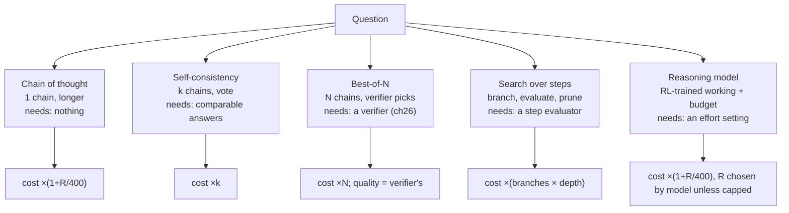
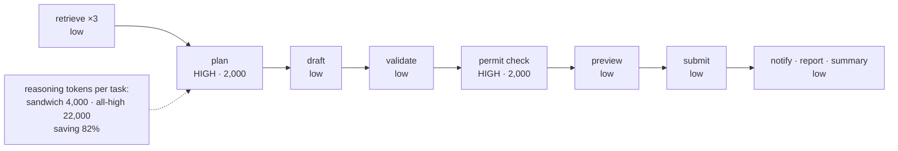

# Chapter 09 — Reasoning and test-time compute

*Part I · Word budget 5,000–8,000 · Lab 09 · Verified as of September 2026 · Derived figures from `labs/ch09-reasoning/derive.py`*

## 09.1 Intuition

Ask a model whether the seal replacement on P-101 needs a hot-work permit and it answers in one token: yes or no. Ask it to work out the answer — what fluid the pump handled, what the procedure's hazard class is, what the site's permit rule says about that class — and it produces a hundred tokens of working before the same one-token answer, and it is right more often. Nothing about the model changed. It spent more computation on the question, in the only currency a language model has: tokens generated.

That is test-time compute, and the discovery that it can be spent deliberately — that a model can be trained to think longer on hard problems and stop early on easy ones, and that thinking longer buys accuracy the way training longer does — is the reason a new class of models exists. It is also a bill. Every token of working is an output token, priced at the output rate, and it is invisible in the answer; the provider reports it in the usage line and nowhere else. The maintenance agent that reasons for two thousand tokens on every query costs six times what it costs when it does not, and takes six times as long.

The plant's job is not to choose reasoning or not. It is to spend it where it pays: on the plan and the check, where a wrong step is expensive, and not on the extraction and the formatting, where a small model without reasoning is right nearly every time. This chapter gives the mechanisms — chain of thought, sampling many answers and voting, searching over steps, and the reinforcement learning that made models do this on their own — with the arithmetic that says what each costs and what each buys, and with the evidence for where reasoning fails: on tasks with no checkable answer, and on tasks so complex that the working collapses.

## 09.2 Mechanism

### Chain of thought

A model prompted with examples of step-by-step working produces step-by-step working, and its accuracy on multi-step problems rises with it; Wei and colleagues showed the effect emerges with scale and is large on arithmetic and symbolic reasoning (Wei et al., "Chain-of-Thought Prompting," 2022, primary). Kojima and colleagues showed that a single phrase — "let's think step by step" — elicits it without examples (Kojima et al., 2022, primary). The mechanism is the transformer's: each generated token is another position the model can attend to, so the working becomes a scratchpad the model reads back; a problem that needs more steps than one forward pass can hold becomes tractable when the steps are written down.

Two limits the plant should know. The working is not always the reason: Turpin and colleagues showed that a model's stated chain of thought can omit the factor that actually drove its answer, so the text is evidence of a process, not a faithful transcript of one (Turpin et al., "Language Models Don't Always Say What They Think," 2023, primary). And the working is billed: a hundred tokens of it on a one-token answer is a hundredfold output cost.


### Why more tokens help: the computational view

A transformer does a fixed amount of computation per token — the same number of layers, the same matrices (ch03). A problem that needs more sequential steps than that fixed depth can carry cannot be solved in one forward pass, however large the model. Writing the working down is how the model borrows depth: each generated token is another pass through the whole stack, with the earlier working in the context to attend to. Theoretical results make this precise — transformers with a chain of thought can compute functions that the same transformer cannot compute in a single pass, and the length of the chain is the extra depth (Merrill and Sabharwal, "The Expressive Power of Transformers with Chain of Thought," 2024, primary). The practical corollary is that reasoning is not a property of a model tier but of a computation: a hard step is one that needs more passes than the model can spend in one, and the effort setting is how many passes to allow.

### Sequential versus parallel spending

Test-time compute can be spent in two directions and they buy different things. **Sequential** spending — one longer chain, revisions, backtracking — buys depth: the model can carry a longer argument and correct itself. It costs latency in proportion, because every token waits for the last. **Parallel** spending — many samples, a vote or a verifier — buys coverage: the chance that at least one attempt is right. It costs tokens in proportion and latency not at all, because the samples run at once. Snell et al.'s allocation result is the rule for choosing: when the model is usually close (an easy prompt), one longer chain wins; when it is usually far (a hard prompt), breadth wins (Snell et al. 2024, primary). For an interactive step, latency is the constraint and parallel spending is the only kind available; for a batch step overnight, sequential depth is free.

### Prompting for reasoning without a reasoning model

The non-reasoning models the router sends routine steps to can still be asked to work step by step, and for the two high-effort steps a plant may prefer that to a reasoning model for one reason: control. A chain of thought elicited by the guide has a length the guide sets — "answer in at most five numbered steps" — and a structure the sensors can parse; a reasoning model's working has neither. The trade is accuracy: on the hard end of the range, the RL-trained working outperforms the prompted one, which is what the training bought. The plant measures both on the step class (09.4) and keeps the one that passes the sensor more often per token.

### Sampling and voting

If one chain of thought is right 60% of the time, several are more useful than one. Self-consistency samples $k$ chains and takes the majority answer; on GSM8K it raised a 540B model's accuracy by about 18 points (Wang et al., "Self-Consistency Improves Chain of Thought Reasoning," 2022, primary). The arithmetic is binomial: at per-sample accuracy 0.6, a majority of 5 is right 68% of the time, of 11 75%, of 21 83%; at 0.7, 84%, 92%, 97% (derive.py, derived). The gain is real and it costs $k$ times the tokens, and it works only where answers can be compared — a number, a label, a yes or no — not where every sample is a different paragraph.

### Best-of-N and verifiers

Instead of voting, generate $N$ candidates and pick the one a verifier accepts. Coverage — the probability that at least one of $N$ samples is correct — rises fast: at per-sample accuracy 0.3, four samples cover 76% and sixteen cover 99.7% (derive.py, derived; Brown et al., "Large Language Monkeys," 2024, primary, measured this scaling across tasks). The catch is the verifier. With a perfect one, best-of-16 at 0.3 per-sample accuracy yields 99.5%; with a verifier that accepts a wrong answer one time in five, 66%; one time in two, 44% (derive.py, derived). Best-of-N is exactly as good as its verifier, which is why the sensors of ch26 are the plant's verifiers and a grader alone is not one. Lightman and colleagues showed that a reward model trained to judge each step of the working, rather than only the final answer, is a better verifier for reasoning — process supervision over outcome supervision (Lightman et al., "Let's Verify Step by Step," 2023, primary).

### Search over steps

Tree of Thoughts treats the working as a tree: at each step, propose several continuations, evaluate them, and expand the promising ones (Yao et al., "Tree of Thoughts," 2023, primary). It is best-of-N applied per step with pruning, and it costs accordingly. Snell and colleagues measured how to allocate a fixed test-time budget between sampling in parallel and revising sequentially, and found the best allocation depends on the difficulty of the prompt — easy prompts favour one longer chain, hard ones favour breadth — and that a compute-optimal allocation can match a model fourteen times larger on some tasks (Snell et al., "Scaling LLM Test-Time Compute Optimally," 2024, primary). The plant's version of that finding is the router (ch23): effort is a per-step decision, not a per-model one.

### Reasoning models

The methods above are things a harness does around a model. Reasoning models internalize them. Trained with reinforcement learning against verifiable rewards (ch08) — a correct answer, a passing test — the model learns to produce long working on hard problems, to check itself, to backtrack, and to stop when the problem is easy; DeepSeek-R1 showed the behaviours emerging from RL alone, with a distilled family of smaller reasoning models following (DeepSeek-AI, "DeepSeek-R1," Nature 2025, primary). OpenAI's o-series, Anthropic's extended thinking, and Google's thinking modes are the commercial forms; all bill the hidden working as output tokens, and all expose an effort or budget control (vendor documentation, verified Sep 2026).

Three properties follow from the training. The gains are largest where the reward was checkable — mathematics, code, structured problems — and smallest where it was not. The working is long and its length is the model's own decision unless capped, so a budget is a harness setting, not a suggestion. And the failure mode is specific: Shojaee and colleagues found that on puzzles of controlled complexity, reasoning models' accuracy collapses past a complexity threshold while their token use *falls* — the model gives up rather than works harder — and that below the threshold, non-reasoning models often match them at a fraction of the tokens (Shojaee et al., "The Illusion of Thinking," Apple, 2025, primary). Reasoning is a tool with a working range, not a general upgrade.

**Figure 09.1 — Ways to spend test-time compute, and what each needs.**



*Takeaway: every method is tokens; the ones that use a verifier are only as good as the verifier.*


### Reasoning and tool calls

The agent's working is not only text. A step that reasons about the permit rule can call a tool mid-working — fetch the fluid history, look up the site rule — and continue with the result in its context; the reasoning models expose this as tool use inside the thinking (vendor documentation, verified Sep 2026), and the ReAct pattern (ch22) is its harness-level form. Two consequences. A tool result inside the working is untrusted content inside the model's reasoning, and the policy engine (ch28) governs the call exactly as it governs any other; the working does not get a wider scope because it is thinking. And a tool call is the one part of the working that is verifiable — the call and its result are logged (ch29) — so a chain that reaches its answer through a tool has left evidence a chain of prose has not.

### Reasoning for verification, not only for answering

The largest return on reasoning in a harness is often at Verify, not at Act. A grader model (ch27) asked to judge a work order against a rubric benefits from working through each criterion, and the working is short and structured — one line per criterion — so it costs little and parses cleanly. The process-supervision result (Lightman et al. 2023, primary) is the same finding from the training side: a step-by-step judgment is a better verifier than a holistic one. For the plant this means the high-effort budget on the verification step is spent on a checklist, not an essay, and the checklist is the rubric the humans use, so the two can be compared (ch26).

### Distilled reasoning and the small model

The reasoning behaviour trained into a large model transfers to a small one by distillation (ch08): the large model's working and answers become the small model's training data, and the small model learns to produce working of its own. DeepSeek-R1's distilled family showed the pattern at several sizes (DeepSeek-AI 2025, primary), and the vendors' "mini" reasoning tiers are its commercial form. For the plant's on-site model this is the path to a medium-effort tier that runs inside the perimeter: a distilled reasoning model of modest size, measured on the step classes where medium effort moved the golden set, with the same budget cap as any other.

### Where the tokens go

A reasoning token is an output token. At the frontier output price of ch37 — $10 per million — a query with 400 visible output tokens costs $0.004 in output; with 2,000 reasoning tokens added, $0.024, six times as much; with 8,000, $0.084, twenty-one times (derive.py, derived; price vendor, Sep 2026). Latency scales the same way at decode speed: 8 seconds becomes 48 becomes 168 at 50 tokens per second (illustrative rate, ch04). The scenario's monthly output bill is $360 with reasoning on 10% of queries and $1,440 with reasoning on all of them (derive.py). None of this appears in the answer; the gateway's usage record (ch23) is where the plant sees it.

### The reasoning sandwich

The eleven-step P-101 task (ch22) has two steps where a wrong decision is expensive — the plan and the permit-type check — and nine where a small model without reasoning is right nearly every time: retrieval calls, field extraction, schema validation, formatting, notification. Reasoning at 2,000 tokens on the two costs 4,000 tokens per task; on all eleven, 22,000 — an 82% saving from placing effort rather than applying it everywhere (derive.py, derived). The router (ch23) implements the placement by step class; the observability records (ch29) show reasoning tokens per step, so a step that reasons and never needed to is visible.

### Reference implementation

The vote, coverage, and imperfect-verifier arithmetic, plus a per-step effort allocator. Lab 09 runs them against simulated per-sample accuracies and reproduces 09.3.

```python
from math import comb

def majority_vote_accuracy(p: float, k: int) -> float:
    """P(majority of k independent samples is correct) at per-sample accuracy p (k odd)."""
    return sum(comb(k, i) * p**i * (1 - p)**(k - i) for i in range(k // 2 + 1, k + 1))

def coverage(p: float, n: int) -> float:
    """P(at least one of n samples is correct)."""
    return 1 - (1 - p) ** n

def best_of_n(p: float, n: int, verifier_tpr: float, verifier_fpr: float) -> float:
    """P(chosen answer is correct) when a verifier accepts correct samples with prob tpr and wrong ones with prob fpr;
    the first accepted sample is returned; if none is accepted, one is picked at random."""
    acc_c, acc_w = p * verifier_tpr, (1 - p) * verifier_fpr
    acc = acc_c + acc_w
    if acc == 0:
        return p
    p_none = (1 - acc) ** n
    return (1 - p_none) * (acc_c / acc) + p_none * p

EFFORT = {"low": 0, "medium": 500, "high": 2000}          # reasoning tokens per step (illustrative budgets)

def allocate_effort(steps: list) -> dict:
    """steps: list of (name, step_class). Plan and verify get high effort; routine steps low; hard steps medium."""
    plan = {}
    for name, cls in steps:
        plan[name] = "high" if cls in ("plan", "verify") else "medium" if cls == "hard" else "low"
    tokens = sum(EFFORT[e] for e in plan.values())
    return {"plan": plan, "reasoning_tokens": tokens, "all_high_tokens": len(steps) * EFFORT["high"]}
```

### Reasoning in the harness

Four rules. **Budget per step class**, set in the router and enforced by the gateway; the model's own stopping is not trusted with the bill. **Verify outside the model**: a reasoning model's self-check is part of its working, not a sensor; the sensors of ch26 run after it regardless. **Do not read the working as the reason**: the trace is logged (ch29) for review, and a reviewer who finds the stated reasoning persuasive has learned that the model can write persuasively. **Prefer a checkable decomposition**: a task broken into steps with deterministic checks turns test-time compute into best-of-N with a real verifier, which is the configuration in which it pays most.

**Figure 09.2 — Where effort goes in the P-101 task.**



*Takeaway: two of eleven steps carry the risk; they get the effort.*

### Cookbook evidence: effort as a dial

The vendor's notebook treats `effort` as the first lever to touch before changing the model: it scales the thinking and tool-use tokens the model spends without changing which model runs (Anthropic, Claude Cookbook, August 2026, vendor). On its ten-claim eval, lowering the frontier tier's effort from high to low cut cost per task from $0.150 to $0.121 at 10/10 both times; the mid tier held 10/10 at medium and slipped at low. The notebook's sequence — lower effort first, then drop a tier and re-sweep effort, one notch at a time against the eval — is the effort-measurement protocol of 09.8 stated by the vendor, and its `max_tokens` guidance is this chapter's: a hard ceiling the model never sees, set as a backstop for runaways, not as a tuning knob; a stop-sequence sentinel for early exits cut a failed-input case's cost by 56%.

## 09.3 Worked numbers

All figures from `derive.py` (derived).

**Cost and latency per query by reasoning length** (frontier output $10/M; 400 visible tokens; decode 50 tokens/s illustrative).

| Reasoning tokens | Output cost per query | Multiplier | Latency |
|---|---|---|---|
| 0 | $0.004 | 1× | 8 s |
| 500 | $0.009 | 2.2× | 18 s |
| 2,000 | $0.024 | 6× | 48 s |
| 8,000 | $0.084 | 21× | 168 s |

**Self-consistency.**

| Per-sample accuracy | k = 1 | k = 5 | k = 11 | k = 21 |
|---|---|---|---|---|
| 0.6 | 0.60 | 0.68 | 0.75 | 0.83 |
| 0.7 | 0.70 | 0.84 | 0.92 | 0.97 |

**Coverage.** At 0.3 per-sample accuracy: 1 sample 30%, 4 samples 76%, 16 samples 99.7%. At 0.6: 4 samples 97%.

**Best-of-16 at 0.3 with a verifier of 90% true-positive rate.** False-positive rate 0: 99.5%. 0.2: 65.8%. 0.5: 43.5%. A verifier that accepts wrong answers half the time makes sixteen samples worth barely more than one.

**The sandwich.** 4,000 reasoning tokens per task against 22,000; 82% saving. Monthly, the scenario's output line is $360 with 10% escalation and $1,440 with reasoning everywhere.

## 09.4 Measurement

**Accuracy versus reasoning budget per step class.** On the golden set, run each step class at low, medium, and high effort; report pass rate with Wilson intervals and reasoning tokens per step. The step classes where high effort moves the pass rate outside the interval of low effort are the ones that get it. Lab 09 provides the analysis; the run needs a model and is gated.

**Reasoning tokens per step in production**, from the gateway; p50 and p95 per step class; a routine class with a rising p95 is a budget that has slipped.

**Cost per correct answer.** For each method on a step class: tokens per attempt × attempts, divided by pass rate — the metric that compares one long chain against five short ones against best-of-four with a sensor. Report it beside pass rate; a method with a higher pass rate and a higher cost per correct answer has not won.

**Collapse check.** For the plant's hardest task class, accuracy and reasoning tokens as complexity rises (more steps, more constraints); a fall in both together is the threshold Shojaee et al. describe, and the task belongs to a human or a decomposition past it.

**Verifier quality for any best-of-N.** True-positive and false-positive rates of the verifier on the golden set; the best-of-N gain is computed from them, not assumed.

**Faithfulness spot-check.** For a sample of reviewed traces, whether the stated reasoning cites the factor a sensor found decisive; a low rate is a reason to trust sensors and not prose.

What to record: model and version, effort setting per step class, reasoning tokens per step, verifier rates, golden-set version, date.


### Reference output (Lab 09, this run)

What the lab prints when it reproduces; the plant's numbers replace these.

```text
majority p=0.6 k= 5: formula 0.683  simulated 0.687  chapter 0.683  OK
majority p=0.6 k=21: formula 0.826  simulated 0.824  chapter 0.826  OK
majority p=0.7 k=11: formula 0.922  simulated 0.920  chapter 0.922  OK
coverage p=0.3 n= 4: formula 0.760  simulated 0.757  OK
coverage p=0.3 n=16: formula 0.997  simulated 0.997  OK
best-of-16 p=0.3 tpr=0.9 fpr=0.0: formula 0.995  simulated 0.994  chapter 0.995  OK
best-of-16 p=0.3 tpr=0.9 fpr=0.2: formula 0.658  simulated 0.656  chapter 0.658  OK
best-of-16 p=0.3 tpr=0.9 fpr=0.5: formula 0.435  simulated 0.438  chapter 0.435  OK
sandwich: 4000 reasoning tokens vs all-high 22000 (saving 82%) OK
cost multiplier at 2000 reasoning tokens: 6.0× (chapter 6.0) OK
cost multiplier at 8000 reasoning tokens: 21.0× (chapter 21.0) OK
Lab 09: REPRODUCED
```

## 09.5 Failure

| Failure mode | Mechanism | Detection signal | Mitigation | Owning component |
|---|---|---|---|---|
| Reasoning everywhere | High effort on routine steps | Output line dominated by reasoning tokens; latency up | Effort per step class; sandwich | ch23; this chapter |
| Uncapped working | Model decides its own length | p95 reasoning tokens far above p50; runaway tasks | Budget at the gateway; cap per step | ch21; ch23 |
| Working read as reason | Reviewer persuaded by the trace | Approvals citing the model's argument, not a sensor | Sensors decide; trace logged for pattern review only | ch26; ch31 |
| Self-check as verification | Model's own check treated as a sensor | Escapes on tasks the model "verified" | Deterministic sensors after every step | ch26 |
| Voting on incomparable answers | Self-consistency on free-text outputs | No majority; arbitrary pick | Vote only on structured answers; grader for text | This chapter; ch27 |
| Best-of-N with a weak verifier | Verifier accepts wrong candidates | Gain far below coverage | Measure verifier rates; use deterministic checks | ch26 |
| Complexity collapse | Task past the model's working range | Accuracy and tokens fall together | Decompose or route to a human | ch22; ch31 |
| Reasoning bill invisible | Hidden tokens not attributed | Output line unexplained | Reasoning tokens as a span attribute | ch29 |
| Reasoning model for a latency-bound step | Interactive step waits on working | Time-to-answer past the user's tolerance | Low effort or a non-reasoning model for interactive steps | ch23 |
| Effort set once | Budgets never revisited as models change | Newer models reason cheaper; budgets stale | Quarterly re-measurement per step class | ch23 |
| Tool call inside working unguarded | Reasoning granted wider scope because it is 'thinking' | Policy decisions missing for calls made mid-working | Every call through the policy engine regardless of origin | ch28 |
| Verification as an essay | Grader reasons at length without structure | Long, unparseable judgments; κ falls | One line per criterion; rubric-structured working | ch27 |
| Sequential spend on an interactive step | Long chain where the user waits | Time-to-answer past tolerance | Parallel spend or low effort for interactive steps | ch23 |

## 09.6 The frontier

**Strongest free treatments.** Wei et al. (2022) and Kojima et al. (2022) establish chain of thought; Wang et al. (2022) self-consistency; Yao et al. (2023) tree search; Lightman et al. (2023) process supervision; Brown et al. (2024) coverage scaling; Snell et al. (2024) compute-optimal allocation; DeepSeek-AI (2025) RL-trained reasoning; Shojaee et al. (2025) the collapse; Turpin et al. (2023) unfaithfulness. Each stops at its benchmark. Vendor documentation on effort controls stops at the parameter. Huyen's *AI Engineering* (2025) treats prompting techniques including chain of thought and stops before the cost arithmetic and the per-step allocation.

**What this chapter adds.** The methods placed by what each needs and what each costs, with the verifier as the deciding factor; the binomial and coverage arithmetic the reader can recompute; the imperfect-verifier result that makes best-of-N a sensor question; reasoning tokens priced and timed for a real workload; the sandwich as an allocation with an 82% saving; the collapse and unfaithfulness results as the working range; and a runnable allocator. Open: the accuracy–effort curve per step class on an industrial workload is unmeasured; the protocol in 09.4 is the measurement.

**Related chapters.** ch15 (Economics of models).

## 09.7 Industrial application

**The permit-type check.** Step seven asks whether the seal replacement on P-101 needs a hot-work permit. A small model at low effort answers from the procedure's hazard class and is right nearly every time when the class is stated; when it is not — the procedure predates the classification — the question needs the fluid history, the site rule, and a judgment, and that is the step routed to the frontier model at high effort, with 2,000 tokens of working the plant pays $0.02 for (derive.py). The sensor that follows (ch26) checks the answer against the rule regardless of how it was reached.

**The plan.** Step four, the plan, is the other high-effort step: the model that decides the eleven steps and their order is the model the task's reliability compounds on (ch16's per-step arithmetic). Two thousand tokens here are cheap insurance against a plan that skips validation.

**What the plant does not buy.** A reasoning model on the notification and report steps; self-consistency on drafted work orders (incomparable texts); best-of-N on any step whose verifier is a grader alone; and a reasoning model for the technician's interactive question, where 48 seconds is a failed interaction.

**The trace.** Every reasoning trace is logged (ch29) and none is shown to the technician as the reason; the report shows the sensors' verdicts. A supervisor who wants to see the working can, and the chapter's caution travels with it: the working is what the model wrote, not necessarily why it answered.

**OT boundary.** A reasoning model that can argue for a control action more persuasively is not a model that gets one; the absence of any such tool is unchanged (ch35).

## 09.8 Decision aids

**Effort by step class (starting values; measure per class).**

| Step class | Effort | Reasoning tokens | Model tier |
|---|---|---|---|
| Retrieval, extraction, formatting, notification | Low | 0 | Small |
| Draft from retrieved context | Low | 0 | Small or frontier |
| Plan | High | up to 2,000 | Frontier |
| Verification judgments without a deterministic sensor | High | up to 2,000 | Frontier, cross-family from any grader |
| Interactive answer to a user | Low | 0 | Small; escalate on request |
| Overnight batch (re-evaluation, reports) | Medium–high | up to 2,000 | Frontier or distilled on-site reasoning model |

**Method selection.** Interactive step → low effort, or parallel samples if accuracy requires it; never a long sequential chain. Structured, comparable answer → self-consistency where the budget allows. Deterministic verifier exists → best-of-N with that verifier. Multi-step with checks → decomposition (ch22) — it is best-of-N per step. No verifier and free text → one chain, a grader, and a human on the gate.

**Budget rule.** Reasoning tokens per step class capped at the gateway; p95 reviewed monthly; cap raised only on golden-set evidence that accuracy moves, and lowered when a newer model reaches the same pass rate with fewer.

**Effort-measurement protocol (Lab 09b, needs a model).** For each step class in the golden set: run at low, medium, and high effort, three samples per item; record pass rate with Wilson intervals and reasoning tokens p50/p95; the class adopts the lowest effort whose interval overlaps the highest's; re-run quarterly and on any model change. Cost gate: items × classes × 3 effort levels × 3 samples × mean tokens × price, printed before the run.

**Reasoning-trace review rule.** Traces are reviewed for patterns (which steps reason long, which fail) in the weekly steering review (ch29); no approval decision cites a trace as its evidence; the sensor verdicts are the evidence.

**Vendor questions.** How reasoning tokens are reported and billed; whether effort is controllable per request; whether the working can be retrieved for audit; published accuracy versus token curves for the model's tiers.

## 09.9 Sources

| # | Claim or figure | Source | Tier | Verified | Link |
|---|---|---|---|---|---|
| 1 | Chain-of-thought prompting | Wei et al., 2022, arXiv 2201.11903 | primary | Sep 2026 | https://arxiv.org/abs/2201.11903 |
| 2 | Zero-shot chain of thought | Kojima et al., 2022, arXiv 2205.11916 | primary | Sep 2026 | https://arxiv.org/abs/2205.11916 |
| 3 | Self-consistency; ~+18 points on GSM8K (PaLM 540B) | Wang et al., 2022, arXiv 2203.11171 | primary | Sep 2026 | https://arxiv.org/abs/2203.11171 |
| 4 | Coverage scaling with samples | Brown et al., "Large Language Monkeys," 2024, arXiv 2407.21787 | primary | Sep 2026 | https://arxiv.org/abs/2407.21787 |
| 5 | Process supervision beats outcome supervision | Lightman et al., 2023, arXiv 2305.20050 | primary | Sep 2026 | https://arxiv.org/abs/2305.20050 |
| 6 | Tree of Thoughts | Yao et al., 2023, arXiv 2305.10601 | primary | Sep 2026 | https://arxiv.org/abs/2305.10601 |
| 7 | Compute-optimal test-time scaling; can match a 14× larger model | Snell et al., 2024, arXiv 2408.03314 | primary | Sep 2026 | https://arxiv.org/abs/2408.03314 |
| 8 | RL-trained reasoning; distilled variants | DeepSeek-AI, "DeepSeek-R1," Nature 2025 | primary | Sep 2026 | https://api-docs.deepseek.com/quick_start/pricing |
| 9 | Complexity collapse; token use falls past threshold | Shojaee et al., Apple, 2025 | primary | Sep 2026 | https://machinelearning.apple.com/research/illusion-of-thinking |
| 10 | Unfaithful chain of thought | Turpin et al., 2023, arXiv 2305.04388 | primary | Sep 2026 | https://arxiv.org/abs/2305.04388 |
| 10a | Chain of thought extends expressive power with sequence length | Merrill & Sabharwal, ICLR 2024, arXiv 2310.07923 | primary | Sep 2026 | https://arxiv.org/abs/2310.07923 |
| 11 | Reasoning tokens billed as output; effort controls | OpenAI, Anthropic, Google documentation | vendor | Sep 2026 | https://openai.com/index/ |
| 12 | Costs, latencies, majority and coverage tables, imperfect-verifier results, sandwich saving | `labs/ch09-reasoning/derive.py` | derived | Sep 2026 | labs/ch09-reasoning/derive.py |
| 13 | 50 tokens/s; 2,000-token budgets; per-sample accuracies | Illustrative | illustrative | Sep 2026 | — |
| 14 | Accuracy–effort curve per step class on industrial tasks | None published | open | Sep 2026 | — |
| C | Cost-optimization checklist measured on a claims agent: 10-claim eval, 2 trials per configuration | Anthropic, "Cost Optimization on the Claude API," Claude Cookbook, Aug 2026 (Lehrburger) | vendor | Sep 2026 | https://platform.claude.com/cookbook/cost-optimization-cost-optimization |