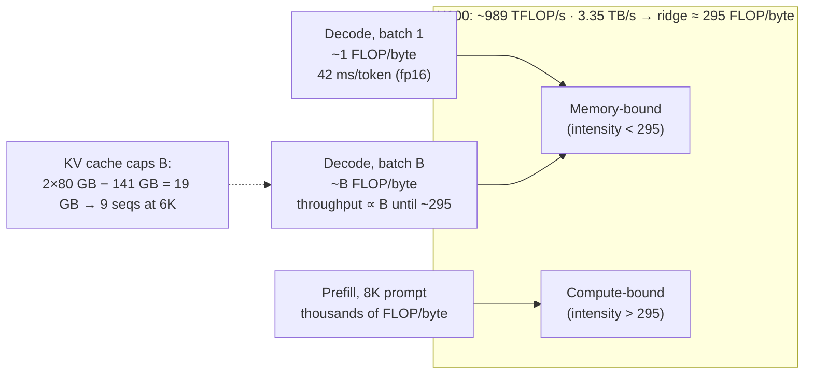
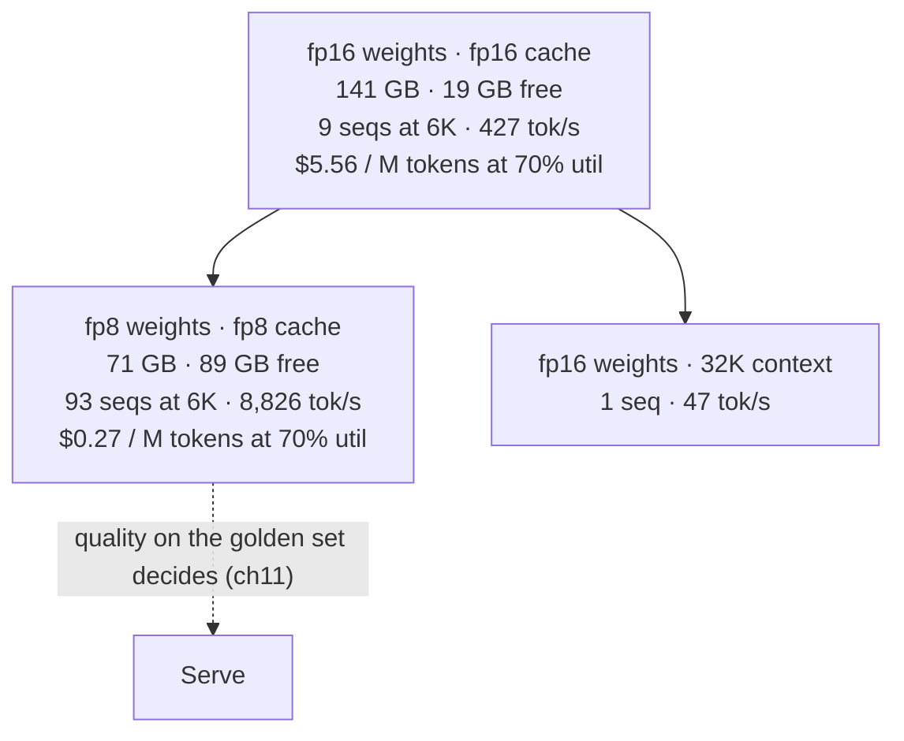

# Chapter 10 — Inference engineering

*Part I · Word budget 5,000–9,000 · Lab 10 · Verified as of September 2026 · Derived figures from `labs/ch10-inference/derive.py`*

## 10.1 Intuition

A trained model is a file. Inference is the engineering of turning that file into answers at a speed, a concurrency, and a cost the plant can live with — and it is where the numbers from the earlier chapters become a hardware bill. The parameter count (ch03) is bytes to read; the KV cache (ch04) is bytes to hold; the token price (ch37) is those bytes divided by how many sequences share the reading.

The central fact is one most people find backwards. Generating a token does almost no arithmetic relative to what a GPU can do; it spends its time reading the model's weights from memory. A 70-billion-parameter model in 16-bit is 141 gigabytes, and an H100 can read about 3.35 terabytes a second, so one token takes about 42 milliseconds just to read the weights — 24 tokens a second, however fast the arithmetic (derive.py, derived; NVIDIA H100 datasheet, vendor). The GPU's compute units are idle for almost all of it. The only way to use them is to serve many sequences at once, reading the weights one time for all of them, and the only limit on how many is memory for their caches.

Every serving technique is a response to that fact. Batching amortizes the read. Quantization shrinks what is read. Paged caches fit more sequences into the memory that remains. Speculative decoding gets several tokens from one read. Prefix caching skips reading for the part of the prompt that repeats. This chapter gives each with its arithmetic, then does the plant's sizing: the two-GPU fallback, what it can serve, at what latency, for what cost per token — including the number that surprises: at the scenario's context length, that fallback is capped not by compute, not by bandwidth, but by cache memory at nine concurrent sequences, and the fix is precision, not more GPUs.

## 10.2 Mechanism

### The roofline

A GPU has two ceilings: how many floating-point operations it can do per second, and how many bytes it can move from memory per second. Which one binds depends on the work's *arithmetic intensity* — operations per byte moved. Below the ratio of the two ceilings, the work is memory-bound; above it, compute-bound (Williams, Waterman, and Patterson, "Roofline," 2009, primary). For an H100 SXM at about 989 TFLOP/s dense 16-bit and 3.35 TB/s, the ridge is about 295 operations per byte (derive.py, derived; datasheet, vendor).

Decode at batch one has an intensity of about one operation per byte: two operations per parameter per token (ch03), two bytes per parameter. It sits three hundred times below the ridge. Prefill of a long prompt does the same operations per token for thousands of tokens against one read of the weights, and sits above the ridge. The two phases of one request live on opposite sides of the roofline, which is why they are engineered separately (Pope et al., "Efficiently Scaling Transformer Inference," 2022, primary).

### Batching

Serving $B$ sequences at once reads the weights once for $B$ tokens, so intensity rises with $B$ and decode throughput rises almost linearly until the batch reaches the ridge — about 295 sequences for the 70B model at 16-bit (derive.py, derived). Beyond that the GPU is compute-bound and throughput flattens. Two practical limits arrive first. Per-sequence latency: at batch $B$ each token still waits for the whole batch's read, so latency per token is the same as at batch one — batching raises throughput, not speed. And memory: each sequence needs its KV cache, and the cache, not the ridge, is where the plant's batch stops.

**Continuous batching** removes a second inefficiency. Static batching waits for the slowest sequence in a batch before admitting new ones; continuous batching admits and retires sequences at every decode step, so the batch stays full (Yu et al., "Orca," OSDI 2022, primary). Every production serving stack does this.

### The cache and PagedAttention

The KV cache per sequence is tokens × bytes per token (ch04): 320 KB per token for the 70B model at 16-bit, 1.9 GB at the scenario's 6,000 tokens. Two 80 GB GPUs hold 141 GB of weights and leave about 19 GB — nine sequences at that context, one at 32K (derive.py, derived). That is the binding constraint on the plant's fallback and it is worth stating plainly: the hardware is throughput-limited by cache memory at a batch of nine, not by anything the compute units are doing.

Before PagedAttention, serving stacks reserved each sequence's cache as one contiguous block sized for the maximum possible length, and the reservation was mostly unused; Kwon and colleagues measured 20.4–38.2% utilization of allocated cache memory in prior systems. PagedAttention allocates the cache in fixed blocks — 16 tokens each in vLLM — on demand, like virtual memory pages, wasting at most a partial block per sequence, and reached 2–4× the throughput of the prior systems at equal latency (Kwon et al., SOSP 2023, primary). The technique is universal now; its arithmetic is why the nine-sequence figure above is achievable rather than three.


### Latency, throughput, and the queue

Three quantities describe a serving system and they trade against each other. **Latency** is what one request sees: time-to-first-token plus tokens per second. **Throughput** is what the system delivers: tokens per second across all requests. **Utilization** is what the accountant sees: the fraction of the hour the GPUs were busy. Batching raises throughput and utilization and leaves per-token latency unchanged — until the batch is so large that compute binds, after which per-token latency rises too. Queueing sits in front of all three: a request that arrives when the cache is full waits, and the wait is latency the roofline does not show. A system sized for the peak wastes utilization at the trough; one sized for the mean queues at the peak. The scenario's 2,000 queries a day arrive unevenly — shift changes, morning planning — and the fallback's nine-sequence cap means the morning peak queues while the night idles (traffic shape illustrative). The API absorbs peaks; the fallback absorbs residency-constrained and outage traffic; the hybrid posture of ch37 is this trade written as policy.

### Structured output and its cost

Constrained decoding (ch26) — forcing output to a JSON schema — is implemented in the serving stack by masking, at every decode step, the tokens the grammar forbids. The mask is computed from the grammar's state, and a naive implementation recomputes it per token per sequence, which can dominate decode time for complex schemas; the stacks compile the grammar in advance and cache the masks, and SGLang's design was built around making this fast (Zheng et al. 2023, primary). The plant's work orders are constrained output, and the measurement is decode tokens per second with and without the schema: a large gap is a stack that has not compiled the grammar.

### Memory beyond the weights and the cache

The sizing arithmetic counts weights and cache; the stack needs more. Activations for the prefill of a long prompt, the draft model for speculative decoding, CUDA graphs and kernel workspaces, and the framework's own overhead take several gigabytes, and a stack configured to use all free memory for cache will fail on the first long prefill. The rule is a headroom of 10–20% of GPU memory reserved from the cache pool (illustrative; every stack exposes the setting), and the check is the after-prefill memory measurement of 10.4: a number within a gigabyte of the GPU's capacity is a deployment one long prompt from an out-of-memory error.

### Quantization

Reading fewer bytes per parameter is the direct lever on the decode floor. At 8-bit the 70B model is 71 GB and the floor halves to 21 milliseconds; the freed memory takes concurrency from nine sequences to far more; and quantizing the cache to 8-bit halves its bytes per token too. At 8-bit weights and 8-bit cache, the two-GPU fallback holds 93 sequences at the scenario's context, and the throughput and cost per token change by an order of magnitude (derive.py, derived; ch11 gives the methods and the quality measurement). Quantization is the most consequential serving decision the plant makes, and the golden set decides whether it is free.

### Speculative decoding

A small draft model proposes $k$ tokens; the large model checks them all in one forward pass — one read of the weights — and accepts the longest correct prefix, then samples one more. The output distribution is provably unchanged (Leviathan, Kalman, and Matias, 2023, primary; Chen et al., 2023, primary). The gain is the expected number of tokens per verification, $(1 - \alpha^{k+1})/(1 - \alpha)$ for acceptance rate $\alpha$: about 3.0 tokens per read at $\alpha = 0.8$ and $k = 3$, 4.7 at $\alpha = 0.9$ and $k = 5$ (derive.py, derived). Predictable text — formatted work orders, structured output — has high acceptance; free reasoning has less. The cost is the draft model's own decode and the memory it occupies.

### Prefix caching and the two-phase request

Prefill for a prompt the server has already seen is wasted work: the Keys and Values for an identical prefix are identical. Serving stacks cache them — vLLM's automatic prefix caching, SGLang's RadixAttention — keyed by the token prefix, so a request whose first 4,000 tokens match a recent one runs prefill only on the rest (Zheng et al., "SGLang," 2023, primary; vLLM documentation, vendor). It is the on-site form of the provider-side prompt caching of ch37, and it has the same rule: byte-identical prefix first (ch18).

Disaggregating the two phases is the next step at scale: prefill runs on one pool of GPUs tuned for compute, decode on another tuned for memory, with the cache handed between them; it removes the interference of long prefills stalling short decodes and is standard in large deployments (practitioner; vendor serving documentation). At two GPUs the plant does not disaggregate; it schedules — long prefills admitted between decode steps in chunks, so a 128K prompt does not freeze every other user's token stream.

### Parallelism across GPUs

A model larger than one GPU is split. *Tensor parallelism* splits each matrix across GPUs and combines partial results every layer, needing fast interconnect and giving lower latency (Shoeybi et al., "Megatron-LM," 2019, primary); *pipeline parallelism* puts different layers on different GPUs and passes activations, needing less bandwidth and adding latency. The plant's two-GPU fallback uses tensor parallelism over NVLink, which doubles the effective bandwidth for reading weights and halves the decode floor to 21 milliseconds (derive.py, derived).

**Figure 10.1 — The roofline, and where each phase sits.**



*Takeaway: decode is a memory problem, prefill a compute problem, and the cache decides how many sequences share the memory read.*

### Reference implementation

A serving model: decode floor, batch crossover, KV capacity, throughput, cost per token, and speculative-decoding gain, from a model's configuration and a GPU's two ceilings. Lab 10 runs it for the plant's fallback and reproduces 10.3, and simulates PagedAttention's effect on cache waste.

```python
def serving_model(params: float, bytes_per_param: float, kv_bytes_per_token: float, gpus: int,
                  gpu_mem_gb: float, bw_per_gpu: float, flops_per_gpu: float, ctx_tokens: int, usd_per_gpu_hour: float):
    """Bandwidth/compute/memory model of decode for a dense model served tensor-parallel across `gpus`."""
    weight_bytes = params * bytes_per_param
    bw = bw_per_gpu * gpus; flops = flops_per_gpu * gpus
    floor_s = weight_bytes / bw                                   # decode time per token at batch 1
    compute_s = 2 * params / flops                                # compute time per token
    crossover = max(1, round(floor_s / compute_s))                # batch where compute time = memory time
    free_bytes = gpus * gpu_mem_gb * 1e9 - weight_bytes
    max_seqs = max(0, int(free_bytes / (kv_bytes_per_token * ctx_tokens)))
    batch = min(max_seqs, crossover)
    tps = batch / floor_s if batch else 0.0
    return {"weights_GB": weight_bytes / 1e9, "decode_floor_ms": floor_s * 1e3, "batch_crossover": crossover,
            "free_GB": free_bytes / 1e9, "max_concurrent_seqs": max_seqs, "decode_tps_at_max_batch": tps,
            "usd_per_M_tokens": {u: (usd_per_gpu_hour * gpus) / (tps * u * 3600) * 1e6 if tps else float("inf") for u in (0.1, 0.4, 0.7)}}

def speculative_gain(alpha: float, k: int) -> float:
    """Expected tokens accepted per verification pass with draft length k and per-token acceptance alpha."""
    return (1 - alpha ** (k + 1)) / (1 - alpha)

def prefill_seconds(params: float, prompt_tokens: int, flops: float, utilization: float) -> float:
    return 2 * params * prompt_tokens / (flops * utilization)
```


### The API side of the same arithmetic

The providers the router calls run this chapter's mechanics at a scale the plant does not see, and their prices encode it. The 4–8× gap between input and output prices (ch37; vendor pricing, Sep 2026) is prefill's compute-bound efficiency against decode's memory-bound cost; the 90% cached-input discount is prefix caching's skipped prefill; batch APIs at half price are the provider filling idle capacity at the trough. A plant that understands its own two GPUs understands the invoice: a long output costs more than a long input because of the roofline, and the prefix discipline that fills the on-site prefix cache is the same discipline that earns the provider's discount.

### Small models change the arithmetic, not the rules

An 8B model at 16-bit is 16 GB of weights: one GPU holds it with 64 GB free — over a hundred sequences at the scenario's context at 128 KB per token (ch04) — and its decode floor on one H100 is under 5 ms per token, over 200 tokens per second at batch one (arithmetic from ch03 and ch04 figures, derived). The routine steps the router sends to a small model (ch23) are served from one GPU at a cost per token an order of magnitude below the 70B's, which is the serving side of the over-training economics of ch06. The same sizing worksheet applies; the numbers are just smaller.

### Serving stacks

Four stacks cover production use: vLLM (PagedAttention, continuous batching, prefix caching, quantized formats, speculative decoding, OpenAI-compatible API); SGLang (RadixAttention, structured-output speed); NVIDIA TensorRT-LLM (compiled kernels for NVIDIA hardware, highest throughput at the cost of build complexity); Hugging Face TGI (vendor documentation, verified Sep 2026). All expose the metrics this chapter measures. The plant's choice is a golden-set and an operations question — which stack holds quality at the chosen precision and which the team can run — and the roofline arithmetic is the same under all of them.

### The two numbers the user feels

Time-to-first-token is the prefill: for an 8K prompt on the 70B model, about 1.2 seconds at the full tensor rate and 2.9 at a realistic 40% utilization (derive.py, derived; utilization illustrative), plus queueing. Tokens per second after that is the decode floor divided by nothing the user can see — the batch is shared with everyone else. A technician's interactive question is served well by a short prompt (prefix cached) and a short answer; a long-context batch job should never share a decode step with it, which is the scheduling rule above.

**Figure 10.2 — The plant's fallback under three configurations.**



*Takeaway: the same two GPUs are twenty times cheaper per token at 8-bit — if the golden set says the model is still right.*

## 10.3 Worked numbers

Every throughput and cost-per-token figure in this chapter is modelled from published hardware specifications and the chapter's own arithmetic, not measured on a GPU; Lab 10b (needs a GPU) is the measurement, and the plant's numbers replace these (derive.py, derived; modelled, not measured).


All figures from `derive.py` (derived); hardware ceilings from the H100 SXM datasheet (vendor), model figures from ch03 and ch04, GPU price from ch37 (vendor).

**Decode floor, Llama 3 70B.**

| Configuration | Weight bytes | Effective bandwidth | Floor per token | Tokens/s at batch 1 |
|---|---|---|---|---|
| fp16, 1 GPU | 141 GB | 3.35 TB/s | 42.1 ms | 23.7 |
| fp16, 2 GPUs tensor-parallel | 141 GB | 6.70 TB/s | 21.1 ms | 47.5 |
| fp8, 1 GPU | 71 GB | 3.35 TB/s | 21.1 ms | 47.5 |

**Ridge and crossover.** 295 operations per byte; compute per token 0.14 ms; batch crossover 295 sequences. Memory, not compute, is the limit long before that.

**Cache capacity, 2 × 80 GB.** After 141 GB of weights, 19 GB free: 9 sequences at 6,000 tokens, 1 at 32K. At 8-bit weights and 8-bit cache: 89 GB free, 93 sequences at 6,000 tokens.

**Throughput and cost per token at the cache-capped batch, 70% utilization, $5.98 per hour for two GPUs.** fp16: 427 tokens/s, $5.56 per million tokens. fp8 throughout: 8,826 tokens/s, $0.27 per million. For comparison, the frontier API's fresh-input price in ch37 is $1.25 per million and its output price $10 (vendor). At 16-bit the on-site fallback is more expensive per token than the API's input line; at 8-bit it is cheaper than either — and it is a fallback, sized for residency and availability, not for cost (ch37).

**Utilization.** At the fp16 batch-32 bandwidth model — a batch the cache cannot actually hold at 6K, shown for the shape — cost per million tokens is $10.94 at 10% utilization, $2.74 at 40%, $1.56 at 70%. Utilization is the multiplier on every self-hosting figure.

**Speculative decoding.**

| Acceptance α | k = 3 | k = 5 |
|---|---|---|
| 0.6 | 2.18 | 2.38 |
| 0.8 | 2.95 | 3.69 |
| 0.9 | 3.44 | 4.69 |

Tokens per weight read; the speed-up is that figure divided by the overhead of the draft.

**Prefill.** 8K prompt: 1.17 s at the full 989 TFLOP/s, 2.92 s at 40% utilization.

## 10.4 Measurement

**The four numbers per configuration.** Time-to-first-token at the scenario's prompt size; decode tokens per second per sequence; aggregate tokens per second at the maximum batch the cache admits; GPU memory after load and after a full-batch prefill. Report each at 16-bit and at the candidate lower precision, with the stack and its version. Lab 10 gives the model; the measurement is on the plant's hardware.

**Compare to the floor.** Measured decode tokens per second at batch one against the bandwidth floor; the ratio is the stack's efficiency, and a ratio far below one is a configuration problem (wrong kernels, no tensor parallelism, cache misconfigured), not a hardware limit.

**Cache utilization.** From the stack's metrics: cache blocks allocated versus used; a low figure means the block size or the maximum-length setting is wasting the memory that sets the batch.

**Prefix-cache hit rate** per request class; the stable prefix should hit at nearly 100% for the agent's calls.

**Speculative acceptance rate** per output class if speculative decoding is enabled; low acceptance means the draft is costing more than it saves.

**Queue wait.** Time from request arrival to admission into a decode batch, p50 and p95, per queue; the interactive queue's p95 is the number the technician feels, and a rising one at a flat GPU utilization is a cache-capacity limit, not a compute limit.

**Structured-output overhead.** Decode tokens per second with and without the work-order schema; a gap above a few percent means the grammar is not compiled.

**Utilization over the day.** GPU busy time against wall time; it is the multiplier on cost per token (10.3) and the argument for or against self-hosting (ch37).

What to record: stack and version, precision of weights and cache, tensor-parallel degree, block size, maximum sequence length, batch, prompt size, hardware, date.


### Reference output (Lab 10, this run)

What the lab prints when it reproduces; the plant's numbers replace these.

```text
fp16 weights GB          chapter      141  model      141  OK
fp16 floor ms (2 GPU)    chapter     21.1  model     21.1  OK
crossover batch          chapter      295  model      295  OK
free GB                  chapter       19  model       19  OK
max seqs @6K fp16        chapter        9  model        9  OK
max seqs @32K fp16       chapter        1  model        1  OK
tps kv-capped fp16       chapter      427  model      427  OK
$/M @70% fp16            chapter     5.56  model     5.56  OK
max seqs @6K fp8 all     chapter       93  model       93  OK
tps fp8 all              chapter     8826  model     8826  OK
$/M @70% fp8 all         chapter     0.27  model     0.27  OK
spec a=0.8 k=3           chapter     2.95  model     2.95  OK
spec a=0.9 k=5           chapter     4.69  model     4.69  OK
prefill 8K @40%          chapter     2.92  model     2.92  OK
```

## 10.5 Failure

| Failure mode | Mechanism | Detection signal | Mitigation | Owning component |
|---|---|---|---|---|
| Compute sized, memory ignored | GPUs chosen by FLOPs; cache capacity forgotten | Concurrency far below plan; requests queue | Size from weights + cache; the roofline first | This chapter; ch03; ch04 |
| Batch-one benchmark | Vendor tokens/s quoted at batch 1 | Aggregate throughput a fraction of expected | Measure at the cache-capped batch | This chapter |
| Static batching | Batch waits for its slowest sequence | GPU idle between batches; latency spikes | Continuous batching; every stack supports it | This chapter |
| Long prefill stalls decode | A 128K prompt monopolizes a step | Token streams freeze for other users | Chunked prefill; separate queues; disaggregation at scale | ch21; this chapter |
| Cache fragmentation | Contiguous reservation at max length | Cache utilization 20–40% | Paged cache; correct max-length setting | This chapter |
| Precision changed unmeasured | 8-bit or 4-bit adopted on the vendor's word | Golden-set regressions | Golden set before and after; ch11 | ch11; ch12 |
| Speculative decoding on the wrong text | Draft acceptance low on free reasoning | Slower than plain decode | Enable per output class; measure acceptance | This chapter |
| Prefix not cached | Prefix changes byte-to-byte; stack cannot reuse | TTFT high on every call; hit rate low | Stable prefix first; hit-rate alarm | ch18; ch37 |
| Utilization illusion | Cost per token computed at 100% busy | Real cost several times plan | Measure utilization; cost at the measured figure | ch37 |
| Wrong parallelism | Pipeline parallel where latency matters | Decode floor doubled | Tensor parallel over fast interconnect for latency | This chapter |
| Kernel fallback | Fused attention unavailable at the chosen dtype or head size | Memory grows with context; throughput collapses | Assert kernels at startup; log them | ch04; ch29 |
| No headroom | Cache pool takes all free memory | Out-of-memory on the first long prefill | 10–20% reserved; after-prefill memory check | This chapter |
| Grammar recomputed per token | Structured output without a compiled grammar | Decode rate falls sharply with a schema | Compiled grammars; measure with and without | ch26; this chapter |
| Sized for the mean | Peak traffic queues at the cache cap | Morning latency spikes | Hybrid: API for peaks, fallback for residency | ch37 |

## 10.6 The frontier

**Strongest free treatments.** Pope et al. (2022) give the roofline analysis of transformer inference and the batching and parallelism trade-offs at Google scale; Kwon et al. (2023) PagedAttention and its measurements; Yu et al. (2022) continuous batching; Leviathan et al. and Chen et al. (2023) speculative decoding with its proof; Zheng et al. (2023) prefix caching; Shoeybi et al. (2019) tensor parallelism; Williams et al. (2009) the roofline itself. The vLLM, SGLang, and TensorRT-LLM documentation are complete on their stacks. Huyen's *AI Engineering* (2025) has an inference-optimization chapter covering these techniques for engineers and stops before sizing a specific deployment from a configuration file to a cost per token at a utilization.

**What this chapter adds.** One model that goes from parameters, precision, and cache per token to floor, crossover, capacity, throughput, and cost per token, run for the plant's actual fallback; the finding that the fallback is cache-capped at nine sequences and twenty times cheaper per token at 8-bit; the speculative-decoding gain as an arithmetic the reader can recompute; the scheduling rule for interactive against batch traffic; and a measurement protocol whose first check is the ratio of measured decode to the bandwidth floor. Open: measured stack efficiency ratios on current versions are not published in comparable form; Lab 10's protocol on the plant's hardware is the measurement.

**Related chapters.** ch15 (Economics of models).

## 10.7 Industrial application

**Sizing the fallback, done properly.** Two H100s. At 16-bit: nine concurrent sequences at the scenario's 6,000 tokens, 47 tokens per second each, 427 aggregate, $5.56 per million tokens at 70% utilization (derive.py, derived). Enough for 2,000 queries a day by a wide margin — the fallback idles most of the time, which is the utilization illusion in the other direction: its cost per token is high because it is rarely used, and that is acceptable because it exists for residency and availability, not for cost (ch37).

**The 8-bit question.** At 8-bit weights and cache the same hardware holds 93 sequences and serves at $0.27 per million tokens. The plant runs the golden set at 8-bit (ch11); if it holds, the fallback becomes a primary for routine steps inside the perimeter and the router (ch23) sends them there. The decision is one afternoon of measurement and it changes the cost anatomy.

**Scheduling for the technician.** Interactive questions run on a queue that admits no prompt over 8K; document batch jobs run on a separate queue with chunked prefill; the prefix cache holds the agent's 4,000-token prefix so a question's prefill is 2,000 tokens, under a second. Nothing in this is exotic; all of it is configuration in the serving stack, and all of it is on the day-one checklist of 10.8.

**What the plant asks a vendor.** Measured decode tokens per second at batch one against the bandwidth floor — the ratio, not the number; cache utilization; TTFT at the plant's prompt size; throughput at the cache-capped batch, not at a batch the memory cannot hold.

**OT boundary.** Serving runs inside the perimeter on the IT side; the model's outputs reach the CMMS and the technician, never a controller (ch35).

## 10.8 Decision aids

**Sizing worksheet.**

| Input | Value |
|---|---|
| Parameters; bytes per parameter (weights) | |
| KV bytes per token (ch04); bytes per cache value | |
| GPUs; memory each; bandwidth each; FLOP/s each; interconnect | |
| Context per sequence (scenario) | |
| Decode floor (ms/token) = weight bytes ÷ aggregate bandwidth | |
| Free memory = GPU memory − weights; max sequences = free ÷ (KV/token × context) | |
| Throughput at max batch = max sequences ÷ floor | |
| Cost per M tokens = GPU $/h ÷ (throughput × utilization × 3,600) × 10⁶ | |

**Precision rule.** Measure the golden set at 16-bit, 8-bit weights, and 8-bit weights plus 8-bit cache; adopt the lowest precision whose interval overlaps 16-bit's; record it with the stack version; re-measure on any stack or model change, because quantized kernels differ between versions.

**Capacity rule.** Concurrency is free memory divided by cache per sequence at the real context, never the crossover batch; if the number is under the peak concurrent demand, the fixes in order are: shorter context (retrieval, ch05), 8-bit cache, 8-bit weights, more GPUs.

**Queue rule.** Interactive: prompts ≤ 8K, prefix cached, decode priority, p95 wait under two seconds (illustrative target). Batch: chunked prefill, admitted between decode steps, no latency target. Never one queue; the interactive queue's wait is the alarm.

**Stack configuration checklist (fallback, day one).** Tensor-parallel over the two GPUs; continuous batching on; paged cache with block size per the stack's default; maximum sequence length set to the scenario's need, not the model's maximum; 10–20% memory headroom; prefix caching on; fused attention kernels asserted in the startup log; two queues (interactive, batch) with chunked prefill on the batch queue; metrics exported to the observability backend (ch29); precision per the golden-set result of ch11.

**Vendor-claim checks.** Tokens/s stated with batch, precision, and context; cache utilization stated; TTFT at a stated prompt size; the floor arithmetic reconciles.

## 10.9 Sources

| # | Claim or figure | Source | Tier | Verified | Link |
|---|---|---|---|---|---|
| 1 | Roofline model | Williams, Waterman, Patterson, CACM 2009 | primary | Sep 2026 | https://doi.org/10.1145/1498765.1498785 |
| 2 | Transformer inference roofline; batching; parallelism | Pope et al., 2022, arXiv 2211.05102 | primary | Sep 2026 | https://arxiv.org/abs/2211.05102 |
| 3 | PagedAttention; 20.4–38.2% prior utilization; 2–4× throughput; 16-token blocks | Kwon et al., SOSP 2023 | primary | Sep 2026 | https://arxiv.org/abs/2309.06180 |
| 4 | Continuous batching | Yu et al., "Orca," OSDI 2022 | primary | Sep 2026 | https://www.usenix.org/conference/osdi22/presentation/yu |
| 5 | Speculative decoding; distribution preserved | Leviathan, Kalman, Matias, ICML 2023, arXiv 2211.17192; Chen et al., 2023, arXiv 2302.01318 | primary | Sep 2026 | https://arxiv.org/abs/2211.17192 |
| 6 | Prefix caching / RadixAttention | Zheng et al., "SGLang," 2023, arXiv 2312.07104; vLLM docs | primary / vendor | Sep 2026 | https://arxiv.org/abs/2312.07104 |
| 7 | Tensor parallelism | Shoeybi et al., "Megatron-LM," 2019, arXiv 1909.08053 | primary | Sep 2026 | https://arxiv.org/abs/1909.08053 |
| 8 | H100 SXM: ~989 TFLOP/s dense fp16; 3.35 TB/s HBM3 | NVIDIA H100 datasheet | vendor | Sep 2026 | https://www.nvidia.com/en-us/data-center/h100/ |
| 9 | Serving stacks and their features | vLLM, SGLang, TensorRT-LLM, TGI documentation | vendor | Sep 2026 | https://docs.vllm.ai/ |
| 10 | $2.99 per H100-hour | RunPod on-demand (ch37) | vendor | Sep 2026 | — |
| 11 | Floors, ridge, crossover, capacity, throughput, cost per token, speculative gains, prefill times | `labs/ch10-inference/derive.py` | derived | Sep 2026 | labs/ch10-inference/derive.py |
| 12 | 40% and 70% utilization; 6,000-token context | Illustrative / scenario | illustrative | Sep 2026 | — |
| 13 | Measured stack efficiency on current versions | None published in comparable form | open | Sep 2026 | — |