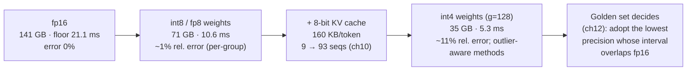
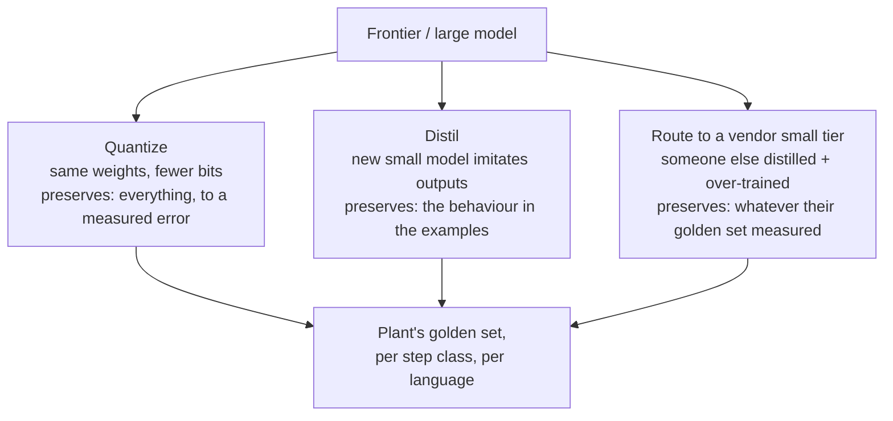

# Chapter 11 — Quantization, distillation, small models

*Part I · Word budget 4,500–8,000 · Lab 11 · Verified as of September 2026 · Derived figures from `labs/ch11-quantization/derive.py`*

## 11.1 Intuition

The previous chapter ended on a number: the same two GPUs serve the plant's fallback twenty times cheaper per token at 8-bit than at 16-bit, if the model is still right. This chapter is about the "if" — and about the two other ways to make a model cheaper that come with the same condition. Quantization stores each weight in fewer bits. Distillation trains a smaller model to imitate a larger one. Small models are what the vendors produce by doing both at scale, plus over-training (ch06). All three trade some quality for a lot of cost, and the trade is measured, never assumed.

The arithmetic is favourable in a specific way. A weight matrix is billions of numbers most of which are small and similar; storing each with sixteen bits of precision is more than the arithmetic needs, and eight bits loses almost nothing — a relative error of about one percent in the weights, well under the noise the model already tolerates. Four bits loses more, and the error is dominated by a few weights that are much larger than the rest; the methods of the last three years are mostly ways of handling those. The bytes saved translate directly into decode speed and concurrency (ch10), which is why quantization is the single most consequential serving decision.

For the plant the chapter answers three questions in order. At what precision does the on-site model still pass the golden set? Which of the eleven steps can a small model handle at a ninth of the cost? And when is it worth distilling a site-specific small model from a frontier one — an operation that costs a few hundred dollars of teacher tokens and a review of every example — rather than routing to the vendor's own small tier?

## 11.2 Mechanism

### What a bit buys

A parameter in 16-bit floating point has about three significant decimal digits and a wide exponent range. Uniform quantization maps a range of values onto $2^b$ evenly spaced levels: a scale $s$ and, for asymmetric schemes, a zero-point $z$, so that $w \approx s \cdot (q - z)$ with $q$ an integer. The rounding error is uniform within half a step, with root-mean-square $s / \sqrt{12}$. For weights that are roughly Gaussian, a per-tensor 8-bit quantization has a relative RMS error of about 1.3%; 4-bit, about 23% (derive.py, derived on a 4,096 × 4,096 Gaussian matrix; the lab reproduces it). One percent is invisible in the output; twenty percent is not, and it is why 4-bit needs the refinements below.

### Groups, outliers, and the methods

**Per-group scaling.** One scale for a whole matrix is set by its largest value, and one large value makes the step coarse for every small one. Grouping — a scale per 32, 64, or 128 consecutive weights — lets each group use its own range. At 4-bit with groups of 128 the relative error falls from 23% to 12% (derive.py, derived); the scales cost 16 bits per group, 0.125 bits per weight at 128, so "4-bit" is 4.125 bits in memory.

**Outliers.** Dettmers and colleagues found that large models develop a few hidden dimensions with activations tens of times larger than the rest — emergent outlier features — and that naive 8-bit quantization of activations collapses on them; their LLM.int8 keeps the outlier dimensions in 16-bit and quantizes the rest (Dettmers et al., "LLM.int8()," 2022, primary). The lab shows the effect on weights: adding a hundredth of a percent of weights at fifty times typical magnitude takes per-tensor 8-bit error from 1.3% to 35% and 4-bit to 89%; per-group scaling brings them back to 1.3% and 13% (derive.py, derived). Every practical method is, in part, an outlier strategy.

**GPTQ** quantizes one column at a time and updates the remaining weights to compensate for the rounding error already committed, using second-order information from a small calibration set (Frantar et al., "GPTQ," 2022, primary). **AWQ** observes that a small fraction of weights matter far more because they multiply large activations, and scales those channels up before quantization so their rounding error shrinks — activation-aware, hence the name (Lin et al., "AWQ," 2023, primary). **SmoothQuant** migrates activation outliers into the weights by a per-channel rescaling so both can be quantized to 8-bit (Xiao et al., 2022, primary). **NF4** — the 4-bit format of QLoRA — spaces its levels by the quantiles of a normal distribution rather than evenly, matching Gaussian weights better (Dettmers et al., "QLoRA," 2023, primary). **GGUF** is the file format of the llama.cpp ecosystem with its own family of block-quantized types, widely used for CPU and small-GPU deployment (practitioner). **FP8** is a floating-point 8-bit format with hardware support on recent GPUs, used for both weights and activations and increasingly for the KV cache (Micikevicius et al., "FP8 Formats for Deep Learning," 2022, primary).


### Why one percent is nothing and twenty is not

The model's own computation is noisy at the level of one percent. Activations in 16-bit carry three significant digits; softmax attention weights are spread across hundreds of positions; the residual stream sums the contributions of a hundred layers, and rounding at each is already present in every forward pass. An 8-bit weight error of one percent sits inside that noise, and the measured consequence — a change in the output distribution too small to move the argmax on most tokens — is why 8-bit has become the default serving precision for large models with little dispute (the mechanism is the arithmetic above; the practice per stack documentation, vendor). Twenty percent is a different regime: it moves the argmax on the tokens where the top two candidates were close, which are exactly the tokens where the model was uncertain — the hard ones. That is why 4-bit degradation concentrates on reasoning, rare identifiers, and rare languages rather than spreading evenly, and why the per-group and outlier-aware methods matter: they bring the error on the weights that matter most back toward the one-percent regime while leaving the rest coarse.

### Quantization-aware training and the trained-for-4-bit model

Post-training quantization rounds a model trained at high precision. Quantization-aware training simulates the rounding during training so the model learns weights that survive it, and it reaches lower error at 4-bit than post-training methods at the cost of a training run the plant cannot do. Its practical form for the plant is the vendor's: some model families are released with official 4-bit or 8-bit checkpoints produced with quantization-aware methods and the vendor's own evaluation, and an official low-precision checkpoint measured on the plant's golden set is preferable to a community quantization of unknown calibration (vendor model cards, verified Sep 2026). The rule is that the provenance of a quantized checkpoint — who quantized it, with what method, on what calibration data — is recorded with the model version (ch29), because two 4-bit files of the same model are two different models.

### Pruning and its limits

Removing parameters outright — individual weights, whole attention heads, whole layers — is the other compression family. Unstructured pruning (zeroing individual weights) saves memory only with sparse kernels the hardware may not accelerate; structured pruning (removing heads or layers) saves compute directly and costs more quality per parameter removed, because the model was trained with those parts (Frantar and Alistarh, "SparseGPT," 2023, primary, for the state of one-shot pruning). For the plant, pruning is a vendor's tool, not its own: a pruned-and-retrained small model from a vendor is a small model like any other, measured on the golden set; the plant does not prune the fallback it serves.

### Weights, activations, and the cache

Three things can be quantized and they differ in difficulty. **Weights** are static and quantized once, offline; every method above applies. **Activations** change per token and carry the outliers; 8-bit activations need SmoothQuant-style handling or hardware FP8, and 4-bit activations are research. **The KV cache** is activations stored per token; 8-bit cache halves the bytes per token (ch04's 320 KB becomes 160) and is the lever that took the fallback from nine sequences to ninety-three (ch10). The stacks support FP8 and INT8 caches; the quality effect is measured like any other (vendor documentation, verified Sep 2026).

### What quantization does to speed

Decode is memory-bound (ch10), so halving the bytes halves the floor: for the 70B fallback on two GPUs, 21.1 ms per token at 16-bit, 10.6 at 8-bit, 5.3 at 4-bit (derive.py, derived). The gain is real only if the kernels dequantize fast enough — a 4-bit format with slow kernels can be slower than 8-bit — which is a stack-and-hardware fact the measurement of 11.4 checks. Prefill is compute-bound and gains less from weight quantization; it gains from FP8 arithmetic where the hardware supports it.

**Figure 11.1 — The precision ladder for one model, and what each step costs and buys.**



*Takeaway: each rung halves the bytes; the error is arithmetic until 4-bit, where the method matters; the golden set is the only judge.*

### Distillation

A small model learns from a large one's outputs. In its original form the student matches the teacher's full probability distribution over tokens, which carries more information than the correct answer alone (Hinton, Vinyals, and Dean, 2015, primary). In current practice the student is fine-tuned on the teacher's generated answers — and, for reasoning models, its generated working (ch09) — over a corpus of prompts; DeepSeek-R1's distilled family at several sizes is the reference case (DeepSeek-AI 2025, primary). The vendors' small tiers are distilled and over-trained models; the plant can distil for itself when the task is narrow enough that a few tens of thousands of teacher examples cover it.

The arithmetic is small. Fifty thousand prompts with 800-token teacher outputs is 40 million tokens — about $400 at the frontier output price (derive.py, derived; price vendor, Sep 2026) — and a LoRA pass on the student is minutes (ch08). The cost is the review: every example the student learns from is an example a reviewer has checked, because the student learns the teacher's errors as faithfully as its successes.

### Small models and where they substitute

Belcak and colleagues argue that models under ten billion parameters can serve most of an agent's subtasks — tool-call formatting, extraction, classification, routing — at ten to thirty times lower cost than frontier models, and that agents should be heterogeneous, with a small model per narrow node and a frontier model reserved for open-ended reasoning; they note that small models trail on multi-hop retrieval and complex tool syntax unless trained for it (Belcak et al., "Small Language Models are the Future of Agentic AI," NVIDIA Research, 2025, primary). The P-101 task is the argument in miniature: nine of its eleven steps are routine, and an 8B model at a ninth of the 70B's per-token compute on those nine steps cuts the task's model compute by 73% (derive.py, derived). The two steps that remain — the plan and the permit judgment — are where the frontier model earns its price (ch09).

What makes a small model good enough is the same three things that make a large one: over-training (ch06), distillation, and post-training on the target behaviour (ch08). What the plant adds is measurement per step class, because "good enough" is a golden-set result, and a small model that is right 99% of the time on extraction is worth nothing on a plan it gets wrong one time in four (rates illustrative).


### Speculative decoding meets quantization

The two levers compose. A 4-bit copy of the same model — or a small distilled model — is a natural draft for speculative decoding (ch10), proposing tokens the full-precision model verifies; the draft's errors cost only a rejected token, never a wrong output, because the verifier's distribution is preserved. For predictable output classes — formatted work orders, structured extraction — the acceptance rate is high and the gain is several tokens per weight read. The plant measures acceptance per output class (ch10) and runs the draft on the same GPUs' spare memory, which the 8-bit cache created.

### Mixed precision by layer

Layers differ in sensitivity. The output-error measurement of 11.4 — the relative error in $y = xW$ per layer at a chosen precision on a calibration sample — finds the layers where 4-bit rounding moves the output most, typically the first and last few and any with pronounced outlier channels, and a serving stack can hold those at 8-bit while the rest run at 4-bit. The memory cost is a few gigabytes; the quality recovered is measured on the golden set like everything else. It is the per-class precision rule applied inside the model instead of across the router, and the two combine.

### The economics in one line

Per token served, cost falls with bytes per parameter (quantization), with parameters (small models, distillation), and with batch (ch10's amortization, which the freed memory enables). Per task, cost falls with the share of steps a small model handles (substitution). The three multiply: the scenario's fallback at 8-bit with routine steps on an 8B extractor is the 70B's cost per token divided by twenty (ch10, derived) on the two steps that still need it, and a ninth of that on the other nine (derive.py, derived; the composed figure is the router's table, ch23). Every factor was measured before it was claimed, which is the chapter's only method.

### Reference implementation

The `quantize()` below is an illustrative symmetric absmax scheme chosen so the arithmetic is visible; production methods (GPTQ, AWQ, FP8 with scaling) differ in how they pick scales and which weights they protect, and their error figures are lower than this scheme's at the same bit width (Frantar 2022; Lin 2023, primary).

Uniform quantization with per-tensor and per-group scales, an outlier injector, the error measurement, and the substitution arithmetic. Lab 11 runs them and reproduces 11.3.

```python
import numpy as np

def quantize(w: np.ndarray, bits: int, group: int = None):
    """Symmetric uniform quantization. Returns the dequantized weights and the bits per weight incl. scales."""
    levels = 2 ** (bits - 1) - 1
    if group is None:
        scale = np.abs(w).max() / levels
        q = np.clip(np.round(w / scale), -levels, levels)
        return q * scale, bits
    wg = w.reshape(-1, group)
    scale = np.abs(wg).max(axis=1, keepdims=True) / levels
    q = np.clip(np.round(wg / scale), -levels, levels)
    return (q * scale).reshape(w.shape), bits + 16 / group

def relative_rms_error(w: np.ndarray, wq: np.ndarray) -> float:
    return float(np.sqrt(np.mean((wq - w) ** 2)) / np.sqrt(np.mean(w ** 2)))

def inject_outliers(w: np.ndarray, fraction: float, factor: float, rng) -> np.ndarray:
    """Multiply a random `fraction` of weights by `factor` — the LLM.int8 outlier phenomenon, on weights."""
    out = w.copy(); idx = rng.choice(w.size, size=max(1, int(w.size * fraction)), replace=False)
    out.reshape(-1)[idx] *= factor
    return out

def output_error(w: np.ndarray, wq: np.ndarray, x: np.ndarray) -> float:
    """Relative error in a layer's output y = x @ w caused by quantizing w."""
    y, yq = x @ w, x @ wq
    return float(np.linalg.norm(yq - y) / np.linalg.norm(y))

def substitution_compute(steps_total: int, steps_routine: int, small_params: float, large_params: float) -> dict:
    """Relative model compute for a task when routine steps run on the small model."""
    all_large = steps_total * 1.0
    mixed = steps_routine * (small_params / large_params) + (steps_total - steps_routine) * 1.0
    return {"all_large": all_large, "mixed": round(mixed, 2), "saving_pct": round(100 * (1 - mixed / all_large))}
```

### Where quality is lost, and how it shows

Quantization error is not uniform across tasks. It shows first on the tasks that depend on small differences in the output distribution: exact recall of long identifiers, arithmetic, multi-step reasoning, and — relevant to the plant — the rarer language, because the weights that serve Portuguese are fewer and their rounding costs more of what they carry (the mechanism follows from the error analysis; the plant's per-language golden set is the measurement). Perplexity on English web text, the figure most quantization papers report, is the least sensitive measure and the least relevant one. The chapter's rule is that the golden set is split by step class and by language, and the precision decision is made per class: a plant may serve extraction at 4-bit and planning at 8-bit on the same hardware, and the router (ch23) knows which is which.

### The harness's view

Precision, distillation, and model size are all router decisions (ch23) backed by golden-set evidence (ch12) and expressed in cost per resolved task (ch37). The harness records, for every call, which model at which precision produced which step (ch29), so a regression can be traced to a precision change as easily as to a prompt change. And the safety and refusal cases in the golden set are re-run at every precision, because a quantized model is a different model (ch08's rule for adapters applies).

**Figure 11.2 — Three ways to a cheaper model, and what each preserves.**



*Takeaway: three paths, one judge.*

## 11.3 Worked numbers

All figures from `derive.py` (derived).

**Memory by precision (weights only; add the cache from ch04).**

| Model | 16-bit | 8-bit | 4-bit |
|---|---|---|---|
| Llama 3 8B | 16 GB | 8 GB | 4 GB |
| Llama 3 70B | 141 GB | 71 GB | 35 GB |
| Llama 3.1 405B | 812 GB | 406 GB | 203 GB |

**Quantization error, 4,096 × 4,096 Gaussian matrix, relative RMS.**

| Scheme | 8-bit | 4-bit |
|---|---|---|
| Per-tensor scale | 1.3% | 23.2% |
| Per-group scale (g = 128) | 0.65% | 11.7% |
| Per-tensor, with 0.01% outliers at 50× | 34.6% | 89.1% |
| Per-group (g = 128), with outliers | 1.3% | 13.4% |

Group scales cost 0.125 bits per weight at g = 128 (4.125 effective bits), 0.25 at g = 64, 0.5 at g = 32 (derive.py, derived).

**Decode floor, 70B on two GPUs.** 21.1 ms at 16-bit, 10.6 at 8-bit, 5.3 at 4-bit — if the kernels keep up.

**Distillation.** 50,000 examples × 800 tokens = 40M teacher tokens, about $400 at $10 per million output; student training minutes; review hours the dominant cost.

**Substitution.** Nine of eleven steps on an 8B model (11.4% of the 70B's compute per token): task model compute falls from 11.0 to 3.0 units, a 73% saving; Belcak et al.'s 10–30× per-token cost ratio is the vendor-tier version of the same arithmetic.

## 11.4 Measurement

**Golden set per precision, per step class, per language.** Run the full golden set at 16-bit, 8-bit weights, 8-bit weights plus 8-bit cache, and 4-bit weights; report pass rate with Wilson intervals per step class and per language; adopt per class the lowest precision whose interval overlaps 16-bit's. Refusal and safety cases included at every precision. Lab 11 reproduces the error arithmetic; this measurement is on the plant's model and golden set.

**Kernel speed at each precision.** Decode tokens per second at batch one and at the cache-capped batch (ch10); a lower precision that is not faster has slow kernels, and the memory saving alone may still justify it.

**Per-language error.** The golden set's Portuguese and English halves reported separately at each precision; the gap between them at 4-bit is the chapter's prediction, and a plant that sees it has a per-language precision decision, not a model decision.

**Output error per layer** on a calibration sample: the relative error in $y = xW$ layer by layer at the chosen precision; layers with high error are candidates for higher precision (mixed-precision serving).

**Distillation review rate and student agreement.** Share of teacher examples the reviewer corrected; student pass rate on a held-out set against the teacher's; a student that matches the teacher on the golden set and disagrees on the held-out set has memorized, not learned.

**Small-model substitution per step class.** Pass rate and cost per step for the small model against the large on each routine class; the router's table is the output.

What to record: model, precision and method (per-group size, calibration set), stack and kernel version, golden-set version per class and language, date.


### Reference output (Lab 11, this run)

What the lab prints when it reproduces; the plant's numbers replace these.

```text
8-bit per_tensor                rel RMS err 0.0128 (chapter 0.0128)  eff bits 8.000  OK
8-bit g128                      rel RMS err 0.0065 (chapter 0.0065)  eff bits 8.125  OK
4-bit per_tensor                rel RMS err 0.2323 (chapter 0.2323)  eff bits 4.000  OK
4-bit g128                      rel RMS err 0.1173 (chapter 0.1173)  eff bits 4.125  OK
8-bit per_tensor_with_outliers  rel RMS err 0.3460 (chapter 0.346)  eff bits 8.000  OK
8-bit g128      _with_outliers  rel RMS err 0.0130 (chapter 0.013)  eff bits 8.125  OK
4-bit per_tensor_with_outliers  rel RMS err 0.8914 (chapter 0.8914)  eff bits 4.000  OK
4-bit g128      _with_outliers  rel RMS err 0.1341 (chapter 0.1341)  eff bits 4.125  OK
layer output error y=xW at 8-bit g128: 0.0065
layer output error y=xW at 4-bit g128: 0.1175
memory table reconciles: True
substitution: task compute 11.0 → 3.02 units, saving 73% (chapter 73%) OK
Lab 11: REPRODUCED
```

## 11.5 Failure

| Failure mode | Mechanism | Detection signal | Mitigation | Owning component |
|---|---|---|---|---|
| Perplexity as proof | Vendor cites English web perplexity at 4-bit | Golden-set regressions on identifiers, arithmetic, Portuguese | Golden set per class and language | ch12; this chapter |
| Outliers unhandled | Naive per-tensor 8-bit on a large model | Collapse on specific inputs | Per-group, outlier-aware methods; FP8 | This chapter |
| Slow kernels | 4-bit format without fast dequantization | Lower precision, no speed gain | Measure tokens/s per precision; choose a supported format | ch10 |
| Cache precision ignored | Weights quantized, cache at 16-bit | Concurrency unchanged | 8-bit cache; measure | ch10 |
| One precision for all steps | Planning served at 4-bit because extraction survives it | Plan-step failures | Precision per step class in the router | ch23 |
| Student learns the teacher's errors | Unreviewed distillation examples | Student repeats systematic mistakes | Every example reviewed; errors fed back as sensors | ch08; ch26 |
| Small model on a hard step | Substitution beyond its measured range | Multi-hop and tool-syntax failures | Per-class measurement; frontier for plan and judgment | ch23 |
| Safety cases skipped at low precision | Refusal behaviour changed by quantization | Refusal golden cases fail after quantization | Refusal cases at every precision | ch08; ch26 |
| Precision change untracked | Regression traced to the wrong cause | Quality drop after a stack upgrade | Precision and method recorded per call | ch29 |
| Calibration set unrepresentative | GPTQ/AWQ calibrated on English web text | Errors on the plant's text | Calibrate on a sample of the plant's corpus | This chapter |
| Checkpoint of unknown provenance | Community 4-bit file with unrecorded method and calibration | Two 'same' models behave differently | Prefer official quantized checkpoints; record provenance with the version | ch29 |
| Uniform 4-bit across layers | Sensitive layers rounded as coarsely as robust ones | Output error concentrated in a few layers | Per-layer output-error measurement; mixed precision | This chapter |
| Draft model errors mistaken for output errors | Speculative draft at 4-bit blamed for quality | None — the verifier preserves the distribution | Measure acceptance, not quality, for the draft | ch10 |

## 11.6 The frontier

**Strongest free treatments.** Dettmers et al. (2022) on outliers and LLM.int8; Frantar et al. (2022) GPTQ; Lin et al. (2023) AWQ; Xiao et al. (2022) SmoothQuant; Dettmers et al. (2023) QLoRA and NF4; Micikevicius et al. (2022) FP8; Hinton et al. (2015) distillation; DeepSeek-AI (2025) distilled reasoning models; Belcak et al. (2025) small models for agents. Each is complete on its method and stops at its benchmarks — mostly perplexity and English tasks. Stack documentation covers supported formats. Huyen's *AI Engineering* (2025) covers quantization and model compression in its inference chapter and stops before the error arithmetic, the per-class precision decision, and the substitution accounting.

**What this chapter adds.** The error arithmetic a reader can reproduce, with the outlier effect and the group-scale remedy quantified; the precision ladder tied to the fallback's floor and concurrency; distillation costed; substitution accounted per step; the per-class, per-language precision rule with the router as its implementation; and a runnable quantizer. Open: quantization's effect on Portuguese technical text at 4-bit is unmeasured in the literature; the protocol of 11.4 on the plant's golden set is the measurement.

**Related chapters.** ch03 (The transformer block).

## 11.7 Industrial application

**The afternoon that changes the cost anatomy.** The plant quantizes its 70B fallback to 8-bit weights and 8-bit cache and runs the golden set: per step class, per language, plus the refusal cases. If the intervals overlap 16-bit's, the fallback holds ninety-three sequences instead of nine and costs $0.27 per million tokens instead of $5.56 (ch10) — and the router starts sending routine steps to it inside the perimeter. If planning regresses at 8-bit and extraction does not, the router serves the two classes at different precisions on the same hardware.

**The 4-bit question.** Four-bit weights would take the 70B to 35 GB — one GPU, with 45 GB for cache (derive.py, derived). The error is an order of magnitude larger than 8-bit's and the plant's Portuguese step classes are the ones to watch; the golden set decides, and a 4-bit model that passes extraction and fails planning is a fine extraction model.

**Distilling the site's extractor.** The extraction step — technician's request to structured fields — is narrow. Fifty thousand real requests from the CMMS history, answered by the frontier model, reviewed by a planner at a sample rate the review budget allows, become the training set for a site-specific 8B extractor; $400 of teacher tokens, an hour of training, and a per-class golden set that says whether it beats the vendor's small tier on the plant's text. If it does, the routine steps run on it at a ninth of the compute.

**OT boundary.** A smaller or cheaper model is not a more trusted one; the toolset it reaches is the same, and it reaches no control system (ch35). The same holds for a quantized one: precision changes the model's errors, not its permissions.

## 11.8 Decision aids

**Precision decision (per step class, per language).**

| Precision | Adopt when |
|---|---|
| 16-bit | The class fails at 8-bit; or the class is planning or judgment and the plant is conservative |
| 8-bit weights + 8-bit cache | Interval overlaps 16-bit's; kernels measured faster | 
| 4-bit weights (g ≤ 128, outlier-aware) | Interval overlaps 16-bit's on this class; format's kernels measured; calibration on plant text |

**Distillation go/no-go.** The step is narrow and has a deterministic sensor so the student's output can be checked without a grader; teacher examples can be reviewed at the needed rate; a held-out set exists; the vendor's small tier has been measured and found short on the plant's text; data-protection review of the prompts is done.

**Substitution rule.** Route a step class to a small model only when its pass rate on that class is within the interval of the large model's; keep plan and judgment on the frontier until measured otherwise; re-run the class comparison quarterly, because the vendors' small tiers improve faster than the plant's routing table.

**Quantized-checkpoint record (per model version).** Source (official or community); method (GPTQ, AWQ, NF4, FP8, GGUF type); bits and group size; calibration set (size, language, source); stack and kernel version; golden-set results per class and language; refusal results; date. A checkpoint without this record is not deployed.

**Mixed-precision rule.** Measure per-layer output error on a calibration sample from the plant's corpus; hold the top decile of layers by error at 8-bit; serve the rest at the chosen lower precision; re-measure the golden set.

**Vendor questions.** Quantization method, group size, and calibration set; per-task (not perplexity) results at each precision; kernel throughput at each precision on the plant's hardware; whether the KV cache can be quantized; whether the safety behaviour was re-evaluated at the served precision.

## 11.9 Sources

| # | Claim or figure | Source | Tier | Verified | Link |
|---|---|---|---|---|---|
| 1 | Outlier features; LLM.int8 mixed precision | Dettmers et al., 2022, arXiv 2208.07339 | primary | Sep 2026 | https://arxiv.org/abs/2208.07339 |
| 2 | GPTQ | Frantar et al., 2022, arXiv 2210.17323 | primary | Sep 2026 | https://arxiv.org/abs/2210.17323 |
| 3 | AWQ | Lin et al., 2023, arXiv 2306.00978 | primary | Sep 2026 | https://arxiv.org/abs/2306.00978 |
| 4 | SmoothQuant | Xiao et al., 2022, arXiv 2211.10438 | primary | Sep 2026 | https://arxiv.org/abs/2211.10438 |
| 5 | QLoRA; NF4 | Dettmers et al., 2023, arXiv 2305.14314 | primary | Sep 2026 | https://arxiv.org/abs/2305.14314 |
| 6 | FP8 formats | Micikevicius et al., 2022, arXiv 2209.05433 | primary | Sep 2026 | https://arxiv.org/abs/2209.05433 |
| 7 | Knowledge distillation | Hinton, Vinyals, Dean, 2015, arXiv 1503.02531 | primary | Sep 2026 | https://arxiv.org/abs/1503.02531 |
| 8 | Distilled reasoning models | DeepSeek-AI, "DeepSeek-R1," Nature 2025 | primary | Sep 2026 | https://api-docs.deepseek.com/quick_start/pricing |
| 9 | Small models for agent subtasks; 10–30× cheaper; limits on multi-hop and tool syntax | Belcak et al., NVIDIA Research, 2025, arXiv 2506.02153 | primary | Sep 2026 | https://arxiv.org/abs/2506.02153 |
| 9a | One-shot pruning | Frantar & Alistarh, "SparseGPT," 2023, arXiv 2301.00774 | primary | Sep 2026 | https://arxiv.org/abs/2301.00774 |
| 10 | GGUF / llama.cpp quantization types | llama.cpp documentation | practitioner | Sep 2026 | https://github.com/ggml-org/llama.cpp |
| 11 | FP8/INT8 KV cache support | vLLM, TensorRT-LLM documentation | vendor | Sep 2026 | https://docs.vllm.ai/ |
| 12 | Memory by precision; error tables; overhead bits; floors; distillation cost; substitution saving | `labs/ch11-quantization/derive.py` | derived | Sep 2026 | labs/ch11-quantization/derive.py |
| 13 | 0.01% outliers at 50×; 50,000 examples × 800 tokens; review rates | Illustrative | illustrative | Sep 2026 | — |
| 14 | 4-bit effects on Portuguese technical text | None published | open | Sep 2026 | — |