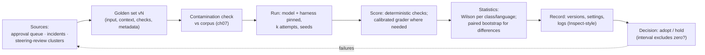
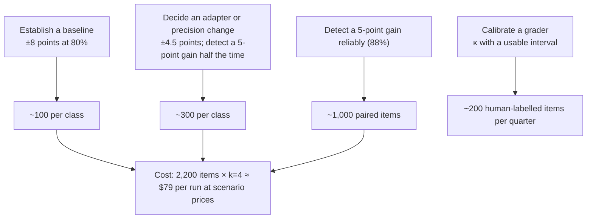

# Chapter 12 — Evaluation science

*Part I · Word budget 5,000–8,000 · Lab 12 · Verified as of September 2026 · Derived figures from `labs/ch12-evaluation/derive.py`*

## 12.1 Intuition

Every chapter of this book ends the same way: the golden set decides. This chapter is about what a golden set is, how big it must be, how to score it, and how to know whether a difference between two numbers is real — because the alternative is a plant that changes its prompts, its models, and its precision on the strength of a demo and a feeling.

A language model is non-deterministic and its errors are not uniform. The same question asked twice can get two answers; the same system can be right on ninety-five easy tasks and wrong on the five that matter. Evaluating it is therefore statistics, not inspection: a fixed set of tasks with known-correct answers, a rule for scoring each, a count of passes, and an interval around that count that says how much of it is luck. The arithmetic is unforgiving. Eighty percent on twenty tasks means somewhere between 58% and 92%. Eighty percent on three hundred means 75% to 84%. And detecting that one system is five points better than another, with confidence, takes about a thousand paired tasks (derive.py, derived) — far more than any vendor demo has ever shown a plant.

The chapter then treats the two instruments that need calibration of their own. A grader model that scores outputs is a measuring device with documented biases, and its agreement with humans is a number the plant computes each quarter. And public benchmarks — the scores in vendor announcements — measure capability on public tasks in a scaffold the vendor chose, have known label errors, and may be in the training data; they rank models loosely and predict the plant's tasks poorly. The plant's own golden set, built from its own work with deterministic checks and split by step class and language, is the only evaluation that answers its questions, and this chapter is how to build one that survives an engineer's scrutiny.

## 12.2 Mechanism

### What a golden set is

A golden set is a versioned collection of tasks, each with an input, the context the system is allowed, a deterministic success check, and metadata: step class, language, difficulty, source, and the defect it seeds if any (ch26). It is held out of everything the model sees — no example in a guide, no chunk in memory, no line in an adapter's training pairs — and it is checked for contamination against the corpus at every version (ch07). Its items come from real work: approved and rejected outputs from the approval queue (ch31), incidents, and the failure clusters the steering review finds (ch16). It grows by the steering loop and is never trimmed to make a number look better.

The success check is the hard part and the most important, and it is written before the item is added: an item without a check is a review-queue case, not a golden item. "Is the work order correct" is not a check; "every required field present, the procedure cited at its current revision, permit type consistent with hazard class, parts in the approved list" is four checks, each a sensor (ch26), each a line of code. A task whose correctness cannot be written as a check is scored by a grader with a rubric, and the rubric is calibrated (12.2 below). A task with neither is not in the golden set; it is in the human review queue.

### Metrics, and which ones

**Pass rate** — the share of tasks whose checks all pass — is the headline, reported per step class and per language, never only in aggregate. **pass^k** (ch16) is pass rate under the requirement that all $k$ attempts succeed, and is the reliability metric an operation needs. **Cost per correct answer** (ch09) is tokens spent divided by passes, the metric that compares methods. Per-criterion pass rates — which check fails most — are the steering loop's input. Continuous scores (partial credit per criterion) are kept alongside pass/fail so that a capability arriving shows as a trend rather than a jump (ch06's emergence result). Precision and recall apply to retrieval (ch02, ch20) and to sensors (ch26); F1 is their harmonic mean and hides which of the two is failing, so both are reported.

### Intervals

A pass rate on $n$ items is an estimate. The Wilson score interval (Wilson 1927, primary) gives its 95% range without the failures of the naive formula near 0 and 1:

$$\frac{\hat p + \frac{z^2}{2n} \pm z\sqrt{\frac{\hat p(1-\hat p)}{n} + \frac{z^2}{4n^2}}}{1 + \frac{z^2}{n}},\qquad z = 1.96.$$

At 80% pass: 20 items give 58–92%; 50 give 67–89%; 100 give 71–87%; 300 give 75–84%; 1,000 give 77–82% (derive.py, derived). At 95% the intervals are narrower but the same shape. A pass rate reported without $n$ and an interval is not a measurement.

### Comparing two systems

Two systems run on the same items are paired: each item is a pair of outcomes, and the question is whether the difference in pass rate is distinguishable from zero. The paired bootstrap — resample items with replacement, recompute the difference, repeat thousands of times, read the 2.5th and 97.5th percentiles — makes no distributional assumption and handles the correlation between systems on shared items (Efron 1979, primary; Dror et al., "The Hitchhiker's Guide to Testing Statistical Significance in NLP," 2018, primary, for the practice). The lab's simulation gives the power to detect a five-point gain (80% to 85%): about 14% at 100 items, 47% at 300, 88% at 1,000 (derive.py, derived, at a moderate correlation between systems). Three hundred items — the size ch08 recommends for an adapter decision — detects a five-point difference less than half the time. Either the golden set is larger or the decision is made on a larger difference; a plant that adopts a change on a three-point gain over a hundred items has adopted noise.


### Sampling, temperature, and what "one run" means

A model's output is a sample from a distribution; the same prompt at temperature above zero yields different outputs, and even at zero the serving stack's batching and numerics can vary the result (vendor documentation, verified Sep 2026). An evaluation therefore fixes the sampling settings and runs each item $k$ times, and it reports which $k$ and which statistic. pass@k — at least one of $k$ succeeds — flatters; pass^k — all $k$ succeed — is what an operation needs (ch16); the plain pass rate at $k = 1$ is the baseline. A vendor's "single run" is a pass@1 sample with no interval; the plant's is $k = 4$ with pass^4 reported beside pass rate, and the gap between the two is the reliability the harness must supply.

### Difficulty, stratification, and the easy-item trap

Items are not equal. A golden set drawn only from the approval queue's approvals is biased toward what the system already does well; the rejected outputs, the incidents, and the steering review's clusters supply the hard items, and the set is stratified so each class holds a known share of each. Reported pass rates are then per stratum as well as per class, because a system that improves on easy items and regresses on hard ones shows an aggregate gain and an operational loss. The item template's difficulty field is set at labelling — by the reviewer's judgment, or by how many attempts the system needed when the item was created — and a set whose difficulty distribution drifts easier over time is a set being trimmed by another name.

### Measurement error in the labels

The golden set's answers were written by people, and people disagree. Two labelers on the same items produce a κ of their own, and it bounds what any system can score: a grader cannot agree with humans more than humans agree with each other, and the 81% human–human figure in Zheng et al. is the ceiling the 85% grader figure sits against (Zheng et al. 2023, primary). The plant labels a subset of items twice, computes inter-labeler κ, and treats items below agreement as either ambiguous — rewritten or retired — or as genuinely hard, kept and flagged. A golden set with no double-labelled subset has no measured ceiling, and a pass rate above the ceiling is a sign of contamination, not excellence.

### Graders as instruments

Where no deterministic check exists, a model grades against a rubric (ch27 gives the design). Zheng and colleagues measured how well that works: a strong grader agreed with human raters on about 85% of non-tied comparisons, against 81% agreement between humans themselves — and showed position bias (favouring the first of two answers), verbosity bias, and self-enhancement bias (favouring its own family's outputs) (Zheng et al., "Judging LLM-as-a-Judge with MT-Bench and Chatbot Arena," NeurIPS 2023, primary). Agreement is measured, not assumed, with a statistic that corrects for chance: Cohen's κ for two raters (Cohen 1960, primary) or Krippendorff's α for more (Krippendorff 2004, primary). A worked example: 85% observed agreement with marginals of 60/40 and 65/35 gives expected chance agreement of 53% and κ of 0.68 (derive.py, derived) — substantial, and well short of the raw 85%. The plant's rule: a grader is calibrated on a human-labelled subset every quarter; κ below about 0.6 retires it; pairs are judged in both orders; the grader is from a different model family than the generator.

### Public benchmarks and what they measure

MMLU (Hendrycks et al. 2021), HELM (Liang et al. 2022), SWE-bench (Jimenez et al. 2023) and its Verified subset (Chowdhury et al. 2024), τ-bench (Yao et al. 2024), and their successors measure capability on public tasks. Four qualifications attach to every score. **Scaffold**: agent benchmarks are run in a harness the reporter chose, and the same model moves by double digits across harnesses (ch16). **Contamination**: benchmark items leak into training corpora; Sainz and colleagues documented the problem and the field's weak detection (Sainz et al., "NLP Evaluation in Trouble," 2023, primary), and at a 1% per-item leak rate a hundred-item set is entirely clean with probability 0.37 (derive.py; ch07). **Label errors**: Gema and colleagues found a substantial share of MMLU items with errors — a wrong key, an ambiguous question — concentrated in some subjects (Gema et al., "Are We Done with MMLU?" 2024, primary). **Distribution**: none of them is Portuguese maintenance work. A public score is a loose ranking signal for model selection and nothing more.


### Evaluating the pieces, not only the whole

An end-to-end pass rate says whether the task succeeded; it does not say why it failed. The harness is evaluated component by component with the same discipline. Retrieval has precision and recall at $k$ on the golden questions (ch02, ch20). Sensors have false-positive and false-negative rates on seeded defects (ch26). Graders have κ (ch27). The policy engine has false-deny and false-allow rates on its golden calls (ch28). The router has quality retention per class against the frontier baseline (ch23). Each is a small golden set of its own, and together they explain the end-to-end number: a task pass rate that falls while retrieval recall is flat and a sensor's false-negative rate has risen has located its cause. The steering review reads the component numbers first and the aggregate last.

### Online evaluation and the production signal

The golden set is offline; production is the other half. Three production signals are evaluation data. The approval queue's approvals and rejections with reasons are labels on live outputs (ch31). Sensor verdicts on every step are pass rates per criterion at production scale (ch26). And user corrections — a technician editing a drafted work order before submitting it — are the most honest label there is, captured as a diff (ch29). None of these replaces the golden set, because production is not stratified and its "correct" is not known; all of them feed it, and a production rejection cluster that the golden set did not predict is the golden set's next hundred items.

### A/B and interleaving

When two configurations are candidates, running both on live traffic and comparing outcomes is the standard in consumer systems and the wrong default in a plant: the outputs are consequential and the traffic is small. The golden set decides first; a live comparison follows only for configurations that pass, on a slice of traffic with human review on both arms, with the same paired statistics as offline. Interleaving — showing a reviewer two candidate outputs for the same request and recording which was approved — is the safer form, because no unreviewed output reaches a system of record, and it doubles as grader calibration data.


### Multiple comparisons and the quarterly review

A plant that runs its golden set on eleven classes in two languages makes twenty-two comparisons per run, and at a 95% interval one of them is expected to look significant by chance each time. The steering review that adopts every "significant" class-level gain will adopt noise once per run. Two disciplines hold. A gain is adopted when it replicates on the next run or when the interval is wide enough to survive a correction for the number of comparisons (a Bonferroni-style division of the significance level by the count is the conservative form; Dror et al. 2018, primary, for the practice). And decisions are made at the level they were planned: a change intended to fix permit judgment is judged on permit judgment, and its effect elsewhere is a regression check, not a search for good news.

### Reproducibility

An evaluation is reproducible when someone else can run it and get the same number within the interval. That needs: the golden-set version; the model and version pinned; the harness commit; the guides, sensors, and policy bundle versions; temperature and sampling settings; $k$; the scoring code; and the date. Inspect AI, from the UK AI Security Institute, is the open framework built for this — tasks as code, structured logs, reproducible runs — and its logs are the form of evidence regulators and auditors can read (UK AISI, Inspect AI documentation, primary). A number without those records is a number nobody can check, and the book's rule is that such a number does not go in.

**Figure 12.1 — The evaluation pipeline and its records.**



*Takeaway: the golden set is a versioned instrument fed by real work; every number it produces carries its interval and its provenance.*

### Reference implementation

Wilson intervals, the paired bootstrap, Cohen's κ, Krippendorff's α for nominal data, and a power estimate. Lab 12 runs them and reproduces 12.3.

```python
import math
import numpy as np

def wilson(passes: int, n: int, z: float = 1.96):
    p = passes / n; d = 1 + z * z / n
    c = (p + z * z / (2 * n)) / d; h = z * math.sqrt(p * (1 - p) / n + z * z / (4 * n * n)) / d
    return c - h, c + h

def paired_bootstrap(a: np.ndarray, b: np.ndarray, iters: int = 10000, rng=None):
    """95% interval for mean(b) - mean(a) over paired items; returns (low, high, point)."""
    rng = rng or np.random.default_rng(0); diff = b.astype(float) - a.astype(float); n = len(diff)
    boots = np.array([diff[rng.integers(0, n, n)].mean() for _ in range(iters)])
    return float(np.quantile(boots, 0.025)), float(np.quantile(boots, 0.975)), float(diff.mean())

def cohen_kappa(r1: np.ndarray, r2: np.ndarray) -> float:
    labels = np.unique(np.concatenate([r1, r2])); po = np.mean(r1 == r2)
    pe = sum(np.mean(r1 == l) * np.mean(r2 == l) for l in labels)
    return (po - pe) / (1 - pe) if pe < 1 else 1.0

def krippendorff_alpha_nominal(ratings: np.ndarray) -> float:
    """ratings: (raters, items) with NaN for missing; nominal metric."""
    items = [ratings[:, j][~np.isnan(ratings[:, j])] for j in range(ratings.shape[1])]
    items = [v for v in items if len(v) >= 2]
    n = sum(len(v) for v in items)
    Do = 0.0
    for v in items:
        m = len(v); Do += sum((v[i] != v[k]) for i in range(m) for k in range(m) if i != k) / (m - 1)
    Do /= n
    allv = np.concatenate(items); labels, counts = np.unique(allv, return_counts=True)
    De = sum(counts[i] * counts[k] for i in range(len(labels)) for k in range(len(labels)) if i != k) / (n * (n - 1))
    return 1 - Do / De if De > 0 else 1.0

def power_to_detect(n: int, p1: float, p2: float, corr: float = 0.5, trials: int = 300, rng=None) -> float:
    """Share of simulated paired comparisons whose bootstrap interval excludes zero."""
    rng = rng or np.random.default_rng(0); hits = 0
    t1, t2 = np.quantile(rng.standard_normal(200000), p1), np.quantile(rng.standard_normal(200000), p2)
    for _ in range(trials):
        z = rng.standard_normal(n); a = corr * z + math.sqrt(1 - corr ** 2) * rng.standard_normal(n)
        b = corr * z + math.sqrt(1 - corr ** 2) * rng.standard_normal(n)
        lo, _, _ = paired_bootstrap((a < t1).astype(int), (b < t2).astype(int), iters=200, rng=rng)
        hits += lo > 0
    return hits / trials
```

### Evaluation in the harness

The golden set runs at four moments. **Before deployment**, to establish the baseline per class and language. **On every change** to a guide, sensor, policy, model version, or precision — the regression gate (ch26, ch10). **On a schedule**, weekly against the live index and model, to catch drift the changes did not cause (ch02, ch29). **After incidents**, when the steering review turns a failure into new items. Each run is recorded with its versions and produces one page: pass rate per class and language with intervals, the difference from the previous run with its interval, cost per correct answer, and the items that changed verdict — the list the steering review reads first.

**Figure 12.2 — How many items, for what decision.**



*Takeaway: the golden set is cheap to run and expensive to build; the expense is the labels, and the labels come from real work.*

## 12.3 Worked numbers

All figures from `derive.py` (derived).

**Wilson 95% intervals at 80% pass.**

| Items | Interval | Half-width |
|---|---|---|
| 20 | 58–92% | ±16.8 |
| 50 | 67–89% | ±10.9 |
| 100 | 71–87% | ±7.8 |
| 300 | 75–84% | ±4.5 |
| 1,000 | 77–82% | ±2.5 |

At 95% pass: 20 items ±11.3; 100 items ±4.5; 300 items ±2.5; 1,000 items ±1.3 (derive.py, derived).

**Power to detect 80% versus 85%, paired.** 100 items: 14%. 300 items: 47%. 1,000 items: 88% (simulation at a moderate item correlation; the lab reproduces it).

**Cohen's κ example.** Observed agreement 0.85; marginals 0.60/0.40 and 0.65/0.35; expected chance agreement 0.53; κ = 0.68.

**Grader agreement in the literature.** 85% grader–human on non-tied comparisons against 81% human–human (Zheng et al. 2023, primary) — raw agreement, not chance-corrected.

**The plant's golden set.** Eleven step classes at 100 items each is 1,100 items; two languages, 2,200. One run at $k = 4$ and the scenario's per-query cost of about $0.009 (ch37, configuration C) is about $79. Running is cheap; labelling 2,200 items from the approval queue is the cost, and it is the cost of knowing.

**Contamination.** A hundred-item set is entirely clean with probability 0.37 at a 1% per-item leak rate; the check of ch07 runs on every version.

## 12.4 Measurement

**Golden-set health.** Items per class and language; share with deterministic checks versus grader-scored; date of newest item; contamination check result; items retired this quarter and why.

**Interval discipline.** Every reported pass rate carries $n$, $k$, the statistic (pass rate or pass^k), and its Wilson interval; every reported difference carries its paired-bootstrap interval; a decision cites the interval, not the point.

**Grader calibration.** κ (or α) per grader against a fresh human-labelled subset each quarter, with the subset size; position-bias check by judging pairs in both orders; retirement below 0.6.

**Regression-gate latency.** Time from a change to its golden-set result; a gate that takes a day is skipped under pressure, and the run is cheap enough to take minutes on the API path and under an hour on the on-site fallback at its measured throughput (ch10).

**Verdict churn.** Items that changed verdict between runs, listed; the steering review's first page.

**Labeler ceiling.** Inter-labeler κ on the double-labelled subset, per class; a system pass rate above the ceiling is investigated as contamination.

**Component rates.** Retrieval precision/recall, sensor false-positive/negative rates, grader κ, policy false-deny/allow, router quality retention — reported on the same page as the task pass rate, so a change in the aggregate can be located.

What to record: golden-set version and item counts; model, precision, harness, guides, sensors, policy versions; sampling settings; $k$; scoring code version; date; the full log.


### Reference output (Lab 12, this run)

What the lab prints when it reproduces; the plant's numbers replace these.

```text
Wilson n=  20 p=0.80: (0.584, 0.919)  chapter [0.584, 0.919]  OK
Wilson n= 100 p=0.80: (0.711, 0.867)  chapter [0.711, 0.867]  OK
Wilson n= 300 p=0.80: (0.751, 0.841)  chapter [0.751, 0.841]  OK
Wilson n=1000 p=0.80: (0.774, 0.824)  chapter [0.774, 0.824]  OK
power n= 100 (0.80 vs 0.85): 0.14  chapter 0.14  OK
power n= 300 (0.80 vs 0.85): 0.43  chapter 0.47  OK
power n=1000 (0.80 vs 0.85): 0.91  chapter 0.88  OK
kappa example: agreement 0.85, marginals judge 0.60 human 0.65, kappa 0.681 (chapter 0.681) OK
Krippendorff alpha on the same two raters: 0.682 (close to kappa: True)
identical systems bootstrap: (0.000, 0.000) includes 0: True
Lab 12: REPRODUCED
```

These measurements are the improvement loop's inputs (ch32): clusters are mined from them weekly and changes are tested against them.

## 12.5 Failure

| Failure mode | Mechanism | Detection signal | Mitigation | Owning component |
|---|---|---|---|---|
| Point estimate as fact | Pass rate without $n$ or interval | Decisions reversed on re-run | Wilson interval on every rate; $n$ stated | This chapter |
| Underpowered comparison | 100 items to detect a 5-point gain | Adopted changes that do not replicate | Power calculation before the decision; larger set or larger effect | This chapter |
| Aggregate hides the class | One pass rate across all step classes and languages | A failing class masked by easy ones | Report per class and language; never only aggregate | This chapter |
| Golden set in the guides | Items used as examples or in memory | Scores rise; production does not | Held out of everything the model sees; contamination check | ch07; ch18 |
| Trimmed set | Hard items removed to raise the number | Pass rate up; incidents unchanged | Items retire only for cause, logged | This chapter |
| Uncalibrated grader | Rubric scores trusted without κ | Disputes at the gate; drift | Quarterly calibration; retire below 0.6 | ch27 |
| Grader shares the generator's family | Self-enhancement bias | Systematic leniency | Cross-family grader; both orders | ch27 |
| Benchmark as evidence | Vendor MMLU or SWE-bench score used for the plant's decision | Golden set disagrees | Public scores rank loosely; golden set decides | This chapter |
| Unreproducible run | Versions and settings unrecorded | Cannot repeat a number | Inspect-style logs; versions in every record | ch29 |
| Non-deterministic scoring | Success check depends on a model or on time | Same output scores differently | Deterministic checks; graders only where necessary and calibrated | ch26 |
| F1 hides the failure | Retrieval or sensor reported as one number | Precision and recall unknown | Report both | ch02; ch26 |
| Easy-item drift | New items drawn only from approvals | Difficulty distribution drifts; aggregate rises | Stratify by difficulty; hard items from rejections and incidents | This chapter |
| No labeler ceiling | Single-labelled set; inter-labeler κ unknown | Pass rates above what humans agree on | Double-label a subset; compute the ceiling | This chapter |
| A/B on live consequential traffic | Unreviewed candidate outputs reach a system of record | Incidents during the test | Golden set first; interleaving with review | This chapter; ch31 |
| End-to-end only | Task pass rate without component rates | Failures cannot be located | Component golden sets; component numbers first | This chapter |

The recurring modes above appear, with their owning components and golden cases, in the failure catalogue (ch33).

## 12.6 The frontier

**Strongest free treatments.** Zheng et al. (2023) on graders; Wilson (1927), Efron (1979), Cohen (1960), and Krippendorff (2004) on the statistics; Dror et al. (2018) on significance testing in NLP; Hendrycks et al. (2021), Liang et al. (2022), Jimenez et al. (2023), Chowdhury et al. (2024), and Yao et al. (2024) on the benchmarks; Sainz et al. (2023) on contamination; Gema et al. (2024) on label errors; the Inspect AI documentation on reproducible evaluation. Each is complete for its subject and stops there. Huyen's *AI Engineering* (2025) devotes two chapters to evaluation — the deepest general treatment — and stops before the power arithmetic, the per-class golden-set design for an operation, and the cost of a run.

**What this chapter adds.** The golden set specified as an instrument fed by real work with deterministic checks first; the interval table and the power table that size a decision; κ worked so a reader can compute it; the four qualifications on every public score; the four moments the set runs in the harness; the run costed; and runnable statistics. Open: no published golden set for industrial maintenance work exists to compare against; the plant's is the first, and the protocol here is how it is built.

**Related chapters.** ch13 (Failure science of models); ch15 (Economics of models).

## 12.7 Industrial application

**Building the plant's golden set.** Eleven step classes from the P-101 task's structure — three retrieval classes, extraction, drafting, validation, permit judgment, preview, submission, notification, reporting — each seeded with a hundred items in each language from the approval queue's history: the technician's request, the retrieved context frozen at the time, the approved output, and the checks that would have caught the rejected ones (illustrative counts). Six weeks of a planner's part-time labelling, ten percent double-labelled for the ceiling, reviewed by document control for currency (ch07). The contamination check runs against the corpus; two items are found in an onboarding document and rewritten (ch07's example).

**The first decision it makes.** The 8-bit precision question (ch10, ch11): the set runs at 16-bit and 8-bit, $k = 4$, $79 per run; per class and language, the intervals overlap everywhere except permit judgment in Portuguese, where 8-bit's interval sits three points below and does not overlap (illustrative). The router serves that one class at 16-bit and the rest at 8-bit — a decision no aggregate would have supported.

**The grader.** The description-accuracy criterion — does the drafted description match the fault the technician reported — has no deterministic check; a cross-family grader with a three-line rubric is calibrated on 200 human-labelled items and reaches κ = 0.71 (illustrative); it is re-calibrated in December and retired if it falls below 0.6.

**What the plant tells a vendor.** Send the model; we will run our golden set — 2,200 items, four attempts each, about $79 of tokens and an afternoon. A vendor whose confidence rests on a public score has not met the plant's evaluation, and the plant's is the one that counts.

**OT boundary.** Nothing in evaluation touches it; the golden set contains no task that reaches a control system because no such task exists for the agent (ch35), and a benchmark that scores an agent on control actions is not a benchmark the plant runs.

## 12.8 Decision aids

**Sizing rule (from the tables in 12.3).** Baseline per class: 100 items (±8 at 80%). Change decision: 300 items per affected class (±4.5), and the change adopted only if the paired-bootstrap interval excludes zero. Reliable detection of a 5-point difference: 1,000 paired items. Grader calibration: 200 human-labelled items per quarter.

**Double-labelling rule.** Ten percent of each class labelled independently by a second reviewer; inter-labeler κ per class reported with the set; items below agreement rewritten or flagged hard.

**Golden-set item template.** Id; step class; language; input; frozen context (chunk ids and revisions); allowed tools; success checks (code references); grader rubric if any; seeded defect if any; source (queue id, incident id); added date; retired date and reason.

**Run record (one page, every run).** Golden-set version; model and version; precision; harness commit; guide, sensor, and policy versions; sampling settings; $k$; scoring code version; per-class and per-language pass rates with intervals; differences from the previous run with intervals; cost per correct answer; verdict churn list; date.

**Comparison discipline.** Decide on the class the change targeted; treat other classes as regression checks; adopt a class-level gain only when it replicates or survives a multiple-comparison correction; record the planned decision before the run.

**Reading a public score.** Ask: which scaffold; contamination checked how; label-error rate; distribution versus ours; $n$ and interval. Use it to shortlist candidate models; use the golden set to decide among them.

## 12.9 Sources

| # | Claim or figure | Source | Tier | Verified | Link |
|---|---|---|---|---|---|
| 1 | Wilson score interval | Wilson, JASA 1927 | primary | Sep 2026 | https://doi.org/10.1080/01621459.1927.10502953 |
| 2 | Bootstrap | Efron, Annals of Statistics 1979 | primary | Sep 2026 | https://doi.org/10.1214/aos/1176344552 |
| 3 | Significance testing practice in NLP | Dror et al., ACL 2018 | primary | Sep 2026 | https://aclanthology.org/P18-1128/ |
| 4 | Cohen's κ; Krippendorff's α | Cohen 1960; Krippendorff, Content Analysis, 2004 | primary | Sep 2026 | https://doi.org/10.1177/001316446002000104 |
| 5 | Grader agreement 85% vs 81%; position, verbosity, self-enhancement biases | Zheng et al., NeurIPS 2023, arXiv 2306.05685 | primary | Sep 2026 | https://arxiv.org/abs/2306.05685 |
| 6 | MMLU; HELM; SWE-bench; SWE-bench Verified; τ-bench | Hendrycks 2021 (2009.03300); Liang 2022 (2211.09110); Jimenez 2023 (2310.06770); Chowdhury 2024; Yao 2024 (2406.12045) | primary | Sep 2026 | https://arxiv.org/abs/2310.06770 |
| 7 | Benchmark contamination | Sainz et al., EMNLP Findings 2023, arXiv 2310.18018 | primary | Sep 2026 | https://arxiv.org/abs/2310.18018 |
| 8 | MMLU label errors | Gema et al., 2024, arXiv 2406.04127 | primary | Sep 2026 | https://arxiv.org/abs/2406.04127 |
| 9 | Reproducible evaluation framework | UK AI Security Institute, Inspect AI documentation | primary | Sep 2026 | https://inspect.aisi.org.uk/ |
| 10 | Interval table; power table; κ example; golden-set sizes; run cost; contamination probability | `labs/ch12-evaluation/derive.py` | derived | Sep 2026 | labs/ch12-evaluation/derive.py |
| 11 | $0.009 per query (configuration C) | ch37 | derived | Sep 2026 | — |
| 12 | Eleven classes; six weeks of labelling; κ = 0.71; the Portuguese permit-judgment finding | Illustrative | illustrative | Sep 2026 | — |
| 13 | A public golden set for industrial maintenance work | None exists | open | Sep 2026 | — |