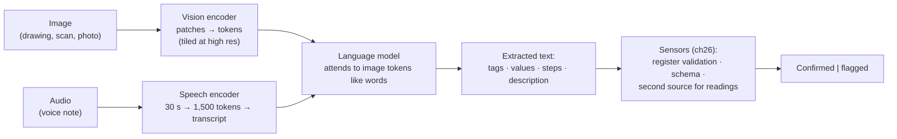
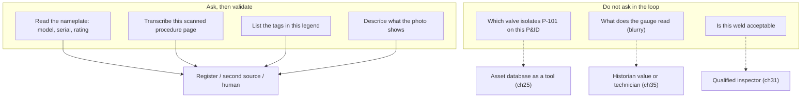

# Chapter 14 — Multimodality

*Part I · Word budget 4,500–7,000 · Lab 14 · Verified as of September 2026 · Derived figures from `labs/ch14-multimodal/derive.py`*

## 14.1 Intuition

Half of what a maintenance agent needs to read is not text. The P&ID that shows where P-101 sits in the process, the scanned procedure from years ago that was never re-typed, the photograph the technician takes of the leaking seal, the nameplate with the pump's serial and rating, the technician's voice note from the pump deck — all of it reaches the agent as pixels or sound, and a language model reads tokens.

Multimodal models close the gap by turning an image into tokens before the language model sees it: a vision encoder cuts the image into patches, embeds each, and hands the language model a sequence of image tokens it attends to like words. The mechanism is the transformer again, and so are its costs. An image is hundreds to thousands of tokens; a scanned page is nine thousand; a full P&ID sheet at drawing resolution is six thousand, and a procedure corpus stored as page images is eighteen times the tokens of the same corpus as text (derive.py, derived). The first lesson is that images are expensive input and text is cheap, which is why the plant's pipeline extracts text once (ch07) and sends images to the model only when the image is the question.

The second lesson is about what the model sees. It reads printed text well, handwriting adequately, and equipment tags — the thing the plant cares most about — with a confusion between O and 0, I and 1, S and 5 that no amount of prompting removes (optical confusion classes; illustrative of the failure, quantified in 14.3). It sees the symbols on a P&ID and reads their labels, and it does not reliably trace a line from a valve to a pump across a crowded sheet. For the plant the design that follows is the one every chapter of this book converges on: the model extracts, a deterministic sensor validates — every extracted tag against the equipment register — and the harness knows exactly which tags it could not confirm.

## 14.2 Mechanism

### From pixels to tokens

A vision transformer divides an image into fixed-size patches — 16 × 16 or 14 × 14 pixels — flattens each into a vector, projects it, adds a position embedding, and feeds the sequence to a transformer encoder; the patches are the image's tokens (Dosovitskiy et al., "An Image is Worth 16×16 Words," 2020, primary). At 224 pixels and 14-pixel patches that is 256 tokens; at 336, 576; at 448, 1,024; at 1,024 pixels, 5,329 (derive.py, derived). The encoder is trained to align image embeddings with text embeddings — CLIP's contrastive objective over image–caption pairs is the reference (Radford et al., "Learning Transferable Visual Models from Natural Language Supervision," 2021, primary) — so that a picture of a pump and the word "pump" land near each other, which is what lets a language model use the encoder's output.

A multimodal language model connects the two: the encoder's patch embeddings pass through a projection into the language model's embedding space and are inserted into the token sequence, where the language model's attention treats them as it treats words (Alayrac et al., "Flamingo," 2022, primary, for the cross-attention design; Liu et al., "Visual Instruction Tuning," LLaVA, 2023, primary, for the simple projection that most open models use). Training then proceeds as in ch08 — instruction pairs with images, preference data — and the result is a model that answers questions about pictures with the same fluency, the same confidence, and the same failure classes (ch13) as it answers questions about text.

### Resolution and tiling

An encoder trained at 336 pixels sees a 3,000-pixel drawing as a thumbnail; the tag on a valve is two pixels wide and unreadable. Production models handle high resolution by tiling: the image is cut into 512-pixel tiles (the pattern several vendors document), each tile encoded separately, the tiles' tokens concatenated after a global thumbnail, and often pooled to a fixed budget per tile (vendor vision documentation, verified Sep 2026; the per-tile budget varies by vendor and the chapter uses 256 as an illustrative value). A P&ID sheet at 3,000 × 2,000 is 24 tiles and about 6,400 tokens; a 300-dpi A4 scan is 35 tiles and about 9,200; a phone photograph at full resolution is 48 tiles and 12,500 (derive.py, derived). The token count is the bill and the context cost, and it is why the harness downsamples images to the resolution the task needs and no more — a nameplate photo at 1,024 × 768 is 4 tiles and 1,280 tokens.

### What vision models do well and badly on industrial documents

**Printed text and tables**: strong; document question-answering benchmarks measure it (Mathew, Karatzas, and Jawahar, "DocVQA," 2021, primary), and the models read a scanned procedure's steps, a nameplate's rating, and a table's cells with accuracy that depends mainly on resolution.

**Handwriting**: adequate on clear block capitals, unreliable on cursive and on technicians' field notes; the plant measures.

**Identifiers**: the failure that matters. Optical confusions — O/0, I/1, S/5, B/8, Z/2 — mean a five-character tag read at a 2% per-character error rate is exactly right 90% of the time; at 5%, 77% (derive.py, derived). The plant's fix is not a better model but a sensor: every extracted tag is validated against the equipment register, and a misread tag is corrected when a substitution within the optical confusion classes lands on exactly one registered tag — which recovers most single-character errors and takes the 2% case to about 99.6% (derive.py, derived). The order of the correction matters, and Lab 14 found why: registers are dense — P-100 to P-399 — so a plain edit-distance rule finds P-1O1 one edit from P-101 *and* from P-111, P-121, and every other neighbour, and never corrects anything; the confusion-class substitution (O → 0, not O → 1) is what disambiguates. A tag with no unique candidate is flagged, not guessed.

**Symbols and topology on drawings**: the models name the symbols they were trained on and read their labels; tracing a line across a crowded sheet — which valve isolates which pump — is unreliable and is not a question to ask a vision model in the loop. The plant's P&ID intelligence, where it exists, lives in a CAD export or an asset database the agent queries as a tool (ch25); the image is for the human, and for the legend.

**Photographs of equipment**: the model describes what it sees — a wet flange, a corroded bolt, a gauge reading — and it hallucinates readings on blurry gauges as readily as it hallucinates torques (ch13). A gauge reading from a photograph is a claim with a confidence the harness does not have; the sensor is a second photograph, a technician's confirmation, or the historian's value.


### Training data and what the encoder learned

The vision encoder's competence is its training data's. CLIP-style encoders learned from hundreds of millions of web image–caption pairs (Radford et al. 2021, primary): photographs of ordinary objects with ordinary captions. Engineering drawings, scanned forms, and equipment nameplates are rare in that data, and the encoder's features for them are weaker than its features for a dog or a street. The instruction-tuning stage that follows (Liu et al. 2023, primary) adds document and chart data, and the vendors have added more with each generation; the models read a table today that they could not read two years ago (vendor model cards, verified Sep 2026). Two consequences for the plant. The encoder was never trained on this plant's symbol library or tag format, and no prompt teaches it one — the register sensor is the substitute for that training. And a model's document-reading score on a public benchmark is a score on public documents; the plant's scans, drawings, and photographs are measured on the plant's golden set (ch12) before the ingestion pipeline trusts them.

### Layout, reading order, and the table problem

A page is two-dimensional and the model emits one dimension. Reading order — which column first, whether a footnote interrupts a step, where a table's header sits relative to its rows — is inferred by the model from layout, and it is inferred wrong often enough to matter: a two-column procedure read across columns interleaves two steps into nonsense; a table read row by row without its header loses the units. Document-layout models and the vendors' document modes address this with explicit structure detection, and the ingestion pipeline (ch07) asks for structured output — steps as a list, tables as cells with headers — rather than free text, then validates the structure with the same schema sensor the work order uses (ch26). The parse-quality sample of ch07 reads the extracted structure against the page for exactly this failure, per format.

### Cost, latency, and when to send a picture

An image is thousands of input tokens and its prefill is proportional (ch10): a 9,216-token page costs about $0.012 at the frontier fresh-input price and adds a second or more to time-to-first-token (derive.py; price vendor, Sep 2026; latency illustrative). Sent once at ingestion for 36,000 pages, the procedure corpus costs about $415 to extract — a fraction of the review it needs (ch07). Sent on every query, the same pages would cost 18 times the text and slow every answer. The rule that follows is the one in 14.2: the image travels with the request only when the image is the question. Provider-side prompt caching does not apply to images the way it applies to a stable text prefix (vendor documentation, verified Sep 2026), so an image in the prefix is an image paid for every call.


### Optical character recognition versus vision-language extraction

Two tools read a page and the plant needs both. Classical OCR — engines trained to recognize characters, with layout analysis in front — is fast, cheap, deterministic, and returns character confidences; it fails on degraded scans, unusual fonts, and handwriting, and it does not understand what it reads. A vision-language model reads degraded text by using context — it knows a torque table has numbers and units — and it can be asked for structure; it is slow, costs thousands of tokens a page, is non-deterministic, and will complete a smudged number with a plausible one (ch13). The pipeline uses OCR first for born-clean scans and reserves the vision model for pages OCR marks low-confidence; on identifiers, both feed the register sensor, and a page where the two disagree on a tag goes to the parse-quality sample by rule. The engines are practitioner tools rather than research objects, and the measurement — character error rate and identifier exact-match per format, per tool — is the plant's (14.4).

### Video and the moving picture

A video is images at a rate, and the models that accept it sample frames — one a second, or fewer — and encode each; a minute of video is sixty or more images' worth of tokens (vendor documentation, verified Sep 2026). For the plant the use is narrow: a technician's walk-around clip becomes a handful of frames the model describes, and the description enters the record as observation, never as measurement. Continuous camera feeds are not agent input; they belong to the plant's video systems, and if an event from them ever reaches the agent it does so as a text alert through intake (ch17).

### Generation is not the plant's use

Multimodal models also produce images, and the plant's harness does not ask them to. A generated diagram, a rendered P&ID, or a synthesized photograph of "what the failure looks like" is an artifact with no provenance and every hallucination risk of a generated paragraph; the output policy (ch28) excludes generated images from work orders, reports, and evidence packs. The one legitimate use is illustration for training material, labelled as generated, outside the harness's records.

### Audio

Speech models encode audio into tokens too: Whisper's encoder turns a 30-second window into 1,500 tokens for a transformer decoder that emits text (Radford et al., "Robust Speech Recognition via Large-Scale Weak Supervision," 2022, primary). For the plant, audio is transcription — a technician's voice note becomes a text request at intake (ch17) — and the transcription is a document with the same rules as any other: identifiers validated against the register (spoken tags are the same confusion in another channel), language identified per note, personal data handled per class (ch07). Plant noise degrades transcription, and the measurement is word error rate on the plant's own recordings, per location, before any voice interface is trusted at intake.

**Figure 14.1 — Modalities into the token stream, and the sensor after each.**



*Takeaway: the model turns pixels and sound into claims; the register and the sensors turn claims into confirmed data.*


### Grounding an answer in an image

A text answer cites a chunk; an image answer should cite a region. The models increasingly return bounding boxes or point coordinates for what they read — "the serial is at these pixels" — and the harness stores the region with the extracted value, so a reviewer can look at the exact patch that produced a tag rather than the whole drawing (vendor documentation on grounding outputs, verified Sep 2026). The citation sensor of ch26 has an image form: a value entered from an image carries its source image id, page, and region; a value without them is unsupported and the abstention path applies (ch13). For the parse-quality sample this is what makes review fast — the reviewer sees the crop and the extracted text side by side — and for an audit it is what makes an extracted value reproducible.

### Multimodal inputs in the loop

An image can enter at three points of the agent loop (ch22). At intake, as the technician's photograph or a scanned request — transcribed, validated, confirmed. At retrieval, as a linked asset the human opens — never as tokens in the model's per-step window unless a step asks a question of the picture. And at Act, when a tool returns an image (a camera snapshot, a rendered drawing) — treated as untrusted content, its text validated, its tokens counted against the step's budget. The per-step context assembly (ch19) has a rule for all three: an image enters the window once, for the step that needs it, and is replaced by its extracted text and region citation for every step after.

### Reference implementation

Patch and tile arithmetic, and the register-validation sensor for extracted identifiers. Lab 14 runs them on a synthetic extraction with seeded optical confusions and reproduces 14.3.

```python
import math

def patch_tokens(width: int, height: int, patch: int = 14) -> int:
    return (height // patch) * (width // patch)

def tiled_tokens(width: int, height: int, tile: int = 512, per_tile: int = 256, base: int = 256):
    """Vendor-style high-resolution encoding: a base thumbnail plus a pooled budget per tile (per_tile illustrative)."""
    tiles = math.ceil(width / tile) * math.ceil(height / tile)
    return tiles, base + tiles * per_tile

CONFUSIONS = {"O": "0", "0": "O", "I": "1", "1": "I", "S": "5", "5": "S", "B": "8", "8": "B", "Z": "2", "2": "Z"}

def edit_distance(a: str, b: str) -> int:
    prev = list(range(len(b) + 1))
    for i, ca in enumerate(a, 1):
        cur = [i]
        for j, cb in enumerate(b, 1):
            cur.append(min(prev[j] + 1, cur[j - 1] + 1, prev[j - 1] + (ca != cb)))
        prev = cur
    return prev[-1]

def confusion_candidates(s: str, max_subs: int = 2) -> set:
    """All strings reachable by substituting up to max_subs characters within the optical confusion classes."""
    out = {s}
    frontier = {s}
    for _ in range(max_subs):
        nxt = set()
        for w in frontier:
            for i, ch in enumerate(w):
                if ch in CONFUSIONS:
                    nxt.add(w[:i] + CONFUSIONS[ch] + w[i + 1:])
        frontier = nxt - out; out |= nxt
    return out

def validate_tag(extracted: str, register: set, max_edits: int = 1) -> dict:
    """Confirm an extracted identifier against the equipment register. Correction order: (1) optical-confusion
    substitutions that land on exactly one registered tag; (2) a unique registered tag within max_edits; else flag.
    Dense registers (P-100…P-399) make plain edit distance ambiguous — P-1O1 is one edit from P-101 and P-111 —
    so confusion-class correction runs first."""
    if extracted in register:
        return {"tag": extracted, "status": "confirmed"}
    conf = [t for t in confusion_candidates(extracted) if t in register and t != extracted]
    if len(conf) == 1:
        return {"tag": conf[0], "status": "corrected", "from": extracted, "by": "confusion-class"}
    near = [t for t in register if edit_distance(extracted, t) <= max_edits]
    if len(near) == 1:
        return {"tag": near[0], "status": "corrected", "from": extracted, "by": "edit-distance"}
    return {"tag": None, "status": "flagged", "from": extracted, "candidates": sorted(set(conf) | set(near))}

def validate_all(extracted: list, register: set) -> dict:
    results = [validate_tag(t, register) for t in extracted]
    return {"results": results,
            "confirmed": sum(r["status"] == "confirmed" for r in results),
            "corrected": sum(r["status"] == "corrected" for r in results),
            "flagged": sum(r["status"] == "flagged" for r in results)}
```

The sensor does not know what the image looked like; it knows what the plant's equipment register says exists and which characters a scanner confuses, and those two facts are the ground truth the model lacks. The first version of this sensor used edit distance alone, and the lab's dense synthetic register showed it correcting nothing; the confusion-class pass was added because of that run.

### Images in the harness

Four rules. **Extract once, at ingestion** (ch07): scanned documents become text with per-page provenance and a parse-quality sample; the index holds text, and the image is a linked asset for the human. **Send the image only when it is the question**: a photograph of the failure, a nameplate to read, a legend to look up — downsampled to the resolution the task needs, with the token cost recorded per call (ch29). **Validate every identifier and every reading**: tags against the register; readings against a second source or a human; the vision model's output is a claim (ch13). **Keep images out of the policy path**: an image can carry an injected instruction as surely as a document — text in the picture is text in the context — and the policy engine (ch28) governs what the model does with what it read from a picture exactly as with what it read from a file.

**Figure 14.2 — What the plant asks a vision model, and what it does not.**



*Takeaway: extraction and description, validated; topology, readings, and judgments belong to tools and people.*

### Cookbook evidence: pixels are tokens

The vendor's cost-optimization notebook states the image tokenization rule and shows it: images and PDF pages are tokenized by pixel area at roughly one token per 28×28-pixel patch, so cost scales with resolution rather than information content; a claim photograph at 2048×1536 cost 4,088 tokens and the same photograph downscaled to 960×720 cost 928 — and still answered "is the bumper dented"; 1280×720 is the notebook's safe default, capping an image near 1,200 tokens (Anthropic, Claude Cookbook, August 2026, vendor). The same notebook moved a 5,000-row CSV out of the window — 135,000 tokens pasted in context against 19,800 through the Files API and the code-execution tool, 79% cheaper — which is this chapter's rule for tables and PDFs: extract or compute in the sandbox, and let only the answer reach the model.

## 14.3 Worked numbers

All figures from `derive.py` (derived).

**Patch tokens by resolution (14-pixel patches).** 224 px: 256. 336 px: 576. 448 px: 1,024. 1,024 px: 5,329.

**Tiled encoding (512-pixel tiles; 256 tokens per tile plus a 256-token thumbnail; per-tile budget illustrative).**

| Image | Tiles | Tokens | Cost at $1.25/M input |
|---|---|---|---|
| Thumbnail 1,024 × 768 | 4 | 1,280 | — |
| P&ID sheet 3,000 × 2,000 | 24 | 6,400 | $0.008 |
| A4 scan, 300 dpi | 35 | 9,216 | $0.012 |
| Phone photo 4,032 × 3,024 | 48 | 12,544 | — |

**Images versus text for the procedure corpus.** 3,000 procedures × 12 pages = 36,000 page images at 9,216 tokens: 332 million tokens. The same corpus as extracted text: 18 million (scenario). Ratio 18.4×. The pipeline extracts once.

**Tag reading.** Five-character tag, per-character optical error: 1% → exact 95.1%; 2% → 90.4%; 5% → 77.4%. With register validation at one edit: the 2% case recovers 9.2 points of single-character errors and reaches 99.6%.

**Audio.** 1,500 encoder tokens per 30 seconds in the Whisper design (Radford et al. 2022, primary).

## 14.4 Measurement

**Extraction accuracy per document class and resolution.** On the golden set's scanned procedures, nameplates, and legends: character error rate on text; exact-match rate on identifiers before and after register validation; per resolution, so the downsampling rule is set from data. Lab 14 does the validation arithmetic on a synthetic extraction; the extraction itself is measured on the plant's images with the model in use.

**Register-validation outcomes.** Confirmed, corrected, flagged counts per batch; the flagged list reviewed; a rising corrected share is a resolution or a lighting problem upstream.

**Reading claims.** For gauge and nameplate readings, agreement with the historian or a second photograph; readings without a second source are not entered.

**Word error rate** on plant voice notes, per location and language; the threshold for voice intake is set from it.

**Token cost per image class** from the gateway (ch29); a class whose tokens per call rise is one where downsampling has slipped.

**OCR–VLM disagreement rate** on identifiers per format; the rate is the parse-quality sample's size, and a rising rate is a scanner, lighting, or format change upstream.

**Region coverage.** Share of image-extracted values stored with a region citation; the target is 100%, enforced by the ingestion pipeline refusing values without one.

What to record: model and version, image resolution as sent, tiling as reported by the provider, tokens billed, register version, date.


### Reference output (Lab 14, this run)

What the lab prints when it reproduces; the plant's numbers replace these.

```text
patches 224px/14: 256 (chapter 256) OK
patches 336px/14: 576 (chapter 576) OK
patches 1024px/14: 5329 (chapter 5329) OK
A4 scan 300dpi (2480x3508): 35 tiles, 9216 tokens (chapter 35, 9216) OK
P&ID sheet (3000x2000): 24 tiles, 6400 tokens (chapter 24, 6400) OK
phone photo (4032x3024): 48 tiles, 12544 tokens (chapter 48, 12544) OK
corpus image/text ratio 18.4 (chapter 18.4)
exact before validation 0.969 (chapter ~0.904); after 1.000 (chapter ~0.996); confirmed 4846 corrected 154 flagged 0; wrong-and-not-flagged 0
validation improves exact-match and never silently guesses a wrong tag beyond the 1-edit-unique rule: True
Lab 14: REPRODUCED
```

## 14.5 Failure

| Failure mode | Mechanism | Detection signal | Mitigation | Owning component |
|---|---|---|---|---|
| Full-resolution by default | Every image sent at native size | Image tokens dominate input cost | Downsample to the task's resolution; cost per image class tracked | ch29; this chapter |
| Corpus as images | Scans kept as page images in the index | 18× the tokens; slow retrieval | Extract text at ingestion; image as linked asset | ch07 |
| Tag confusion trusted | O/0, I/1 errors enter the work order | Wrong equipment on a record | Register validation; flag unresolvable tags | This chapter; ch26 |
| Line tracing in the loop | Model asked which valve isolates which pump | Wrong isolation reference | Asset database as a tool; image for humans | ch25; ch35 |
| Reading from a blurry gauge | Model states a value with no support | Value disagrees with historian | Second source required; reading is a claim | ch13; ch35 |
| Injection through an image | Instruction text inside a picture | Output follows text from the image | Policy engine; image text is untrusted content | ch28 |
| Handwriting overtrusted | Field notes transcribed with silent errors | Transcription disagrees with technician | Measure per class; confirm at intake | ch17 |
| Voice in noise | Transcription errors on the pump deck | High WER at that location | Per-location WER threshold; confirmation step | ch17 |
| Photo as evidence of condition | Description read as an inspection verdict | Acceptability judged by the model | Qualified inspector; model describes, human judges | ch31 |
| Provider tiling unrecorded | Token cost per image unknown | Bills unexplained | Tokens billed per call recorded with resolution | ch29 |
| Reading order wrong | Two-column page read across columns | Interleaved steps; tables without headers | Structured extraction; parse-quality sample per format | ch07 |
| Image in the cached prefix | Picture placed with the stable prefix | Paid on every call; no cache benefit | Images only with the request that needs them | ch18; ch37 |
| Generated image as evidence | Rendered picture enters a record | Artifact with no provenance | Output policy excludes generated images | ch28 |
| OCR and VLM disagree silently | Two extractions, one chosen arbitrarily | Tag mismatch undetected | Disagreement routes to parse-quality review | ch07 |

The recurring modes above appear, with their owning components and golden cases, in the failure catalogue (ch33).

## 14.6 The frontier

**Strongest free treatments.** Dosovitskiy et al. (2020) on vision transformers; Radford et al. (2021) on CLIP; Alayrac et al. (2022) and Liu et al. (2023) on connecting vision to language models; Mathew et al. (2021) on document question answering; Radford et al. (2022) on Whisper. Vendor documentation covers image tokenization and pricing for each provider. Each stops at its method or its product. Huyen's *AI Engineering* (2025) covers multimodal models in its foundations chapter and stops before the per-image token arithmetic for industrial documents and the register-validation sensor.

**What this chapter adds.** The patch and tile arithmetic carried to the cost of a drawing, a scan, and a corpus; the identifier-confusion arithmetic and the register sensor that recovers it; the division of labour — extraction and description validated, topology and readings and judgments to tools and people; audio as a document at intake; and runnable validation code. Open: vision-model identifier accuracy on industrial drawings and scans at plant resolutions is unmeasured in the literature; the protocol in 14.4 is the measurement.

**Related chapters.** ch20 (Retrieval and knowledge).

## 14.7 Industrial application

**The 2009 procedure.** Never re-typed, scanned at 300 dpi, twelve pages. Ingestion (ch07) sends each page to the vision model once — 9,216 tokens a page, about $0.14 for the document (derive.py; price vendor) — and stores the text with per-page provenance; the parse-quality sample finds "P-1O1" on page four, the register sensor corrects it to P-101, and the corrected text is what the index holds. The image stays linked for the planner who wants to see the original.

**The technician's photograph.** A wet flange, a seal weeping. Sent at 1,024 × 768 — 1,280 tokens — with the request; the model describes it, the description enters the draft work order as the technician's evidence with the photograph attached, and no value is read from it. The nameplate in the same photo is read and the serial validated against the register.

**The P&ID.** The agent does not trace it, and the chapter's rule is not a caution about a weak model but a design decision: isolation topology is safety-relevant, the asset database is authoritative, and a vision model's reading of a crowded sheet is a claim without a sensor. The isolation valves for P-101 come from the asset database through a read tool (ch25); the P&ID sheet is attached to the work order for the permit process, where a person reads it. The legend's tag list, extracted once at ingestion and validated, is what makes the sheet findable by equipment.

**The voice note.** "Bomba P-101, selo vazando, precisa de OS." Transcribed at intake; the tag validated against the register — the speech model heard "P-1-0-1" and the register confirms it; the request confirmed back to the technician before the task starts (ch17), because the plant's word error rate on the pump deck was measured at a level that makes confirmation cheap insurance (illustrative). The transcript, the audio's id, and the confirmation are the request's provenance.

**OT boundary.** A gauge in a photograph is not a historian value; a drawing is not a control system; nothing the model reads from an image reaches a controller (ch35).

## 14.8 Decision aids

**Resolution rule per task.** Nameplate or photo description: 1,024 pixels on the long side. Scanned page for extraction: 300 dpi, once at ingestion. Drawing legend: full resolution once at ingestion; thumbnail thereafter. Record tokens billed per class.

**Image-input checklist.** Is the image the question, or is its text already in the index? Downsampled to the rule? Every identifier validated against the register? Every reading confirmed by a second source? Image text treated as untrusted for policy? Region cited for every value? Tokens recorded? Out of the cached prefix?

**Region-citation rule.** Every value extracted from an image is stored with image id, page, and region; a value without a region is unsupported. Reviewers see the crop, not the sheet.

**Validation outcome handling.** Confirmed → proceed. Corrected → proceed with the correction logged. Flagged → the step abstains on that identifier and routes to a human (ch13's abstention path).


**Ingestion extraction table (per format; starting values).**

| Format | First pass | Second pass | Identifier sensor | Sample rate |
|---|---|---|---|---|
| Born-digital PDF | Text layer | — | Register | 1% |
| Clean scan | OCR | VLM on low-confidence pages | Register | 2% |
| Degraded scan / handwriting | VLM, structured output | OCR for cross-check | Register; disagreements to review | 5% |
| Drawing legend | VLM at full resolution once | — | Register | 5% |
| Nameplate photo | VLM at 1,024 px | — | Register + second source for ratings | per photo |
| Voice note | Speech model | Confirmation at intake | Register on spoken tags | per note |

**Vendor questions.** Tokens per image at the plant's resolutions and how tiling is computed; identifier accuracy on a sample of the plant's scans; whether image text is subject to the same content policies as document text; word error rate on industrial audio.

## 14.9 Sources

| # | Claim or figure | Source | Tier | Verified | Link |
|---|---|---|---|---|---|
| 1 | Vision transformer; patches as tokens | Dosovitskiy et al., ICLR 2021, arXiv 2010.11929 | primary | Sep 2026 | https://arxiv.org/abs/2010.11929 |
| 2 | Contrastive image–text alignment | Radford et al., CLIP, 2021, arXiv 2103.00020 | primary | Sep 2026 | https://arxiv.org/abs/2103.00020 |
| 3 | Connecting vision encoders to language models | Alayrac et al., Flamingo, 2022, arXiv 2204.14198; Liu et al., LLaVA, 2023, arXiv 2304.08485 | primary | Sep 2026 | https://arxiv.org/abs/2204.14198 |
| 4 | Document question answering | Mathew, Karatzas, Jawahar, DocVQA, 2021, arXiv 2007.00398 | primary | Sep 2026 | https://arxiv.org/abs/2007.00398 |
| 5 | Speech encoding: 30 s → 1,500 tokens | Radford et al., Whisper, 2022, arXiv 2212.04356 | primary | Sep 2026 | https://arxiv.org/abs/2212.04356 |
| 6 | Tiling at 512 px; per-image token budgets | Vendor vision documentation | vendor | Sep 2026 | https://docs.claude.com/en/docs/build-with-claude/vision |
| 7 | Patch counts; tile counts and tokens; corpus ratio; tag-error and validation probabilities; per-image cost | `labs/ch14-multimodal/derive.py` | derived | Sep 2026 | labs/ch14-multimodal/derive.py |
| 8 | 256 tokens per tile; per-character error rates; corpus page counts | Illustrative | illustrative | Sep 2026 | — |
| 9 | Identifier accuracy on industrial drawings and scans | None published at plant resolutions | open | Sep 2026 | — |
| C | Cost-optimization checklist measured on a claims agent: 10-claim eval, 2 trials per configuration | Anthropic, "Cost Optimization on the Claude API," Claude Cookbook, Aug 2026 (Lehrburger) | vendor | Sep 2026 | https://platform.claude.com/cookbook/cost-optimization-cost-optimization |