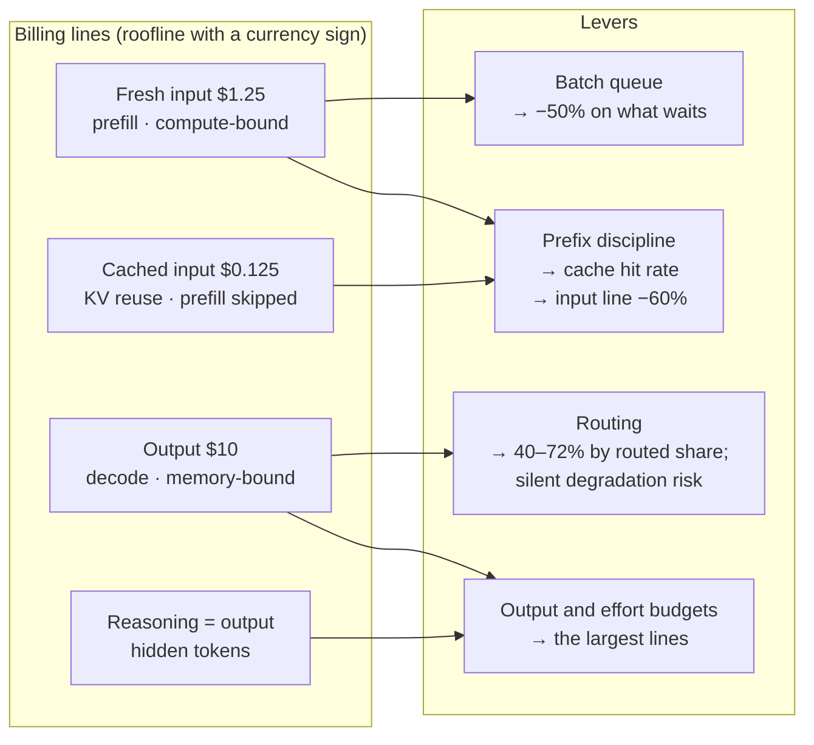
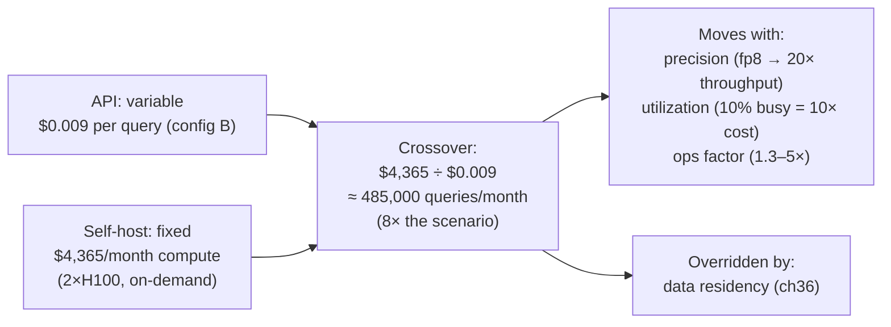

# Chapter 15 — Economics of models

*Part I · Word budget 5,000–8,000 · Lab 15 · Verified as of September 2026 · Derived figures from `labs/ch15-economics/derive.py`*

## 15.1 Intuition

The price list for a language model has four numbers, and each one is a fact about hardware that the previous chapters explained. Fresh input is cheap because prefill is compute-bound and a GPU is good at compute (ch10). Output is four to eight times dearer because decode reads the whole model from memory for every token (ch04, ch10). Cached input is a tenth of fresh because the provider skipped the prefill for a prefix it already held (ch04). Reasoning tokens are output tokens because that is what they are (ch09). The price list is the roofline with a currency sign.

That is the first half of this chapter: where the prices come from, so that the plant can predict how they will move and which of its own habits change the bill. The second half is what the plant does with them. Caching pays when a prefix is reused more than about one and a half times. Batch pricing halves the cost of anything that can wait an hour. Routing sends the routine share of queries to a model a fifth the price, and it is the lever with the largest claims and the largest gap between claims and measurement. Self-hosting is a fixed cost that crosses the variable one at a volume the plant can compute.

The chapter ends where ch37 begins: with the observation that at the plant's scale the token bill is small, and that its shape — output-heavy, reasoning-heavy, cache-sensitive — matters more than its size, because the shape is what the plant's engineering decisions move. The trajectory matters too. The list price of frontier input fell about twenty-four-fold in the two and a half years between GPT-4's launch and GPT-5's (derive.py, derived from vendor list prices); a plant that designs for today's price has designed for a number that will not be there next year, and the design that survives is the one that measures its own cost per resolved task and re-runs the arithmetic quarterly.

## 15.2 Mechanism

### The four billing lines and their origins

| Line | Sep 2026 list, frontier ($/M tokens) | Mechanism | Chapter |
|---|---|---|---|
| Fresh input | 1.25 | Prefill: compute-bound, parallel over the prompt | ch10 |
| Cached input | 0.125 | Prefix's Keys and Values already held; prefill skipped | ch04, ch10 |
| Output | 10.00 | Decode: memory-bound, one weight read per token | ch04, ch10 |
| Reasoning | billed as output | Hidden output tokens | ch09 |

(Prices are GPT-5 list prices, vendor, verified Sep 2026; the small tier — GPT-5-mini — is 0.25 / 0.025 / 2.00.)

The ratios are the roofline. Output at eight times input is decode's memory-bound cost against prefill's compute-bound efficiency; the exact ratio varies by vendor and model between four and eight (vendor pricing, Sep 2026). Cached input at a tenth is the marginal cost of storing and reading Keys and Values against recomputing them. The small tier at a fifth is a smaller model's smaller weight read (ch10's arithmetic on an 8B against a 70B) plus over-training's dividend (ch06). None of the four numbers is arbitrary, which is why none of them is stable: hardware, kernels, and model size all move, and the prices follow.


### Why output costs what it costs, and why it is falling more slowly

The output line is the one to understand, because it is the largest and the most stubborn. A generated token requires the whole model to be read from memory once (ch10); the read is amortized across the sequences in a batch, and the batch is capped by the KV cache; so the provider's cost per output token is its GPU-hour cost divided by the tokens per hour its cache-capped batches produce. Every technique that raised that figure — paged caches, grouped-query attention, quantized caches, speculative decoding (ch04, ch10, ch11) — is visible in the output price's fall; every limit that remains — memory bandwidth, cache capacity — is why it fell six-fold while input fell twenty-four-fold. Input is prefill: compute-bound, parallel, and helped by every generation of tensor hardware. The plant reads its own bill the same way: an output-heavy workload is riding the slower curve, and the lever on it is length, not waiting for the price to fall.

### Tokens are the unit, tasks are the cost

A price per token is a price for a unit the plant does not sell. What the plant buys is resolved work orders, answered questions, drafted reports, and the cost that matters is per outcome: tokens per task times price per token, divided by the task success rate — because a failed task is paid for and then paid for again (ch09's cost per correct answer; ch37's cost per resolved task). Two consequences. A cheaper model that fails more can cost more per outcome than a dearer one that fails less, which is the arithmetic behind the routing-degradation table. And the largest cost per outcome is often not tokens at all but the human minutes a failure consumes (ch37's oversight line), so the economic value of a sensor that catches a failure before the gate (ch26) is measured in reviewer hours, not in tokens saved. The gateway prices tokens; the ledger prices outcomes; the plant manages the second.

### Price discrimination and the tiers

Vendors publish tiers — frontier, mid, small — that differ in size, training, and price by an order of magnitude or more, and the tiers are the provider's routing offered as a menu. The plant's router (ch23) chooses among them per step; the small tier is the over-trained, distilled model of ch06 and ch11 priced at its smaller weight read; the mid tier is the frontier's cheaper sibling. A fourth tier is implicit: the on-site model, whose price is the fallback's compute divided by its utilization (ch10). The economic question for each step class is the same — which tier's quality retention on the golden set is within the interval at the lowest cost per outcome — and the answer changes every time a vendor releases a tier, which is why the router's table has a review date.

### Caching: mechanics and break-even

Provider-side prompt caching stores the KV state of a prompt prefix and reuses it when a later request begins with the same bytes. Three rules govern it (vendor documentation, verified Sep 2026). The prefix must be byte-identical — a changed token invalidates every cached position after it (ch04). It must exceed a minimum length, typically 1,024 tokens (larger for some small models). And it expires: five minutes by default, an hour on request, with Anthropic charging a write surcharge on the first use — 1.25× the fresh price for the five-minute lifetime, 2× for the hour — while OpenAI and Google cache automatically without a surcharge.

The break-even is arithmetic. With a write at $w$ times the fresh price and reads at a tenth, caching pays when the prefix is reused more than $w / (1 - 0.1)$ times: 1.39 reuses at 1.25×, 2.22 at 2× (derive.py, derived). The agent's stable prefix — 4,000 tokens of guides, tool schemas, and reference chunks (ch16's scenario) — is reused thousands of times a day; caching is not a question. The effective input price is what moves: at a two-thirds cacheable share, a 50% hit rate gives $0.875 per million, 90% gives $0.575, and a perfect hit rate gives $0.50 — a 60% cut in the input line from prefix discipline alone (derive.py, derived).

### Batch pricing

Work that can wait is priced at half (vendor batch APIs, verified Sep 2026): the provider fills idle capacity at the trough (ch10's utilization argument from the other side). For the plant, overnight ingestion, golden-set runs, and periodic reports are batch work; interactive queries are not. If a fifth of the workload can wait, the blended discount is 10%; if half, 25% (derive.py, derived). The harness routes by queue (ch10, ch21), and the batch queue's share is a number the gateway reports.

### Routing: the evidence and the arithmetic

A router sends each query — or each step — to the cheapest model that will handle it. Three families exist (ch23 gives the designs): a classifier that predicts difficulty before generation; a cascade that tries the cheap model, checks the answer, and escalates on failure; and semantic routing by similarity to labelled clusters. The published results are strong and conditional. RouteLLM reported cost reductions over 85% on MT-Bench, 45% on MMLU, and 35% on GSM8K while retaining 95% of GPT-4's quality (Ong et al., "RouteLLM," 2024, primary); FrugalGPT reported up to 98% with cascades (Chen, Zaharia, Zou, 2023, primary). Independent evaluations on realistic traffic land nearer 35% at under 2% quality loss, and routing skill does not transfer to unfamiliar task types (RouterArena-style evaluations, analyst). Bedrock's intelligent routing reports about 30% within a model family (vendor).

The arithmetic for the scenario's query — 2,000 fresh, 4,000 cached, 400 output tokens — is direct: all-frontier $0.0070 per query, all-small $0.0014, and at 50 / 70 / 90% routed to small, $0.0042 / $0.0031 / $0.0020, savings of 40 / 56 / 72% (derive.py, derived). The saving is a function of the routed share, and the routed share is a function of the classifier's accuracy and the workload's difficulty mix — which is why the headline numbers are ceilings.

The risk is silent degradation. If 30% of queries are hard and the router recognizes them with 80% accuracy, 6% of all queries are hard queries sent to the small model; if the small model fails half of those, the task failure rate rises by 3 points with no alarm — the queries were answered, wrongly (derive.py, derived). At 95% router accuracy the added failure is 0.8 points. The measurement is quality retention per step class on the golden set with intervals (ch12), and the design is the sensors (ch26) that catch the small model's failures the router did not predict.


### Semantic caching: a different economy

Prompt caching reuses a prefix's computation; semantic caching reuses a whole answer. A query that embeds close to a recent one (ch02) returns the stored answer without a model call — saving the entire call, not the prefill — and it carries a failure prompt caching cannot have: a false hit that returns the right answer to the wrong question, two queries about different pumps embedding as one. The economics are a hit rate times a full call's cost against a false-hit rate times the cost of a wrong answer reaching the gate (ch13's $150 against $6, illustrative); at the plant's costs a semantic cache pays only when the false-hit rate is a fraction of a percent, and that rate is measured on the golden set with exact-term and metadata match required before any hit (ch02's rule). For procedure Q&A with near-identical wording across equipment, the answer is usually to leave semantic caching off and let prompt caching carry the saving.

### Contracts, commitments, and rate limits

List prices are the ceiling. Committed-use discounts, enterprise agreements, and reserved capacity lower the per-token price in exchange for volume commitments or fixed monthly spend; rate limits cap the tokens per minute a plant can send and are raised with spend tier (vendor documentation, verified Sep 2026). Three rules. A commitment is priced against the measured workload, not the planned one, because the plant's volume is the number the sensors and the gate leave after failures, and it is smaller than the demo suggested. A rate limit is a capacity the harness's queues (ch21) respect, with the on-site fallback absorbing the overflow rather than the plant paying for a higher tier it uses one hour a day. And the contract states the price-change notice period, because the trajectory runs in the plant's favour and a long fixed price is a bet against it.

### What a price-per-token comparison misses

Two models at the same list price are not the same cost. They tokenize the plant's Portuguese differently (ch01), so the same document is a different token count; they differ in output verbosity, so the same task is a different output line; they differ in the reasoning tokens they emit at a given effort (ch09); and they differ in the routed share they can carry at quality. The comparison that holds is cost per resolved task on the golden set per class, with all four lines recorded (ch12, ch37). A vendor comparison on price per million tokens is the least informative number in this chapter; it is also the only one a vendor prints in large type.

### Self-hosting: the crossover

A rented GPU is a fixed cost per hour; an API is a variable cost per token. The two lines cross where monthly GPU cost equals monthly API cost. For the plant's two-GPU fallback at $4,365 a month of compute (ch10, ch37) against the API's configuration-B cost of about $0.009 per query, the crossover is 485,000 queries a month — eight times the scenario's 60,000 (derive.py, derived). Below it the API is cheaper; above it, self-hosting is, at the utilization the arithmetic assumed. Three things move the crossover: precision (an 8-bit fallback serves twenty times more per hour, ch10), utilization (a GPU busy 10% of the time costs ten times per token what a busy one does), and the operations factor (1.3–5× compute, ch37). And one thing overrides it: data residency. A query that may not leave the perimeter is served on site at any price (ch36).

**Figure 15.1 — The four lines, their mechanisms, and the four levers.**



*Takeaway: the plant does not set prices; it sets the hit rate, the batch share, the routed share, and the output length.*

### The trajectory

Frontier list prices have fallen faster than any other input the plant buys. GPT-4 at launch in March 2023 was $30 per million input tokens and $60 per million output for the 8K-context model; GPT-5 in August 2025 lists at $1.25 and $10 — a 24-fold fall on input and 6-fold on output in about two and a half years, for a more capable model (vendor list prices, historical; ratios derive.py, derived). Output fell less because decode's memory-bound cost is harder to engineer away than prefill's. Two consequences. A break-even computed today moves toward the API every quarter, so a self-hosting decision is re-run, not made once. And the token bill's share of the cost anatomy (ch37) shrinks while the oversight and engineering lines do not — the plant's spending migrates from the model to the harness, which is where this book says it belongs.

### Reference implementation

Blended input price, cache break-even, batch blending, routing cost and its degradation risk, and the self-host crossover. Lab 15 runs them against the scenario and reproduces 15.3.

```python
PRICES = {"in": 1.25, "cached": 0.125, "out": 10.0, "small_in": 0.25, "small_cached": 0.025, "small_out": 2.0}  # $/M, list, Sep 2026

def blended_input_price(hit_rate: float, cacheable_share: float, p=PRICES) -> float:
    return (1 - cacheable_share) * p["in"] + cacheable_share * (hit_rate * p["cached"] + (1 - hit_rate) * p["in"])

def cache_breakeven_reuses(write_multiplier: float, p=PRICES) -> float:
    """Reuses of a prefix at which caching (write once, read cheaply) beats paying fresh every time."""
    return write_multiplier * p["in"] / (p["in"] - p["cached"])

def batch_blended_discount(batch_share: float, discount: float = 0.5) -> float:
    return batch_share * discount

def query_cost(fresh: int, cached: int, out: int, tier: str = "frontier", p=PRICES) -> float:
    if tier == "frontier":
        return (fresh * p["in"] + cached * p["cached"] + out * p["out"]) / 1e6
    return (fresh * p["small_in"] + cached * p["small_cached"] + out * p["small_out"]) / 1e6

def routed_cost(routed_share: float, fresh=2000, cached=4000, out=400) -> float:
    return routed_share * query_cost(fresh, cached, out, "small") + (1 - routed_share) * query_cost(fresh, cached, out, "frontier")

def silent_degradation(hard_share: float, router_accuracy: float, small_fail_on_hard: float) -> float:
    """Added task-failure rate from hard queries misrouted to the small model."""
    return hard_share * (1 - router_accuracy) * small_fail_on_hard

def selfhost_crossover(monthly_gpu_cost: float, api_cost_per_query: float) -> float:
    """Queries per month at which a fixed GPU bill equals the variable API bill."""
    return monthly_gpu_cost / api_cost_per_query
```

### What the plant controls

Four levers, in order of leverage for the scenario. **Output length and reasoning effort** (ch01, ch09): the largest lines, moved by format discipline, constrained output, and per-step effort budgets. **Prefix discipline** (ch18): stable content first, byte-identical, above the cache minimum — the input line's 60% cut (derive.py, derived). **Routing** (ch23): the routed share, measured on the golden set with quality retention, not assumed from a headline. **Queue placement** (ch10, ch21): what waits goes to batch. None of the four is a price negotiation; all four are engineering, recorded per call by the gateway (ch29) so the plant can see which lever moved the bill.

**Figure 15.2 — Self-host crossover for the scenario.**



*Takeaway: at the plant's volume the API is cheaper by eight times; the fallback exists for residency and availability, and the crossover is re-run quarterly.*

### Cookbook evidence: the levers in the vendor's order

Anthropic's Applied AI team published its cost-optimization checklist as a measured notebook in August 2026, and its order is the chapter's argument with the vendor's numbers attached: get it working on a capable model and build an eval; prompt caching; input-token management; agent-loop efficiency; output-token management; Batch API; model selection and effort — model last, because it is the one lever that lowers the intelligence ceiling (Anthropic, "Cost Optimization on the Claude API," Claude Cookbook, August 2026, vendor). On a claims-adjuster agent with a ten-claim eval, an unoptimized frontier baseline cost $0.29 per task at 10/10; the Pareto-optimal configuration at a 100% bar — a mid-tier model at medium effort with an explicit cache breakpoint on the static prefix — cost about $0.022, thirteen times less; the explicit breakpoint alone roughly halved cost per task, because auto-caching only amortizes within one conversation. The notebook's negative results are as useful: moving the reference manual behind a tool cut the prefix by 80% and gave back a claim; tool-search deferral added cost at a dozen small schemas; code execution added tokens where there was no numeric work; context editing and compaction changed nothing on six-turn loops. Its method statement is this book's: measure cost per completed task, not per token; set the quality bar first; run about fifty cases and at least five trials before a production decision. The figures are the vendor's on the vendor's example — direction, not the plant's number.


### Price note (VERIFY, 21 Sep 2026)

The list prices this chapter derives from — $1.25 / $0.125 / $10 per million for the frontier tier and $0.25 / $0.025 / $2 for the small tier — are OpenAI's still-published GPT-5 and GPT-5-mini rates (OpenAI pricing documentation, vendor, verified Sep 2026). They are no longer the flagship tier: current flagships list at $5–10 input and $30–50 output per million (OpenAI GPT-5.5; Anthropic Fable 5, vendor pricing pages, Sep 2026), four to eight times the figures used here. The chapter's ratios (cache break-even, routing savings, crossover) hold under any price pair with the same structure; the absolute dollar figures scale with the tier chosen, and a plant re-derives them from `derive.py` with its own prices.

## 15.3 Worked numbers

All figures from `derive.py` (derived); list prices vendor, September 2026.

**Blended input price at a two-thirds cacheable share.**

| Cache hit rate | Effective $/M input | Cut vs fresh |
|---|---|---|
| 0% | 1.250 | — |
| 50% | 0.875 | 30% |
| 90% | 0.575 | 54% |
| 100% | 0.500 | 60% |

**Cache break-even.** 1.39 reuses at a 1.25× write surcharge; 2.22 at 2×; no surcharge, one reuse.

**Batch blending.** 20% of work batchable: 10% off the whole; 50%: 25%.

**Routing for the scenario's query.**

| Routed to small | Cost per query | Saving |
|---|---|---|
| 0% | $0.0070 | — |
| 50% | $0.0042 | 40% |
| 70% | $0.0031 | 56% |
| 90% | $0.0020 | 72% |
| 100% | $0.0014 | 80% |

**Silent degradation.** Hard share 30%, small model fails half of hard queries: router accuracy 80% adds 3.0 points of task failure; 95% adds 0.8.

**Published versus realistic.** RouteLLM: over 85% on MT-Bench (Ong et al. 2024, primary). Independent, realistic traffic: about 35% at under 2% quality loss (analyst).

**Self-host crossover.** $4,365 ÷ $0.009 = 485,000 queries a month; the scenario is 60,000.

**Trajectory.** Input $30 → $1.25 (24×); output $60 → $10 (6×), March 2023 to August 2025.

## 15.4 Measurement

**The four lines per call**, from the gateway: fresh, cached, output, reasoning tokens and their cost, tagged by use case, step class, and model (ch29). This is the instrument; without it every figure in this chapter is an estimate.

**Cache hit rate** per request class, weekly; the stable prefix's rate should be near 100%, and a fall is prefix drift (ch18).

**Batch share** of tokens per week, and the blended discount it produced.

**Routed share and quality retention** per step class, on the golden set, with intervals (ch12); the saving is reported beside the retention, never alone.

**Cost per resolved task** (ch37), monthly, against the baseline — the number the four levers exist to move.

**Price-list refresh.** List prices re-verified quarterly and on any vendor announcement; derive.py re-run; the crossover and the routing table recomputed.

**Cost per outcome per tier.** For each step class, tokens per task × price ÷ pass rate, per candidate tier; the router's table is this measurement, and its review date is the newest tier's release.

What to record: prices with their verification date; hit rate; batch share; routed share and retention; cost per resolved task; date.


### Reference output (Lab 15, this run)

What the lab prints when it reproduces; the plant's numbers replace these.

```text
blended input @ hit 0.0: 1.25 (chapter 1.25) OK
blended input @ hit 0.5: 0.875 (chapter 0.875) OK
blended input @ hit 0.9: 0.575 (chapter 0.575) OK
blended input @ hit 1.0: 0.5 (chapter 0.5) OK
cache break-even @ 1.25x write: 1.39 reuses (chapter 1.39) OK
cache break-even @ 2.0x write: 2.22 reuses (chapter 2.22) OK
routed   0%: $0.00700 (chapter 0.007) OK
routed  50%: $0.00420 (chapter 0.0042) OK
routed  70%: $0.00308 (chapter 0.00308) OK
routed  90%: $0.00196 (chapter 0.00196) OK
routed 100%: $0.00140 (chapter 0.0014) OK
silent degradation @ router 0.8: +0.03 (chapter 0.03) OK
silent degradation @ router 0.95: +0.008 (chapter 0.008) OK
self-host crossover: 485,000 queries/month (chapter 485,000) OK
```

## 15.5 Failure

| Failure mode | Mechanism | Detection signal | Mitigation | Owning component |
|---|---|---|---|---|
| Input price compared, output ignored | Model chosen on the cheap line | Output-heavy workload costs more than planned | Price the workload's shape, not the input line | This chapter; ch23 |
| Prefix drift | A byte changes early; cache misses | Hit rate falls; input line rises | Stable prefix first, byte-identical; hit-rate alarm | ch18; ch37 |
| Cache below minimum | Prefix shorter than the provider's minimum | No cached tokens billed | Count the prefix with the tokenizer; pad with stable content if needed | ch01; ch18 |
| Headline routing saving planned | 85% assumed | Measured saving a third of plan | Golden-set measurement; plan on the measured routed share | ch23 |
| Silent degradation | Hard queries misrouted; answered wrongly | Task failure rate up with no router alarm | Quality retention per class; sensors after the small model | ch23; ch26 |
| Batch work on the interactive queue | Everything at full price | No batch discount collected | Queue placement; batch share reported | ch10; ch21 |
| Break-even computed once | Prices fall; crossover moves | Self-hosting justified on a stale price | Quarterly recomputation | This chapter; ch37 |
| Utilization ignored | Self-host priced at 100% busy | Real cost per token several times plan | Measured utilization in the crossover | ch10 |
| Reasoning unbudgeted | Effort left high | Output line dominated by hidden tokens | Effort per step class | ch09 |
| Residency treated as a cost question | Self-host rejected on price alone | Data leaves the perimeter | Residency overrides the crossover | ch36 |
| Semantic cache false hits | Similar queries about different equipment return one answer | Wrong-pump answers at the gate | Exact-term and metadata match required; measure false-hit rate; usually off | ch02; this chapter |
| Commitment on planned volume | Contract sized to the demo | Unused commitment | Commit on measured post-sensor volume | This chapter |
| Price per token as the comparison | Tokenization, verbosity, and reasoning ignored | Cheaper list, dearer task | Cost per resolved task per class | ch12; ch37 |

The recurring modes above appear, with their owning components and golden cases, in the failure catalogue (ch33).

## 15.6 The frontier

**Strongest free treatments.** Vendor pricing and caching documentation are the primary sources for the four lines and are complete and perishable. Ong et al. (2024) and Chen et al. (2023) establish routing and cascades with measured savings on benchmarks and stop there. Pope et al. (2022) and Kwon et al. (2023) explain the inference mechanics behind the prices (ch10). The FinOps Foundation's FOCUS specification defines how token billing lands in a cost ledger. Huyen's *AI Engineering* (2025) treats cost as part of inference optimization and model selection and stops before the cache break-even, the routing-degradation arithmetic, and the crossover as a recomputed quantity.

**What this chapter adds.** The price list read as the roofline; the cache break-even and blended-price arithmetic; batch blending; routing's cost curve beside its silent-degradation curve, with the published ceilings placed against independent measurement; the self-host crossover as a moving number with its three drivers and its one override; the trajectory quantified; and runnable code. Open: the plant's own routed share and quality retention — the only routing numbers that count — are unmeasured until Lab 15's protocol runs on its golden set.

## 15.7 Industrial application

**Reading the invoice.** The scenario's monthly bill under configuration B (ch37) is $540: $150 fresh input, $30 cached, $360 output including reasoning. Two-thirds of it is output. The lever with the most leverage is therefore not the model's price but the artifact's length and the reasoning budget — a work order that is its eight fields and nothing else, and high effort on two steps of eleven (ch09). The second lever is the routed share; the third, the prefix; the fourth, the batch queue for the overnight re-index.

**The fallback's economics.** At 60,000 queries a month the crossover sits eight times away; the two GPUs are a residency and availability decision, and their cost is carried on the orchestration line of the anatomy (ch37), not justified as a token saving. If the program grows to five use cases at ten times the volume, the crossover is reached at 16-bit and passed by a wide margin at 8-bit (ch10), and the arithmetic is re-run with measured utilization.

**Routing, honestly.** The plant's classifier, measured on its golden set, sends 70% of steps to the small tier — with the permit-judgment class held on the frontier tier regardless of the classifier, because ch12's measurement put it there — at a quality retention whose interval overlaps the frontier's — a 56% saving on the token line (derive.py; the 70% is the plant's measurement, illustrative). The vendor's slide said 85%. Both numbers are true; only one is the plant's.

**What the plant tells finance.** The token bill is $540 and falling; the price list has fallen twenty-fold in thirty months; the harness's engineering and the reviewers' hours are the budget; and the cost per resolved work order — not the price per token — is the figure the program is measured on (ch37).

**OT boundary.** Prices do not touch it; a cheaper model reaches no more systems than a dear one (ch35).

## 15.8 Decision aids

**Bill-shape worksheet (per use case, monthly).**

| Line | Tokens | $ | Lever | Owner |
|---|---|---|---|---|
| Fresh input | | | Prefix discipline; retrieval scope | ch18; ch20 |
| Cached input | | | Hit rate | ch18 |
| Output | | | Artifact format; constrained output | ch01; ch26 |
| Reasoning | | | Effort per step class | ch09; ch23 |
| Batch share | | | Queue placement | ch10; ch21 |
| Routed share | | | Router accuracy; quality retention | ch23 |

**Cache rule.** Any prefix reused more than twice is cached; the stable prefix is byte-identical, above the minimum, and first.

**Routing rule.** Plan on the measured routed share; report the saving with quality retention per class; never on a headline.

**Crossover rule.** Recompute quarterly with current prices, measured utilization, and the operations factor; residency overrides.

**Model-comparison rule.** Two candidates are compared on cost per resolved task per step class on the golden set, with fresh, cached, output, and reasoning tokens recorded — never on list price per million tokens.

**Semantic-cache rule.** Off by default for equipment-specific queries; on only where the golden set shows a false-hit rate below the cost ratio of a wrong answer to an abstention, with exact-term and metadata match required.

**Vendor questions.** Cache minimum, lifetime, and write surcharge; batch discount and turnaround; price-change notice period; per-model input/output ratio; whether reasoning tokens are itemized.

## 15.9 Sources

| # | Claim or figure | Source | Tier | Verified | Link |
|---|---|---|---|---|---|
| 1 | List prices: frontier 1.25 / 0.125 / 10; small 0.25 / 0.025 / 2 | OpenAI GPT-5 and GPT-5-mini pricing | vendor | Sep 2026 | https://developers.openai.com/api/docs/pricing |
| 2 | Cache minimum ~1,024 tokens; 5-min / 1-h lifetimes; Anthropic 1.25× / 2× write surcharge; automatic caching at OpenAI and Google | Vendor caching documentation | vendor | Sep 2026 | https://docs.claude.com/en/docs/build-with-claude/prompt-caching |
| 3 | Batch APIs at ~50% | Vendor pricing documentation | vendor | Sep 2026 | https://docs.claude.com/en/docs/about-claude/pricing |
| 4 | RouteLLM: >85% MT-Bench, 45% MMLU, 35% GSM8K at 95% quality | Ong et al., 2024, arXiv 2406.18665 | primary | Sep 2026 | https://arxiv.org/abs/2406.18665 |
| 5 | FrugalGPT: up to 98% | Chen, Zaharia, Zou, 2023, arXiv 2305.05176 | primary | Sep 2026 | https://arxiv.org/abs/2305.05176 |
| 6 | ~35% at <2% loss on realistic traffic; skill does not transfer | RouterArena-style evaluations | analyst | Sep 2026 | needs fetch |
| 7 | ~30% within a family | Bedrock intelligent prompt routing | vendor | Sep 2026 | https://docs.aws.amazon.com/bedrock/latest/userguide/ |
| 8 | GPT-4 launch pricing $30 / $60 (8K), Mar 2023 | OpenAI announcement, historical | vendor | Sep 2026 | https://openai.com/index/ |
| 9 | Inference mechanics behind the prices | Pope et al. 2022; Kwon et al. 2023 (ch10) | primary | Sep 2026 | https://arxiv.org/abs/2309.06180 |
| 10 | FOCUS token billing | FinOps Foundation | primary | Sep 2026 | https://www.finops.org/framework/ |
| 11 | Blended prices; break-evens; batch blending; routing costs and degradation; crossover; trajectory ratios | `labs/ch15-economics/derive.py` | derived | Sep 2026 | labs/ch15-economics/derive.py |
| 12 | $4,365 compute; $0.009 per query; 30% hard share; 50% small-model failure on hard | ch10, ch37; illustrative | derived / illustrative | Sep 2026 | — |
| 13 | The plant's routed share and retention | Unmeasured until the golden set runs | open | Sep 2026 | — |
| C | Cost-optimization checklist measured on a claims agent: 10-claim eval, 2 trials per configuration | Anthropic, "Cost Optimization on the Claude API," Claude Cookbook, Aug 2026 (Lehrburger) | vendor | Sep 2026 | https://platform.claude.com/cookbook/cost-optimization-cost-optimization |