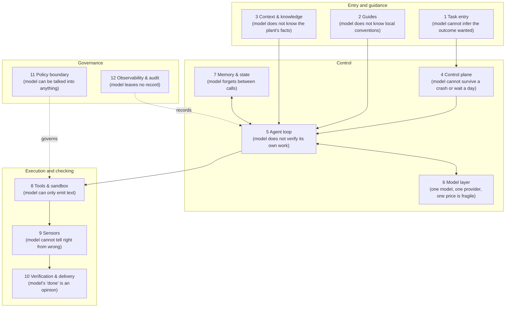
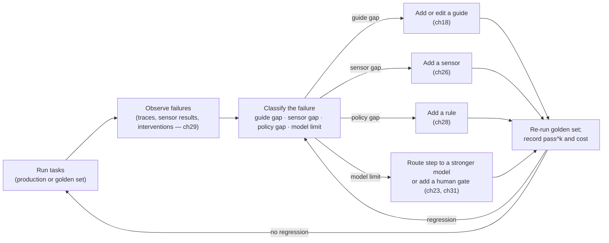

# Chapter 16 — Thesis and evidence

*Part II · Word budget 6,000–8,000 · Lab 16 · Verified as of September 2026 · Derived figures from `labs/ch16-thesis/derive.py`*

## 16.1 Intuition

Give the same model two different pieces of software to live inside and you get two different agents. One resolves 46 of 100 software issues; the other, with the same weights and the same prompts about the task, resolves 55 (Stop Comparing LLM Agents Without Disclosing the Harness, 2026, preprint). Nothing about the model changed. What changed is the harness — in benchmark reports usually called the scaffold; this book uses the two words for the same thing — the code around the model that decides what it sees, what it can do, how it checks its work, and what happens when it is wrong.

The refinery maintenance agent (the running scenario of this book) is the same lesson at a plant. A frontier model asked in a chat window to draft a work order for the seal leak on pump P-101 produces a plausible draft that cites a procedure by memory, gets the revision wrong one time in ten, and has no way to submit anything. The same model inside a harness — retrieval over the governed procedure set, a schema check on the draft, a permit rule, a supervisor gate, a durable workflow, a log — produces a work order the plant can act on and a record the auditor can read. The capability was there in both cases; the reliability came from the harness.

This chapter states that claim precisely, shows the measurements that support it, and names the vocabulary the rest of Part II uses. Two ideas carry it. The first is that capability and reliability are different quantities: a model that succeeds 60% of the time on one attempt succeeds on eight consecutive attempts far less often (Yao et al. 2024, primary), and a plant runs the same task thousands of times. The second is that every component of a harness exists to cover something the model cannot do on its own — which means the harness is a list of the model's current limits, and can shrink as models improve, but never to zero while the tasks have consequences.

## 16.2 Mechanism

### The equation and its terms

**Agent = Model + Harness.** The formulation is LangChain's ("The Anatomy of an Agent Harness," March 2026, practitioner) and has become the field's shorthand; this book adopts it. The *model* is the frozen weights behind an API: it maps a context window to a next-token distribution and nothing else. The *harness* is everything else: the software that assembles the context, exposes tools, runs the loop, stores state, checks outputs, enforces permissions, and records what happened. An agent is the composite. Nothing in the harness changes the weights; a harness improvement is a software change, and it transfers when the model is swapped.

Anthropic's engineering team states the design principle that follows: every component in a harness encodes an assumption about what the model cannot do on its own (Anthropic, "Effective Harnesses for Long-Running Agents," November 2025, vendor). Read each of the twelve components in this book as an answer to "what goes wrong without it." Retrieval exists because the model does not know the plant's procedures. Sensors exist because the model cannot tell whether its own output is correct. The policy engine exists because the model cannot be trusted to obey a rule under adversarial input. When a future model removes an assumption, the component can be removed too; until then it stays.


### The equation's terms, extended

"Agent = Model + Harness" is an equation with a hidden third term: the task. The same model and the same harness score differently on different work, and the plant's evidence is on its work only. Three consequences that the field's benchmark culture obscures. A harness component's value is task-relative — retrieval is worth everything on a documents task and little on a pure-reasoning one — so the component register (16.2) is per use case, and a plant's second use case (ch34) inherits the harness's code and re-derives its assumptions. A model's ranking is task-relative — the golden set's per-class results (ch12) routinely rank models differently from the public leaderboards — so model selection is a routing-table decision per class (ch23), not a purchase. And the thesis's claim is therefore modest and exact: for a given task, the harness is the larger of the two levers the plant controls, and the only one it can measure without a vendor's help.

### Where the idea came from

The term is younger than the practice. Long before anyone said "harness," production teams that shipped anything on a language model had built the same things: a retrieval layer because the model hallucinated facts, a schema validator because it emitted malformed output, a retry wrapper because the API failed, a log because nobody could reproduce a bug. Anthropic's "Building Effective Agents" (December 2024, vendor) gave the practice its first widely read vocabulary — the augmented LLM, five workflow patterns, and the agent loop — and its central advice: find the simplest solution possible and add agentic complexity only when it measurably improves outcomes. Hashimoto's framing of the model as a reasoning kernel and the harness as the determinant of reliability, LangChain's equation, and Böckeler's guides-and-sensors taxonomy followed through 2025 and 2026 (practitioner sources as cited in 16.9). The 2026 preprint on undisclosed harnesses supplied the first controlled evidence that the scaffold moves benchmark scores by double digits (arXiv 2605.23950, preprint). Meanwhile the vendors began shipping harness primitives as products — graders in isolated contexts, memory consolidation, delegation, agent-generated workflows (Anthropic Managed Agents and Claude Code posts, May–June 2026, vendor) — which is the clearest sign that the field has agreed on what a harness is.

Two consequences of that history matter for the plant. The components are not a theory; they are the residue of what broke in production, which is why each carries an assumption rather than a rationale. And because the vendors now sell several of the components, the plant's choice is no longer whether to have a harness but which parts to rent, which to build, and — the subject of ch38 — which must be its own because they encode its operations.

### Guides and sensors

Böckeler's vocabulary ("Harness engineering for coding agent users," martinfowler.com, April 2026, practitioner) organizes every control in the harness on two axes, and this book uses it unchanged.

| | Computational (deterministic) | Inferential (a model's judgment) |
|---|---|---|
| **Feedforward guide** — acts before the model does | Schema the output must match; tool signatures; retrieved documents; templates | System prompt; rules; worked examples; skills |
| **Feedback sensor** — acts after | Tests; linters; type checks; policy decisions; citation checks | Grader models; human review |

Guides raise the probability of a correct first attempt. Sensors catch the incorrect ones and give the model a signal to repair. Computational controls are cheap, fast, and cannot be argued with; inferential ones are flexible and carry the model's own failure modes. The design rule is to prefer computational wherever the domain allows and to treat every inferential control as a measurement instrument requiring calibration (ch27). Böckeler's *steering loop* — observe a failure, add a guide or a sensor, re-evaluate — is the mechanism by which a harness improves, and the observability component (ch29) is where it closes.

### The twelve components

**Figure 16.1 — The reference architecture, with the assumption each component covers.**



*Takeaway: the model (component 6) is rented; the other eleven are built, and each names a limit of the model.*

The component chapters (ch17 to ch29) treat one component each with the same structure: purpose, internals, design decisions, interfaces, failure modes, what breaks without it, metrics, and the running scenario. The cross-cutting chapters (ch30 to ch33) cover what cuts across them: delegation, humans in the loop, self-improvement, and the failure catalogue.

### Capability versus reliability

A benchmark score is a capability measurement: the share of tasks a model completes once. An operation needs a reliability measurement: the share of tasks it completes every time. τ-bench (Yao et al. 2024, primary) introduced the metric that separates them. **pass^k** is the probability that a task succeeds on all $k$ of $k$ independent attempts — the opposite of pass@k, which asks whether at least one of $k$ succeeds. For a system that must be right on every shift, pass^k with a large $k$ is the number that matters, and it falls fast: if attempts were independent with per-attempt success $p$, pass^k would be $p^k$.

The measured curve falls less fast than independence predicts, and that is informative. GPT-4o's τ-bench retail pass^1 is 60.4%; under independence pass^8 would be 1.8%; the benchmark reports pass^8 under 25% — a roughly 59% relative drop (Yao et al. 2024, primary; arithmetic from derive.py, derived). Attempts are strongly correlated: the same task fails the same way each time, because the failure is a property of the task–agent pair, not of the sampling. That is exactly the kind of failure a harness can remove — a missing tool, an ambiguous instruction, an unverifiable step — and exactly the kind a model upgrade often does not.


### What "reliability" costs, and who pays

Capability is the vendor's line; reliability is the plant's. The arithmetic of 16.3 (derive.py, derived) — a per-step pass rate of 95% giving a 57% chance that an eleven-step task completes, and the harness's per-step verification lifting it — is a statement about where the plant's money goes: into sensors, gates, retries, and the reviewers who calibrate them (ch37's anatomy puts oversight as the largest line). The vendor's model improves capability for free, on the vendor's schedule; the plant's harness improves reliability for money, on the plant's schedule; and the plant's cost per resolved task falls when either happens. The thesis's practical corollary is that a plant should spend on reliability first, because it is the term the plant controls and the term the work is measured on, and should re-derive its spending quarterly as the vendor's capability moves the baseline (ch06's cadence). A plant that waits for capability to deliver reliability is waiting for a number the vendor does not sell.

### What the scaffold experiments show

The direct evidence for the thesis is same-model, different-scaffold variance. Holding the weights fixed and changing only the harness:

| Experiment | Model held fixed | Scaffolds compared | Result | Source |
|---|---|---|---|---|
| SWE-bench Pro | Claude Opus 4.5 | SEAL → Claude Code | 45.9% → 55.4% resolved, +9.5 pp (+21% relative) | 2026 preprint (arXiv 2605.23950); derive.py |
| SWE-bench Verified | Grok 4 | SWE-agent → xAI scaffold | +14–16 pp (spread only; endpoints per the preprint's table) | same preprint |
| Analyst monitoring | one model | several public scaffolds | 62.3%–70.2% resolved, 7.9 pp range | Epoch AI (analyst); derive.py |
| τ-bench | GPT-4o | same scaffold, k attempts | pass^1 60.4% → pass^8 <25% | Yao et al. 2024 (primary) |

Three cautions the preprint itself raises and this book keeps (arXiv 2605.23950, 2026, preprint). The scaffolds differed in more than one way — tools, prompts, retry logic, context management — so the spread attributes to the harness as a whole, not to any component. The benchmarks are software engineering; no equivalent controlled comparison exists for an industrial document or maintenance workload. And the numbers are from 2025–2026 snapshots of models that change monthly; the *magnitude* of harness effects is what transfers, not the specific scores.

The production accounts point the same way. OpenAI's engineering report on its Codex-based team describes three engineers growing to seven and shipping about one million lines of agent-generated code across roughly 1,500 merged pull requests in five months, and attributes the outcome to the harness — repository guides, enforced architectural constraints, observability wired into the loop — rather than to the model (OpenAI, "Harness engineering," February 2026, vendor; first-party, unaudited). Anthropic's long-running-agents post ships a runnable harness and reports its failures candidly (Anthropic, November 2025, vendor).


### The scaffold evidence, read carefully

The same-model, different-scaffold results are the thesis's empirical core, and they deserve to be read for what they show and what they do not. Three properties of the data. **The spread is consistent in direction**: every reported case in which a model was moved from a simpler to a more engineered scaffold on SWE-bench Verified moved its score up, by 8 to 16 points (derive.py; the 2026 preprint and Epoch AI's range, as tiered in 16.2 — the preprint's figures are pending independent verification, and Epoch's range is the figure to rely on until then). No published case shows a richer scaffold lowering a frontier model's score on that benchmark, which is what one would expect if the scaffold's contribution were noise. **The spread is comparable to a model generation**: the gaps between successive frontier releases on the same benchmark have been of the same order as the scaffold gaps, so a plant choosing between "wait for the next model" and "build the harness" is choosing between two levers of similar size, one of which it controls. **The spread is measured on coding agents with tests as sensors** — the best-instrumented case. On a task with weaker sensors the spread could be larger (the harness has more to add) or smaller (it has less to check with); the two-scaffold protocol below is how the plant finds out for its own tasks rather than assuming.

What the data does not show is a decomposition of the spread into components. The preprint reports scaffolds as wholes; it does not say how much of the 9.5 points came from better retrieval versus better verification versus better loop control. That decomposition is the plant's to do, by ablation on its golden set — remove one component, re-run, measure — and it is the mechanism behind 16.2's assumption register: a component whose removal does not move the pass rate has an assumption the plant's tasks do not need.

### pass^k, derived and used

τ-bench's authors defined pass^k as the probability that all $k$ independent attempts at a task succeed, and reported it falling steeply with $k$ for every model (Yao et al. 2024, primary; the figures in 16.2). The derivation is one line under independence — $\text{pass}^k = p^k$ for per-attempt success $p$ — and the observed curve departs from it in a way that carries information. If attempts were independent, GPT-4o's retail pass^1 of 60.4% would give a pass^8 of 1.8%; the observed figure under 25% is an order of magnitude higher, which means failures are correlated across attempts: the same tasks fail every time. That is the harness's opportunity. Correlated failures are failures with a cause — a missing fact, an ambiguous request, a sensor gap — and a cause is something a component can address; uncorrelated failures would be noise no harness could touch. The steering loop (16.2) is the procedure for finding the correlated failures and assigning each to a component, and pass^k rising toward pass^1 as the loop runs is the measure that it is working.

Two operational uses. The gate (ch31) and the routing table (ch23) use pass^k at the $k$ the operation needs — a task run once a day needs pass^1; a workflow that must never fail in a month of daily runs needs pass^30 (illustrative framing) — and the golden set reports the $k$ the class is held to. And the two-scaffold protocol reports pass^k for both scaffolds, because a harness that raises pass^1 by five points and pass^4 by fifteen has done more than the first number says.

### The 2×2, worked on the P-101 task

Böckeler's grid — guides and sensors against computational and inferential — sorts every one of the eleven steps' controls into a cell, and the sort is a design review. **Computational guides**: the template's required fields (ch17), the routing table (ch23), the assembler's budget (ch19) — rules code enforces before the model acts. **Inferential guides**: the class instructions, the examples, the identity element (ch18) — text the model reads and usually follows. **Computational sensors**: schema, citation, permit rule, parts-in-BOM, zone register (ch26) — checks that run in a millisecond and cannot be argued with. **Inferential sensors**: the description-accuracy grader and the procedure-appropriateness grader (ch27), and the supervisor at the gate. The review question per step is whether a control sits in the right cell: an inferential guide that could be a computational one (a rule stated in prose that a template could enforce) is a control that fails at the model's instruction-following rate; an inferential sensor that could be computational (a grader checking a field a schema could check) is one that fails at κ. The P-101 task, sorted, has nine of eleven criteria in the computational-sensor cell, two in the inferential-sensor cell, and the guide side split between the template's structure and the class guide's prose — which is the coverage figure of ch26 read as a grid.

### The assumption register

Every component encodes an assumption, and the assumptions are listed, tested, and retired. The register is a table the steering review maintains: component, the assumption it encodes about the model or the work, the evidence for it at the time it was added, the test that would retire it, and the last date the test was run. Three examples from the scenario. The policy engine assumes the model cannot be trusted to hold a permission rule; the test is the prompt-only comparison on the golden set, and the assumption is retired the day a model holds the rule at the engine's reliability — which, for audited actions, will not be the day the evidence trail is no longer required. The repair cap of three assumes repairs beyond three rarely succeed; the test is the repair-success-by-attempt histogram (ch22), re-read quarterly. The compaction summary assumes the model cannot use a growing history well; the test is the effective-length measurement (ch05), re-run on each model version. A register with no retirements over a year is a harness that has stopped asking whether its components are still needed; one with retirements is a harness getting smaller and cheaper as the models improve, which is the outcome the thesis predicts.

### How a harness improves

A harness is not designed once. It converges through Böckeler's steering loop, and the loop is the reason the harness rather than the model is where reliability accumulates.

**Figure 16.2 — The steering loop.**



*Takeaway: each observed failure becomes a permanent, versioned change; the golden set is the regression gate.*

Four properties make the loop work. Failures are classified before they are fixed, because the fix for a guide gap (the model did not know the convention) is different from the fix for a sensor gap (it knew and got it wrong, and nothing caught it). Every change is versioned — guides in Git, sensors as tests, policies as code — so the harness has a history and a diff. Every change is re-evaluated on the golden set before it ships, so the loop cannot silently trade one failure for another. And the loop runs on a cadence, weekly in the maturity model of ch39, because a harness that is only changed after incidents drifts toward whatever failed most recently.

### Reading a benchmark claim

The evidence in this chapter comes from three benchmarks, and each measures something different. SWE-bench Verified is 500 real GitHub issues whose tests were human-validated as fair; a "resolved" task is one whose hidden tests pass after the agent's patch (Chowdhury et al., OpenAI, 2024, primary). It measures capability on software repair in a scaffold the reporter chooses — which is the preprint's complaint. τ-bench measures tool-agent-user interaction with a simulated user and deterministic state checks, and is the source of pass^k (Yao et al. 2024, primary). AgentDojo measures security under injection with 629 deterministic cases (Debenedetti et al. 2024, primary; ch28). None measures an industrial document or maintenance workload; none measures cost. A vendor score is therefore a claim about capability, in a scaffold, on software or synthetic tasks, at one point in time — four qualifications a plant should attach before using it in a budget.

**Table 16.2 — What each benchmark measures.**

| Benchmark | Tasks | Success check | Measures | Scaffold disclosed? |
|---|---|---|---|---|
| SWE-bench Verified | 500 human-validated GitHub issues | Hidden tests pass | Capability, software repair | Often not |
| τ-bench | Retail and airline tool tasks with a simulated user | Final database state | Capability and reliability (pass^k) | Yes (paper's) |
| AgentDojo | 97 tasks × 27 injections = 629 cases | Environment state | Security under attack; utility under attack | Yes (paper's) |
| The plant's golden set | 50–100 real tasks | Deterministic per task | Capability, reliability, cost on the real workload | Yours |

### Where the hours go

If the harness is the asset, the budget should show it. Chapter 37 prices the token bill for the scenario at hundreds of dollars a month and the oversight line at thousands; the engineering hours to build and steer the twelve components are the largest cost of all and the one that produces the asset. A program that spends its budget on model access and treats the harness as glue code has its priorities inverted by the evidence in this chapter: the model bill is rented capability that any competitor can rent; the harness is the plant's own reliability, versioned and transferable.

### What the thesis does not claim

It does not claim the model is unimportant: the scaffold spreads are 8–16 points (derive.py, derived), and the gap between model generations on the same benchmarks has been larger than that; the model still sets the ceiling the harness works under. It does not claim harness effects are additive across components; the experiments measure whole harnesses. And it does not claim the harness is permanent: as models take on verification and planning, components will be retired — the design principle above is also a retirement rule. What it claims is narrower and sufficient: for a fixed model, the harness is the largest lever an operator controls, and reliability — the pass^k an operation needs — is a harness property.

## 16.3 Worked numbers

All arithmetic from `derive.py` (derived).

**Independence versus measurement.** With per-attempt success 0.604, pass^2 would be 36.5%, pass^4 13.3%, pass^8 1.8% if attempts were independent. The reported pass^8 of under 25% would require a per-attempt rate of 84.1% under independence — 24 points above the measured pass^1. The gap between 1.8% and 25% is the correlation: the same tasks fail every time.

**Expected attempts to first success.** At pass^1 of 0.604, the expected number of attempts to a first success is 1.66; at 0.80 it is 1.25; at 0.95 it is 1.05; at 0.99 it is 1.01. Every retry is a full re-spend of the task's tokens (ch37), so a harness that raises pass^1 from 0.60 to 0.95 cuts expected token cost per success by about a third before any caching or routing.

**The scaffold spread as a budget.** A 9.5-point gain from scaffold alone on SWE-bench Pro is 21% relative. If an operator's maintenance workload behaves like this — an assumption to test, not a fact — the harness engineering budget competes with the model-upgrade budget on equal terms, and it transfers across the next three model versions, which the upgrade does not.

**The running scenario in these terms.** The P-101 work order needs eleven tool calls (ch16 scenario, illustrative). If each step succeeded independently at 0.95, the whole task would succeed at $0.95^{11} = 57\%$; at 0.99 per step, 90% (derived). Per-step reliability compounds, which is why the harness verifies each step (ch22) rather than the final artifact alone.

## 16.4 Measurement

The thesis is testable on the reader's own workload, and the test is the first thing a program should run.

**Two scaffolds, one model.** Build a golden set of 50–100 tasks from the real workload with deterministic success checks (ch12). Run the same model twice: once in the control harness, once in the harness under evaluation. The control is specified so two teams run the same one: a system prompt of at most 500 tokens stating the task and output format; every tool the full harness has, exposed directly with its schema and no risk classes; no retrieval (the model may call a search tool if the full harness has one, but nothing is pre-loaded); no sensors and no repair — one attempt per task; no gates; temperature and model version identical to the full run; the same $k$ attempts per task. Anything the control lacks that the full harness has is, by construction, part of the measured spread (control specification is this chapter's; scenario). Report pass^1 and pass^4 for both, with confidence intervals — a Wilson interval on the pass rate, or a paired bootstrap on the difference. The spread is the harness effect on this workload. Lab 16 provides the protocol and the analysis; the run itself needs a model and is gated.


**How big the golden set must be.** A pass rate of 60% measured on 20 tasks has a 95% Wilson interval of roughly 39%–78%; on 50 tasks, 46%–72%; on 100, 50%–69%; on 200, 53%–67% (derive.py, derived). A scaffold spread of ten points is invisible at 20 tasks and resolvable at 100. Fifty is the floor for a first test; a hundred is the number to fund before a scaffold decision is made on the result. The cost is tokens times tasks times $k$ times two scaffolds — at the scenario's per-query cost it is tens of dollars (ch37), which is the cheapest measurement in this book.

**pass^k, not pass@k.** Report the all-of-k metric. Four attempts per task is enough to see correlation; eight is better and costs twice as much. State $k$ with every number.

**Attribute by ablation, not by belief.** To learn which component matters, remove one at a time from the full harness and re-run the golden set: no retrieval, no sensors, no policy engine. The drop when a component is removed is its contribution on this workload. Expect interactions — sensors without a repair loop do little — and report them.

**Record for every run:** model and version pinned; harness commit hash; golden-set version; $k$; the success check for each task; date.


### Reference output (Lab 16, this run)

What the lab prints when it reproduces; the plant's numbers replace these.

```text
pass8_independent      chapter 0.0177  derived 0.0177  OK
per_attempt_for_25     chapter 0.841  derived 0.841  OK
relative_drop          chapter 59  derived 59  OK
opus_spread_pp         chapter 9.5  derived 9.5  OK
task_0.95^11           chapter 0.57  derived 0.57  OK
task_0.99^11           chapter 0.9  derived 0.9  OK
wilson50_low           chapter 0.462  derived 0.462  OK
Lab 16 part 1: REPRODUCED
```

These measurements are the improvement loop's inputs (ch32): clusters are mined from them weekly and changes are tested against them.

## 16.5 Failure

| Failure mode | Mechanism | Detection signal | Mitigation | Owning component |
|---|---|---|---|---|
| Capability read as reliability | A pass^1 score is used to plan an operation that needs pass^k | Production failure rate far above 1 − pass^1 | Measure pass^k on the golden set before deployment | Evaluation (ch12) |
| Model upgrade as the fix | Failures that are properties of the task–harness pair persist across model versions | Same tasks fail after the upgrade | Ablation to locate the failing component; steering loop | This chapter; ch29 |
| Benchmark scaffold assumed | A vendor score achieved in a tuned scaffold is expected in the plant's harness | Golden-set score far below the published one | Run the published scaffold and yours on your golden set | Model layer (ch23) |
| Harness sprawl | Every failure gets a new component; nothing is retired | Component count rising; latency and cost rising; no ablation evidence | Each component carries its assumption; re-test the assumption on each model upgrade | This chapter |
| Inferential control unmeasured | A grader or judge is trusted without calibration | Judge agreement with humans unknown | κ or α against human labels every quarter | ch27 |
| Two harnesses, one score | Benchmark comparisons across vendors that used different scaffolds | The harness is not disclosed | Compare only within a disclosed scaffold; disclose yours | This chapter |
| Golden set contamination | Tasks or their answers leak into guides, few-shot examples, or memory, so the score measures recall not capability | Score jumps after a guide edit without a mechanism; failures cluster on tasks added after the edit | Hold the golden set out of everything the model sees; version it; add fresh tasks each quarter | Evaluation (ch12) |
| Scenario drift | Later chapters or teams quietly change the running scenario's parameters, so numbers stop comparing | Two documents cite different volumes or token sizes for the same task | One scenario definition in this chapter; every use cites it | This chapter |

## 16.6 The frontier

**Strongest free treatments.** LangChain's "The Anatomy of an Agent Harness" (March 2026) states the equation and derives a component list from the behaviors a coding agent needs; it stops at coding agents and at description — no measurements, no economics, no governance components. Böckeler's "Harness engineering for coding agent users" (April 2026) gives the guides/sensors × computational/inferential vocabulary and the steering loop with clear diagrams; it is qualitative and about coding-agent users, and stops before evidence. Anthropic's "Building Effective Agents" (December 2024) and "Effective Harnesses for Long-Running Agents" (November 2025) give the workflow patterns and the design principle used above, with a runnable coding harness; they stop at Claude and at software. The 2026 preprint "Stop Comparing LLM Agents Without Disclosing the Harness" and τ-bench (Yao et al. 2024) supply the measurements; each stops at its benchmark and neither draws the operational conclusion. Darú's *Harness Engineering* living book (2026) compares open harnesses from source code and stops at coding agents.

**What this chapter adds.** The measurements and the vocabulary in one place, with the arithmetic that turns pass^1 into pass^k and shows the correlation in the τ-bench data; the twelve components each labeled with the assumption it covers; the thesis bounded by what the evidence does not show; a measurement protocol the reader runs on their own workload; and the running scenario the rest of the book builds on. Open, and stated as open: no controlled same-model/different-scaffold comparison exists on an industrial document or maintenance workload; Lab 16 is the protocol for producing one.

## 16.7 Industrial application

**The scenario, fixed here for every later chapter.** A refinery maintenance agent serving the Engineering, AI, and Data teams: it reads work orders, equipment history, P&IDs, and procedures; drafts and, with supervisor approval, submits work orders to the CMMS; 2,000 queries a day; about 6,000 input tokens per query of which 4,000 are a stable prefix, 400 output tokens; a self-hosted 70B-class fallback on site; never any tool that reaches DCS, PLC, or safety instrumented systems. The canonical task is the seal leak on pump P-101 in restricted zone Z3, which needs a hot-work permit and a supervisor's approval. Every chapter uses this scenario; none invents another (scenario parameters, illustrative).

**What the thesis means for the plant.** The model is a line item, rented per token and replaceable. The harness is the plant's asset: its guides encode how the site writes work orders; its retrieval index is the governed procedure set; its sensors are the site's rules made executable; its policy bundle is the permission model; its logs are the compliance evidence. A model upgrade is a configuration change and a golden-set run; a harness change is engineering, reviewed and versioned. Budgeting follows: the model bill is small (ch37) and the harness is where the hours go.

**The first measurement the plant should make.** Before funding the twelve components, run the two-scaffold test on fifty real work-order tasks with the simplest possible harness against a first version of the real one. If the spread is small, the workload may be one where a chat assistant with retrieval is enough (ch34 — the suitability gate); if it is large, the harness budget has its justification in the plant's own numbers rather than in a software benchmark.

**The OT boundary is part of the thesis.** The component list has no entry that reaches a control system, because the assumption "the model cannot be trusted with a setpoint" has no harness that makes it safe; the component for that limit is absence (ch35).

## 16.8 Decision aids

**Component–assumption register (fill for every deployment).**

| Component | Assumption it covers | Still true for the current model? (evidence) | Retire? |
|---|---|---|---|
| 1 Task entry | Model cannot infer the intended outcome | | |
| 2 Guides | Model does not know local conventions | | |
| 3 Context & knowledge | Model does not know the plant's facts | | |
| 4 Control plane | Model cannot survive a crash or wait for a human | | |
| 5 Agent loop | Model does not verify its own work | | |
| 6 Model layer | One model, one provider, one price is fragile | | |
| 7 Memory & state | Model forgets between calls | | |
| 8 Tools & sandbox | Model can only emit text; text can be dangerous | | |
| 9 Sensors | Model cannot tell right from wrong | | |
| 10 Verification & delivery | Model's "done" is an opinion | | |
| 11 Policy boundary | Model can be talked into anything | | |
| 12 Observability & audit | Model leaves no record | | |

**pass^k planning rule.** Decide the $k$ the operation needs (shifts per week the task runs without a human check is a fair proxy); measure pass^k at that $k$ on the golden set; deploy without a human gate only where pass^k meets the plant's tolerance for that task's consequence. Where it does not, the gate stays and the STP rate (ch37) reports progress.

**Two-scaffold test checklist.** Golden set ≥ 50 tasks with deterministic checks; same model version in both runs; simplest harness defined in writing; $k \ge 4$; confidence intervals reported; harness commit hash and model version recorded; spread reported in points and relative.

## 16.9 Sources

| # | Claim or figure | Source | Tier | Verified | Link |
|---|---|---|---|---|---|
| 1 | Agent = Model + Harness; component derivation | LangChain, "The Anatomy of an Agent Harness," Mar 2026 | practitioner | Sep 2026 | https://python.langchain.com/docs/ |
| 2 | Every harness component encodes an assumption about what the model cannot do | Anthropic, "Effective Harnesses for Long-Running Agents," Nov 2025 | vendor | Sep 2026 | https://www.anthropic.com/engineering |
| 3 | Guides/sensors × computational/inferential; steering loop | Böckeler, martinfowler.com, Apr 2026 | practitioner | Sep 2026 | https://martinfowler.com/articles/exploring-gen-ai/ |
| 4 | Workflow patterns; simplest solution first | Anthropic, "Building Effective Agents," Dec 2024 | vendor | Sep 2026 | https://www.anthropic.com/engineering/building-effective-agents |
| 5 | pass^k; GPT-4o retail pass^1 60.4%, airline 42.0%; retail pass^8 < 25% | Yao et al., τ-bench, 2024, arXiv 2406.12045 | primary | Sep 2026 | https://arxiv.org/abs/2406.12045 |
| 6 | Opus 4.5 SEAL → Claude Code 45.9% → 55.4% (SWE-bench Pro); Grok 4 +14–16 pp (Verified) | "Stop Comparing LLM Agents Without Disclosing the Harness," 2026, arXiv 2605.23950 | preprint / analyst | Sep 2026 | https://arxiv.org/abs/2605.23950 |
| 7 | Single model 62.3–70.2% across scaffolds | Epoch AI monitoring | analyst | Sep 2026 | https://epoch.ai/ |
| 8 | ~1M lines, ~1,500 PRs, 3→7 engineers, 5 months | OpenAI, "Harness engineering," Feb 2026 | vendor | Sep 2026 | https://openai.com/index/ |
| 8a | SWE-bench Verified: 500 human-validated tasks | Chowdhury et al., OpenAI, "Introducing SWE-bench Verified," Aug 2024 | primary | Sep 2026 | https://openai.com/index/ |
| 8b | AgentDojo 629 cases | Debenedetti et al. 2024 (ch28) | primary | Sep 2026 | https://arxiv.org/abs/2406.13352 |
| 9 | Open harness comparison from source code | Darú, Harness Engineering (2026) | practitioner | Sep 2026 | needs fetch |
| 10 | Independence curves; Wilson intervals at 20/50/100/200; 84.1% needed for pass^8 = 25%; 59% relative drop; expected attempts; 0.95^11 = 57%, 0.99^11 = 90% | `labs/ch16-thesis/derive.py` | derived | Sep 2026 | labs/ch16-thesis/derive.py |
| 11 | Scenario parameters (2,000/day, 6,000/4,000/400 tokens, eleven calls, P-101 in Z3) | This chapter | illustrative / scenario | Sep 2026 | — |
| 12 | No controlled scaffold comparison on an industrial workload | Search, Sep 2026 | open | Sep 2026 | — |