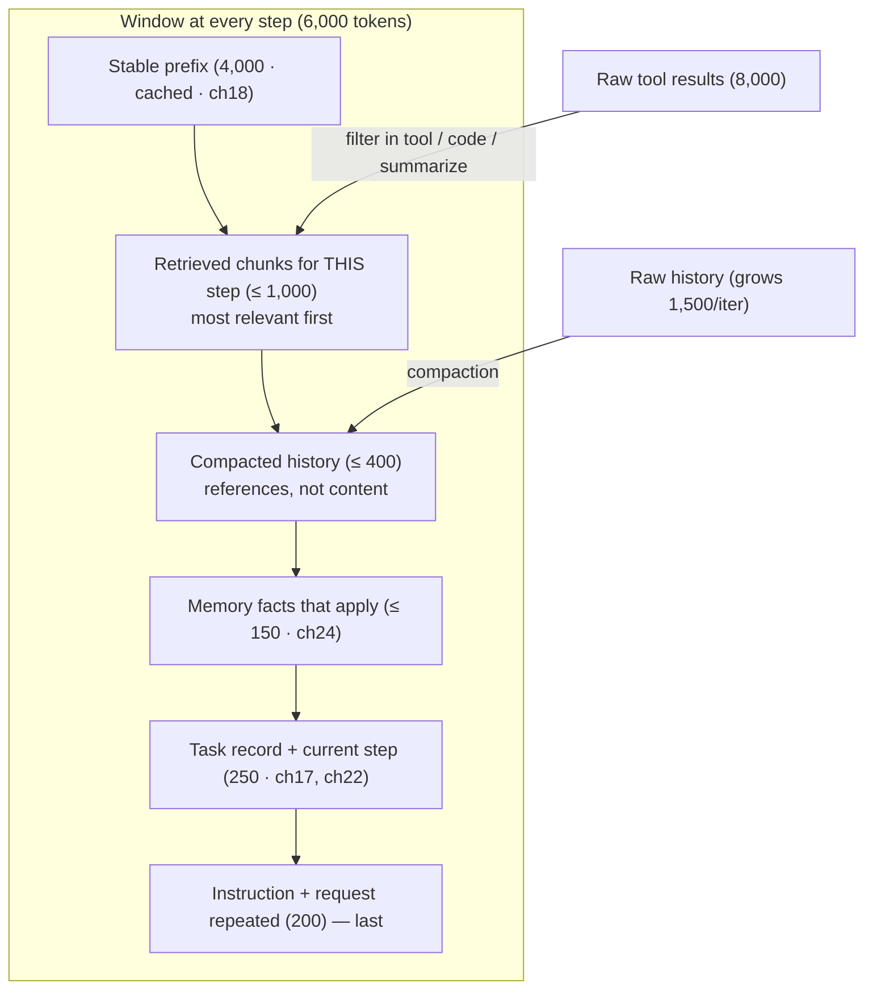
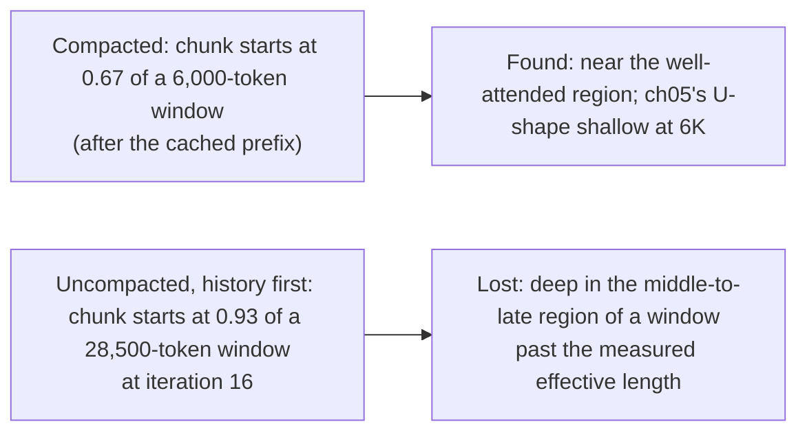

# Chapter 19 — Context engineering

*Part II · Word budget 7,000–10,000 · Lab 19 · Verified as of September 2026 · Derived figures from `labs/ch19-context/derive.py`*

## 19.1 Intuition

The model sees only what is in its window at the moment it is called, and the window is small, expensive, and degrades as it fills. Context engineering is the discipline of deciding what goes in it, in what order, at what size, for each call — and, just as much, what stays out. Anthropic's phrase is that context is a finite resource with diminishing returns; the earlier chapters gave the mechanism: attention dilutes (ch04), position preference deepens (ch05), and measured effective length falls well short of the advertised window (ch05's NoLiMa figures).

The agent loop makes the problem worse by design. Every step adds a tool result, a sensor verdict, a model output; an uncompacted history grows by about 1,500 tokens an iteration in the scenario, so a task that took sixteen iterations would be running in a window nearly five times its starting size by the end — with the retrieved chunks that matter pushed from the two-thirds mark to the ninety-third percentile, the place the model attends to least (derive.py, derived). The cure is not a longer window; it is a window rebuilt for every step from the prefix, the current step's needs, and a compacted record of what came before, so that the window is the same size at step thirteen as at step one.

This chapter is the per-call assembly rule. The stable prefix first (ch18). Then, in a fixed budget: the retrieved chunks the step needs, the compacted history, the memory facts that apply, the task record and the step, and the instruction last. Tool results trimmed before they enter — a raw CMMS response of a hundred rows is eight thousand tokens the model needs five of (illustrative). Nothing important in the middle. The arithmetic says the discipline is worth 60% of the fresh tokens per task (derive.py, derived) and, more than that, the difference between a model that finds the permit clause and one that does not.

## 19.2 Mechanism

### The attention budget

The window is a budget because attention is. Every token in the window competes for weight in every head at every layer (ch04): the softmax over $n$ positions spreads a fixed total, so the weight the answering token can win is bounded by how many competitors it has and how well its key matches the query. Doubling the window does not halve the weight on the right token, but it doubles the competitors, and for the copying heads that do exact recall — an identifier, a revision number — the effect is a measurable fall in the probability of the right token past a few thousand positions (ch04's dilution arithmetic; ch05's NoLiMa figures). Anthropic's guidance names this the attention budget and draws the conclusion this chapter implements: find the smallest set of high-signal tokens that maximizes the likelihood of the desired outcome (Anthropic, "Effective Context Engineering for AI Agents," September 2025, vendor).

The budget is spent on three things and the assembler's job is to keep the third small. **Signal**: the chunks, facts, and instruction the step needs. **Structure**: headings, delimiters, the prefix's rules — tokens that carry no answer but make the signal findable. **Noise**: everything else — raw history, untrimmed results, repeated boilerplate, bookkeeping. The ratio of signal to total is the window's efficiency, and 19.4's chunk-start fraction is one proxy for it: the closer the answering content sits to the start of the dynamic part, the less noise precedes it.

### The three rots

Context fails in three recognizable ways, and each has a mechanism, a signature in the records, and a defence. The names come from practitioner writing on long-context failure (Breunig, "How Long Contexts Fail," 2025, practitioner) and the measurements from the long-context literature (ch05).

**Context rot** — degradation with length alone. The same question with the same answering passage scores lower as filler is added, even irrelevant filler; Chroma measured the effect across models and found it present in every one, with structure and distractor similarity making it worse (Chroma, "Context Rot," 2025, practitioner; Modarressi et al. 2025, primary). Mechanism: attention dilution and position preference. Signature: pass rate per step falling with window size at a flat error mix — nothing specific went wrong, everything got a little worse. Defence: the budget below measured effective length; compaction; just-in-time retrieval.

**Context poisoning** — a wrong item enters and persists. A confabulated fact (ch13), a misread tag (ch14), an injected instruction in a tool result (ch28), or a superseded revision beside the current one (ch02) is admitted once and then re-read at every step, compacted into the summary, and cited as if it were a finding. Mechanism: the model treats what is in its window as true; repetition across steps raises its weight. Signature: a claim in the output that no retrieved chunk supports, traced back through the history to its first appearance. Defence: references in the summary rather than content; sensors after every step; model outputs never indexed or remembered without review; metadata filters that keep the superseded revision out.

**Context distraction** — the model attends to its own history instead of the task. Past a length the Gemini 2.5 team observed near 100K tokens, their agent repeated actions from its history rather than planning new ones (Gemini 2.5 Technical Report, 2025, primary). Breunig separates two sub-forms: *distraction*, where the model leans on accumulated context over its training; and *confusion*, where superfluous content — tool schemas for tools the step cannot use, facts for another asset — pulls the response off course. Mechanism: the history is the largest, most self-similar block in the window and attention finds it. Signature: re-plans that copy earlier steps; tool calls the plan did not include; answers about the wrong asset. Defence: per-step assembly from the task record rather than accumulation; per-class tool sets; per-step fact relevance; and the loop's explicit re-plan transition (ch22) so drift is a state change, not a mood.

A fourth is sometimes named — *context clash*, where two admitted items contradict each other and the model reconciles them silently — and the plant meets it as revision conflicts: the current-revision filter (ch20) is the defence, and the clash sensor is the consistency check of ch13.

**Table — The rots, side by side.**

| Rot | Mechanism | Signature in the records | Primary defence | Chapter |
|---|---|---|---|---|
| Rot | Dilution; position preference | Pass rate falls with window size, error mix flat | Budget below effective length; compaction | ch04, ch05 |
| Poisoning | Wrong item admitted and re-read | Unsupported claim traced to its first appearance | References, not content; sensors per step; no unreviewed outputs in memory | ch13, ch24, ch26 |
| Distraction / confusion | History or irrelevant content out-weighs the task | Repeated actions; off-plan calls; wrong asset | Per-step assembly; per-class tools and facts; explicit re-plan | ch22, ch23 |
| Clash | Contradictory items reconciled silently | Two revisions or values in one output | Revision filter; consistency sensor | ch20, ch13 |


### The budget

The scenario's per-step window is 6,000 tokens: 4,000 of stable prefix, cached, and 2,000 of dynamic content, fresh. The dynamic budget is allocated, not discovered: retrieved chunks up to 1,000; compacted history up to 400; memory facts up to 150; task record and current step 250; instruction 200 (derive.py; allocation illustrative). The budget is set below the model's *measured* effective length on the plant's golden set (ch05), not its advertised window — per language, because Portuguese reaches the limit in fewer words (ch01) — and it is enforced by the assembler — a step whose content exceeds it is trimmed by rule, not by the model's discretion.

### Order

Position is a lever the plant controls for free (ch05). The prefix is first for the cache and the sinks. Retrieved chunks follow, most relevant first, so the answering chunk sits near the two-thirds mark of the window rather than deeper. The compacted history and memory facts come next — context the model consults but rarely copies from. The task record and current step follow. The instruction, with the request repeated, is last, at the well-attended end. The order is fixed in the assembler and is the same for every step of every task class; a class that needs a different order is a class that gets its own assembler configuration, versioned (ch18).


### What the model should never have to reason about

Two kinds of content do not belong in the window at all, and their absence is an engineering decision. **The harness's own bookkeeping** — retry counters, budget balances, policy decisions, trace ids — lives in the control plane (ch21) and the observability records (ch29); the model sees a step and its inputs, never the machinery around it, because bookkeeping in the window is tokens the model may misread as instructions. **Prior model outputs as prose** — the full text of step three's draft when step seven needs only that it was validated — are compacted to a reference; the model re-reading its own earlier prose is the distraction mechanism ch05 described, in which the agent repeats its history rather than reasoning afresh (Gemini 2.5 Technical Report, 2025, primary). The window holds what the step needs and a way to fetch the rest.

### Ordering within the chunks

Retrieval returns a ranked list; the assembler keeps the rank. The re-ranker's order (ch02, ch20) is the order the chunks appear, most relevant first, so the answering chunk sits highest and the fit rule drops from the least relevant end. Two refinements. Each chunk carries its provenance header — document id, section, revision — as its first line, so the citation the model must produce is in the chunk rather than reconstructed (ch26). And chunks from the same document are kept adjacent and in document order when they are all admitted, because a step that reads a procedure's warning and then its step needs them in the order the procedure has them.

### The instruction, written for the step

The last two hundred tokens are the most attended and the most often neglected. The instruction names the step, states what a correct output looks like — the fields, the schema, the citation form — repeats the request verbatim, and says what to do if the step cannot be completed: "If the procedure's hazard class is absent, return `escalate` with the reason." It does not restate the guide; the guide is in the prefix. It does not include the sensor messages from a prior failed attempt as prose; a repair step's instruction carries the failed sensor's message in the form ch26 specified, and nothing else. The instruction is generated from a template per step class, versioned with the guides (ch18), and its length is fixed so the budget holds.

### Compaction

At each step the raw history — prior model outputs, tool results, sensor verdicts — is replaced by a running summary: what the plan is, which steps are done with their key results, what failed and was repaired, what remains. The summary is written by a small model from a template (ch23's routine class), bounded to its budget, and stored in the task's working memory (ch24) so it is rebuilt from the durable record rather than accumulated in the window. Anthropic's context-engineering guidance names compaction as the first technique for long-horizon tasks and warns of its failure — a summary that drops the detail a later step needs (Anthropic, "Effective Context Engineering for AI Agents," September 2025, vendor). The harness's answer is that the summary carries references, not content: the chunk ids, the tool-result ids, the decision ids (ch29), so a later step can fetch what the summary only names.

The arithmetic: uncompacted, the window at iteration $k$ is $6{,}000 + 1{,}500(k-1)$ — 10,500 at four, 16,500 at eight, 28,500 at sixteen, 4.8× the start. Compacted, it is 6,000 at every iteration. Over the thirteen calls of the P-101 task, that is 195,000 tokens uncompacted against 78,000 compacted — a 60% saving — and $0.18 against $0.03 of fresh input per task, $268 against $49 a month (derive.py, derived). Chapter 22 reports the same effect as total tokens over sixteen iterations with the summary modelled as an addition to the base; the two arithmetics agree in direction and differ in what they hold fixed, and this chapter's rule — the summary lives inside the dynamic budget, so the window is constant — is the one the assembler implements.

### Trimming tool results

A tool returns what the system has, not what the step needs. A CMMS query for a pump's history returns a hundred rows at eighty tokens each — 8,000 tokens — of which the step needs the five about seals: 400 tokens; a summary of those five is 150 (derive.py, derived). Three techniques, in order of preference. **Filter in the tool**: the tool's interface takes the selection criteria, so the model never sees the hundred rows (ch25). **Filter in code**: the model writes a short program that runs against the result in the sandbox and returns the selected rows — Anthropic's code-execution pattern for tool results (Anthropic, "Code Execution with MCP," November 2025, vendor). **Summarize and reference**: a small model condenses the result and the window holds the summary plus the result's id, so the full rows are one fetch away. The rule is that no raw tool result over a threshold — a few hundred tokens — enters the window untrimmed, and the threshold is enforced by the assembler.

### Just-in-time retrieval

The window holds what the step needs, fetched when the step runs, not what the task might need, loaded at the start. Anthropic's guidance calls this just-in-time context and contrasts it with pre-loading; the agent keeps lightweight references — file paths, chunk ids, record ids — and loads the content at the step that reads it (Anthropic 2025, vendor). Retrieval per step (ch20) is the plant's form: the query for step seven is the permit question, not the whole task, and the chunks it returns are the permit rule and the hazard class, not the twelve-page procedure. A step that needs the whole document — rare — is a step the router flags for the long-context path (ch05), with its cost visible.

### The cache as a constraint on the window

Manus's practitioner account of context engineering makes one metric primary: the KV-cache hit rate, because in an agent loop the input-to-output ratio is on the order of a hundred to one and the cached-input price is a tenth of fresh (Manus, "Context Engineering for AI Agents," July 2025, practitioner). Three of their rules follow from the cache's byte-identity requirement (ch04, ch18): keep the prefix stable — no timestamps at the top; make the context append-only within a step, never editing earlier content; and when the tool set must change, mask the disallowed tools in the decoder rather than removing their schemas from the prefix, because a removed schema shifts every byte after it. The plant's assembler follows the first two directly and the third through the router's per-class tool sets, which are fixed within a class so the prefix holds.

**Figure 19.1 — The window, rebuilt every step.**



*Takeaway: the same size at step thirteen as at step one; the answering chunk at the two-thirds mark, not the ninety-third.*


### Context poisoning and the provenance of what enters

Every token in the dynamic part came from somewhere, and where it came from decides how the harness treats it. Retrieved chunks are governed documents with provenance (ch07, ch20). Tool results are untrusted content (ch28) — a history entry a technician typed may contain anything, including an instruction. Memory facts were consolidated under review (ch24). Prior model outputs are the model's own claims (ch13). The assembler labels each section by source — the headings in the reference implementation are not decoration — so the model's instruction hierarchy has something to work with, and the policy engine (ch28) does not depend on it. Poisoning is the case where a wrong or injected item enters and persists: a confabulated fact compacted into the history and re-read for ten steps, or an injected instruction in a tool result that the summary preserves. The defences are the compaction rule (references, not content), the sensor after every step (ch26), and the rule that model outputs never become retrieved context without review (ch13, ch24).

### Compaction as a model call

The summary is written by a model, and it inherits the model's failures: it can drop the detail that mattered, invent a step that did not happen, or preserve an injected instruction as if it were a finding. Three controls. The summary is generated from the working-memory record (ch24) — a structured log of steps, outcomes, and ids — not from the raw prose, so there is little to invent. Its template fixes the fields (plan, steps done with ids, failures and repairs, remaining), so a summary that lacks a field is caught by a schema sensor (ch26). And its size is bounded, so it cannot grow into the history it was meant to replace. The cost is one small-model call per step in the routine class (ch23); the arithmetic of 19.3 shows the saving it buys.

### When the window is not enough

Some steps need more than the budget: a full procedure to check step order, a long log to scan for a pattern. The assembler does not silently exceed the budget; it routes. Three routes, in order. Delegate to a sub-agent with a fresh window (ch30). Decompose the step into sub-steps each within budget (ch22's re-plan). Or, for the rare step that must see everything at once, the long-context path with its cost and its measured-effective-length caveat visible (ch05) — a router decision, logged, with the window size recorded against the step's outcome so the plant learns which steps actually needed it.

### Cookbook evidence: editing, compacting, pruning, delegating

Anthropic's cost-optimization notebook ran a three-claim agent queue in which one tool result — a 135,000-token ledger — landed in the window on turn two and stayed (Anthropic, Claude Cookbook, August 2026, vendor). Against that unmanaged run: server-side context editing (`clear_tool_uses` at a 150K trigger) cut cost 12%; server-side compaction 16%; a client-side "jagged" prune — let bulky results accumulate, then drop them in one pass at claim boundaries so the message array stays byte-identical between prunes and the cache holds — 29%; and a Haiku sub-agent that absorbed the ledger and returned a one-line extract 78%. The ranking is this chapter's argument in the vendor's numbers: pruning by rule at natural boundaries beats server-side editing because it protects the cache, and isolating the bulky step in a sub-agent beats all of them because the parent never pays for the ledger at all. The notebook also states the cache rule this chapter enforces: every edit or compaction invalidates the prompt cache from that point forward, so the trigger is set high enough that clears stay infrequent — the harness's per-step rebuild with a byte-stable prefix and references-not-content summaries is the design that avoids the trade.

### Sub-agents as context isolation

When a task has a sub-problem that would fill the window — reading a long document to answer one question, searching a corpus for a fact, reconciling a hundred-line parts list — the loop delegates it to a sub-agent with its own window, which returns a short answer with references (ch30). The parent's window holds the answer, not the reading. Anthropic's guidance names sub-agent architectures as the third technique beside compaction and structured note-taking, and its multi-agent research system is the worked example: a lead agent plans and delegates, sub-agents each explore in their own context, and the lead synthesizes from their summaries (Anthropic, "How We Built Our Multi-Agent Research System," 2025, vendor; ch30).

### Sub-agent summaries: the contract

The value of delegation is the summary, and the summary is a contract with five fields. **Answer**: the finding, in the form the parent's step needs — a value, a list, a verdict. **Support**: the chunk ids, result ids, or document regions the answer rests on, so the parent can cite them and the sensors can check them (ch26). **Confidence signals**: which of the harness's three signals (ch13) the sub-agent's answer carries — retrieval support, sensor verdicts, grader agreement — not a self-reported probability. **What was not found**: the questions the sub-agent could not answer from its scope, stated, so the parent abstains or asks rather than assuming silence means absence. **Cost**: tokens and calls, so the parent's budget (ch21) and the observability record (ch29) account for the delegation. The summary is bounded — a few hundred tokens — and schema-checked before it enters the parent's window, exactly as a compaction summary is.

Three rules govern how the parent uses it. The summary enters the parent's window as a labelled tool result, untrusted like any other (ch28): a sub-agent can be poisoned as easily as a parent, and its answer passes the parent's sensors before it is acted on. The support references are what the parent cites, never the sub-agent's prose; a work order that cites "the sub-agent said" has no provenance. And the parent never receives the sub-agent's context — its reading, its intermediate outputs, its history — because that is the flood the delegation existed to avoid; a sub-agent that returns more than its contract is a delegation that failed.

The scenario's parts reconciliation is the case: the parent asks a sub-agent to check a forty-line parts list against the approved BOM and the warehouse stock; the sub-agent reads three hundred rows across two tools and returns a summary — four parts not in the BOM, two out of stock, with row ids — of two hundred tokens; the parent's parts sensor (ch26) checks the four against the register and the draft is repaired. The three hundred rows never entered the parent's window.


### Measuring the window

The map for this chapter asks for window size to be measured, and the measurement has more than one number. **Size**: tokens per call, split by section — prefix, chunks, history, facts, task, instruction — from the gateway's usage line and the assembler's accounting, per step class, p50 and p95. **Composition**: the share of the dynamic part in each section; a class whose history share grows is a class whose compaction is failing. **Position**: the chunk-start fraction and the instruction's position (always last, checked). **Signal density**: for golden-set steps, the share of window tokens that the answering chunks occupy — the efficiency the attention budget is spent at. **Growth**: window size at step $k$ against step 1 within a task; the target is flat. **Quality against size**: pass rate per step class binned by window size, from the golden set run at several budgets; this is the plant's own context-rot curve, and the budget is set where it bends. Lab 19 produces the first five for a simulated task; the sixth needs a model and the golden set, and its protocol is: run each class at budgets of 4K, 6K, 8K, and 12K with the same items (budget levels illustrative), report pass rate with intervals per budget, and adopt the smallest budget whose interval overlaps the best.

### Compaction strategies compared

Compaction is a family, and the choice is a trade. **Truncation** — drop the oldest history — is free and loses the plan's first steps first; usable only for tasks whose early steps do not matter later, which is few. **Rolling summary** — a model rewrites the history into a bounded summary each step — is the general method; its risk is fidelity, and its control is the structured source (working memory) and the schema. **Hierarchical summary** — per-step summaries rolled into a task summary, with the per-step ones retrievable by id — costs a little more and lets a later step re-expand one earlier step without the whole history. **Selective retention** — keep verbatim the items a rule marks as load-bearing (the plan, the criteria, the last sensor message) and summarize the rest — is what the harness's template does, and it is why the summary has fixed fields. **Reset with notes** — clear the window entirely and restart from the task record plus the notes file, the pattern Anthropic describes for very long tasks and Claude Code implements as a context reset — is the last resort and the cleanest, and it works only because the working memory (ch24) holds everything the reset must recover. The plant uses selective retention by template every step and reset-with-notes when a task crosses a class-specific iteration count, and the observability record shows which.

### Context across the task's lifetime

A task's context is not one window but a sequence of them, and the sequence has a shape worth designing. At intake (ch17) the context is the request and the template. At planning (ch22) it is the task record and the class guide — no chunks yet, because the plan decides what to retrieve. At each Act step it is the assembly this chapter specifies. At Verify it is the artifact, the criteria, and the sensor verdicts — the model reads its output against the checks, not against the history. At Repair it is the first attempt's window plus the failed sensor's message and nothing else. At the gate (ch31) the human's context is the artifact, the criteria with verdicts, and the unenforced rules — a rendering of the same records, not the model's window. And at delivery the context is gone: the window is not stored, the records are (ch29), and the next task starts from its own intake. A harness that carries one growing window from intake to delivery has confused a conversation with a task, and the rots follow.


### Working with the model's own limits

Two model properties shape the assembler beyond the budget. **Structured output and the window**: constrained decoding (ch26) consumes no extra input tokens, but the schema the model must fill is in the prefix as the output contract, and a schema with forty fields is a thousand tokens on every call; the contract is kept minimal per class and the fields the CMMS defaults are left out. **Reasoning tokens and the window**: a reasoning model's working (ch09) is output, not context, but on the next step the loop decides whether any of it enters the window — and the answer is no: the working is logged (ch29), the conclusion enters as a compacted line, and the model does not re-read its own reasoning, for the distraction reason above. The two rules keep the window a function of the task, not of the model's verbosity.

### The assembler as a component with a version

The assembler is code — the budget table, the order, the trimming threshold, the summary template, the overflow routes — and it is versioned like a guide (ch18), with a golden-set run on any change and its version recorded per task (ch29). A change to the budget is a change to what every task of a class sees, and the measurement of 19.4 is how the change is judged. The assembler's configuration is per class and per language, because the same content is more tokens in Portuguese (ch01) and the effective length is measured per language (ch05); a plant with one assembler configuration for both languages has set the Portuguese budget by the English measurement. Lab 19's assembler is the reference: the plant's differs in its tokenizer, its thresholds, and its templates, and in nothing structural.

### Reference implementation

An assembler that enforces the budget by rule, trims tool results, compacts history to references, and reports position and size for every step. Lab 19 runs it through a sixteen-iteration simulated task and reproduces 19.3.

```python
from dataclasses import dataclass, field

BUDGET = {"retrieved": 1000, "history": 400, "facts": 150, "task": 250, "instruction": 200}   # dynamic, tokens (illustrative)
RAW_RESULT_MAX = 300                                                                              # raw tool results above this are trimmed

def tokens(s: str) -> int:
    return max(1, round(len(s) / 4))

def trim_result(result_rows: list, select, result_id: str, summarize) -> str:
    """Filter first; if still over the threshold, summarize; always keep the reference id."""
    rows = [r for r in result_rows if select(r)]
    text = "\n".join(rows)
    if tokens(text) > RAW_RESULT_MAX:
        text = summarize(rows)
    return f"[result {result_id}]\n{text}"

def compact(history: list, budget: int) -> str:
    """Running summary as references: step, outcome, ids. Oldest entries are dropped first if over budget."""
    lines = [f"step {h['step']}: {h['outcome']} (refs {','.join(h['refs'])})" for h in history]
    while lines and tokens("\n".join(lines)) > budget:
        lines.pop(0)
    return "\n".join(lines)

def fit(text: str, budget: int, unit: str = "\n") -> str:
    parts = text.split(unit)
    while parts and tokens(unit.join(parts)) > budget:
        parts.pop()                      # drop from the end: least relevant chunks / oldest facts last in their lists
    return unit.join(parts)

def assemble(prefix: str, chunks: list, history: list, facts: list, task: str, step: str, request: str) -> dict:
    """Fixed order; budget enforced by rule; instruction last. Returns the window and its accounting."""
    retrieved = fit("\n".join(chunks), BUDGET["retrieved"])
    hist = compact(history, BUDGET["history"])
    fx = fit("\n".join(facts), BUDGET["facts"])
    tsk = fit(f"{task}\nSTEP: {step}", BUDGET["task"])
    instr = fit(f"Complete the step above for the request: {request}", BUDGET["instruction"])
    body = "\n\n".join(["## Retrieved\n" + retrieved, "## History\n" + hist, "## Facts\n" + fx, "## Task\n" + tsk, "## Instruction\n" + instr])
    window = prefix + "\n\n" + body
    p_tok = tokens(prefix); w_tok = tokens(window)
    return {"window": window, "tokens": w_tok, "prefix_tokens": p_tok, "dynamic_tokens": w_tok - p_tok,
            "chunk_start_fraction": round(p_tok / w_tok, 2), "over_budget": w_tok - p_tok > sum(BUDGET.values())}
```

The `fit` function drops from the end of each list, which is why the lists are ordered most-relevant-first before they reach it; the assembler never asks the model what to drop.

### Structured note-taking

Between steps the agent keeps notes outside the window — a task file, a decision log, a progress record — and reads them back by reference. Anthropic's guidance calls this structured note-taking and gives the example of an agent persisting progress across context resets (Anthropic 2025, vendor); Claude Code's practice is a to-do file the agent updates. In the harness the notes are the working memory of ch24, written by the loop at each transition (ch22), and the compaction summary is derived from them rather than from the raw history — so a reset, a crash, or a resume (ch21) rebuilds the same window from the same durable record.

**Figure 19.2 — Where the answering chunk sits.**



*Takeaway: compaction is a positional decision as much as a cost decision.*

## 19.3 Worked numbers

All figures from `derive.py` (derived); allocations and growth rate illustrative.

**Window by iteration.**

| Iteration | Uncompacted | Compacted |
|---|---|---|
| 1 | 6,000 | 6,000 |
| 4 | 10,500 | 6,000 |
| 8 | 16,500 | 6,000 |
| 16 | 28,500 (4.8×) | 6,000 |

**Tokens per task (13 calls).** Uncompacted 195,000; compacted 78,000; saving 60%. Fresh input per task: $0.179 against $0.033. Monthly at 1,500 tasks: $268 against $49.

**Chunk position.** Compacted: retrieved chunks start at 0.67 of the window. Uncompacted with history first, iteration 16: 0.93.

**Tool-result trimming.** Raw history query 8,000 tokens; filtered to the relevant rows 400; summarized 150. Twenty-fold by filtering alone.

**Dynamic budget.** 2,000 tokens: retrieved 1,000; history 400; facts 150; task and step 250; instruction 200.

## 19.4 Measurement

**Window size per step**, p50 and p95 per task class, from the gateway (ch29); the target is the budget, and a p95 above it is an assembler that has been bypassed.

**Chunk start fraction** per step: prefix tokens over window tokens; a value drifting toward one is history or facts crowding the chunks, and it is the single chart that shows the lost-in-the-middle failure being rebuilt inside the loop.

**Raw result tokens versus admitted tokens** per tool: the trimming ratio; a tool whose ratio is near one is a tool returning what the step needs, or a threshold not enforced.

**Compaction fidelity**: for a sample of tasks, whether a later step needed content the summary dropped — detected as a re-fetch by reference (fine) or a failure the steering review traces to a missing detail (a template fix).

**Cache hit rate** on the prefix per class (ch18), and the append-only property within a step: a prefix hash that changes mid-task is an editing violation.

**Effective-length margin**: the budget as a fraction of the measured effective length per language (ch05); the margin is what the plant has left before quality falls.

**Overflow routes** per class: steps that exceeded the budget and where they went — sub-agent, decomposition, long-context — with outcome; a class that routes often is a class whose budget or chunking needs work.

**Summary schema compliance**: share of compaction summaries passing the schema sensor; a summary missing its 'remaining' field is a step the loop cannot resume correctly.

What to record: assembler version and budget per class; window size and composition per step; chunk start fraction; trimming ratio per tool; compaction summary size; date.


### Reference output (Lab 19, this run)

What the lab prints when it reproduces; the plant's numbers replace these.

```text
tool result: raw 7246 tokens → admitted 13 tokens; reference kept: True
compacted window by iteration (1,4,8,16): [4986, 5005, 5031, 5086]  (budget ≤ 5850)
uncompacted window by iteration (1,4,8,16): [6695, 11151, 17092, 28974]  growth 4.3× (chapter 4.8×)
chunk start fraction: compacted 0.77→0.76 (chapter 0.67); uncompacted history-first 0.8→0.95 (chapter 0.93)
instruction last and compaction within budget: True
Lab 19: REPRODUCED
```

## 19.5 Failure

| Failure mode | Mechanism | Detection signal | Mitigation | Owning component |
|---|---|---|---|---|
| History accumulates | Raw outputs and results appended each step | Window grows per iteration; p95 far above budget | Compaction to references each step | This chapter; ch22 |
| Raw tool result admitted | 8,000-token response in the window | Step tokens dominated by one result | Filter in tool, in code, or summarize; threshold enforced | ch25; this chapter |
| Chunks pushed to the middle | History or facts placed before chunks | Chunk start fraction rising; recall falling | Fixed order: chunks first after the prefix | ch05; this chapter |
| Instruction buried | Instruction before a long block | Model answers the previous step | Instruction and request last | ch05 |
| Summary drops the detail | Compaction as prose, not references | Later step fails on a fact the summary lost | Summaries carry ids; content fetched by reference | This chapter; ch24 |
| Pre-loading | Whole documents loaded at task start | Window full before step one; cost up | Just-in-time retrieval per step | ch20 |
| Prefix edited mid-task | Tool schema removed; timestamp inserted | Cache hit rate falls within a task | Append-only within a step; mask tools, don't remove | ch18; ch23 |
| Budget set at the advertised window | 128K assumed usable | Recall falls past the measured effective length | Budget below measured effective length per language | ch05 |
| Model chooses what to drop | Assembler asks the model to trim | Non-deterministic windows; drift | Trimming by rule in code | This chapter |
| Sub-agent reading returned whole | Delegate returns its context, not its answer | Parent window flooded | Sub-agents return answers with references | ch30 |
| Facts crowd chunks | Memory retrieval returns many facts | Facts budget exceeded; chunks trimmed | Per-step fact relevance; facts budget enforced | ch24 |
| Compaction not durable | Summary lives only in the window | Resume rebuilds a different window | Summary derived from working memory on the control plane | ch21; ch24 |
| Bookkeeping in the window | Retry counts, budgets, trace ids shown to the model | Model reasons about the harness | Bookkeeping in the control plane; steps and inputs only | ch21 |
| Poisoned summary | Confabulated or injected content preserved by compaction | Later steps cite a fact no chunk supports | Summary from structured working memory; references only; sensors each step | ch13; ch24; ch26 |
| Budget exceeded silently | Assembler admits an over-size step | Window above budget with no route recorded | Route: sub-agent, decompose, or logged long-context path | ch30; ch22; ch05 |
| Source labels absent | Sections unlabelled by provenance | Instruction hierarchy has nothing to work with | Labelled sections; policy engine regardless | ch28 |
| Context clash | Two revisions or two values admitted | Silent reconciliation; inconsistent output | Revision filter; consistency sensor | ch20; ch13 |
| Sub-agent returns its context | Delegate's reading enters the parent | Parent window floods | Summary contract; schema-checked; bounded | ch30 |
| Reasoning re-read | Prior working placed in the next window | Distraction; token growth | Working logged, conclusion compacted | ch09; ch29 |
| One assembler for two languages | Portuguese budget set by English measurement | Portuguese steps exceed effective length | Per-language budget and measurement | ch01; ch05 |
| Truncation as compaction | Oldest history dropped | Plan's early steps lost | Selective retention by template; reset with notes | ch24 |

The recurring modes above appear, with their owning components and golden cases, in the failure catalogue (ch33).

## 19.6 The frontier

**Strongest free treatments.** Anthropic's context-engineering post (September 2025) is the definitive practical source — finite resource, right altitude, just-in-time retrieval, compaction, structured note-taking, sub-agents — and stops at guidance. Manus's account (July 2025) contributes the cache-first metrics and the append-only and tool-masking rules from production, and stops at their product. Anthropic's code-execution pattern (November 2025) gives in-sandbox filtering of tool results. Liu et al. (2023) and Modarressi et al. (2025) supply the positional and effective-length evidence (ch05). Chroma's context-rot report (2025) measured degradation with input length across models (practitioner). 12-Factor Agents states "own your context window." Darú's living book covers context management in open coding agents.

**What this chapter adds.** The per-step budget as an allocation enforced by rule; the fixed order derived from the positional evidence; compaction as references with its window and cost arithmetic; tool-result trimming with a threshold and three techniques ordered; the cache's byte-identity requirement turned into assembler rules; sub-agents as isolation; a runnable assembler; and the chunk-start fraction as the metric that catches the positional failure. Open: compaction fidelity — how often a summary drops what a later step needs — is unmeasured on industrial tasks; 19.4 is the protocol.

## 19.7 Industrial application

**Step seven of the P-101 task.** The permit check. The assembler builds: the 4,000-token prefix (cached, hash unchanged since step one); two chunks — the permit rule and the procedure's hazard-class line, 600 tokens, most relevant first; a 300-token compacted history naming the six prior steps with their result ids; two memory facts — the pump's fluid service and last month's bearing repair, 80 tokens; the task record and step, 220 tokens; the instruction with the request repeated, 150 tokens. Window: 5,350 tokens; chunk start at 0.75 (illustrative). The permit clause is where the model finds it.

**The history query.** Step two returned 100 rows of P-101 history. The tool's interface accepted `component=seal`, so the model saw 5 rows — 400 tokens — and the result id; when step nine's report needed the bearing repair, it fetched that row by reference rather than having carried a hundred rows through seven steps.

**The repair step.** Step seven's permit check fails the permit sensor. The repair instruction carries the sensor's message — "Field `permit_type` is `'none'`; the procedure's hazard class is H, which requires `hot_work`" — and nothing else; the window is otherwise the same as the first attempt, so the model changes one field rather than redrafting. The assembler logs both windows with their hashes, and the observability record shows the repair as one step with two attempts (ch29).

**The poisoned history, caught.** In month two a work order cited a torque of 45 Nm that no chunk supported (illustrative). The observability replay traced it: step three's draft had included the value from the model's training rather than the procedure; the compaction summary — then written as prose — carried "torque 45 Nm" forward; steps five through nine re-read it as a finding. The fix was the reference-only summary template and the citation sensor at every step, and the golden set gained the case. The signature — an unsupported claim with a first appearance — is now a weekly query.

**The task that ran long.** A parts reconciliation that took twenty-two iterations (illustrative). Uncompacted, its final window would have been 37,500 tokens — past the on-site model's measured effective length in Portuguese (ch05) — and its answering chunks at the ninety-fifth percentile. Compacted, it ran at 6,000 tokens for every step, and the steering review saw the iteration count, not a quality collapse.

**OT boundary.** The window holds procedures and CMMS records; a historian value enters as a tool result through the broker and is trimmed like any other (ch35). No section of the window is an instruction to a controller, and the assembler has no template that could produce one.

## 19.8 Decision aids

**Budget table (per task class; starting values).**

| Element | Tokens | Rule |
|---|---|---|
| Stable prefix | 4,000 | Cached; hashed; first |
| Retrieved chunks | ≤ 1,000 | Per step; most relevant first; ≤ half the dynamic budget |
| Compacted history | ≤ 400 | References, not content; from working memory |
| Memory facts | ≤ 150 | Per-step relevance; oldest dropped first |
| Task record + step | ≤ 250 | From the task record |
| Instruction | ≤ 200 | Last; request repeated |
| Total | ≤ 6,000 | Below measured effective length per language |

**Trimming rule.** Raw tool results above 300 tokens never enter untrimmed: filter in the tool if the interface allows; else filter in code in the sandbox; else summarize; always keep the result id.

**Order rule.** Prefix → chunks → history → facts → task and step → instruction. Fixed per class; versioned.

**Cache rules within a task.** Prefix unchanged; append-only within a step; tools masked, not removed; no timestamps or ids in the prefix.

**Delegation rule.** A sub-problem that would exceed half the dynamic budget goes to a sub-agent that returns an answer with references; the parent's window holds the answer and the sub-agent's task id.

**Source-labelling rule.** Every dynamic section carries its provenance heading — retrieved, result, history, facts, task, instruction — and tool results carry their result id; the labels are for the model's hierarchy, the policy engine is the boundary.

**Compaction summary template.** Plan (one line); steps done — id, outcome, result ids; failures and repairs — step, sensor, resolution; remaining — steps and their inputs; under 400 tokens; schema-checked.

**Instruction template (per step class).** Step name; expected output form; request verbatim; escalation condition; for repair steps, the failed sensor's message verbatim and nothing else; under 200 tokens.

**Sub-agent summary schema.** Answer; support (ids, regions); signals present (retrieval / sensor / grader); not found; cost (tokens, calls); under 300 tokens; schema-checked at the parent.

**Compaction strategy by class.** Selective retention by template every step; hierarchical per-step summaries retrievable by id for classes over eight steps; reset with notes past the class's iteration cap; truncation never.

**Rot triage.** Pass rate falls with size, error mix flat → rot: lower the budget, compact. Unsupported claim traced to a first appearance → poisoning: references only, sensor per step, review memory. Repeated or off-plan actions → distraction: per-step assembly, per-class tools, explicit re-plan. Two values for one fact → clash: revision filter, consistency sensor.

**Vendor questions.** Is the per-step window rebuilt or accumulated? Is compaction by references or by prose? Are tool results trimmed before entering the window, and by whom? Is the prefix hash reported per call?

## 19.9 Sources

| # | Claim or figure | Source | Tier | Verified | Link |
|---|---|---|---|---|---|
| 1 | Context as a finite resource; compaction; note-taking; sub-agents; just-in-time retrieval | Anthropic, "Effective Context Engineering for AI Agents," Sep 2025 | vendor | Sep 2026 | https://www.anthropic.com/engineering/effective-context-engineering-for-ai-agents |
| 2 | KV-cache hit rate as the primary metric; append-only; mask tools; ~100:1 input–output ratio | Manus, "Context Engineering for AI Agents," Jul 2025 | practitioner | Sep 2026 | https://www.anthropic.com/engineering/effective-context-engineering-for-ai-agents |
| 3 | In-sandbox filtering of tool results | Anthropic, "Code Execution with MCP," Nov 2025 | vendor | Sep 2026 | https://www.anthropic.com/engineering/code-execution-with-mcp |
| 4 | Positional and effective-length evidence | Liu et al. 2023; Modarressi et al. 2025 (ch05) | primary | Sep 2026 | https://arxiv.org/abs/2307.03172 |
| 5 | Degradation with input length across models | Chroma, "Context Rot," 2025 | practitioner | Sep 2026 | https://research.trychroma.com/context-rot |
| 5a | Poisoning, distraction, confusion, clash as named failure modes | Breunig, "How Long Contexts Fail," 2025 | practitioner | Sep 2026 | https://www.dbreunig.com/2025/06/22/how-contexts-fail-and-how-to-fix-them.html |
| 5b | Lead agent and sub-agents with summaries | Anthropic, "How We Built Our Multi-Agent Research System," 2025 | vendor | Sep 2026 | https://www.anthropic.com/engineering/multi-agent-research-system |
| 6 | Own your context window | HumanLayer, 12-Factor Agents | practitioner | Sep 2026 | https://github.com/humanlayer/12-factor-agents |
| 7 | Window by iteration; tokens per task; savings; chunk fractions; trimming ratios; costs | `labs/ch19-context/derive.py` | derived | Sep 2026 | labs/ch19-context/derive.py |
| 8 | 1,500 tokens/iteration; budget allocation; 100 rows × 80 tokens; 22-iteration task | Illustrative / scenario | illustrative | Sep 2026 | — |
| 9 | Compaction fidelity on industrial tasks | None published | open | Sep 2026 | — |
| C | Cost-optimization checklist measured on a claims agent: 10-claim eval, 2 trials per configuration | Anthropic, "Cost Optimization on the Claude API," Claude Cookbook, Aug 2026 (Lehrburger) | vendor | Sep 2026 | https://platform.claude.com/cookbook/cost-optimization-cost-optimization |