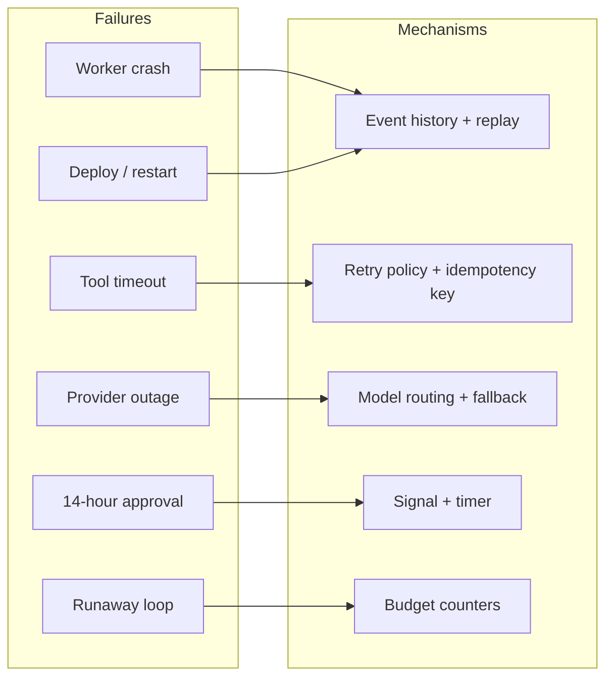

# Chapter 21 — Control plane and durable execution

*Part II · Word budget 5,000–8,000 · Lab 21 · Verified as of September 2026 · Derived figures from `labs/ch21-control-plane/derive.py`*

## 21.1 Intuition

The maintenance agent reaches step eight of the P-101 work order at 17:42 and asks for the supervisor's approval (scenario, ch16). The supervisor is off shift. The approval arrives at 08:02 the next morning. Somewhere in the fourteen hours between, the service was redeployed, one worker process was killed, and the retrieval index returned a server error twice. When the approval lands, the task should continue from step eight — not from the beginning, not with a second work order, and not with the seven steps' worth of tokens spent again.

That is what the control plane is for. It is the part of the harness that runs the agent as a *workflow* rather than a script: a durable record of every step taken, so that a crash is a resume and a wait is a suspension. It also owns the things a script does badly — retrying a call that timed out, deciding which model handles which step, stopping a task that has spent its budget, and holding a task open for a human without holding a process open.

The mechanism is old. Durable workflow engines predate language models by a decade; what is new is that agents are the first workload where the unit of work is expensive, non-deterministic, and side-effecting all at once. A step that costs a dollar of tokens, may produce a different result on re-run, and may have created a record in a system of record is a step you must not repeat by accident. The control plane is the machinery that makes not repeating it a property of the system rather than a hope.

## 21.2 Mechanism

### Workflows and activities

Durable-execution engines — Temporal is the reference; AWS Bedrock AgentCore and Restate are alternatives with the same shape — split a program into two kinds of code (Temporal documentation, vendor, verified Sep 2026).

A **workflow** is orchestration logic: the sequence, the branches, the waits. It must be *deterministic* — given the same history of inputs it makes the same decisions — because the engine re-executes it from its recorded history to recover state after a crash. A workflow does no I/O of its own.

An **activity** is a unit of work with side effects: a model call, a tool call, a database write. Activities are not deterministic and are not replayed; their *results* are recorded in the workflow's event history, and on replay the engine returns the recorded result instead of running the activity again.

The **event history** is the append-only log of everything that happened to a workflow: activity scheduled, activity completed with result, timer started, signal received. It is the source of truth. A worker process holds no state that matters; kill it, start another, and the engine rebuilds the workflow's position by replaying the history through the deterministic code.

**Figure 21.1 — The agent loop as a workflow with activities.**

```mermaid
sequenceDiagram
    participant W as Workflow (deterministic)
    participant H as Event history
    participant A as Activities (model, tools)
    participant S as Signals (approval, clarification)
    W->>H: record: task started
    W->>A: activity: plan (model call)
    A-->>H: completed: plan = [11 steps]
    loop each step
        W->>A: activity: act + observe + verify (tool call, sensors)
        A-->>H: completed: result, verdicts
    end
    W->>H: record: awaiting approval (timer 72 h)
    Note over W: worker killed here; new worker replays H and resumes waiting
    S-->>H: signal: approved by S, reason, expiry
    W->>A: activity: submit (idempotency key t-2207/8)
    A-->>H: completed: WO-48211 created
    W->>H: record: task complete
```

*Takeaway: nothing the model or the tools did is ever redone by accident, because every result is in the history before the workflow moves on.*


### The orchestrator's job, stated

An orchestrator is the program that knows what step comes next and survives everything that can go wrong between steps. It owns the task's state, schedules its activities, waits for its signals, enforces its budgets, and records its history; it does none of the work itself. The distinction matters because the two most common designs get it wrong in opposite directions. A loop inside a single process that calls the model and the tools directly owns state in memory, loses it on a crash, cannot wait for a human without holding a thread, and has no history to replay — it is fast to write and impossible to operate. A queue of independent jobs with no orchestrator owns no task state at all; each step runs when its message arrives, and the question "where is task t-2207" has no answer. Durable execution is the design in the middle: the orchestrator is code, the code's state is persisted as a history, and the history is replayed to recover the state after any failure. Temporal is the reference engine; AgentCore, Managed Agents, and comparable runtimes embed the same model behind a managed surface (vendor documentation, verified Sep 2026).

### Temporal internals the harness relies on

Five mechanisms inside the engine explain its guarantees and its constraints. **Event history**: every workflow is a sequence of events — started, activity scheduled, activity completed with its result, timer started, signal received, workflow completed — persisted by the server; the workflow's state is not stored, it is recomputed by replaying the history through the workflow code. **Deterministic replay**: because state is recomputed, the workflow code must produce the same commands given the same history; it cannot read the clock, generate random numbers, call the network, or branch on anything not in the history — those things happen in activities, whose results the history records. **Task queues and workers**: the server places workflow tasks and activity tasks on named queues; workers poll the queues they serve; a worker crash loses nothing, because the task is re-delivered and the history replayed on another worker. **Sticky execution**: a worker caches a workflow's replayed state so that consecutive tasks for the same workflow need not replay from scratch; the cache is an optimization, and correctness never depends on it. **Versioning**: a change to workflow code that would alter the commands produced from an old history is guarded with a patch marker, so running workflows follow the old path and new ones the new (Temporal documentation, vendor, verified Sep 2026).

The constraints these impose on the harness are exact. The loop's control flow — which step next, whether to repair, when to escalate — is workflow code and must be deterministic given the history; every model call, tool call, retrieval, and sensor is an activity. A random seed for the golden set's sampling is an activity result. The current time for a deadline check is a workflow-side timer, not a clock read. And a change to the loop's logic is versioned with a patch, because a task started under the old logic must finish under it.

### AgentCore internals, placed

Amazon's AgentCore is a managed runtime for agents with five services the harness maps onto its components (AWS AgentCore documentation, vendor, verified Sep 2026). **Runtime** executes agent sessions in isolated microVMs with a session lifetime, which is the sandbox and the working-memory boundary of ch25 and ch24. **Memory** offers short-term session memory and long-term memory with extraction strategies, which the harness uses for working and episodic memory only, keeping semantic memory under its own reviewed store (ch24). **Gateway** exposes tools and MCP servers with authentication and transforms, which is the tool gateway of ch25. **Identity** manages the agent's credentials and the user's delegated access, which is the dual identity of ch28 and the vault issuance of ch25. **Observability** emits traces in OpenTelemetry form to CloudWatch or a collector, which is ch29's input. What AgentCore does not provide as a first-class primitive is the durable workflow with replayable history; the harness runs its loop on Temporal (or Temporal-style durable execution) and uses AgentCore's services from activities. Managed Agents (Anthropic) offer a comparable surface — sessions, memory, outcomes, webhooks — with the same placement.

### Orchestrators compared

| Property | Temporal (self-hosted or cloud) | AgentCore | Managed Agents | Plain job queue |
|---|---|---|---|---|
| Durable, replayable task state | Yes (event history) | Session-scoped | Session-scoped | No |
| Wait for a human for hours | Timer + signal; no thread held | Session must persist | Session must persist | Not directly |
| Retries with non-retryable types | Native | Per tool | Per tool | Library-dependent |
| Idempotency support | Task/step keys in activities | Tool-level | Tool-level | Manual |
| Budgets as workflow logic | Yes | Via gateway | Via platform | Manual |
| Versioning of running tasks | Patch markers | Redeploy | Redeploy | None |
| Air-gap / residency | Self-hostable | AWS regions | Vendor cloud | Self-hostable |

(Properties as stated in each vendor's documentation, vendor, verified Sep 2026. The plant's residency requirement, ch36, is the row that decides.)

### Mapping the loop onto the engine

The agent loop of ch22 maps directly. Plan, Act, Observe, and Verify are activities — each a model call, a tool call, or a sensor run, with its result recorded. The loop's control decisions — next step, repair or escalate, at the cap or not — are workflow code, and therefore deterministic and replayable. The human gate is a **signal** the workflow waits for, with a **timer** for expiry. Budgets are counters in workflow state, checked before each activity is scheduled. Re-plan is a new plan activity whose result replaces the remaining steps in workflow state.

Two consequences follow that a script cannot offer. Because activity results are recorded, a task interrupted at step seven resumes at step eight with steps one to seven's results in hand and no tokens re-spent. And because the workflow waits on a signal rather than a thread, a fourteen-hour approval costs a timer entry, not a process.

### Retries, and what they must not do

The engine retries a failed activity according to a policy: initial interval, backoff factor, maximum interval, maximum attempts, and a set of error types that are *not* retried. The schedule in this book's default — base one second, factor two, cap thirty seconds, full jitter, six attempts — spends at most about sixty-one seconds before giving up (derive.py, derived; jitter per Google SRE guidance on avoiding synchronized retries, practitioner). The non-retryable set matters as much as the schedule: a policy deny (ch28), a schema failure (ch26), and a model refusal are not transient and must go to the loop's Repair, not to the retry policy — the retry/repair distinction of ch22, enforced here by error type.

The rule that makes retries safe is **idempotency**. A retried write must not produce a second effect. Every activity that changes state carries a key derived from the task and step — `t-2207/8` for the P-101 submission — and the receiving system (or the tool wrapper in front of it) treats a second request with the same key as the same request, returning the first result (the pattern is the one payment APIs standardized; Stripe API idempotency documentation, vendor). Without it, the ambiguous case — the call succeeded but the response was lost — produces a duplicate on every retry; with it, the ambiguous case is resolved by the receiver.


### Retries in depth

A retry policy has five parameters and the harness sets each per activity type: initial interval, backoff coefficient, maximum interval, maximum attempts, and the set of non-retryable error types. Model calls retry on transport and rate-limit errors with backoff and a cap of three; they do not retry on content errors — a refusal, a malformed output — which are the loop's to repair (ch22). Tool reads retry like model calls. Tool writes retry only with an idempotency key attached, and the executor confirms the key was honoured before treating a retry as safe. Policy denials are non-retryable by construction: a denied call retried is a loop hammering a gate, and the engine's non-retryable error types are where that is encoded. Sensor failures are never retried — a sensor is deterministic, and running it again on the same input produces the same verdict. The observability record (ch29) carries the attempt count per activity, and the steering review reads the distribution: an activity type whose attempts cluster at the cap is one whose retry policy is hiding a systematic failure.

### Compensation and the saga, worked

The P-101 task writes twice: a draft to the CMMS draft queue at step six and a submission at step eight. If the submission fails after the draft succeeded — the CMMS rejects it for a reason the sensors did not anticipate — the task does not leave a draft the planner will find next week without context. Compensation runs: the draft is annotated with the task id and the failure, or withdrawn, per the class's compensation rule, and the annotation is itself an idempotent write with its own key. Sagas — a sequence of writes with a compensating action for each — are the general form (Garcia-Molina and Salem, "Sagas," 1987, primary); the harness's workflows declare, per write step, the compensation that undoes it, and the engine runs the compensations in reverse order on failure. A write with no declared compensation is a write the class may not make, which is a rule the pull-request review enforces.

### Compensation

Some effects cannot be made idempotent and cannot be rolled back by the engine: a notification sent, a record created in a system without keys. For those, the workflow records a *compensating* activity alongside the effect — delete the draft, send the correction — and runs the compensations in reverse order if the task is abandoned after the effect. This is the saga pattern (Garcia-Molina and Salem, "Sagas," 1987, primary), and the control plane is where it lives: the workflow knows which effects have happened because they are in its history.

### Budgets and caps

The control plane is where the caps of ch22 are enforced, because it is the only component that sees every activity before it runs. Before scheduling an activity, the workflow checks: steps so far against the step cap; model calls so far against the call cap; tokens so far (from recorded activity results) against the token budget; wall-clock elapsed against the time cap; and the task's spend against the per-task cost cap, which the gateway (ch23) also enforces as a second line. Exceeding any one schedules an *escalate* activity and ends the loop. A budget enforced in the model's prompt is a request; a budget enforced here is a fact.


### Idempotency in depth

An idempotency key makes a write safe to repeat, and the key's design decides what "the same write" means. The harness's key is `task_id/step` for a step's principal write and `task_id/step/n` for a step that legitimately writes several records; the executor (ch25) attaches it to every write tool call; the system of record — the CMMS — either honours it natively (an `Idempotency-Key` header or a client reference field) or the tool wraps the write in a lookup-then-create keyed on it. Three subtleties. A repair (ch22) that re-drafts a step is a new attempt of the same step and keeps the same key, so a work order drafted twice by a repair is one draft. A retry after a timeout whose original write succeeded returns the original result under the same key, which is the case Lab 21 tests. And a key must be generated by the control plane from the task record, never supplied by the model, because a model that chooses keys can choose to collide with a previous task's.

### Approval states in depth

An approval is a state the task enters and a signal that moves it out, and the state machine has more states than approve and reject. **Pending**: the task has requested approval; a timer runs against the class's deadline; the approver is notified with the artifact, the criteria, and the verdicts (ch31). **Approved**: the signal carries the approver's identity, a reason, and the approval id the policy engine will verify on the gated call (ch28). **Rejected**: the signal carries a reason coded against the criteria, which becomes a repair input (ch22) or an escalation. **Expired**: the timer fired; the task escalates to a second approver or closes with a recorded reason — never auto-approves. **Withdrawn**: the requester cancelled; compensation runs (21.2). **Delegated**: the approver named another; the new approver's identity is recorded and the timer restarts. Every transition is an event in the history and an intervention record (ch29), and the approval id is single-use — a second gated call with the same id is denied.

### Budgets in depth

A budget is a workflow-side counter checked before every activity is scheduled, with four dimensions: model calls, tool calls, tokens (from the gateway's usage line), and wall-clock time. Each has a per-task cap from the task's class and a per-step cap where a step is known to be bounded (a retrieval step needs at most three calls). Exceeding a cap does not fail the task; it escalates it — the workflow enters a budget-exceeded state, a human sees the task's history and decides to extend or close, and the decision is recorded. Two design rules. The budget is checked *before* scheduling, not after completion, so a cap is a limit rather than a report. And the token cap is enforced twice — by the workflow's counter and by the gateway's hard cap (ch23) — because the gateway can stop a call the workflow did not schedule (a sub-agent's, a tool's own model use) and the workflow can stop a step the gateway would have allowed.

### Model routing

The control plane decides which model an activity calls, because it knows the step's class and the budget remaining (ch23 gives the router's design). Routine steps — field extraction, formatting — go to a small model; planning and verification go to the frontier model; a step tagged hard goes to the frontier model at high reasoning effort; and a provider outage flips the route to the fallback without changing the workflow. The route is recorded in the activity's result along with the model version, so a replay knows which model produced which step.


### Timeouts and heartbeats

An activity that never returns is worse than one that fails, because nothing retries it. Engines give each activity a set of timeouts and the harness sets every one of them (Temporal documentation, vendor). *Schedule-to-start* bounds how long an activity may wait in a queue before a worker picks it up — a signal that the worker pool is undersized. *Start-to-close* bounds a single attempt — a model call that has run for five minutes is a hung connection, not a slow model. *Schedule-to-close* bounds the whole activity including retries. For long activities — a batch re-index, a large document parse — the activity *heartbeats*: it reports progress to the engine periodically, and a missed heartbeat is treated as a failure so the retry can begin before the start-to-close timeout expires. For the agent's activities the defaults are short: model calls thirty seconds start-to-close at low effort and three minutes at high; tool calls per the tool's declared latency; sensors ten seconds. A tool that needs longer declares it and heartbeats.


### Timers, deadlines, and the calendar

A task has a deadline from intake (ch17) and the workflow holds it as a timer; the timer is durable — a deploy, a crash, or a week of waiting does not lose it — and when it fires the workflow escalates. Three timer uses beyond the deadline. The approval wait (21.2's state machine) has its own timer per class. The heartbeat on a long activity (a batch re-index; a browser session) detects a hung worker without waiting for the activity's full timeout. And scheduled tasks — the weekly preventive-maintenance run, the nightly consolidation pass (ch24), the golden-set nightly gate (ch27) — are workflows started by the engine's scheduler with the same history and the same guarantees as a technician's request. A cron job outside the engine is a task with no history; the plant runs its schedules inside.

### Failure modes of the control plane itself

The engine is infrastructure and fails like infrastructure. **The server is unavailable**: workers cannot poll; tasks pause; nothing is lost, because state is in the persisted history, and work resumes when the server returns — the plant runs the server redundantly and measures its availability like the model layer's (ch23). **A worker is unavailable**: its tasks are re-delivered to other workers; the plant runs more than one per queue. **A workflow is stuck**: an activity that never completes and never times out — the timeout and heartbeat rules prevent it, and the observability record's "tasks running longer than p99" alarm (ch29) finds the ones that slipped. **A poison workflow**: a task whose replay fails because the code changed incompatibly — the versioning rule prevents it, and a failed replay is an incident that names the deploy. **History too large**: continue-as-new (21.2) prevents it. Each has a metric on the control plane's own page: server availability, worker count per queue, stuck-task count, replay failures, and history sizes.

### Versioning the workflow code

Determinism has a cost the first deploy reveals. If workflow code changes — a step added, a branch reordered — while tasks are in flight, replaying an old history through the new code diverges, and the engine rejects it. Engines solve this with explicit versioning: a change is wrapped so that histories recorded before it take the old path and histories after it take the new (Temporal's patching and worker versioning, vendor). The harness rule that follows is operational, not technical: the workflow code for the agent loop is versioned like a schema, in-flight tasks are drained or pinned before a breaking change, and the version is recorded in the history so an audit can say which orchestration logic governed a task. This is also why the loop's control logic is kept small and stable while the model-facing parts — guides, sensors, policies — change freely as activities.

### Long histories

A task with hundreds of activities accumulates a history that takes seconds to replay and grows without bound if the loop runs for days. Engines provide *continue-as-new*: the workflow closes its history and starts a fresh one carrying only the state it needs — the plan, the results summary, the budgets consumed (Temporal documentation, vendor). For agents this is the control-plane twin of context compaction (ch19): the model's window is compacted per step; the workflow's history is compacted per epoch. The rule of thumb in this book is to continue-as-new at a hundred activities or at every re-plan, whichever comes first, and to keep large tool outputs out of the history altogether — store them in the sandbox or an object store and record the reference and a hash.

### Child workflows for delegation

When the agent delegates (ch30), each sub-agent runs as a *child workflow* with its own history, its own budgets, and a parent that receives its result as an activity would. The child inherits the parent's task id in its own, so the audit trail is a tree, and it inherits at most the parent's permissions (ch28's intersection rule). A parent that spawns children without caps is the multi-agent runaway loop; the control plane bounds fan-out and depth the way it bounds steps. Children return summaries, not histories, for the same reason sub-agents return summaries to the context (ch19): the parent's history is its budget.


### Delegation as child workflows, worked

The parts reconciliation (ch19, ch25) runs as a child workflow: the parent schedules it with the sub-task's record — parent id, scope intersected (ch28), criteria, budget carved from the parent's — and waits on its completion as it would on any activity; the child has its own history, its own retries, and its own compensations, and its result is a summary the parent's sensors check (ch19's sub-agent contract). If the child exceeds its budget it escalates to the parent, not to a human directly; if the parent is withdrawn the child is cancelled and its compensations run. The observability record joins the two histories by the parent id (ch29), so an audit of the parent's work order can follow the reconciliation's every call.

### Queues, workers, and isolation

Activities are dispatched through *task queues*, and the queue is where operational policy lives. One queue per model provider lets the harness rate-limit calls to that provider and drain it during an outage while other work continues; one queue per tool class keeps a slow CMMS from blocking fast retrieval; a queue for sandboxed execution routes code to workers that run inside the isolated environment (ch25). Worker pools are sized from the schedule-to-start metric; a rising one is the alarm. None of this is visible to the model, which is the point: the model proposes a step and the control plane decides where, when, and under what limits it runs.

### Signals must be authenticated

The approval signal is the most security-sensitive message in the system, because it is the thing that turns an escalated write into an executed one. It carries the approver's identity, the reason, and an expiry, and the control plane verifies the identity against the approver role the policy engine named (ch28) before recording the signal; a signal from anyone else is logged and ignored. The clarification signal from intake (ch22) carries the requester's identity for the same reason. A workflow that accepts an unauthenticated "approved" is a policy engine with a back door.


### Testing the control plane

Workflow code is tested three ways. **Replay tests**: recorded histories from production are replayed against the current workflow code in CI; a non-deterministic change or an unguarded logic change fails the replay before it is deployed — the engine's own test harness supports this (Temporal documentation, vendor). **Crash tests**: Lab 21's protocol — start a task, kill the worker at a random step, resume, assert no duplicate side effects and no repeated activities — run against the real engine in staging (Lab 21b) on every workflow change. **Signal tests**: an approval, a rejection, an expiry, and a withdrawal each exercised, with the resulting states and compensations asserted. The tests are part of the regression pipeline of ch27, and a workflow change that lacks a replay test is a change the pull-request review returns.

### The control plane's page

One page, read weekly (ch29's steering review): tasks started, completed, escalated, expired, and withdrawn per class; approval wait p50 and p95 per class; retries per activity type with the share at the cap; budget escalations by dimension; compensations run; stuck tasks; replay failures; server availability; history sizes. The page is where the plant sees a class whose approvals are taking two days, an activity whose retries have doubled, or a budget that every task exceeds — operational facts the model's output never shows and the control plane always records.

### The history as the audit spine

Everything the observability component (ch29) needs is already in the history: every activity with its inputs' hash and its result, every route and model version, every signal with its identity, every escalation with its cause, every timestamp. The harness exports the history per task, hash-chains the export, and maps its entries onto the evidence the regulations ask for (ch28's mapping table). The control plane is therefore not one more thing to instrument; it is the instrument, and the design rule is that anything that matters to a task happens as an activity or a signal so that it lands in the history by construction.

### Reference implementation

The following is a minimal event-sourced executor with the properties above — deterministic orchestration, recorded activity results, resume from history, idempotent writes — in about sixty lines. It is not Temporal; it is the shape of Temporal small enough to read, and Lab 21 crashes it mid-task and resumes it. Its limits are the point of its size: one process, no concurrency, no worker pool, no real timers (a wait is a `Suspend` the caller re-invokes later), no retry policy (retries live in the tool wrapper), and a history in a local file. Everything it lacks is what an engine provides; everything it has is what an engine guarantees.

```python
import json, hashlib
from typing import Callable

class History:
    """Append-only event log. In production this is the engine's durable store."""
    def __init__(self, path): self.path = path; self.events = []
    def load(self):
        try: self.events = [json.loads(l) for l in open(self.path)]
        except FileNotFoundError: self.events = []
        return self
    def append(self, ev):
        self.events.append(ev)
        with open(self.path, "a") as f: f.write(json.dumps(ev) + "\n")

class Crash(Exception): pass          # the worker died
class Suspend(Exception): pass        # the workflow is waiting; the caller persists and re-runs it later

class Workflow:
    """Deterministic orchestration over recorded activity results."""
    def __init__(self, history: History, activities: dict, budgets: dict, task_id: str):
        self.h = history; self.acts = activities; self.budgets = budgets; self.task_id = task_id
        self.cursor = 0; self.calls = 0; self.tokens = 0

    def activity(self, name: str, **args):
        """Return the recorded result if this activity already completed; otherwise run it once and record."""
        key = hashlib.sha256(json.dumps([self.task_id, name, args], sort_keys=True).encode()).hexdigest()[:16]
        for ev in self.h.events[self.cursor:]:
            if ev["type"] == "activity_completed" and ev["key"] == key:
                self.cursor = self.h.events.index(ev) + 1
                self.calls += ev["result"].get("calls", 0); self.tokens += ev["result"].get("tokens", 0)
                return ev["result"]                                   # replay: no re-execution
        if self.calls >= self.budgets["calls"] or self.tokens >= self.budgets["tokens"]:
            self.h.append({"type": "escalated", "reason": "budget exhausted", "at": name})
            raise RuntimeError("escalated: budget exhausted")
        result = self.acts[name](idempotency_key=key, **args)       # first execution
        self.h.append({"type": "activity_completed", "key": key, "name": name, "result": result})
        self.cursor = len(self.h.events)
        self.calls += result.get("calls", 0); self.tokens += result.get("tokens", 0)
        return result

    def wait_signal(self, name: str, mailbox: dict):
        """Suspend until a signal is present. No thread is held: the workflow returns and is re-run later."""
        for ev in self.h.events:
            if ev["type"] == "signal" and ev["name"] == name: return ev["payload"]
        if name in mailbox:
            self.h.append({"type": "signal", "name": name, "payload": mailbox[name]}); return mailbox[name]
        raise Suspend(f"waiting for signal {name}")

def run_task(h: History, acts: dict, mailbox: dict, budgets: dict, task_id: str, crash_at: int = None):
    wf = Workflow(h, acts, budgets, task_id)
    plan = wf.activity("plan", task="P-101 seal leak")["steps"]
    results = []
    for i, step in enumerate(plan):
        if crash_at is not None and i == crash_at: raise Crash(f"worker killed at step {i}")
        if step == "submit_work_order":
            approval = wf.wait_signal("approval", mailbox)
            results.append(wf.activity(step, order="WO-48211", approval=approval))
        else:
            results.append(wf.activity(step, n=i))
    h.append({"type": "task_complete"})
    return results
```

Three lines carry the guarantees. `activity` looks in the history before it runs anything, so a resumed task returns recorded results without calling the model or the tool. The idempotency key is derived from the task id, the activity's name, and its arguments — the `task_id/step` scheme of 21.8 — so a retried write reaches the receiver with the same key and two tasks never share one (Lab 21 caught a first version that omitted the task id: every task's submission shared a key). `wait_signal` raises `Suspend` rather than blocks, so a waiting task holds nothing but a history entry; a `Crash` is the worker dying, and the two are distinct in the code because they are distinct in production.

### AgentCore and the session

AWS Bedrock AgentCore approaches the same problem from the runtime side: each agent session runs in its own isolated microVM with dedicated compute and filesystem, sanitized when the session ends, with managed memory and a gateway for tools (AWS Bedrock AgentCore documentation, vendor, verified Sep 2026). It supplies isolation and long-lived sessions; the workflow semantics above — recorded results, deterministic replay, signals — still have to be provided by an engine or by the harness. The two are complementary, and the reference architecture in this book runs the workflow engine inside the isolated session.

**Figure 21.2 — What survives what.**



*Takeaway: each failure class has one mechanism, and each mechanism is control-plane code — none of them is a prompt.*

## 21.3 Worked numbers

All figures from `derive.py` (derived).

**Transient failures compound.** The P-101 task makes thirteen model or tool calls (ch16, ch22 scenario). If each has a 2% chance of a transient failure — a timeout, a rate limit, a server error — the task completes with no failure only 77% of the time; at 5%, 51%. With one retry per call, task success is 99.5% at 2% and 96.8% at 5%; with three retries, effectively 100% at either rate. Retries are not optional at eleven steps.

**Re-execution without checkpoints.** If a crash strikes uniformly at random across the eleven steps and the task restarts from the beginning, the expected work redone is 45% of the task. At one crash per 500 tasks (illustrative) and 7,500 tokens per step (ch22, compacted), that is about 75,000 extra tokens per thousand tasks — small in money, but every redone step is also a re-executed side effect if the writes are not idempotent, and that is the cost that matters.

**Duplicate writes.** If 2% of writes are retried after an ambiguous timeout and nothing de-duplicates them, a thousand tasks with one write each produce about twenty duplicate work orders (illustrative rate; arithmetic derived). Twenty duplicate work orders a month is a plant that stops trusting the agent.

**The cost of waiting the wrong way.** The supervisor's approval took fourteen hours and twenty minutes (scenario). The cost of holding a thread for it is not the compute — about thirty-six cents at half a vCPU (illustrative rate) — it is that a deploy in the window kills every waiting task, and a thousand tasks a month waiting on humans is a thousand tasks lost at every deploy. A timer entry in a history costs nothing and survives the deploy.

**Backoff.** Base one second, doubling, capped at thirty, six attempts: delays of 1, 2, 4, 8, 16, 30 seconds, sixty-one in total. A retry policy without a cap and a maximum count is a loop.

## 21.4 Measurement

**Resume correctness.** Kill the worker at a random step in a thousand tasks; count model calls, tool calls, and writes before and after; the totals must equal an uninterrupted run's, and the write count must be exactly one per write step. Lab 21 does this on the reference executor; Lab 21b does it on a Temporal deployment.

**Retry rate by cause** and **retry success rate**, per activity type. A rising retry rate on one tool is that tool's problem, not the agent's.

**Escalation by budget**, by which budget. Tokens exhausted points at compaction (ch19); calls exhausted at the repair cap (ch22); time exhausted at a tool or a human.

**Approval wait time** distribution and the share of tasks that expire at the timer.

**History size per task** and replay time; a history that takes seconds to replay is a workflow doing too much per task, and the fix is splitting it.

What to record: engine and version, retry policies per activity, budget values, idempotency key scheme, and the history export for any task under review.


### Reference output (Lab 21, this run)

What the lab prints when it reproduces; the plant's numbers replace these.

```text
300 tasks, crash at random step, resumed twice each: activity executions 3600 vs uninterrupted 3600
writes executed 300 (expected 300); distinct idempotency keys 300
runaway plan halted by call budget: True
p_no_failure_f0.02     chapter 0.769  derived 0.769  OK
task_success_f0.05_r1  chapter 0.968  derived 0.968  OK
redo_fraction          chapter 0.455  derived 0.455  OK
backoff_total          chapter 61.0  derived 61.0  OK
Lab 21: REPRODUCED
```

## 21.5 Failure

| Failure mode | Mechanism | Detection signal | Mitigation | Owning component |
|---|---|---|---|---|
| Non-idempotent write retried | Ambiguous timeout; retry creates a duplicate | Duplicate records in the system of record | Idempotency key per write; receiver de-duplicates | This chapter; ch25 |
| Non-deterministic workflow code | Orchestration reads the clock, random, or an external call; replay diverges | Replay errors; resumed tasks take a different path | All I/O in activities; determinism checks in tests | This chapter |
| Retrying a permanent error | Policy deny or schema failure treated as transient | Retries with identical failure; wasted calls | Non-retryable error types; route to Repair | This chapter; ch22 |
| No maximum attempts | Retry policy without a cap | A tool outage becomes a stuck task forever | Cap attempts and total time; escalate | This chapter |
| State in the worker | Plan or results held only in process memory | Crash loses hours; task restarts from zero | State in history; nothing in the worker that matters | This chapter; ch24 |
| Held threads for humans | Approval implemented as a blocking wait | Worker pool exhausted by waiting tasks; deploys kill waits | Signals and timers; workflow returns while waiting | This chapter; ch31 |
| Budget in the prompt only | "Do not exceed 20 steps" as an instruction | Tasks exceeding caps; discovered at invoice | Counters checked before scheduling | This chapter; ch23 |
| Compensation absent | Effect without a recorded undo; task abandoned after the effect | Orphaned drafts and notifications | Saga: compensating activity recorded with each non-idempotent effect | This chapter |
| History bloat | Large tool outputs stored in events | Replay slow; storage growing | Store references and hashes; outputs in the sandbox or object store | This chapter; ch19 |
| Route not recorded | Activity result lacks model and version | Replay cannot tell which model produced a step | Model, version, and route in every activity result | ch23; ch29 |
| Unauthenticated signal | Any message named "approval" resumes the write | Approval recorded without an approver identity | Verify signal identity against the approver role before recording | This chapter; ch28 |
| Missing timeouts | An activity hangs; nothing retries it | Tasks stuck with no failure and no progress; schedule-to-start rising | Every activity declares all timeouts; long activities heartbeat | This chapter |
| Breaking workflow change with tasks in flight | Replay diverges from new code | Engine non-determinism errors after a deploy | Version workflow code; drain or pin in-flight tasks; record version in history | This chapter |
| Unbounded fan-out | Parent spawns children without caps | Child count and depth rising; budgets exceeded in aggregate | Cap children and depth; children carry budgets; summaries not histories | This chapter; ch30 |

The recurring modes above appear, with their owning components and golden cases, in the failure catalogue (ch33).

## 21.6 The frontier

**Strongest free treatments.** Temporal's documentation is the definitive description of workflows, activities, event history, replay, signals, and timers, with SDKs in several languages; it stops at general workflows and does not treat the agent loop, model routing, or token budgets as first-class. AWS Bedrock AgentCore's documentation covers isolated long-running sessions, memory, and a tool gateway; it stops before workflow semantics and idempotency. 12-Factor Agents states "launch, pause, resume with simple APIs" and "unify execution state and business state" as principles (HumanLayer, practitioner) and stops at principles. Anthropic's long-running-agents post uses Git commits and a progress file as checkpoints for a coding agent (Anthropic, November 2025, vendor) — a lightweight durable execution — and stops at that pattern. The saga literature (Garcia-Molina and Salem 1987) and the SRE guidance on retries with jitter are complete for their subjects and predate agents. Darú's living book has a planning-and-loop chapter grounded in open harnesses and stops at coding agents without a workflow engine.

**What this chapter adds.** The mapping of the agent loop onto workflow and activity with the two consequences — no re-spend, no held process — made explicit; the retry/repair distinction enforced by error type; idempotency and compensation as control-plane responsibilities; budgets as counters checked before scheduling; a sixty-line executor with the engine's guarantees that a lab can crash and resume; and the arithmetic that shows retries are mandatory at eleven steps. Open: no published measurement of resume correctness or duplicate-write rates for agent workloads on production engines; Lab 21b's Temporal protocol is the test.

**Related chapters.** ch15 (Economics of models).

## 21.7 Industrial application

**The P-101 task as a workflow.** Twelve activities — one plan and eleven steps — plus one repair call, one signal, one timer; thirteen model or tool calls in all (ch22). The plan activity runs on the frontier model; the three reads on the small model; the draft and the permit check on the frontier model; the validation and preview as tool activities with sensors; the submission as a write activity with key `t-2207/8` after the approval signal. The history is the audit record (ch29): every activity's result, the route and model version that produced it, the signal's identity and reason, and the timestamps. The 02:00 redeploy that killed the worker during the approval wait is one event in the history — `worker restarted` — followed by `signal received` at 08:02 and `activity completed: submit_work_order` at 08:02:04.

**What the plant's engineers should insist on.** No worker holds state; the history export for any task is available on request; every write has a key the CMMS honors; retry policies are per tool and have maximum attempts; the approval wait is a timer with an expiry the supervisor role agreed to; and budgets are counters. A vendor whose agent "keeps context in memory during the task" fails the first test and, at the first deploy, the plant's patience.

**OT boundary.** The control plane schedules activities against registered tools only; there is no activity type that reaches a control system, so there is nothing for the engine to retry or resume in that direction (ch28, ch35).

## 21.8 Decision aids

**Engine selection.**

| Requirement | Test |
|---|---|
| Durable history | Kill a worker mid-task; the task resumes with no repeated side effects |
| Signals and timers | A task can wait 72 hours for a human at zero process cost |
| Per-activity retry policy | Non-retryable error types configurable per activity |
| Idempotency support | Activity ids or keys available to the tool layer |
| Deterministic replay | Workflow code cannot perform I/O; the SDK enforces or lints it |
| Self-hostable | Runs inside the plant's network if the data must |
| Air-gappable | No control-plane dependency on an external service |


**Two engines the plant might not choose, and why.** A message queue with a consumer loop gives retries and decoupling but no replayable history; state lives in the consumer and dies with it, and a wait for a human becomes a polling job. A cron-driven state machine in a database gives durability but reinvents replay, signals, and timers by hand, and the hand-written version is where non-determinism bugs live. Both are how agent pilots start and both are why they fail at the first long task; the chapter's engine selection table is the test to run before the choice is made (engine comparison is this chapter's assessment; practitioner).

**Retry policy template.** Base 1 s, factor 2, cap 30 s, full jitter, six attempts, total under 90 s; non-retryable: policy deny, schema failure, model refusal, validation error, authorization failure.

**Budget template per task.** Steps 20; model calls 60; tokens 200,000; wall clock 24 h excluding approval waits; cost from ch37's per-task cap; approval timer 72 h with a reminder at 24 h.


**Activity timeout defaults.**

| Activity | Start-to-close | Schedule-to-close | Heartbeat | Retries |
|---|---|---|---|---|
| Model call, low effort | 30 s | 3 min | — | 3 |
| Model call, high effort | 3 min | 10 min | — | 2 |
| Tool call, read | tool's declared p99 × 3 | 2 min | — | 3 |
| Tool call, write | tool's declared p99 × 3 | 2 min | — | 3, idempotent |
| Sensor run | 10 s | 1 min | — | 1 |
| Batch job (re-index, parse) | 30 min | 2 h | 60 s | 1 |

**Idempotency key scheme.** `task_id/step_index[/attempt]` — attempt included only when a repair changes the arguments; never a timestamp; never random.

## 21.9 Sources

| # | Claim or figure | Source | Tier | Verified | Link |
|---|---|---|---|---|---|
| 1 | Workflows, activities, event history, replay, signals, timers, retry policies | Temporal documentation | vendor | Sep 2026 | https://docs.temporal.io/ |
| 2 | Isolated microVM sessions; managed memory; tool gateway | AWS Bedrock AgentCore documentation | vendor | Sep 2026 | https://docs.aws.amazon.com/bedrock-agentcore/ |
| 3 | Idempotency keys for safe retries | Stripe API documentation | vendor | Sep 2026 | https://docs.stripe.com/api/idempotent_requests |
| 4 | Sagas and compensation | Garcia-Molina & Salem, "Sagas," SIGMOD 1987 | primary | Sep 2026 | https://doi.org/10.1145/38713.38742 |
| 5 | Exponential backoff with jitter | Google SRE book, "Handling Overload"; AWS Architecture Blog on jitter | practitioner | Sep 2026 | https://ai.google.dev/gemini-api/docs/pricing |
| 6 | Launch/pause/resume; unify execution and business state | HumanLayer, 12-Factor Agents | practitioner | Sep 2026 | https://github.com/humanlayer/12-factor-agents |
| 7 | Git and progress file as checkpoints | Anthropic, "Effective Harnesses for Long-Running Agents," Nov 2025 | vendor | Sep 2026 | https://www.anthropic.com/engineering |
| 8 | Compounding failure rates; retry success; redo fraction; duplicate-write arithmetic; backoff schedule; held-worker cost | `labs/ch21-control-plane/derive.py` | derived | Sep 2026 | labs/ch21-control-plane/derive.py |
| 9 | Thirteen calls, one crash per 500 tasks, 2% ambiguous timeouts, 14 h 20 m wait, $0.05 per vCPU-hour | Scenario and assumptions | illustrative / scenario | Sep 2026 | — |
| 10 | Resume correctness and duplicate rates on production engines for agent workloads | None found | open | Sep 2026 | — |