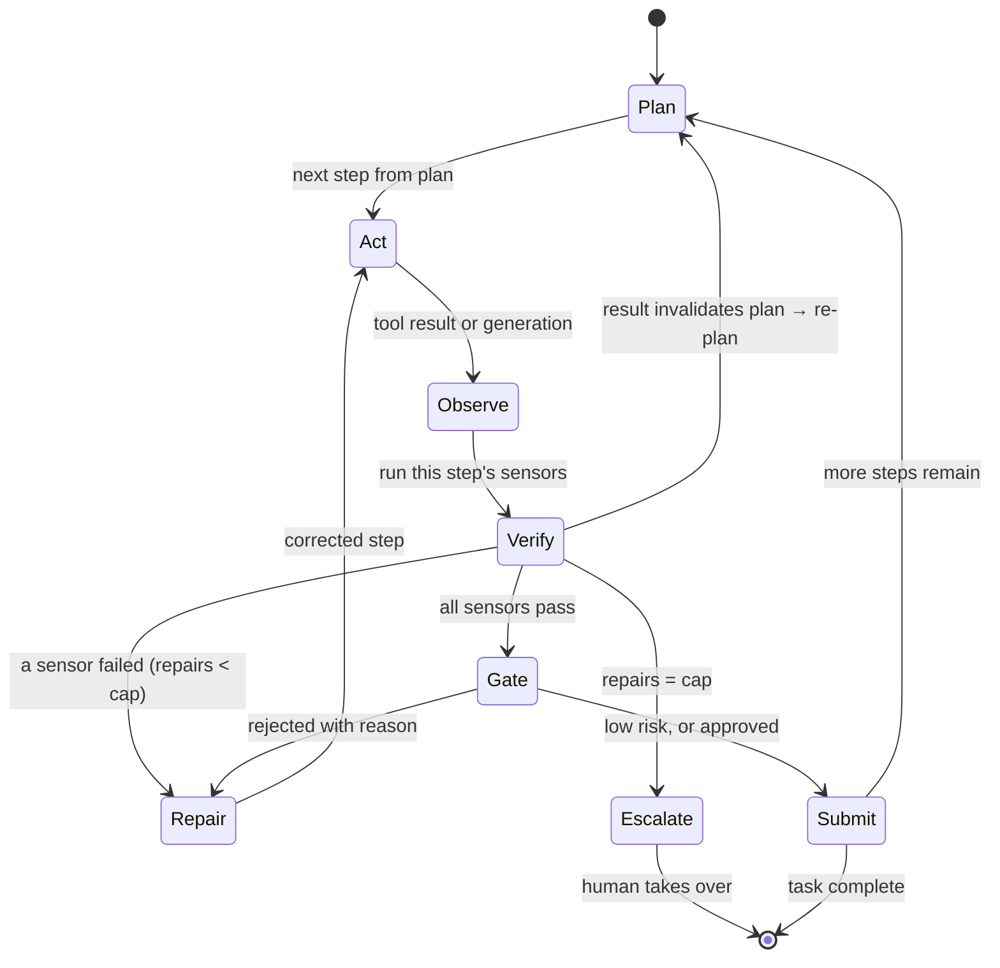
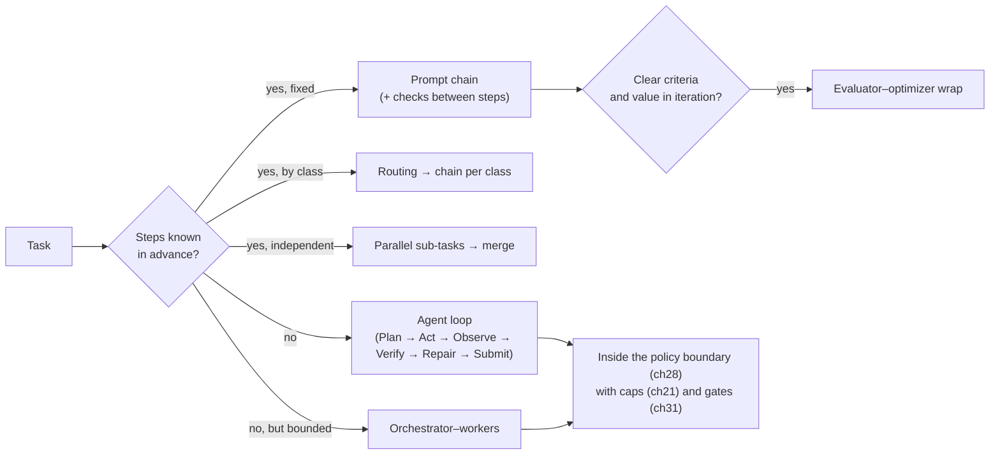

# Chapter 22 — The agent loop and workflow patterns

*Part II · Word budget 5,000–8,000 · Lab 22 · Verified as of September 2026 · Derived figures from `labs/ch22-loop/derive.py`*

## 22.1 Intuition

A model answers once. An agent keeps going until something outside the model says the work is done. The thing that keeps it going is the loop, and the thing that says it is done is a check the model did not write.

The maintenance agent drafting the work order for the seal leak on pump P-101 does not produce the order in one call. It plans: retrieve the procedure, pull the pump's history and the approved parts list, draft the eight fields, validate against the CMMS schema, check the permit type against the hazard class, preview, submit for approval. It acts on one step. It looks at what came back. It runs the checks for that step. If a check fails — the permit field is empty — it reads the failure and repairs the step. When every check passes and the supervisor has approved, it submits. Then it stops.

Every word in that paragraph is a design decision with a failure mode behind it. Plan before acting, or the model drifts. One action per turn, or you cannot tell which one broke. Verify with something deterministic, or "done" is the model's opinion. Cap the repairs, or the loop runs until the invoice arrives. Rebuild the context each turn, or the window fills with old tool output and the model stops reading it. This chapter gives the loop its states, the arithmetic that says why each rule exists, the simpler patterns that should be tried first, and code that runs.

## 22.2 Mechanism

### Workflows before agents

Anthropic's "Building Effective Agents" draws the line the field now uses: a *workflow* is a system where code decides the sequence of model calls; an *agent* is one where the model decides its own sequence (Anthropic, December 2024, vendor). The advice that accompanies it is the most important sentence in this chapter's sources: find the simplest solution possible, and add agentic complexity only when it measurably improves outcomes. Five workflow patterns cover most tasks without an open-ended loop.

| Pattern | Shape | Use when | Scenario example |
|---|---|---|---|
| Prompt chaining | Fixed sequence; each step's output feeds the next, with a check between | Steps are known in advance | Extract fields → draft → format |
| Routing | Classify, then send to a specialized path | Inputs fall into classes with different handling | Request type → document Q&A vs work-order drafting |
| Parallelization | Independent sub-tasks run concurrently; results merged or voted | Sub-tasks do not depend on each other | Retrieve procedure, history, and BOM at once |
| Orchestrator–workers | A planner dispatches bounded workers and integrates | Sub-tasks cannot be enumerated in advance but each is bounded | Planner assigns "find current revision" to a retrieval worker |
| Evaluator–optimizer | Generate, grade against criteria, revise | Clear criteria and value in iteration | Draft → grader → revised draft |

The full agent loop is for tasks where the number and order of steps cannot be known until the work is under way. Most industrial document and maintenance tasks are prompt chains with a routing step in front; the loop is reserved for the minority, and even then it runs inside the gates of ch28.


### The five patterns, each in depth

Anthropic's taxonomy names five workflow patterns that use a model without giving it control of the flow (Anthropic, "Building Effective Agents," December 2024, vendor). Each has a plant use, a failure it invites, and a test for whether it is the right one.

**Prompt chaining.** A fixed sequence of model calls, each transforming the previous output, with a deterministic check between steps: extract the fields from the request → draft the description → format the work order. Use it when the steps are known and their order never changes. Its failure is an early step's error propagating; the check between steps is the defence, and the pattern is the loop's Act→Verify with the plan fixed in code. Test: does the golden set show variance in the step sequence? If no, chain.

**Routing.** A classifier sends an input to one of several specialized paths: a fault report to the work-order chain, a scheduling change to the planning chain, a question to the Q&A path (ch17, ch23). Use it when inputs fall into classes with different handling. Its failure is misclassification, and the classifier's accuracy per class (ch12) with the confirmation message at intake is the defence. Test: do the classes have different templates, tools, or sensors? If yes, route.

**Parallelization.** Independent calls run at once — sectioning (split a task into parts) or voting (the same task several times, aggregated). The plant's use is reads: three retrievals in parallel (22.2's fan-out), or the same extraction by two models with a consistency sensor. Use it for reads and for verification, never for writes. Its failure is a race on state; the fan-out-for-reads rule is the defence.

**Orchestrator–workers.** A model plans sub-tasks and delegates each to a worker, then synthesizes; the sub-tasks are not known in advance. The plant's use is the parts reconciliation (ch19, ch21): the orchestrator decides which assets and which lists, workers check each, the orchestrator assembles. Use it when the decomposition depends on the input. Its failure is the orchestrator's plan being wrong or unbounded; plan conformance (ch17) and the child-workflow budget (ch21) are the defences.

**Evaluator–optimizer.** One call generates, another evaluates against criteria, and the loop repeats until the evaluator passes or a cap is reached — the Repair transition with a grader as the evaluator (ch27). Use it for criteria a deterministic sensor cannot check and a grader can, with the grader calibrated. Its failure is a grader that passes the wrong thing or never passes; κ and the cap are the defences.

**Table — Which pattern, for which step class.**

| Step class | Pattern | Why |
|---|---|---|
| Field extraction, formatting, notification | Prompt chaining | Fixed steps; deterministic checks between |
| Intake class assignment | Routing | Classes differ in template and tools |
| Retrieval ×3; dual extraction with consistency check | Parallelization | Independent reads; voting for verification |
| Parts reconciliation across lists | Orchestrator–workers | Decomposition depends on the parts list |
| Description accuracy; procedure appropriateness | Evaluator–optimizer | Grader-checked criteria with a cap |
| The task as a whole | The loop (Plan→Act→Observe→Verify→Repair→Submit) | Steps vary; each needs verification |

### When to use each: the decision

The rule is to start one level simpler than the task seems to need and add structure only when the golden set shows the simpler form failing. A chain is tried first because it is deterministic, cheap, and fully observable; routing is added when one chain cannot serve every input; parallelization when latency or verification needs it; orchestrator–workers when the decomposition varies; and the full loop with re-planning when the golden set shows tasks whose step sequence the plant cannot fix in code. Anthropic's guidance says the same — find the simplest solution possible, add complexity only when it demonstrably improves outcomes — and the plant's evidence for "demonstrably" is the two-scaffold protocol (ch16) run between the simpler and the richer form. The scenario's work-order task began as a chain, added routing at intake, added parallel reads, and became a loop when the golden set showed re-plans on a fifth of tasks (illustrative); each step up carried a measurement.

### The six states

**Figure 22.1 — The agent loop.**



*Takeaway: the model owns Plan, Act, and Repair; the harness owns Verify, Gate, and the caps.*

**Plan.** From the task record (ch17) and the retrieved context (ch20), the model produces an ordered list of steps, each naming the tool it will use and the check it must pass. The plan is stored in task state (ch24) and is visible to humans. Planning separately from acting is the plan-and-execute pattern; it beats interleaved reasoning and acting for multi-step tasks because the plan is inspectable and the model does not drift step by step (Wang et al., "Plan-and-Solve Prompting," 2023, primary; the ReAct pattern of interleaving thought and action — Yao et al. 2022, primary — remains the right shape *within* a step).

**Act.** Execute one step: one tool call or one generation. One, not several. A batch of three tool calls in one turn saves a round trip and loses attribution — when one fails, the loop cannot tell which, and the rollback is all three.

**Observe.** Capture the result — output, error, or artifact — and record it. Large results are summarized or written to the sandbox with a reference; they do not enter the context whole (ch19).

**Verify.** Run the sensors declared for this step (ch26): deterministic checks first — schema, domain rules, citation presence, tests — and inferential ones only where no deterministic check exists. The step passes only when every declared sensor passes.

**Repair.** On a failure, the model receives the sensor's message and produces a corrected step. The message is written for the model: what failed, what was expected, and where possible what to change. Repairs are capped per step; at the cap the loop escalates to a human rather than trying again.

**Submit.** After Verify passes and, for actions above the risk threshold, after the human gate (ch31), the step's effect is committed — the artifact delivered or the write executed with an idempotency key (ch21). If steps remain, the loop returns to Plan with the updated state; otherwise the task closes.

Two transitions are easy to omit and expensive to omit. **Re-plan**: when an observation invalidates the plan's assumptions — the procedure has no current revision, the pump's history shows an open work order already — the loop returns to Plan explicitly rather than improvising the remaining steps. The re-plan flag is set by a tool result or a sensor — deterministic code that recognized the condition — never by the model asking to start over, which would make the flag a way around the step cap. **Escalate at the cap**: a loop without an exit for persistent failure is the runaway loop of ch37.


### Each state, in depth

**Plan.** The model reads the task record and the class guide and produces a plan: an ordered list of steps, each with a tool or a model action, an expected artifact, and its verifier. The plan is structured output (ch26), validated against the class's allowed steps and the task's scope (ch17's plan conformance), and stored in working memory (ch24). The plan is not the model's to change silently: a step it did not plan is a re-plan through the explicit transition. Effort is high here (ch09) because the plan is the step the whole task compounds on.

**Act.** One step: assemble the window (ch19), call the model or the tool at the step's tier and effort (ch23), through the policy engine (ch28) and the executor (ch25). Act produces an observation — a tool result or a model output — and nothing else; it does not verify, and it does not decide what comes next.

**Observe.** The observation is trimmed, labelled, and written to working memory with its result id (ch19, ch24). Observe is where a tool result is classified as transient failure (retry, ch21), semantic failure (repair), or success, and where an observation that invalidates the plan's assumptions sets the re-plan flag — deterministically, by a sensor that recognizes the condition, never by the model asking to start over.

**Verify.** The sensor chain runs (ch26): cheap first, fail fast, messages written for the model; the grader last where a criterion needs it (ch27). Verify's output is a list of failed checks with messages, or empty.

**Repair.** If Verify failed and the cap is not reached, the step re-runs with the failed sensor's message in the instruction and nothing else changed (ch19's repair window). Repair is not retry: a retry re-runs an unchanged call after a transient error; a repair re-runs a changed call after a semantic one. The cap is per step class from the repair-success histogram, and reaching it escalates.

**Submit.** The step's artifact is committed — written to the draft queue, submitted with an approval, delivered — through a write tool with an idempotency key (ch21), or the task closes with its report. Submit is the state the gate (ch31) sits in front of for gated classes; a submission without the approval id the policy engine expects does not happen.

The two omitted transitions — re-plan and escalate — are transitions to states outside the step: re-plan returns to Plan with the observation that caused it; escalate returns to a human with the history. Both are recorded (ch29), and both are counted (22.4), because a class whose tasks re-plan often has a plan template that is wrong and a class whose tasks escalate often has a sensor gap or a scope problem.

### Reference implementation

Complete and runnable; Lab 22 executes it with a simulated model and real sensors.

```python
from dataclasses import dataclass, field
from typing import Callable, Any

@dataclass
class Step:
    name: str; tool: str; args: dict; checks: list          # checks: list of (name, fn(result) -> (ok, message))

@dataclass
class LoopConfig:
    max_repairs_per_step: int = 3; max_steps: int = 20; max_calls: int = 60; token_budget: int = 200_000

@dataclass
class Trace:
    events: list = field(default_factory=list); calls: int = 0; tokens: int = 0
    def log(self, **kw): self.events.append(kw)

class Escalate(Exception): pass

def run_loop(task: dict, plan: Callable, act: Callable, repair: Callable, gate: Callable,
             tools: dict, cfg: LoopConfig, trace: Trace) -> dict:
    """plan(task, state) -> [Step]; act(step) -> (args, tokens); repair(step, msg) -> (args, tokens);
    gate(step, result) -> bool; tools[name](**args) -> result."""
    state = {"done": [], "results": {}, "writes": 0}
    steps = plan(task, state); trace.calls += 1
    i = 0
    while i < len(steps):
        if i >= cfg.max_steps or trace.calls >= cfg.max_calls or trace.tokens >= cfg.token_budget:
            raise Escalate(f"budget exhausted at step {i}: calls={trace.calls} tokens={trace.tokens}")
        step = steps[i]; repairs = 0
        args, tok = act(step); trace.calls += 1; trace.tokens += tok                     # ACT
        while True:
            result = tools[step.tool](**args)                                               # OBSERVE
            failed = []                                                                      # VERIFY
            for check_name, check in step.checks:
                ok, message = check(result)
                if not ok:
                    failed.append((check_name, message))
            trace.log(step=step.name, attempt=repairs + 1, failed=[n for n, _ in failed])
            if not failed:
                break
            if repairs >= cfg.max_repairs_per_step:
                raise Escalate(f"step {step.name} failed after {repairs} repairs: {failed[0][1]}")
            args, tok = repair(step, failed[0][1]); repairs += 1                           # REPAIR
            trace.calls += 1; trace.tokens += tok
        if step.tool.startswith("submit") and not gate(step, result):                       # GATE
            raise Escalate(f"step {step.name} rejected at the human gate")
        state["done"].append(step.name); state["results"][step.name] = result             # SUBMIT
        if result.get("replan"):      # set only by a tool or a sensor, never by the model  # RE-PLAN
            steps = steps[: i + 1] + plan(task, state); trace.calls += 1
        i += 1
    return state
```

The harness owns every line that is not a call to `plan`, `act`, or `repair`. The model cannot skip Verify, cannot exceed a cap, cannot submit past the gate, and cannot run past the budgets, because none of those are decisions it is asked to make.


### Stop conditions

A loop needs to know when to stop, and "the model says it is done" is the one condition the harness does not accept. Five stop conditions, all deterministic. **All planned steps submitted**: the normal end; the report step closes the task. **Repair cap reached on a step**: escalate the step, not the task; the task waits in the approval state (ch21). **Budget exceeded**: model calls, tool calls, tokens, or time (ch21); escalate with the history. **Re-plan cap reached**: a task that re-plans more than the class's cap — two, in the scenario (illustrative) — is a task whose request or template is wrong; escalate to intake. **Policy escalation**: a gated action awaits a human; the task pauses durably. A sixth is the model's own: it may propose `escalate` as an action with a reason — "the procedure's hazard class is absent" — and the loop treats the proposal as a request the observe state validates, not as a stop the model owns. The stop conditions are the loop's assumption register (ch16) made operational: each encodes a belief about how tasks fail, and the counts per condition (22.4) are how the beliefs are checked.

### Loop variants, placed

Three named loops from the literature map onto the six states. **ReAct** interleaves reasoning and action with observation in one model transcript (ch22's evidence section); in the harness the reasoning is the model's working inside Act, the action is Act's tool call, the observation is Observe — with the harness, not the transcript, holding the state, and the sensors, not the model, verifying. **Plan-and-execute** separates the plan from the steps, which is the loop's Plan state with the execution as the Act–Verify sequence; the variant's weakness — a plan that cannot adapt — is the explicit re-plan transition's reason for existing. **Reflexion** feeds a verbal reflection on failure into the next attempt, which is Repair with the sensor message as the reflection — the harness's version is narrower and more reliable, because the reflection is a deterministic sensor's message rather than the model's account of what went wrong (ch13's unfaithfulness). None of the three is wrong; each is a way of describing the same states with a different division between the model and the code, and the harness's division gives the code every structural decision.

### Latency of the loop

Eleven steps at one model call each, plus a plan and a repair, is thirteen model calls in sequence — at a few seconds each, a task of a minute or more before any tool latency or approval wait. Three levers. Parallel reads (22.2) collapse three retrievals into one wall-clock step. The small tier on routine steps (ch23) is faster per call as well as cheaper. And the interactive/batch split (ch10, ch21) keeps a technician's question from queueing behind a batch task. The task's latency budget per class is in the routing table, and the observability record's per-step durations show which step is the bottleneck — usually a tool, an approval, or the plan's high-effort call, in that order (illustrative ordering).

### Context per iteration

The loop rebuilds the model's context every turn from: the stable prefix (guides, tool schemas — cached), the task and plan, the current step, the last observation summarized, the sensor message if repairing, retrieved chunks for this step, and relevant memory (ch19, ch24). It does not append the full history. The arithmetic in 22.3 shows why: an uncompacted history grows the context linearly per iteration, so total tokens grow quadratically, and quality falls as the window fills (ch04, ch05).


### Plan representation

A plan is data the code executes, and its schema decides what the loop can check. Each step carries: an id; a class (retrieve, draft, validate, submit, …) from the router's taxonomy (ch23); the tool or model action with its arguments' sources (a field of the task record, a prior step's result id — never a literal the model invented); the artifact it produces; its verifier list from the class template (ch17); its dependencies on prior steps; and its budget. Plan conformance (ch17) checks every field against the class's allowed values before the first step runs. The plan is stored in working memory (ch24) and cited in the observability record (ch29), and a re-plan produces a new plan version linked to the observation that caused it, so an audit can see the plan as it was at step six and as it became at step seven. A plan written as prose — "first I will read the history, then …" — cannot be conformance-checked, cannot be executed by code, and cannot be audited; structured output (ch26) is what makes it a plan.

### The loop as the plant sees it

From the technician's side the loop is invisible: a request, perhaps a question, a draft to approve. From the planner's side it is the gate (ch31): an artifact, the criteria with their verdicts, the unenforced criteria to judge, the plan and the history one click away. From the engineer's side it is the record (ch29): every state transition with its inputs, outputs, verdicts, and costs. The loop's design serves all three, and the measure of a good loop is that each sees what they need and nothing else — the technician is not shown sensor messages, the planner is not shown tokens, the engineer is not asked to read the artifact to find the failing step.

### Why the caps are where they are

*Repairs per step.* With a first-attempt success of 0.60 and a repair success of 0.50, one repair lifts the step's pass rate to 0.80, three lift it to 0.95, five to 0.99; the expected model calls per step go from 1.0 to 1.4, 1.7, and 1.8 (derive.py, derived). The third repair buys most of the value; the fifth buys a point for a fraction of a call. Three is the default because beyond it the failure is usually not one a retry fixes — the sensor is wrong, the tool is broken, or the task is ambiguous — and a human should look.

*Steps and calls.* A task that plans more than twenty steps or spends more than sixty model calls is either a task that should have been split or a loop that is not converging. The caps are per-task budgets enforced by the control plane (ch21) and the gateway (ch23), and exceeding them is an escalation, not a failure.

*Token budget.* The runaway loop is the one that resends a growing context two hundred times; the budget is what turns a surprise on the invoice into an escalation at iteration forty.

### Sensor messages are for the model

The repair transition works only if the sensor tells the model what to change. "Validation failed" produces the same call again. "Field `permit_type` is required and empty; set it from the procedure's hazard class (class H → hot_work)" produces a repaired call. Böckeler calls sensor output phrased for the model "a positive kind of prompt injection" (Böckeler 2026, practitioner); the 12-Factor Agents guide states the same as "compact errors into the context window" (HumanLayer, 12-Factor Agents, practitioner). Every sensor in ch26 returns a message written this way, and the loop passes it verbatim.


### Retry is not repair

Two different things go wrong at Act, and they are handled by different parts of the system. A *transient error* — the CMMS API timed out, the retrieval index returned a server error — is retried by the control plane with the same arguments, backoff, and an idempotency key (ch21); the model is not consulted, because nothing about the call was wrong. A *sensor failure* — the call returned but the result did not pass a check — is repaired by the model with changed arguments. Conflating the two produces both failure modes at once: retrying a wrong call to the cap, or asking the model to "fix" a network timeout, which it does by inventing a different call. The reference implementation separates them by placing retries inside `tools[step.tool]` and repairs in the loop; the trace records which happened.

Idempotency belongs to the same distinction. Every Act that writes carries a key derived from the task and step, so a retry after a timeout cannot create a second work order, and a repair after a sensor failure is a new key because it is a new call. The control plane chapter gives the mechanics; the loop's contract is that no write leaves Act without one.

### Asking instead of guessing

The loop has a transition the diagram does not show because it is a tool call: asking a human a question. When the plan cannot proceed without information the task record lacks — which of two current procedure revisions the site uses, whether the technician meant the pump or its spare — the right action is a clarification request routed back through intake (ch17), not a guess. 12-Factor Agents states it as "contact humans with tool calls" (HumanLayer, practitioner): the question is a tool, the answer is an observation, and the workflow suspends durably in between exactly as it does for an approval. A loop that guesses at ambiguity has a high first-attempt failure rate that no repair cap fixes; a loop that asks has a clarification rate the plant can measure and drive down with better intake.

### Fan-out within a step

Parallelization is a workflow pattern and also a move inside the loop. Steps that read independent sources — procedure, history, parts list — are one planned step with three concurrent reads and a join; the sensors run on the joined result. The rule that keeps this safe is that fan-out is for reads. Concurrent writes lose the one-action-per-Act attribution the loop depends on, and a plan that needs several writes at once is a plan that should be sequenced, or split across sub-agents each with its own loop and its own gates (ch30).

### Pause, resume, checkpoint

A loop that waits a day for an approval, or is interrupted by a deployment at step seven, resumes from state, not from the beginning. That requires the loop's state — plan, current index, results so far, repairs used, budgets consumed — to live in durable storage (ch24) written at every transition, and the loop itself to be restartable from that record. The reference implementation keeps state in a dictionary for clarity; the production version writes it through the control plane at each transition, which is what turns a crash into a resume with no repeated side effects (ch21). The test is the one Lab 21 runs: kill the worker mid-task and count the writes.

### The grader inside the loop

The evaluator–optimizer pattern is a small loop inside a step: generate, grade against criteria, revise. Inside the agent loop it appears at Verify as an inferential sensor — a grader model with a rubric (ch27) — and it carries the same authority limit as everywhere else in this book: a grader can send a step to Repair and can prioritize human review; it cannot pass a write to a system of record on its own. Deterministic sensors decide what they can decide; the grader fills the gap between them and the human, and its agreement with humans is measured every quarter.


### Measuring the loop per state

Each state has a number. Plan: plan-conformance failures per hundred tasks; steps per plan p50 and p95; effort tokens. Act: model and tool calls per step; latency per step class. Observe: transient failures and retries per tool; re-plan flags raised, by cause. Verify: sensor failures per criterion per step; grader invocations. Repair: repairs per task; success by attempt number (the histogram that sets the cap); repairs that changed nothing (the message-quality signal). Submit: idempotency-key reuses (retries after success); gated submissions awaiting approval; approval wait. Stop conditions: counts per condition per class. The page is the loop's, read weekly beside the control plane's (ch21) and the evaluation's (ch27), and a class whose numbers move without a change in its guides, sensors, or model is a class whose inputs — the requests, the corpus — have changed, which is the steering review's first question.

### Observing what the loop did

The loop is where the observability component (ch29) gets most of its records, and the shape of those records is decided here. Every transition emits an event with the task id, step name, transition, attempt number, sensor names and verdicts, tokens spent, and the tool call's trace id from the policy engine. From those events alone the metrics in 22.4 are queries, an escalation packet is a filter, and a task can be replayed transition by transition. A loop that logs only its final answer has thrown away the evidence of how it got there — which is the evidence a regulator, a reviewer, and the steering loop (ch16) all need.

Two records deserve care. The sensor message on a failed Verify is stored verbatim, because it is what the model repaired against and the thing a reviewer reads to judge whether the sensor was clear. And the plan is stored at every re-plan, not overwritten, so the sequence of plans shows how the task's understanding changed — the difference between an agent that adapted and one that flailed is visible only in that history.


### Migrating a chain to a loop, and back

The patterns are not a ladder a use case climbs once. A class that began as a chain and became a loop because tasks re-planned can return to a chain when the steering review (ch16) finds why: the re-plans clustered on a missing intake field, the field was added to the template (ch17), and the re-plan rate fell to zero — at which point the loop's flexibility costs plan-conformance checks and re-plan handling for nothing, and the class is simpler as a chain. The direction of migration is a golden-set decision each quarter: the class runs as both forms on the same items, and the simpler form wins if its pass rate is within the interval. The harness's code supports both because the loop with a fixed plan and re-plan disabled *is* a chain, and the routing table's per-class configuration says which mode a class runs in.

### What changes when the model plans its own loop

Vendors now ship harnesses in which the model generates the workflow per task — deciding the steps, the sub-agent fan-out, and the model for each step at run time (Anthropic, Claude Code dynamic workflows, June 2026, vendor). Read against this chapter, that moves Plan from a single call to a program the model writes, and it changes nothing about who owns Verify, the caps, the gate, or the budget: a model-written plan still runs inside harness code that checks every step and stops at the limits. The vendor's own guidance notes the pattern is token-intensive; the arithmetic in 22.3 applies unchanged. What it does change is the shape of the golden set: a plan that varies per run needs pass^k measured across runs, not a single trace inspected once.

### What the evidence says about loops

Three results anchor the design, and each comes with a result that cuts the other way. ReAct — interleaving reasoning traces with actions — reported 34 and 10 point absolute gains over imitation and reinforcement-learning baselines on ALFWorld and WebShop with one or two in-context examples; on HotpotQA, chain-of-thought alone beat it, and the paper says so (Yao et al., "ReAct," 2022, primary). Reflexion — feeding a verbal reflection on the failure back into the next attempt — raised GPT-4's HumanEval pass@1 from 80% to 91% and solved 130 of 134 ALFWorld tasks against ReAct's 108; on MBPP it slightly lowered accuracy, and on WebShop the reflections did not converge because the evaluator's signal was not actionable (Shinn et al., "Reflexion," NeurIPS 2023, primary). It is the Repair transition with a memory, and its failures are the argument for sensor messages that say what to change. Self-Refine — generate, self-critique, revise, with the same model — reported about 20 points absolute average improvement across seven tasks (Madaan et al., "Self-Refine," 2023, primary), with the caveat that self-critique without an external check inherits the model's blind spots, which is why this book's Verify is deterministic first. All three are software or synthetic benchmarks; the size of the effects on an industrial workload is for the reader's golden set (ch16).

**Figure 22.2 — Where the five workflow patterns sit relative to the loop.**



*Takeaway: the loop is the last pattern to reach for, and it never runs ungated.*

## 22.3 Worked numbers

All figures from `derive.py` (derived).

**Repair caps.** First-attempt success $p = 0.60$, repair success $q = 0.50$. Step pass rate with cap $c$: $p + (1-p)(1-(1-q)^c)$.

| Repair cap | Step pass rate | Expected model calls per step |
|---|---|---|
| 0 | 0.60 | 1.00 |
| 1 | 0.80 | 1.40 |
| 3 | 0.95 | 1.70 |
| 5 | 0.988 | 1.77 |

**Task-level effect.** The P-101 task has eleven steps (ch16 scenario). With no repair the task completes at $0.60^{11} = 0.4\%$; with three repairs per step, $0.95^{11} = 57\%$; with a first-attempt rate of 0.95 and three repairs, 93% (derive.py). The loop's repair transition is worth two orders of magnitude at the task level; the first-attempt rate — which guides and retrieval raise — is worth the rest.

**Context growth.** Base context 6,000 tokens per iteration (scenario); an uncompacted history adds about 1,500 tokens per prior iteration — the assumed average size of one tool result plus its sensor verdicts in the scenario (illustrative; Lab 22 records the actual per-iteration growth in its trace so the reader can substitute a measured value). Total tokens over $m$ iterations: uncompacted $mB + g\,m(m-1)/2$; compacted, with one running summary of about $g$ tokens, $m(B+g)$.

| Iterations | Uncompacted | Compacted | Ratio |
|---|---|---|---|
| 4 | 33,000 | 30,000 | 1.1× |
| 8 | 90,000 | 60,000 | 1.5× |
| 16 | 276,000 | 120,000 | 2.3× |

The ratio is the token bill; the quality cost of the uncompacted window (ch05) is on top.

**A runaway loop.** Two hundred uncompacted iterations are 31 million input tokens — about $39 at the frontier fresh-input price of ch37, per task, before output (derive.py; price vendor, Sep 2026). Not ruinous once; ruinous when a bug puts a thousand tasks into the same loop overnight, which is what the call and token caps exist for.

## 22.4 Measurement

**Iterations per task.** Record the number of Act transitions per task; report mean and p95. A rising p95 with a flat mean is a subset of tasks looping; find them.

**Repair rate and repair success.** Share of steps that needed at least one repair; share of repairs after which the step passed. Low repair success with a high repair rate means the sensor messages are not actionable or the task is ambiguous — read the messages.

**Escalation rate by cause.** Cap reached, gate rejected, budget exhausted, re-plan limit. Each cause points at a different component.

**Tokens per step and per task**, split into prefix (cached), observation, sensor message, and retrieved chunks. Tokens per step rising across iterations is the compaction alarm.

**Straight-through-processing rate**: tasks that reached Submit with no human touch (ch37 definition). Lab 22 runs the reference loop with a stochastic model stub and real deterministic sensors, and reports every metric above against the derived expectations.

What to record: loop configuration (caps, budgets), model version, sensor set version, golden-set version, date.


### Reference output (Lab 22, this run)

What the lab prints when it reproduces; the plant's numbers replace these.

```text
cap 0: task pass 0.004  step pass 0.598  calls/step 1.00
cap 3: task pass 0.576  step pass 0.951  calls/step 1.70
step pass cap3     chapter 0.95  measured 0.951  OK
calls/step cap3    chapter 1.7  measured 1.7  OK
task pass cap3     chapter 0.569  measured 0.576  OK
task pass cap0     chapter 0.004  measured 0.004  OK
transient error retried without a model call: True
Lab 22: REPRODUCED
```

## 22.5 Failure

| Failure mode | Mechanism | Detection signal | Mitigation | Owning component |
|---|---|---|---|---|
| Verify skipped | Model declares the step done; harness trusts it | Steps with zero sensor runs; failures found downstream | Verify is harness code, not a model decision; no step passes without declared sensors | This chapter |
| Unbounded repair | No cap; same failure retried | Iterations per task climbing; identical repeated calls | Repair cap per step; escalate at cap | This chapter; ch21 |
| Repair fixes the wrong thing | Sensor message vague; model changes an unrelated field | Repair success low; diffs unrelated to the failure | Sensor messages name the field, the expectation, and the fix | ch26 |
| Batched actions | Several tool calls per turn | One failure rolls back three actions; attribution lost | One action per Act | This chapter |
| Plan drift | Improvising after an invalidating observation | Steps executed that the plan did not contain | Explicit re-plan transition; plan stored and diffed | This chapter; ch24 |
| Context accumulation | Full history appended each iteration | Tokens per step rising; quality falling late in tasks | Rebuild context per iteration; compaction | ch19 |
| Self-critique as the only check | Model grades its own output | Failures the model cannot see pass | Deterministic sensors first; graders calibrated (ch27) | ch26, ch27 |
| Loop where a chain would do | Open-ended loop on a fixed-sequence task | Cost and latency high; plan identical every time | Use the workflow patterns first | This chapter |
| Escalation without state | Human receives "failed" with no plan, trace, or message | Time to resolve escalations high | Escalate with the plan, the failing step, the sensor message, and the trace | ch31, ch29 |
| Retry treated as repair | A transient tool error is sent to the model, which changes the call | Repairs whose sensor message is a network or server error | Retries in the tool layer with the same arguments; repairs only on sensor failures | ch21; this chapter |
| Guessing at ambiguity | The plan proceeds on an assumption the task record does not support | High first-attempt failure on a class of tasks; corrections at the gate cite missing information | Clarification as a tool call routed to intake; measure clarification rate | ch17; this chapter |
| Concurrent writes | Fan-out applied to actions that change state | Two writes with one attribution; partial failure unrecoverable | Fan-out for reads only; sequence writes | This chapter |

The recurring modes above appear, with their owning components and golden cases, in the failure catalogue (ch33).

## 22.6 The frontier

**Strongest free treatments.** Anthropic's "Building Effective Agents" (December 2024) defines workflows versus agents, gives the five patterns with diagrams, and states the simplest-first rule; it stops at the pattern level, with no loop implementation, no caps, and no arithmetic. OpenAI's "A Practical Guide to Building Agents" (2025) gives single- and multi-agent orchestration with SDK code and guardrail types; it stops before verification design and before reliability measurement. ReAct, Reflexion, and Self-Refine (2022–2023) establish the reasoning–action interleave, the reflective repair, and self-critique with measured gains; each stops at its benchmark and none places the pattern inside gates and budgets. 12-Factor Agents (HumanLayer) gives the principles — own your control flow, compact errors, launch/pause/resume — and stops at principles. Böckeler (2026) supplies the sensor-message insight. Darú's living book has an agent-loop chapter grounded in open harness source code and stops at coding agents.

**What this chapter adds.** The six states with the two transitions the free sources omit (re-plan and escalate-at-cap); a runnable loop in which every control is harness code; the arithmetic for repair caps and context growth that turns each design rule into a number; the workflow patterns placed as a decision tree ahead of the loop; the running scenario carried through; and a lab that measures the loop's own metrics. Open: the effect sizes of ReAct, Reflexion, and Self-Refine on an industrial document workload are unmeasured; Lab 22's stub is a simulation, and the reader's golden set is the real test.

## 22.7 Industrial application

**The P-101 task through the loop.** Plan (one model call): eleven steps. Steps one to three retrieve the procedure, the pump's history, and the approved parts list — a parallel sub-task in practice, three reads with no writes. Step four drafts the eight fields; its sensors are the CMMS schema and the domain rules. Step five validates; step six checks permit type against hazard class and fails — the field is empty; the sensor's message names the field and the rule; one repair sets it; the sensor passes. Step seven previews. Step eight submits for approval: the gate holds, the workflow suspends (ch21), the supervisor approves next morning with a reason; the call is re-evaluated by the policy engine (ch28) and allowed; the submission carries an idempotency key. Steps nine to eleven notify the technician, attach the test report, and write the decision summary. Thirteen model calls, one repair, one escalation resolved by approval, no re-plan.

**Where a chain would have done.** If the plant's work orders are always drafted from the same three sources into the same eight fields, this is a prompt chain with a routing step, not an agent — and it should be built as one first. The loop earns its place when the history reveals an open order that changes the plan, when the procedure has no current revision and a human must be asked which to use, or when the technician's request does not fit a class. The two-scaffold test of ch16 is where the plant finds out which case it is in.

**What the loop never does.** No step in any plan names a tool that reaches a control system, because none is registered (ch28, ch35). The loop's escalation goes to a person, never to a broader permission.

## 22.8 Decision aids

**Pattern selection.** Steps known and fixed → prompt chain. Known by class → routing. Independent → parallel. Bounded but not enumerable → orchestrator–workers. Unknown → agent loop, gated. Clear criteria and value in iteration → wrap with evaluator–optimizer. Start one level simpler than you think you need; move up only on golden-set evidence.

**Loop configuration defaults (change with evidence).**

| Parameter | Default | Reason |
|---|---|---|
| Repairs per step | 3 | Third repair captures most of the value (22.3) |
| Steps per task | 20 | Beyond it, split the task |
| Model calls per task | 60 | 20 steps × (1 + 3 repairs) upper bound, minus planning |
| Token budget per task | 200,000 | Roughly 30 compacted iterations at the scenario's size |
| Re-plans per task | 2 | A third re-plan means the task is not what intake said |
| Actions per Act | 1 | Attribution and rollback |

**Sensor-message checklist.** Names the field or artifact; states what was expected; states what was found; states the fix where one is known; contains no text taken from untrusted tool output.

**Escalation packet.** Plan; failing step; last sensor message; trace id; tokens and calls spent; the cause code (cap, gate, budget, re-plan limit).

## 22.9 Sources

| # | Claim or figure | Source | Tier | Verified | Link |
|---|---|---|---|---|---|
| 1 | Workflows vs agents; five patterns; simplest solution first | Anthropic, "Building Effective Agents," Dec 2024 | vendor | Sep 2026 | https://www.anthropic.com/engineering/building-effective-agents |
| 2 | Single/multi-agent orchestration; guardrails | OpenAI, "A Practical Guide to Building Agents," 2025 | vendor | Sep 2026 | https://cdn.openai.com/business-guides-and-resources/a-practical-guide-to-building-agents.pdf |
| 3 | ReAct: +34 / +10 points absolute on ALFWorld / WebShop; CoT beats ReAct on HotpotQA | Yao et al., "ReAct," 2022, arXiv 2210.03629 | primary | Sep 2026 | https://arxiv.org/abs/2210.03629 |
| 4 | Reflexion: HumanEval pass@1 80% → 91% (GPT-4); ALFWorld 130/134 vs 108/134; MBPP slight regression; WebShop no gain | Shinn et al., "Reflexion," 2023, arXiv 2303.11366 | primary | Sep 2026 | https://arxiv.org/abs/2303.11366 |
| 5 | Self-Refine: ~20 points absolute average improvement | Madaan et al., "Self-Refine," 2023, arXiv 2303.17651 | primary | Sep 2026 | https://arxiv.org/abs/2303.17651 |
| 6 | Plan-and-execute separation | Wang et al., "Plan-and-Solve Prompting," 2023, arXiv 2305.04091 | primary | Sep 2026 | https://arxiv.org/abs/2305.04091 |
| 7 | Sensor output as positive prompt injection | Böckeler, martinfowler.com, Apr 2026 | practitioner | Sep 2026 | https://martinfowler.com/articles/exploring-gen-ai/ |
| 8 | Compact errors; own control flow; launch/pause/resume | HumanLayer, 12-Factor Agents | practitioner | Sep 2026 | https://github.com/humanlayer/12-factor-agents |
| 9 | Repair-cap table; task-level rates; context growth; runaway cost | `labs/ch22-loop/derive.py` | derived | Sep 2026 | labs/ch22-loop/derive.py |
| 10 | Frontier fresh-input price $1.25/M | Vendor pricing, Sep 2026 (ch37) | vendor | Sep 2026 | https://docs.claude.com/en/docs/about-claude/pricing |
| 11 | p = 0.60, q = 0.50, growth 1,500 tokens/iteration, eleven steps | Assumptions for the arithmetic | illustrative / scenario | Sep 2026 | — |
| 12 | Effect sizes on industrial workloads | None found | open | Sep 2026 | — |