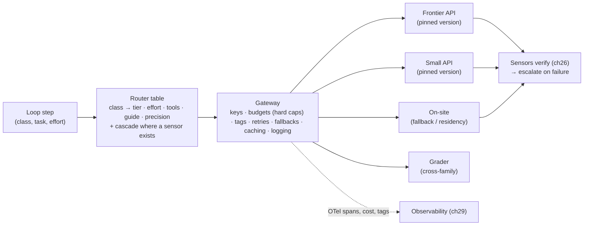
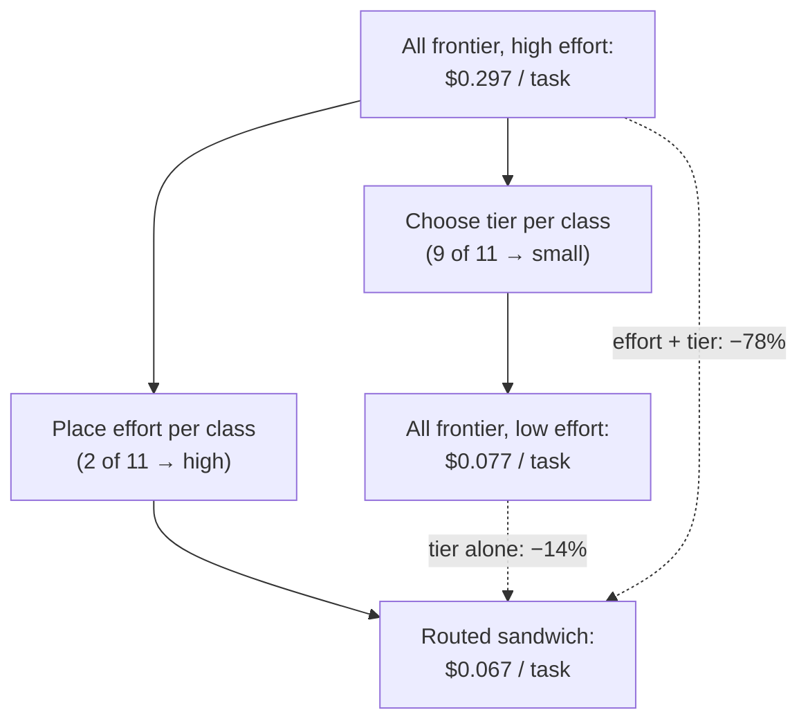

# Chapter 23 — Model layer, routing, gateways

*Part II · Word budget 7,000–10,000 · Lab 23 · Verified as of September 2026 · Derived figures from `labs/ch23-routing/derive.py`*

## 23.1 Intuition

The harness does not have a model; it has a model layer. Behind one interface sit a frontier model rented by the token, a small model a fifth its price, an on-site model that runs when the network is down or the data may not leave, and a grader from a different family than any of them. In front of the interface sits a gateway — one endpoint, one set of keys, one ledger — through which every call passes and is counted. And between the two sits a router that decides, per step, which model runs at what effort with which tools.

Three facts organize the chapter. The first is that the plant's work is not one task but eleven step classes, and they differ by an order of magnitude in what they need: extracting fields from a request is a small-model job at no reasoning effort; deciding a permit type from a hazard class the procedure does not state is a frontier job at high effort. A router that sends each class to the model that handles it at quality is the largest engineering lever on the token bill after the artifact's length (ch15). The second is that the lever's published size is a ceiling: RouteLLM's 85% is a benchmark figure, independent measurement on realistic traffic lands near 35%, and the plant's own number — routed share times quality retention per class, on the golden set, with intervals — is the only one that counts (ch15). The third is that the routing table's most consequential column is not the model but the effort: on the scenario's task, sending nine of eleven steps to the small model saves 14% against an all-frontier task at low effort and 78% against one at high effort, because the two high-effort steps cost more than the other nine together (derive.py, derived). Placement of effort, not choice of tier, is what the router decides first.

The gateway is where all of this is enforced and measured. Budgets are hard caps, not guidance. Every call carries its step class, model, version, effort, and cost. A provider outage becomes a fallback rather than an incident. And a model version is pinned, because a vendor's silent upgrade is a change to every task the plant runs, and the plant learns of it from the golden set or not at all.

## 23.2 Mechanism

### The three roles

**Primary** models do the work: a frontier tier for planning, judgment, and open-ended drafting; a small tier for extraction, formatting, classification, summarization, and tool-call assembly (ch11's substitution arithmetic). **Fallback** models take over when a primary is unavailable, rate-limited, or forbidden for a request's data class: the on-site model behind the perimeter (ch10), sized for residency and availability rather than cost, and a second API provider where the plant permits it. **Grader** models score outputs against rubrics (ch27), and the rule that governs them is independence: a grader from a different model family than the generator, with a different guide (ch18), so that a shared blind spot cannot pass its own error. The three roles are a table, not a diagram: every step class names its primary, its fallback chain, and its grader, and the table is versioned.

### Tiers and what each is for

| Tier | Typical use | Effort | Cost per scenario query | Serves |
|---|---|---|---|---|
| Frontier API | Plan; permit and procedure judgment; drafting with open context | High where the step class earned it (ch09) | $0.007 at low effort; $0.027 at 2,000 reasoning tokens | Two of eleven steps |
| Small API | Extraction; classification; formatting; query rewriting; compaction summaries; tool-call assembly | Low | $0.0014 | Nine of eleven steps |
| On-site (fallback / residency) | Any class when the API is down or the data class requires residency; routine classes if 8-bit quality holds (ch11) | Per class | Fixed cost (ch10) | Outage and residency traffic |
| Grader (cross-family) | Rubric scoring; calibration | Structured, short | Per call | Verification steps and the gate |

(Costs derive.py, derived from ch15's list prices; step counts from the scenario.)

### Routers: three designs

**Classifier routing** predicts, before generation, which tier a request needs. RouteLLM trained routers on preference data to send a query to a strong or a weak model and reported 85% cost reduction on MT-Bench, 45% on MMLU, and 35% on GSM8K at 95% of the strong model's quality (Ong et al., "RouteLLM," 2024, primary). A classifier is cheap — a small model or a trained head, run once per request — and its failure is silent: a hard query it calls easy is answered wrongly with no alarm (ch15's degradation arithmetic). In the harness the classifier is the step class itself for most calls — the router's table maps class to tier deterministically — and a learned classifier decides only the residue within a class where difficulty varies.

**Cascade routing** generates with the cheap model, verifies, and escalates on failure. FrugalGPT's cascades reported up to 98% cost reduction on some tasks (Chen, Zaharia, Zou, 2023, primary). The cascade's quality is its verifier's: with a deterministic sensor (ch26) the escalation decision is exact; with a model's self-reported confidence it is ch13's miscalibration. Expected cost is the cheap call plus the escalation rate times the frontier call — $0.0021 per query at a 10% escalation rate, $0.0049 at 50%, savings of 70% and 30% against the frontier (derive.py, derived). The cascade is the router of choice wherever a step has a sensor, and the harness has sensors on nine of eleven steps.

**Semantic routing** embeds the request and matches it to labelled clusters — task classes, known intents — and routes by nearest cluster. It is fast and it has the embedding's blind spots (ch02): identifiers and negations. In the harness it is the intake classifier's fallback for free-text residue (ch17), not the step router.

The plant's router is therefore mostly a table: step class → tier, effort, tool set, guide version, precision (ch11), with a cascade inside each class that has a sensor and a classifier only where difficulty varies within a class. The table is the artifact the golden set validates and the observability record cites.

**Table — The routing table for the scenario's task.**

| Step class | Primary tier | Effort | Verifier | Escalation | Tools |
|---|---|---|---|---|---|
| Retrieve (×3) | Small | Low | Citation sensor | — | read tools |
| Plan | Frontier | High | Plan conformance (ch17) | — | none |
| Draft | Small (cascade) | Low | Schema, zone, citation | Frontier on failure | none |
| Validate | Small | Low | Schema | — | validate tool |
| Permit check | Frontier | High | Permit rule sensor | Human on sensor failure after repair | read tools |
| Preview, submit, notify | Small | Low | Diff, policy | — | write tools (submit gated) |
| Report, summary | Small | Low | Schema | — | none |


### What a step class is, and how classes are found

The router's unit is the step class, and the classes come from the work, not from a taxonomy. A class is a set of steps that share an artifact type, a verifier, a tool set, and a difficulty distribution narrow enough that one tier serves it. The scenario's eleven steps fall into seven classes because three retrieval steps are alike and three delivery steps are alike. Classes are discovered from the loop's records (ch29): steps are clustered by tool set and artifact, the golden set is stratified by the clusters, and a cluster whose pass rate on the small tier is bimodal — easy items pass, hard items fail — is a class that needs a within-class classifier or a split into two classes. The table grows as the plant's use cases grow (ch34), and each new class enters with its golden-set results per tier, its verifier, and its effort budget, or it does not enter.

### Building the within-class classifier

Where a class's difficulty varies — the permit check when the hazard class is stated versus when it is not — a classifier decides per item. The plant's classifier is trained on the plant's items: golden-set items labelled by which tier passed them, features from the task record and the retrieved chunks (is the hazard class present; is the procedure current; how many assets are in scope), and a small model or a gradient-boosted head as the learner. Its accuracy per class is measured on a held-out split, and the silent-degradation arithmetic (ch15) converts that accuracy into an added failure rate the plant accepts or does not: at 30% hard items and 80% accuracy, 6% of the class's items are hard items sent to the small tier, and if the small tier fails half of them, the class's failure rate rises by three points (ch15, derived). The alternative to a classifier is a cascade — try small, verify, escalate — and where the class has a sensor the cascade wins, because its escalation decision is exact. The classifier is for classes whose sensor is a grader or a human, where a wrong small-tier answer is expensive to catch.

### Cascades in depth

A cascade has four parameters. **The verifier**: a deterministic sensor (ch26) — schema, citation, domain rule — or, failing that, a calibrated grader (ch27), never the model's stated confidence (ch13). **The escalation target**: the next tier, with its own verifier; a two-level cascade (small → frontier) covers most classes, and a three-level one (small → frontier at low effort → frontier at high effort) covers judgment classes where the effort is the expensive part. **The retry policy**: on a verifier failure, whether the small tier repairs once with the sensor message (ch22) before escalating — a cheap second chance that often succeeds on structural failures. **The cap**: how much a cascade may spend before it escalates to a human; the gateway's per-task budget holds it. The cascade's economics are the escalation rate: the plant measures it per class and per month, and a rising rate is the earliest sign that the small tier's version or the corpus has drifted.

### Semantic routing where it belongs

Semantic routing — nearest labelled cluster in embedding space — is the intake classifier's method for the free-text residue of chat requests (ch17): "P-101 selo vazando" embeds near the fault-report cluster and far from the scheduling cluster. Inside the loop it has no role, because the step class is known from the plan. Its failure modes are ch02's — identifiers and negations — which is why intake runs rules first and embeddings second, and why the intake confirmation message states the class the requester can correct.

### Measured versus vendor savings

Three published figures and one measurement discipline. RouteLLM's 85% is on MT-Bench, a benchmark of general chat questions, with a router trained on chat preference data; its transfer to a maintenance agent's step classes is unknown until measured. FrugalGPT's 98% is a cascade on tasks with clean verification. Independent evaluations on realistic mixed traffic land near 35% at under 2% quality loss, and routing skill does not transfer to unfamiliar task types (RouterArena-style evaluations, analyst; ch15). Bedrock's intelligent routing reports about 30% within a model family (vendor). The discipline is the golden set (ch12): route each class through the candidate tiers, report pass rate per class with Wilson intervals, compute the saving from the routed share and the tier costs, and report the saving beside the quality retention — never alone. Lab 23 runs the protocol on a simulated golden set and produces the two numbers with paired-bootstrap intervals; the plant's run substitutes its models.


### Measured versus vendor, worked through

The plant's measurement replaces three vendor numbers with three of its own, and the replacement has a shape worth showing. The vendor's slide says "85% cost reduction at 95% quality." The plant's golden set, 300 items per class, four attempts each (ch12), yields per class: the small tier's pass rate with its interval; the frontier's; the escalation rate if a cascade; the per-item cost under each configuration. The routed share is then not a choice but a result — the classes where the small tier's interval overlaps the frontier's — and the saving is the sum of per-item cost differences over the golden set, with a paired-bootstrap interval, weighted by each class's production share. Quality retention is the difference in pass rate between the routed and the all-frontier configuration, with its interval, per class and overall. The plant reports: "Routed share 64% of steps; saving 41% (95% interval 37–45%) of the token line; retention −0.4 points (−1.6 to +0.8); permit-judgment class held on the frontier" (illustrative). That sentence is what the vendor's slide should have said and could not, because the vendor did not have the plant's classes.

Three things make the number honest. The golden set is stratified by class in production proportion, so a saving on a rare class does not dominate. The intervals are paired, so item difficulty is held fixed across configurations. And the retention is per class, because an overall figure can hide a class that regressed — which is exactly what ch12's multiple-comparison rule and ch15's silent-degradation arithmetic predict.

### Effort budgets: the second column

The table's effort column is set by ch09's protocol — accuracy versus reasoning tokens per class — and it interacts with the tier column. A small tier at medium effort may match a frontier tier at low effort on a class at lower cost; a frontier tier at high effort is the right answer on the two judgment classes and the wrong one on the other nine. The lab's arithmetic shows the interaction: the sandwich's two high-effort steps cost $0.054 of the task's $0.067, so a table that halved their reasoning budget would save more than one that moved two more classes to the small tier (derive.py, derived). The rule is that the two columns are set together on the golden set, effort first, and that the p95 of reasoning tokens per class is tracked against the budget monthly.

### Tool sets per class

The router also decides which tools a step can see (ch19's cache argument, ch25's least-privilege argument). A drafting step carries the schemas for the read tools it needs and not the submission tool; a submission step carries the submission tool and the policy engine gates it (ch28). Per-class tool sets keep the prefix short and stable within a class, and they narrow what an injected instruction could invoke; the router's table is where the set is named, and the assembler (ch19) is where it is applied. A tool the class does not list is a tool the model cannot call from that step, before the policy engine is consulted — the same two-layer pattern as intent validation (ch17).

### Effort is a routing decision

The router sets the reasoning budget per step class (ch09) as it sets the tier, and the arithmetic says it is the larger decision. The scenario's routed task — nine steps small at low effort, two steps frontier at 2,000 reasoning tokens — costs $0.067; an all-frontier task at low effort costs $0.077; an all-frontier task at high effort $0.297 (derive.py, derived). The tier saves 14% against the first; the effort placement saves 78% against the second. A router that chooses tiers well and leaves effort high everywhere has done the smaller job. The finding is sensitive to the effort assumed: at 2,000 reasoning tokens the sandwich saves 78% against all-frontier-high; at 1,000 it saves 75%; at 500, 72% (derive.py scheme, derived). The tier saving alone stays at 14% throughout — effort placement dominates at every budget the plant is likely to set.

### Cookbook evidence: the effort ladder, the advisor, the decomposition

The vendor's own ladder on a ten-claim claims-adjuster eval, two trials per configuration (Anthropic, "Cost Optimization on the Claude API," August 2026, vendor): the frontier tier held 10/10 at high, medium, and low effort; the mid tier held 10/10 at high and medium and slipped at low (8–9/10); the small tier scored 4–7/10. Cost per task fell with each step down and pass rate stepped down after it — the routing table's tier-selection rule with the vendor's data. Two routing patterns were measured. An *advisor* — a cheap driver model that can consult a frontier model mid-task — recovered some of the small tier's misses but not the borderline escalations, because the driver had to recognize the hard cases itself; the notebook's conclusion is this chapter's: the pattern needs a cheap gating signal (a threshold, a score band), which is the deterministic within-class classifier of 23.2 and not the model's self-assessment. And a *decomposition* — five small-tier sub-agents gathering facts, one mid-tier decider reading them against a rule card condensed from the manual — reached 9/10 at $0.0188 per task, about 90% under the baseline, and failed the same routine claim in both trials because the condensed rules dropped the exception the manual attached; the notebook's verdict — "cheap and slightly wrong is still not an optimization" — is the silent-degradation arithmetic of 23.2 stated by the vendor.

### The gateway

Every call passes through one proxy — LiteLLM, Portkey, or an equivalent — and the proxy does eight things the harness depends on (vendor documentation, verified Sep 2026). **One interface** over every provider and the on-site model, so a routing change is a table edit, not a code change. **Keys and credentials** held by the gateway, never by the agent process (ch28). **Budgets** as hard caps per task, per use case, per day — enforced by refusal, not by alerting — so a runaway loop stops at its cap (ch21, ch22). **Tags** on every call — task, step class, tier, model version, effort, use case, environment — set by the gateway from the task record, which is what makes attribution all-or-nothing rather than per-caller (ch29's tag arithmetic). **Retries and fallbacks** by policy — provider error → retry with backoff → fallback tier → on-site — with each transition recorded. **Rate-limit handling** as queueing (ch21), not as errors surfaced to the loop. **Caching** where the provider supports it, with hit rates reported. **Logging** to the observability backend in OpenTelemetry form (ch29). Self-hosted, the gateway sits inside the perimeter and adds five to twenty milliseconds per call (illustrative); it is the FinOps instrumentation point of ch37 and the single place the plant can see what its models cost.

LiteLLM is open-source, self-hostable, and the default for a restricted network; Portkey adds a managed control plane and guardrail integration; OpenRouter is a hosted aggregator with a per-call fee and no self-hosting; Helicone and others compete on observability (vendor documentation, verified Sep 2026; ownership and licensing of gateways changed twice in 2026 and the plant re-verifies before selection).


### What the gateway must not do

Two gateway features the vendors offer are left off. **Automatic model selection** — the gateway choosing a tier by its own heuristics or by a vendor's router — moves the routing decision out of the plant's table and out of the golden set's reach; the gateway executes the table, it does not author it. **Prompt rewriting or "optimization" at the proxy** — the gateway altering the request to improve results or cut tokens — breaks the prefix's byte identity (ch18), invalidates the guide's tested bytes (ch18's formatting-sensitivity result), and makes the observability record a record of something the harness did not send; the gateway passes bytes through unchanged and logs them. A gateway is infrastructure: it enforces, counts, retries, falls back, and reports, and it does nothing that changes what the model sees or which model sees it beyond what the table says.

### Version pinning

A model name is not a model. Providers release versions behind aliases — "latest," a family name — and retire versions on a cadence of roughly a year (vendor deprecation policies, verified Sep 2026; cadence illustrative). The harness pins: every call names an exact version; the routing table records it; the golden set was run against it; the observability record carries it. An upgrade is a change like any other — the candidate version runs the golden set per class, the table is edited, the guides are re-tested for compliance drift (ch18), and traffic moves on evidence (ch06's quarterly cadence). A deprecation notice is a scheduled upgrade with a deadline. A plant that calls an alias has a model that changes without a diff, and its first sign is a quality shift the steering review cannot explain.

**Figure 23.1 — The model layer.**



*Takeaway: the table decides, the gateway enforces and counts, the sensors catch what the router got wrong.*


### The on-site tier in the table

The on-site model is a tier with two roles and two configurations. As **fallback**, it serves any class whose golden-set pass rate on it is within threshold when the API is unavailable; classes below threshold go to a human queue. As **residency tier**, it serves every step of a restricted task regardless of quality, with the gate (ch31) reviewing more of its output because the plant chose residency over the frontier's pass rate. Its configuration is the precision decision of ch10 and ch11: 16-bit for judgment classes if the golden set says 8-bit regresses, 8-bit for routine classes, with the router's table naming the precision per class and the serving stack running both on the same hardware. When 8-bit holds quality on routine classes, the on-site tier is also the plant's cheapest primary for those classes inside the perimeter — $0.27 per million tokens at 70% utilization (ch10, derived) — and the table moves them there, with the API small tier as their fallback. The tier's availability is the plant's to run (ch10's day-one checklist), and its golden-set results per class per precision are the fallback chain's basis.

### Multi-provider and the second frontier

A second frontier provider is a fallback and a benchmark. As fallback it covers the first provider's outages for judgment classes, if the plant's data classes permit the second provider at all. As benchmark it is the quarterly candidate: the golden set runs on both, per class, and the table moves classes on evidence. The cost of holding two is a second set of pinned versions, guides re-tested for compliance drift on each (ch18), and grader calibration per family; the benefit is that a vendor's price change, deprecation, or outage is a table edit. The plant's gateway makes the second provider a configuration line; the golden set makes it a decision.

### Routing across languages

The plant's steps run in two languages, and tiers differ by language (ch11's finding that quantization and small tiers lose more on Portuguese). The routing table is therefore per class *and* per language where the golden set shows a difference: a class the small tier handles in English and fails in Portuguese routes by the task record's language field. The classifier features include language; the escalation rate is reported per language; and the on-site tier's precision may differ by language for the same class. A table with one row per class has assumed the two languages behave alike, and the golden set split by language (ch12) is what tests the assumption.

### The routing table as a governed artifact

The table is the harness's most consequential configuration after the policy bundle, and it is governed the same way. It lives in the repository with an owner; changes are pull requests with golden-set results attached; the observability record cites its version per task; the steering review reads its escalation and fallback rates weekly; and a change that moves a class between tiers is announced to the class's sponsor, because it changes the cost and the quality they see. The table also encodes decisions the plant made elsewhere — precision (ch11), effort (ch09), guides (ch18), data classes (ch36) — and a reader who wants to know how a step was run in June finds the table version in June's records and reads it.

### Reference implementation

A routing table, a classifier router, a cascade router with a sensor, a gateway stub with hard budget caps and fallbacks, and the savings-with-intervals computation. Lab 23 routes a simulated golden set through two tiers and reports savings and quality retention with paired-bootstrap intervals.

```python
import numpy as np

PRICES = {"F": {"in": 1.25, "cached": 0.125, "out": 10.0}, "S": {"in": 0.25, "cached": 0.025, "out": 2.0}}   # $/M, Sep 2026 list

def call_cost(tier: str, fresh=2000, cached=4000, out=400, reasoning=0) -> float:
    p = PRICES[tier]; return (fresh * p["in"] + cached * p["cached"] + (out + reasoning) * p["out"]) / 1e6

ROUTING_TABLE = {   # step class → (tier, reasoning tokens, verifier name or None, fallback tier)
    "retrieve": ("S", 0, "citation", "F"), "plan": ("F", 2000, "plan_conformance", None), "draft": ("S", 0, "schema", "F"),
    "validate": ("S", 0, "schema", "F"), "permit": ("F", 2000, "permit_rule", None), "submit": ("S", 0, "policy", "F"), "report": ("S", 0, "schema", "F"),
}

class Gateway:
    """Hard budget caps per task; fallback chain; every call tagged and counted."""
    def __init__(self, task_budget_usd: float, availability: dict):
        self.budget, self.spent, self.avail, self.calls = task_budget_usd, 0.0, availability, []
    def call(self, tier: str, step_class: str, model_fn, reasoning=0):
        cost = call_cost(tier, reasoning=reasoning)
        if self.spent + cost > self.budget:
            raise RuntimeError(f"budget cap {self.budget:.3f} reached at {self.spent:.3f}")
        chain = [tier] + [t for t in ("S", "F", "ONSITE") if t != tier]
        for t in chain:
            if self.avail.get(t, True):
                out = model_fn(t); self.spent += cost if t in PRICES else 0.0
                self.calls.append({"class": step_class, "tier": t, "fell_back": t != tier, "cost": cost if t in PRICES else 0.0, "reasoning": reasoning})
                return out
        raise RuntimeError("no tier available")

def route_classifier(step_class: str, hard: bool, classifier_accuracy: float, rng) -> str:
    """Within a class whose difficulty varies: send hard items to F if the classifier recognises them."""
    tier, _, _, _ = ROUTING_TABLE[step_class]
    if tier == "F": return "F"
    predicted_hard = hard if rng.random() < classifier_accuracy else (not hard)
    return "F" if predicted_hard else "S"

def route_cascade(step_class: str, try_small, verify) -> tuple:
    """Try S; verify with the class's sensor; escalate to F on failure. Returns (tier_used, cost)."""
    tier, reasoning, verifier, fallback = ROUTING_TABLE[step_class]
    if tier == "F": return "F", call_cost("F", reasoning=reasoning)
    out = try_small(); cost = call_cost("S")
    if verify(out): return "S", cost
    return "F", cost + call_cost("F")

def savings_and_retention(cost_base: np.ndarray, cost_routed: np.ndarray, pass_base: np.ndarray, pass_routed: np.ndarray, iters=5000, rng=None):
    """Paired bootstrap over golden items: saving % and pass-rate difference, each with a 95% interval."""
    rng = rng or np.random.default_rng(0); n = len(cost_base); sv, dq = [], []
    for _ in range(iters):
        i = rng.integers(0, n, n)
        sv.append(1 - cost_routed[i].sum() / cost_base[i].sum()); dq.append(pass_routed[i].mean() - pass_base[i].mean())
    return {"saving_pct": (round(100 * np.mean(sv), 1), round(100 * np.quantile(sv, .025), 1), round(100 * np.quantile(sv, .975), 1)),
            "retention_diff": (round(float(np.mean(dq)), 3), round(float(np.quantile(dq, .025)), 3), round(float(np.quantile(dq, .975)), 3))}
```

The gateway refuses a call that would exceed the task's budget rather than logging it; the cascade's verifier is the class's sensor, not the model's opinion; and the savings function returns intervals, because a point estimate of a saving is a claim the golden set cannot support.


### The grader as a first-class model

The grader is routed like any other call and governed more strictly. Its family differs from the generator's; its guide is its own (ch18); its effort is structured — one line per criterion (ch09); its version is pinned and its κ is re-measured on every version change (ch12, ch27). The router sends grader calls to a tier chosen by κ against cost — a small model that agrees with humans at κ = 0.7 on a structured rubric is a better grader per dollar than a frontier model at κ = 0.75 — and the table records the choice with its calibration. Grader calls are tagged as such at the gateway so their cost is a separate line (ch37's oversight anatomy) and their traffic is excluded from the generator's caches, because a grader reading a cached generator prefix is a grader reading the generator's instructions.

### Caching at the gateway

The gateway is where provider prompt caching is made to work: it orders the request so the stable prefix (ch18) is first and byte-identical, it reports the cached-token count per call, and it alarms when a class's hit rate falls. It is also where the plant decides about two other caches. **Response caching** — returning a stored response to a byte-identical request — is safe for deterministic tool-like calls (a query rewrite for the same step and task record) and unsafe for anything the corpus or the task record could have changed since; the gateway keys it by the full request hash plus the corpus version and expires it aggressively. **Semantic caching** — a stored response for a similar request — is ch15's false-hit problem and is off by default. Both are measured by hit rate and by false-hit rate on the golden set, and neither is enabled on a class whose output writes to a system of record.

### Rate limits, queues, and the shape of traffic

Providers cap tokens and requests per minute by spend tier; the plant's traffic arrives unevenly — shift changes, morning planning (ch10). The gateway queues rather than errors: a request over the limit waits in the control plane's queue with its deadline (ch21), and the router may move routine classes to the on-site tier during a peak. Two rules. A rate limit is never surfaced to the loop as a failure — a step that fails because a provider was busy is a harness failure, not a model failure. And the limit is raised with the provider on the measured peak, not on the demo's, because the sensors and the gate remove traffic the demo counted.

### Cost attribution at the source

Every call leaves the gateway with tags the gateway set from the task record: use case, task class, step class, tier, version, effort, environment, requester's team. Because the gateway sets them, a call without tags cannot exist, which is what takes attribution coverage from ch29's 77% (five independently-set tags at 95% each; derived) to 100%. The tags are the FinOps dimensions of ch37; the gateway emits FOCUS-aligned cost records; showback becomes chargeback once coverage is measured at 100% for a quarter. A team that bypasses the gateway to call a provider directly has no cost record, no budget cap, no fallback, no pin, and no audit span; the network policy (ch28) makes the gateway the only egress for model traffic, so the bypass is not possible rather than merely discouraged.

### Fallback logic and availability

A frontier API at 99.9% availability is down about 43 minutes a month (derive.py, derived); with an on-site fallback at 99%, the effective availability of the model layer is 99.999% (derive.py, derived, under independence). The fallback chain is per class: a routine class falls from small API to on-site; a judgment class falls from frontier API to a second provider if permitted and then to on-site at its measured quality, or to a human if the on-site model's pass rate on that class is below the threshold the golden set set. Every fallback is recorded with its reason — provider error, rate limit, residency rule — and the fallback rate per class is a monthly number; a rising one is a provider problem or a rate limit the plant has outgrown. The on-site model's golden-set results per class are what make the chain a decision rather than a hope.

### Residency and data-class routing

Some requests may not leave the perimeter: a task touching personal data beyond the class's allowance (ch36), a document with a restricted access class (ch28), an incident narrative under legal hold. The task record carries the data class (ch17); the router reads it before the tier; a restricted class routes to on-site regardless of cost or quality, and the gateway refuses any provider call tagged with it. The rule is enforced in code, not in the guide, and its golden-set case is a restricted task that must never produce a provider span in the observability record (ch29).

**Figure 23.2 — What the router decides, and what dominates cost.**



*Takeaway: effort placement is the larger decision; tier choice is the second; both are per step class.*

## 23.3 Worked numbers

All figures from `derive.py` (derived); prices vendor, September 2026; step counts scenario.

**Cost per scenario query.** Frontier at low effort $0.0070; small $0.0014; frontier at 2,000 reasoning tokens $0.0270.

**Task cost, eleven steps.** All frontier, low effort: $0.077. Routed sandwich (nine small at low, two frontier at high): $0.067 — 14% below. All frontier, high effort: $0.297 — the sandwich is 78% below. The two high-effort steps are $0.054 of the sandwich's $0.067.

**Cascade.** Small first, escalate on sensor failure: at 10% escalation $0.0021 per query (70% saving against frontier); at 30% $0.0035 (50%); at 50% $0.0049 (30%).

**Classifier at 70% routed.** $0.0031 per query; the silent-degradation arithmetic of ch15 applies.

**Published versus realistic.** 85% (RouteLLM, MT-Bench); 98% (FrugalGPT, cascades); ~35% (independent, realistic traffic); ~30% (Bedrock, within family).

**Availability.** 99.9% API: 43 minutes down per month; with a 99% on-site fallback, 99.999% effective.

**Gateway overhead.** 5–20 ms per call (illustrative), against model calls in seconds.

## 23.4 Measurement

**Routed share and quality retention** per step class on the golden set (ch12): pass rate per tier with Wilson intervals; the routing table's tier for a class is the cheapest whose interval overlaps the best's. Lab 23 runs the protocol on a simulated set with paired-bootstrap intervals on both the saving and the retention difference.

**Saving with an interval**, computed from per-item costs under the base and routed configurations — never from list-price ratios times an assumed share.

**Escalation rate** per cascade class; the number that decides whether the cascade pays and the signal that the small tier or the sensor has drifted.

**Fallback rate** per class with reasons; provider error, rate limit, residency.

**Budget-cap hits** per task class; a task stopped at its cap is a loop failure to investigate (ch22), and the cap is reported as a saving against what the loop would have spent.

**Pin drift**: calls to an alias rather than a pinned version (target zero); versions in use per class; deprecation dates against the upgrade schedule.

**Effort per class**: reasoning tokens p50 and p95 against the table's budget (ch09).

**Residency violations**: provider spans on restricted tasks (target zero).

What to record: routing table version; model versions per class; effort budgets; gateway configuration and version; golden-set version and per-class results; date.


### Reference output (Lab 23, this run)

What the lab prints when it reproduces; the plant's numbers replace these.

```text
task cost: all-F low $0.0770  sandwich $0.0666  all-F high $0.2970; savings 14% / 78% (chapter 14% / 78%)
cascade: escalation 0.17; saving 63.0% (95% 58.7–67.0); retention diff 0.016 (-0.01 to 0.043)
classifier acc 0.8: routed-to-S 0.65; saving 52.3% (48.0–56.5); retention diff -0.06 (-0.1 to -0.02)
classifier acc 0.95: routed-to-S 0.69; saving 55.5% (51.5–59.5); retention diff -0.02 (-0.05 to 0.01)
runaway loop stopped by cap after 1 high-effort calls: budget cap 0.050 reached at 0.027
frontier unavailable → served by S; recorded fell_back=True
API 99.9% → 43.2 min/month down; with on-site 99%: 0.99999
Lab 23: REPRODUCED
```

## 23.5 Failure

| Failure mode | Mechanism | Detection signal | Mitigation | Owning component |
|---|---|---|---|---|
| Headline saving planned | 85% assumed from a benchmark | Measured saving a third of plan | Golden-set measurement per class; plan on the measured share | This chapter; ch15 |
| Silent degradation | Hard items routed to the small tier and answered wrongly | Task failure rate up; router reports nothing | Retention per class with intervals; sensors after the small tier; cascade where a sensor exists | ch15; ch26 |
| Effort left high everywhere | Tier routed, reasoning budget not | Output line dominated by hidden tokens | Effort per class in the table; p95 tracked | ch09 |
| Alias instead of version | "latest" in the table | Quality shift with no diff | Pin; drift metric at zero; scheduled upgrades | This chapter |
| Budget as an alert | Cap logged, not enforced | Runaway loop spends past cap | Gateway refuses at cap | ch21; ch22 |
| Grader shares the generator's family | Same blind spot | Grader passes the generator's errors | Cross-family grader; separate guide | ch27; ch18 |
| Fallback untested | On-site model assumed to hold quality | Outage traffic fails silently | Golden set per class on the fallback; human route below threshold | This chapter; ch12 |
| Residency by convention | Data class not read by the router | Provider span on a restricted task | Data class in the task record; gateway refuses | ch17; ch28; ch36 |
| Keys in the agent | Credentials in the process or the prompt | Key exposure via injection | Gateway holds keys | ch28 |
| Cascade on a grader | Escalation decided by a model's confidence | Miscalibrated escalation | Deterministic sensor as verifier | ch13; ch26 |
| Tags per caller | Each service sets its own tags | Attribution coverage below 80% | Gateway sets tags from the task record | ch29; ch37 |
| Classifier trained on chat data | Router transferred from benchmarks | Misroutes on industrial classes | Step-class table first; learned classifier only within a class, trained on the plant's items | This chapter |
| Gateway as a single point of failure | One proxy, no redundancy | All calls fail with the proxy | Redundant gateway instances; on-site path independent | ch21 |
| Upgrade without guide re-test | New version, old guide | Compliance per rule shifts | Guide re-run per version (ch18) | ch18 |
| One row per class across languages | Portuguese routed as English | Retention gap by language | Per-language rows where the golden set differs | ch11; ch12 |
| Response cache on a writing class | Stored output reused after the corpus changed | Stale artifact written | Response caching only on deterministic non-writing calls; keyed by corpus version | ch15 |
| Grader reads the generator's cache | Shared prefix across roles | Grader sees the generator's instructions | Grader calls tagged and cache-isolated | ch27 |
| Provider bypass | Direct API calls outside the gateway | No record, no cap, no pin | Network policy: gateway is the only model egress | ch28 |
| Gateway rewrites prompts | Proxy 'optimization' alters bytes | Cache misses; guide compliance shifts; records untrue | Pass-through only; log what was sent | ch18; ch29 |
| Gateway picks the model | Vendor auto-routing at the proxy | Table bypassed; no golden-set basis | Gateway executes the table only | This chapter |
| Rate limit surfaced as failure | Loop treats a 429 as a step error | Tasks fail at peaks | Gateway queues; on-site absorbs peaks | ch21 |

The recurring modes above appear, with their owning components and golden cases, in the failure catalogue (ch33).

## 23.6 The frontier

**Strongest free treatments.** Ong et al. (2024) and Chen et al. (2023) establish classifier routing and cascades with measured savings on benchmarks and stop there. RouterArena-style evaluations supply the independent figure and stop at leaderboards. The LiteLLM and Portkey documentation cover gateway functions comprehensively and stop at the product. Vendor deprecation policies state cadences. Anthropic's "Building Effective Agents" (2024) names routing as one of the five workflow patterns. Huyen's *AI Engineering* (2025) treats model selection and routing in its evaluation and inference chapters and stops before the step-class table, the effort-versus-tier arithmetic, and the fallback and residency logic.

**What this chapter adds.** The model layer as three roles and a versioned table per step class; the finding that effort placement dominates tier choice on the scenario's task; cascades tied to deterministic sensors as the preferred router where one exists; the gateway's eight functions with hard caps and gateway-set tags; version pinning as a change-management discipline; fallback chains with availability arithmetic and residency as a routing rule; and a lab that reports savings and retention with intervals rather than a point. Open: the plant's routed share and retention per class — the only routing numbers that count — until the golden set runs.

**Related chapters.** ch01 (Tokens and tokenizers); ch16 (Thesis and evidence); ch30 (Multi-agent systems and protocols).

## 23.7 Industrial application

**The table in production.** Nine step classes to the small tier at low effort, two to the frontier at high effort, per the scenario's table; the draft class runs as a cascade with the schema, zone, and citation sensors as its verifier and an escalation rate of 12% in the first month (illustrative). The permit-check class was measured on the small tier and failed the interval test in Portuguese (ch12's finding), so it stays on the frontier. The routing table is version 7, in Git, with the golden-set results per class attached to the version.

**The outage.** At 14:10 the frontier provider returns errors for eighteen minutes (illustrative). The gateway retries, then falls back: routine classes to the on-site model, whose golden-set pass rate on those classes at 8-bit is within the interval; the plan and permit classes to a human queue, because the on-site model's pass rate on judgment classes is below threshold. Forty tasks are affected; none fails silently; the fallback rate for the day is recorded with its reason, and the incident review reads it from the observability record (ch29).

**The upgrade.** The vendor announces the pinned frontier version's retirement in ninety days. The candidate version runs the golden set per class; two classes improve, one — permit judgment in Portuguese — regresses by two points inside the interval; the guides are re-run for compliance drift (ch18) and one rule is reworded; the table is edited, the version pinned, traffic moved. The deprecation is a change ticket, not an emergency.

**The routed share, honestly.** After the first golden-set run the routed share is 64% of steps, the saving 41% of the token line with an interval of 37–45%, and the retention −0.4 points with an interval that includes zero; the permit-judgment class stays on the frontier in Portuguese and moves to the small tier in English (illustrative). The vendor's slide said 85%. The plant's number is on the routing table's version page, and finance reads that page.

**The residency rule.** A task on an incident narrative carries the data class *restricted*. The router sends every step to on-site; the gateway refuses a provider call the loop attempts for the summary step and logs the refusal; the golden set's restricted case is what put that refusal in the gateway.

**What the plant tells finance.** The token bill is $540 (ch37); routing and effort placement moved it from what it would have been; the saving is reported with its interval per class, and the retention beside it. The vendor's 85% was never a plan.

**OT boundary.** No tier, effort, or fallback reaches a control system; the model layer chooses among models, and none has a tool that does (ch35). An on-site model is not a more trusted one for that purpose: residency keeps data in, it does not let actions out.

## 23.8 Decision aids

**Routing table template (per step class).** Primary tier; pinned version; effort (reasoning-token budget); verifier (sensor name) and escalation target; fallback chain with the human threshold; tool set; guide version; precision; data-class rules; golden-set results with intervals; table version and date.

**Tier selection rule.** The cheapest tier whose pass-rate interval on the class overlaps the best tier's; re-run quarterly and on every candidate version.

**Cascade rule.** Where a class has a deterministic sensor, run small first and escalate on sensor failure; report the escalation rate; never escalate on a model's confidence.

**Effort rule.** Reasoning budget per class from ch09's measurement; the two decisions — tier and effort — are made together, and effort first.

**Gateway checklist.** Self-hosted inside the perimeter; keys held by the gateway; hard caps per task and per use case; tags from the task record; retry and fallback policy per class; caching on; OTel logging; redundant instances; version pinned.

**Pinning rule.** Exact versions only; aliases forbidden; deprecation notices become scheduled upgrades with golden-set runs and guide re-tests.

**Upgrade protocol.** Candidate version pinned in a staging table; golden set per class and language at $k = 4$; guides re-run for per-rule compliance; grader κ re-measured if the grader's family is affected; classes moved only where the interval overlaps or improves; table version bumped; first governed task id recorded; old version retired after one week of parallel observation.

**Fallback chain template (per class).** Primary → retry (3, backoff) → second provider if data class permits → on-site at the class's measured precision if pass rate ≥ threshold → human queue with the task's deadline; every transition recorded with reason.

**Escalation-rate review.** Monthly per cascade class and language; a rise above the golden-set baseline triggers a small-tier version check, a corpus-drift check (ch20), and a sensor re-test (ch26), in that order.

**Vendor questions.** Deprecation cadence and notice period; whether exact versions are addressable; rate limits and how they are raised; residency options; whether the gateway is self-hostable and what it adds per call; whether budgets are enforced or alerted.

## 23.9 Sources

| # | Claim or figure | Source | Tier | Verified | Link |
|---|---|---|---|---|---|
| 1 | RouteLLM: >85% MT-Bench, 45% MMLU, 35% GSM8K at 95% quality | Ong et al., 2024, arXiv 2406.18665 | primary | Sep 2026 | https://arxiv.org/abs/2406.18665 |
| 2 | FrugalGPT cascades: up to 98% | Chen, Zaharia, Zou, 2023, arXiv 2305.05176 | primary | Sep 2026 | https://arxiv.org/abs/2305.05176 |
| 3 | ~35% at <2% loss on realistic traffic; no transfer to unfamiliar tasks | RouterArena-style evaluations | analyst | Sep 2026 | needs fetch |
| 4 | ~30% within a family | Bedrock intelligent prompt routing | vendor | Sep 2026 | https://docs.aws.amazon.com/bedrock/latest/userguide/ |
| 5 | Gateway functions; self-hosting; ownership changes | LiteLLM, Portkey, OpenRouter, Helicone documentation | vendor | Sep 2026 | https://docs.litellm.ai/ |
| 6 | Deprecation cadences and aliases | Vendor deprecation policies | vendor | Sep 2026 | https://developers.openai.com/api/docs/deprecations |
| 7 | Routing as a workflow pattern | Anthropic, "Building Effective Agents," Dec 2024 | vendor | Sep 2026 | https://www.anthropic.com/engineering/building-effective-agents |
| 8 | List prices | OpenAI GPT-5 / GPT-5-mini pricing (ch15) | vendor | Sep 2026 | https://developers.openai.com/api/docs/pricing |
| 9 | Per-query and per-task costs; cascade costs; availability; effort-vs-tier savings | `labs/ch23-routing/derive.py` | derived | Sep 2026 | labs/ch23-routing/derive.py |
| 10 | 12% escalation; 18-minute outage; 99% on-site availability; 5–20 ms overhead | Illustrative | illustrative | Sep 2026 | — |
| 11 | The plant's routed share and retention per class | Unmeasured until the golden set runs | open | Sep 2026 | — |
| C | Cost-optimization checklist measured on a claims agent: 10-claim eval, 2 trials per configuration | Anthropic, "Cost Optimization on the Claude API," Claude Cookbook, Aug 2026 (Lehrburger) | vendor | Sep 2026 | https://platform.claude.com/cookbook/cost-optimization-cost-optimization |