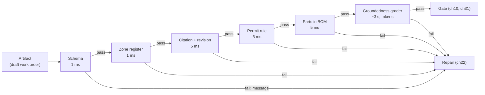
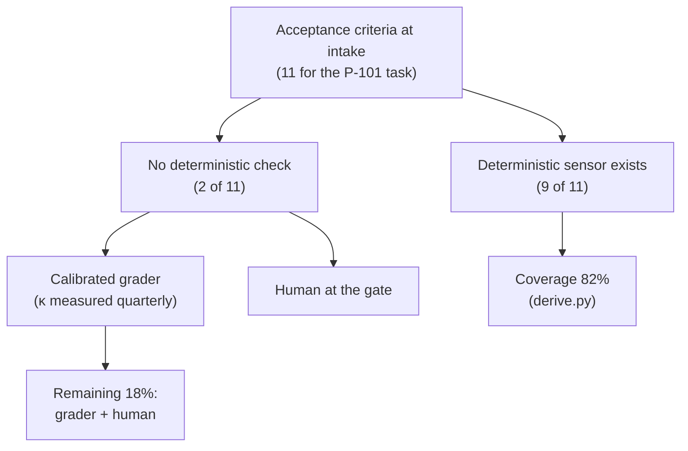

# Chapter 26 — Sensors and verification

*Part II · Word budget 5,000–8,000 · Lab 26 · Verified as of September 2026 · Derived figures from `labs/ch26-sensors/derive.py`*

## 26.1 Intuition

The model has drafted the work order for the seal leak on pump P-101. Eight fields, a procedure citation, a parts list, a permit type. It looks right. The model says it is right. Neither of those is evidence.

A sensor is a check the model did not write and cannot argue with. The CMMS schema either accepts the eight fields or it does not. The procedure number either exists in the document index at its cited revision or it does not. The permit type either matches the hazard class in the procedure or it does not. Each of those is a line of code that runs in a millisecond and returns yes or no, and together they turn "the model says it is right" into "the draft passed nine checks and failed one, and here is the one."

Sensors are the harness's ground truth. They are what makes the Repair transition of the agent loop possible — a failed check with a message the model can act on — and what makes the human gate cheap, because the human reads a report of what was checked rather than checking everything. The design problem is which sensors to build, in what order to run them, what to do about the checks no line of code can make, and how to know the sensors themselves are right. This chapter answers those in turn, with the arithmetic that shows why a noisy sensor is almost always worth running and why a grader is never the only one.

## 26.2 Mechanism

### The two axes

Böckeler's classification (martinfowler.com, April 2026, practitioner) places every sensor on two axes. A **computational** sensor is deterministic code: a schema validator, a test, a linter, a rule, a lookup. It is fast, cheap, has no opinion, and cannot be persuaded. An **inferential** sensor is a model's judgment: a grader with a rubric, a classifier, a human. It is flexible, can check what code cannot, and carries the model's failure modes — bias, inconsistency, susceptibility to the very text it is checking. The rule that follows is the rule this chapter is built on: computational where the domain allows, inferential only to fill the gap between what code can check and what a human must, and never inferential alone for anything that writes to a system of record.

The second distinction is timing. Sensors run at Verify (ch22), after each step, and at the verification gates before delivery (ch10's acceptance, regression, and safety gates). The same sensor code serves both; the difference is that per-step sensors feed Repair and gate sensors feed a verdict.

### The sensor catalogue

| Sensor | Type | What it checks | Latency | Where it comes from |
|---|---|---|---|---|
| Schema validation | Computational | Structure and types of an artifact — the eight CMMS fields, their types, required-ness | ~1 ms | The receiving system's schema (JSON Schema, Pydantic model) |
| Domain rule | Computational | A business invariant — permit type present when hazard class ≥ H; zone in the site's list | ~1 ms | The site's rules, written as code (ch18 guides as code) |
| Citation check | Computational | Every claim cites a chunk; the chunk exists; the document is at its current revision | ~5 ms | The retrieval index (ch20) |
| Reference check | Computational | Referenced entities exist — part numbers in the approved list, equipment tags in the register | ~5 ms | Systems of record via read tools |
| Executable specification | Computational | Behaviour scenarios written at intake (Given / When / Then) run against the artifact | seconds | Intake (ch17); BDD tooling |
| Tests, linters, type checks | Computational | Code artifacts — correctness, style, types (pytest, Ruff, mypy) | seconds | The repository's own suite |
| Static analysis, security scan | Computational | Vulnerabilities, secrets in output, dependency risk (Semgrep, Snyk) | seconds–minutes | Security tooling |
| Diff check | Computational | The change touches only what the task allowed (files, records, fields) | ~1 ms | Task scope from intake |
| Policy decision | Computational | The action is permitted (ch28) | ~ms | Policy engine |
| Application log check | Computational | The tool call had its intended effect (the record exists after the write) | ~ms | Systems of record |
| Groundedness grader | Inferential | Is each claim supported by its cited chunk? | seconds; tokens | A grader model with a rubric (ch27) |
| Rubric grader | Inferential | Does the artifact meet the acceptance criteria that no rule captures? | seconds; tokens | A grader model, calibrated |
| Human review | Inferential | Anything above the risk threshold; the calibration set for every grader | hours | The approval queue (ch31) |

The catalogue has a shape: the computational sensors come from artifacts the plant already has — schemas, rules, indices, registers, test suites — and cost nothing to run; the inferential sensors cost tokens and need calibration. A team that starts by building a grader has skipped the nine sensors it already owned.


### Each sensor family, in depth

The catalogue's rows differ in what they can see, how they fail, and what they cost to maintain; the families the map names are treated here one by one.

**Schema validation.** The cheapest and most complete sensor for structure: the artifact either conforms to the receiving system's schema — the CMMS's work-order schema, the report's contract — or it does not, and constrained decoding (below) can make conformance a guarantee at generation time. Its limit is semantic: a well-formed wrong value passes. Its maintenance cost is the schema's, which the receiving system owns; the sensor reads the live schema or is versioned with it, so a CMMS field change is a sensor change on the same day.

**Domain rules.** The site's invariants as code: permit type from hazard class; priority from criticality; a parts list that must be empty when the task says so; a zone that must be registered. Each is a function over the artifact's fields and a reference (the register, the procedure's metadata); each has an owner who owns the rule in the site's process; each is paired with a guide line (ch18) and a golden case. Rules are the family that grows with the steering loop, and the one whose growth is measured — a rule the loop added because a defect reached the gate is the loop working; a rule nobody can explain is one to retire.

**Citation checks.** Three levels (ch20): the cited chunk exists and is current; the quoted span is in the chunk verbatim; the span supports the claim. The first two are computational and run on every claim; the third is a grader on a sample. The check is what turns "the model said" into "the procedure says," and its most valuable catch is a citation to a chunk that does not contain the quoted span — the signature of a model citing from memory.

**Tests.** For code artifacts — a data-transformation script, a configuration change, a report generator — the repository's own unit and integration tests are the sensor, and the agent's change is verified by running them; a change that adds no test for the behaviour it adds fails a coverage rule the plant sets. Tests are deterministic, versioned, and already owned, which is why coding agents are the best-instrumented case (ch16, ch27).

**Linters and type checkers.** Style, structure, and type conformance for code — Ruff, mypy, and their equivalents — run in milliseconds and catch the class of error a reviewer would otherwise spend the review on; OpenAI's harness report credits enforced structural constraints of this kind for a large share of its team's throughput (OpenAI, February 2026, vendor). For the plant's non-code artifacts the analogue is the schema sensor and the format rules of ch01.

**Static analysis and security scans.** Semgrep-class rules for insecure patterns; dependency scanners for known vulnerabilities; secret scanners over every artifact and every window (ch25's absolute rule); an output-policy scanner for control-system commands, isolation instructions, personal data beyond need, and external addresses (ch28). They run at the safety gate on every artifact regardless of class, and their verdicts cannot be overridden by a grader or the model.

Each family has a false-positive cost and a false-negative cost (26.3), a place in the chain by cost (cheap first), a message template, an owner, and a golden case; the catalogue is a register the steering review maintains, not a list the harness ships with.

### Verification gates, in depth

Three gates stand between the loop's last step and delivery (ch10), and each runs a defined subset of the sensor register with a defined authority.

**The acceptance gate** runs every criterion's sensor on the final artifact — the per-step chain again, over the whole — plus the cross-step checks no single step could run: consistency between the header and the body (ch13), completeness of the plan's promised artifacts, the citation set as a whole against the task's scope. Its verdict is per criterion, and it produces the report the human gate reads (ch31): each criterion with pass, fail, or unenforced, each failure with its message.

**The regression gate** runs the golden set (ch12) against the current guides, sensors, policy bundle, model version, and precision on every change to any of them (ch27's CI mechanics); its output is a pass rate with an interval per class, and it blocks a change on a regression. It is the gate that protects the other two from drift: a sensor edited to fix one case is checked against every case.

**The safety gate** runs the prohibited-content sensors last and deterministically — no control-system commands, no isolation instructions in a work order, no personal data beyond the class's allowance, no external addresses or unapproved communication — and its result is not overridable: a grader cannot pass what it fails, the model cannot argue with it, and a human override is a recorded exception with a named approver and a reason. It runs on every artifact of every class, including those the acceptance gate passed, because a safety sensor's scope is the plant's, not the task's.

The three are ordered — acceptance, then safety, then delivery, with regression running in CI rather than per task — and each records its verdicts in the observability store (ch29) with the sensor versions in force, so an artifact delivered in March can be shown to have passed the gates as they were in March.

### Order: cheap first, fail fast

Sensors run in ascending order of cost, and a failure stops the chain. The draft that fails the schema never reaches the grader; the one that fails the domain rule never spends tokens. The arithmetic in 26.3 shows the effect: the same four sensors cost 30% less in wall time and 30% less in tokens when the grader runs last, and the difference grows with the failure rate of the cheap checks (derive.py, derived). The exception is a sensor whose result is needed to interpret another — the citation check runs before the groundedness grader because the grader needs the chunk — and that is still cheap-first.


### Computational versus inferential, decided per criterion

The two-axis classification is a decision procedure, and it runs at intake (ch17) for every criterion a task class carries. The question is not "can a model check this" — a model can be asked anything — but "can code check this from the artifact and a source of truth the plant holds." A criterion passes to the computational side when its truth is a lookup (the tag is in the register), a comparison (the permit type matches the class the procedure states), a structural property (the fields are present and typed), or an executable scenario (Given/When/Then). It passes to the inferential side when its truth is a judgment about meaning — the description reflects the fault; the procedure is the appropriate one — and stays there until the plant finds the deterministic proxy that makes it computational: a symptom vocabulary that turns "reflects the fault" into "contains the reported symptom term," a scope statement in the procedure's metadata that turns "appropriate" into "the scope names this asset class." The steering loop's most durable improvements are these migrations, and the coverage figure (26.3) is their score. A criterion that stays inferential for a year is either a genuine judgment the plant accepts as human work, or a specification the plant has not yet written down.

### Sensor messages, in depth

The message is the interface to Repair (ch22), and its form is a template with four slots and three prohibitions. The slots: **location** — the field, the step, the line; **found** — the value the sensor saw, quoted as a value, not as prose; **expected** — what the rule or the reference required, with the rule's source named (the procedure's hazard class; the register; the schema); **fix** — the change that would satisfy the sensor, where the sensor knows it. The prohibitions: no text from the artifact beyond field names and values (an artifact containing an instruction must not be able to write that instruction into a message the model will follow — ch28); no reasoning about why the model might have erred (the message is not a lecture); no length beyond the template's cap, because a long message is context rot (ch19). Each sensor's template is versioned with the sensor and tested by the repair-success metric (26.4): a message whose repairs succeed less than half the time is reworded, and the rewording is a pull request with a golden-set run.

Böckeler's phrase for a message written this way is "a positive kind of prompt injection" (Böckeler 2026, practitioner), and the phrase is exact: the harness is deliberately putting text in front of the model that will change what it does next, and the discipline above is what makes the injection the harness's and not an attacker's.

### Sensors and the abstention path

A sensor failure is not always a repair. When the failure is that the artifact makes a claim the corpus cannot support — the citation check finds no chunk; the reference check finds no register entry — the correct next state is abstention (ch13), not another attempt: the model cannot repair a claim into being true. The chain therefore distinguishes repairable failures (structural, relational, citation-format) from unrepairable ones (no support exists), and the second kind routes to escalation with the sensor's message as the reason — "no current procedure covers this asset class; planner to confirm." The distinction is a field on the sensor's verdict, set by the sensor, and it is what keeps the repair cap from being spent on a step that was never going to pass.

### Messages are for the model

A sensor returns two things: a verdict and a message. The message is the interface to Repair (ch22), and it is written for the model, in the form: what failed, what was expected, what was found, and — where the sensor knows — what to change.

| Message | Result |
|---|---|
| "Validation failed." | The model retries the same call |
| "Field `permit_type` is required and empty." | The model adds a permit type — perhaps the wrong one |
| "Field `permit_type` is required and empty. The procedure's hazard class is H; class H requires `hot_work`." | The model sets `hot_work` |

Böckeler calls sensor output phrased this way "a positive kind of prompt injection" (Böckeler 2026, practitioner). Three rules keep it safe and useful. A message is a template filled from the sensor's own inputs, never from text in the artifact or a tool result — an artifact containing an instruction must not be able to write that instruction into a message the model will follow (ch28). A message names the field or location, so a repair changes one thing. And a message's length is bounded; a sensor that returns a page of output has become a source of context rot (ch19).

### Reference implementation

Complete and runnable; Lab 26 executes it against a golden set with seeded defects and measures every sensor.

```python
from dataclasses import dataclass
from typing import Callable, Any

@dataclass
class Verdict:
    sensor: str; ok: bool; message: str = ""; cost_ms: float = 0.0

class Sensor:
    """A check with a name, a cost class (for ordering), and a function returning (ok, message)."""
    def __init__(self, name: str, cost: int, fn: Callable[[dict, dict], tuple]):
        self.name, self.cost, self.fn = name, cost, fn
    def run(self, artifact: dict, refs: dict) -> Verdict:
        ok, msg = self.fn(artifact, refs)
        return Verdict(self.name, ok, msg if not ok else "")

def run_chain(sensors: list, artifact: dict, refs: dict, fail_fast: bool = True) -> list:
    """Run sensors cheap-first; stop at the first failure when fail_fast."""
    verdicts = []
    for s in sorted(sensors, key=lambda s: s.cost):
        v = s.run(artifact, refs); verdicts.append(v)
        if not v.ok and fail_fast:
            break
    return verdicts

# --- computational sensors for the work-order artifact -------------------------------------
REQUIRED = {"order_id": str, "equipment_tag": str, "zone": str, "description": str,
            "procedure_ref": str, "procedure_rev": int, "parts": list, "permit_type": str}
HAZARD_TO_PERMIT = {"L": "none", "M": "cold_work", "H": "hot_work"}

def schema(a, refs):
    for field, typ in REQUIRED.items():
        if field not in a:
            return False, f"Field `{field}` is required and missing."
        if not isinstance(a[field], typ) or (typ is str and a[field] == ""):
            return False, f"Field `{field}` must be a non-empty {typ.__name__}; found {a[field]!r}."
    return True, ""

def citation(a, refs):
    doc = refs["procedures"].get(a.get("procedure_ref"))
    if doc is None:
        return False, f"Procedure `{a.get('procedure_ref')}` is not in the document index; cite an indexed procedure."
    if a.get("procedure_rev") != doc["current_rev"]:
        return False, (f"Procedure `{a['procedure_ref']}` is cited at revision {a.get('procedure_rev')}; "
                       f"the current revision is {doc['current_rev']}. Cite the current revision.")
    return True, ""

def permit_rule(a, refs):
    doc = refs["procedures"].get(a.get("procedure_ref"), {})
    required = HAZARD_TO_PERMIT.get(doc.get("hazard_class"))
    if required and a.get("permit_type") != required:
        return False, (f"Field `permit_type` is {a.get('permit_type')!r}; the procedure's hazard class is "
                       f"{doc['hazard_class']}, which requires `{required}`. Set `permit_type` to `{required}`.")
    return True, ""

def parts_in_bom(a, refs):
    bad = [p for p in a.get("parts", []) if p not in refs["bom"]]
    if bad:
        return False, (f"Field `parts` contains {bad}, which are not in the approved list for this equipment; "
                       f"replace them with approved part numbers.")
    return True, ""

def zone_registered(a, refs):
    if a.get("zone") not in refs["zones"]:
        return False, f"Zone `{a.get('zone')}` is not a registered zone; use one of {sorted(refs['zones'])}."
    return True, ""

WORK_ORDER_SENSORS = [Sensor("schema", 1, schema), Sensor("zone_registered", 1, zone_registered),
                      Sensor("citation", 5, citation), Sensor("permit_rule", 5, permit_rule),
                      Sensor("parts_in_bom", 5, parts_in_bom)]
```

Every sensor here reads a system the plant already has — and Lab 26 caught the first draft of `parts_in_bom` breaking the message template by not naming its field, which is what the template is for. Every sensor here — the CMMS schema, the document index, the hazard classes in the procedures, the approved parts list, the zone register — and every message names the field and the fix. Nothing in it needs a model.

### Executable specifications

The cheapest path from an acceptance criterion to a sensor is to write the criterion as a scenario at intake and run it. A behaviour scenario — *Given* a procedure with hazard class H, *When* a work order is drafted, *Then* its permit type is `hot_work` — is readable by the requester, storable as a guide (ch18), and executable as a test. Tooling for this exists in every language (Cucumber and its ports, practitioner); the harness needs only the discipline of writing criteria in that form. A criterion that cannot be written as a scenario is the signal that it will need a grader or a human, and that is worth knowing at intake rather than at the gate.


### Executable specifications, in depth

A behaviour scenario is a criterion that a requester can read, a sensor can run, and a golden set can hold, and its lifecycle is the harness's tightest loop between specification and enforcement. It is written at intake in the template (ch17) — *Given* a procedure with hazard class H, *When* a work order is drafted, *Then* its permit type is `hot_work` — in the requester's language, with the site's terms. It is stored in the class guide beside the rule it enforces and the ADR that motivates the rule (ch18). It is compiled to a sensor: the *Given* becomes the fixture (the procedure's metadata), the *When* the artifact, the *Then* the assertion; the BDD tooling of the plant's language does the compilation, or the sensor author writes the function by hand with the scenario as its docstring. It is a golden item: the scenario with a seeded violation is the sensor's own test (26.2). And it is reported at the gate in its own words, so the planner reads "permit type is hot_work for class H — pass" rather than a sensor id. A criterion that cannot be written as a scenario is the intake signal that it is inferential (above); a scenario that no sensor implements is a rule marked unenforced in the guide.

### The chain per artifact class

The scenario's work order has one chain; the plant's other artifacts have their own, and the register is per class. A **report** (the task's closing summary) has a schema sensor, a citation check on every figure, a consistency check against the task's decision log (ch24), and the safety scanners — no grader, because a report's claims are all references. A **parts reservation** has a schema sensor, a reference check against stock, a rule that reservations do not exceed the work order's quantities, and the diff sensor against the task's scope. A **code artifact** (a transformation script for the reliability team) has the repository's tests, linter, type checker, static analysis, security scan, and diff check — the coding-agent chain, which is the best-instrumented case. Each class's chain is ordered by cost, has its coverage figure, and is versioned with the class; a new artifact class enters the harness with its chain or does not enter (ch34's verifiability index is the same requirement stated at use-case selection).

### Sensors and the OT boundary

No sensor writes anywhere, and the reference checks that read systems of record read through the same read-only paths the agent uses (ch25, ch35): the historian broker for process values, the register for assets, the CMMS read replica for records. A sensor that needed a write to verify — "submit and see whether the system accepts it" — is a sensor design the harness rejects; the validate tool (ch25) exists so acceptance is checked without a write. The output-policy scanners are the boundary's sensors on the artifact side: an artifact that contains a control-system command fails the safety gate whether or not any tool could have executed it, because the artifact will be read by a person.

### Constrained output as a sensor that never fails

One class of structural defect can be prevented rather than detected. Providers offer constrained decoding — the model's output is forced, token by token, to conform to a JSON schema supplied with the request — so the schema sensor becomes a guarantee at generation time rather than a check afterwards (OpenAI and Anthropic structured-output documentation, vendor, verified Sep 2026). The harness still runs the schema sensor, for two reasons: the guarantee covers syntax and types, not semantics (a well-formed `permit_type` of `"none"` is still wrong), and the sensor is the record that the check happened. What constrained output buys is a near-zero schema failure rate, which moves the chain's first fail-fast point to the domain rules and shortens the average repair loop by one iteration on structural defects.

### Sensors at the gates

The same sensors serve three gates before delivery (ch10), with different scope. The **acceptance gate** runs every criterion's sensor on the final artifact — the per-step chain again, over the whole. The **regression gate** runs the golden set (ch12) against the current guides, sensors, and model, so a change made to fix one task cannot silently break another; it runs on every change to any of the three, and its output is a pass rate with an interval, not a single verdict. The **safety gate** runs the prohibited-content sensors last and deterministically — no control-system commands, no isolation instructions in a work order, no secrets or personal data beyond need, no unapproved external communication (ch28's output policy) — and its result cannot be overridden by a grader or by the model. A gate whose sensors are a subset of the per-step chain has a coverage gap that the per-step chain does not; the gate runs all of them.

### The sensor's own tests

A sensor is code and gets the tests code gets, and its tests are the golden set's defect labels. For every sensor, the golden set holds artifacts with that sensor's target defect seeded and artifacts without it; the sensor's test asserts a fail on the first and a pass on the second, and the assertion runs in CI on every change to the sensor or to the systems it reads. A sensor that has no seeded-defect case in the golden set is untested, and an untested sensor with a low failure rate may be one that never fires. Lab 26's synthetic set seeds one defect class per sensor for exactly this reason; the reader's set does the same with real drafts the reviewers rejected.

### Inferential sensors, with their limits

Some criteria have no deterministic check. "The description accurately reflects the reported fault." "The procedure cited is the right one for this failure mode." These go to a grader — a model with a rubric, run in a context isolated from the generator, returning a verdict and a reason (ch27 treats grader design; this chapter treats their place in the chain).

Three limits govern their use. The documented biases: graders favour the first of two answers, the longer answer, and answers from their own model family, with agreement with humans above 80% on well-structured tasks and lower on hard ones (Zheng et al. 2023, primary). The adversarial limit: a grader reading an artifact that contains injected text is a model reading an injection, and the policy boundary (ch28) is the backstop, not the grader. And the calibration requirement: a grader's agreement with human labels is measured on a held-out set every quarter, reported as Cohen's κ or Krippendorff's α, and a grader below about 0.6 is replaced by a deterministic proxy or a human (calibration thresholds are practitioner convention; the statistic is standard). Two graders from different families raise detection under independence — 70% each gives 91% together (derive.py, derived) — but graders share blind spots, and independence overstates the gain; the number is a ceiling.


### Human review as a sensor with a queue

The last sensor in every chain is a person, and treating the person as a sensor — rather than as the thing the sensors replace — is what makes the gate sustainable. A human sensor has a routing rule (which artifacts reach which reviewer, by risk class and by the uncovered criteria), a service level (hours, not days, or the loop's approval timer expires), a rubric (the same criteria the grader uses, so the two can be compared), and an output that is recorded: verdict, reason, and the criterion that failed. Those records are the calibration set for every grader (ch27) and the source of the next sensor: a reviewer who rejects three drafts in a month for the same reason has found a rule without a sensor, and the steering loop writes it. The measure of a maturing harness is the human sensor firing less often for the same defect classes — the straight-through-processing rate of ch37 — while its rejection rate, when it does fire, stays above zero. A human gate that approves everything is a sensor that has stopped sensing (ch31).

### Sensors on code

When the artifact is code — a data-transformation script, a configuration change, a modernised module — the plant's existing engineering toolchain is the sensor chain: unit and integration tests, linters, type checkers, static analysis, security scanners, and the diff check against the task's allowed scope. OpenAI's report on its agent-first engineering team credits enforced architectural constraints and observability wired into the loop for a team of seven shipping about 1,500 merged pull requests in five months; the constraints were sensors (OpenAI, "Harness engineering," February 2026, vendor, first-party). Anthropic's long-running-agents harness makes end-to-end tests the sensor that decides whether a feature is done (Anthropic, November 2025, vendor). Neither invented a new check; both wired existing ones into the loop and let the model read the results.

**Figure 26.1 — The sensor chain at Verify.**



*Takeaway: five deterministic checks run before any token is spent, and each failure carries the fix.*


### The sensor register

Every sensor is a row in a register the steering review maintains: id; family (schema, rule, reference, citation, test, lint, static, security, grader, human); the criterion it enforces and the guide rule it pairs with (ch18); the source of truth it reads and the read path; cost class (ms, tokens); position in each class's chain; message template version; owner; golden cases (seeded violation, benign twin); false-positive and false-negative rates at last measurement; repairable-or-abstain classification; date added and the failure that motivated it; retirement date if any. The register is what makes coverage a number rather than an impression, and it is the artifact an auditor reads to know what the harness checks (ch29, ch36): a criterion with a sensor row is enforced; one without is judged by a person, and the gate's report says which.

### Sensor economics, extended

The break-even arithmetic of 26.3 assumed one sensor and one defect class. Across the register the question is ordering and marginal value. Each sensor's marginal catch — defects it detects that no earlier, cheaper sensor detected — is measured on the golden set by running the chain with the sensor removed; a sensor whose marginal catch is zero is redundant with an earlier one and is retired or reordered. The chain's total cost is the sum of each sensor's cost times the share of artifacts that reach it under fail-fast, and the reorder rule is that a sensor with a high failure rate on typical drafts moves earlier if its cost allows, because it stops more drafts before the expensive sensors. The plant's register carries the marginal catch and the reach share per sensor, and the steering review reads them quarterly; the numbers usually say the same thing — the cheap, high-catch sensors first, the grader last, and one or two sensors in the middle whose marginal catch has fallen to zero since a template field made their defect impossible.


### What a sensor cannot do

Three limits, stated so the register does not promise them. A sensor cannot check a criterion whose source of truth the plant does not hold in a machine-readable form — "the procedure is appropriate" needs the scope statement in the procedure's metadata, and until document control adds it the criterion is inferential. A sensor cannot detect a defect it was not written for; the register's coverage is coverage of known defect classes, and the steering review's incident clusters are where the unknown ones become known. And a sensor cannot verify that the plant's rules are right; it verifies that the artifact obeys them, and a wrong rule is a document-control finding the sensor faithfully enforces until someone changes it — the same policy-correctness limit holds for the permission rules of ch28 and for every rule in the register.

### Where sensors come from, and who owns them

A sensor is added by the steering loop (ch16): a failure is observed at the gate or in production, classified as a sensor gap, and the check that would have caught it is written, tested against the golden set, and versioned beside the guide that states the rule. Every rule in the guides (ch18) has a sensor or is unenforced; every sensor has a rule or is unexplained. The pair is reviewed together. Ownership follows the source: the schema sensor belongs to whoever owns the CMMS integration, the permit rule to the permit-to-work process owner, the citation check to the document-control function. A sensor with no owner drifts from the rule it enforces.

**Figure 26.2 — Coverage: criteria, sensors, and the gap.**



*Takeaway: coverage is a number, reported per use case, and the uncovered criteria are named.*

## 26.3 Worked numbers

All figures from `derive.py` (derived); per-sensor detection rates and costs are design assumptions (illustrative) until Lab 26 measures them on the reader's artifacts.

**Layered detection.** A structural defect is caught by the schema sensor at 0.99. A rule violation targeted by the domain rule (0.95) and the grader (0.70) is caught by the chain at 0.985 under independence. A semantic defect only a grader can see is caught at 0.70 by one grader and 0.91 by two independent ones — and same-family graders are not independent.

**Ordering.** Four sensors with failure rates on a typical draft of 10% (schema), 15% (rule), 8% (citation), 20% (grader), and costs of 1, 1, 5, and 3,000 ms; the grader costs $0.004 in tokens (illustrative). Cheap-first with fail-fast: 2,117 ms and $0.0028 expected per draft. Grader-first: 3,005 ms and $0.004. The order alone saves 30% of both, and 44% of drafts never reach the grader because a cheaper sensor already failed them.

**Why a noisy sensor is worth running.** A false positive costs one repair call — about $0.02 (illustrative). A false negative that reaches the gate costs six minutes of a reviewer at $60 an hour, $6; one that reaches production costs a reworked work order, $150 (illustrative). A sensor pays for itself while its false-positive rate is below $q \cdot r \cdot C_{FN} / ((1-q)\, C_{FP})$, with $q$ the defect prevalence and $r$ the detection rate. At 5% prevalence and 0.95 detection against the reviewer cost alone, that bound is 15 — a false-positive *rate* above one — which means there is no false-positive rate at which the sensor loses money. The asymmetry between $0.02 and $6 is why the rule is "add the sensor" and the only question is ordering.

**Coverage.** The P-101 task's acceptance criteria are eight fields plus three rules, eleven in all; nine have a deterministic sensor; coverage is 82%. The two without — description accuracy and procedure appropriateness — go to a grader and the supervisor.

**Escapes.** At a 15% defect rate per step and a chain that detects 95%, seven defective steps per thousand reach the gate; at 70% detection — a grader alone — forty-five do. The gate's reviewers see the difference as their workload.

## 26.4 Measurement

**False positives and false negatives per sensor.** Build the golden set with two labels per artifact: correct as a whole, and the specific defect seeded if not (ch12). Run every sensor on every artifact; report, per sensor, the share of correct artifacts it failed (false positive) and the share of artifacts with its target defect it passed (false negative), with Wilson intervals. Lab 26 does this on a synthetic set with seeded defects; the reader's set uses real drafts labelled by the reviewers.

**Chain metrics.** Detection rate of the whole chain per defect class; expected cost and latency per artifact; share of artifacts stopped at each position.

**Message actionability.** For each sensor failure that entered Repair, whether the next attempt passed that sensor. A sensor whose messages lead to passing repairs less than half the time is writing messages the model cannot use; read them.

**Coverage.** Criteria at intake with a deterministic sensor, per use case, with the uncovered criteria listed by name.

**Grader calibration.** κ against human labels on the held-out set, quarterly, per grader (ch27).

What to record: sensor set version, golden-set version, per-sensor rates with intervals, chain order, grader model and rubric version, date.


### Reference output (Lab 26, this run)

What the lab prints when it reproduces; the plant's numbers replace these.

```text
correct drafts 1204: false positives 0
  schema           defective  156  false negatives 0
  zone_registered  defective  173  false negatives 0
  citation         defective  146  false negatives 0
  permit_rule      defective  166  false negatives 0
  parts_in_bom     defective  155  false negatives 0
defective drafts reaching the grader under cheap-first fail-fast: 0 of 796
messages name a field, are under 300 chars, and carry no artifact free text: True (796 messages)
execution order: ['schema', 'zone_registered', 'citation', 'permit_rule', 'parts_in_bom', 'grader']
Lab 26: REPRODUCED
```

These measurements are the improvement loop's inputs (ch32): clusters are mined from them weekly and changes are tested against them.

## 26.5 Failure

| Failure mode | Mechanism | Detection signal | Mitigation | Owning component |
|---|---|---|---|---|
| Form checked, substance not | Schema passes; the content is wrong | Defects reach the gate with all sensors green | Domain rules and reference checks beside the schema; coverage reported by criterion | This chapter |
| Flaky sensor | Nondeterministic check (time-dependent, network-dependent) fails at random | Same artifact passes and fails on re-run | Sensors are pure functions of artifact and refs; external data snapshotted | This chapter |
| Vague message | "Validation failed" | Repairs that repeat the same call | Template: what failed, expected, found, fix | This chapter; ch22 |
| Message injected | Text from the artifact interpolated into the message | Message contains instruction-like text from tool output | Templates only; no interpolation of artifact text beyond field names and values | This chapter; ch28 |
| Grader as the only check | Inferential sensor with no deterministic one for the same criterion | Escapes on structured defects a rule would catch | Deterministic first; grader for the remainder only | This chapter; ch27 |
| Grader uncalibrated | Rubric never validated against humans | κ unknown; disputes at the gate | Quarterly calibration; retire below 0.6 | ch27 |
| Sensor without a rule | A check nobody can explain | Reviewers override it; the model repairs against it blindly | Every sensor paired with its rule in the guides | ch18 |
| Rule without a sensor | A guide states a requirement nothing enforces | Violations in production | Steering loop adds the sensor; coverage report lists the gap | ch16; this chapter |
| Sensor drift | The schema or rule changed in the system of record; the sensor did not | Sudden false-positive spike after an upstream change | Sensors read the live schema or are versioned with it; change alerts | This chapter; ch29 |
| Chain too slow | Expensive sensor first; no fail-fast | Latency and token spend per step high | Cost-ordered chain; fail-fast | This chapter |
| Sensor stale after revision | Citation check accepts a superseded revision | Work orders cite old procedures | Current-revision flag in the index; sensor checks it | ch20; this chapter |
| Untested sensor | No golden-set case seeds its target defect | Sensor never fires; false-negative rate unknown | One seeded-defect case per sensor; CI runs it | This chapter; ch12 |
| Gate runs fewer sensors than the loop | Acceptance gate checks a subset | Defects caught per step slip through at delivery | Gate runs every criterion's sensor plus the safety set | ch10; this chapter |
| Constrained output mistaken for correctness | Schema guaranteed at generation; content still wrong | Well-formed artifacts with rule violations | Domain rules and references still run; constrained output only removes structural defects | This chapter |

The recurring modes above appear, with their owning components and golden cases, in the failure catalogue (ch33).

## 26.6 The frontier

**Strongest free treatments.** Böckeler's "Harness engineering for coding agent users" (April 2026) defines sensors, the computational/inferential split, and the "positive prompt injection" of sensor messages; it is about coding agents and stops at the concept, with no chain, no ordering, no economics, and no calibration. OpenAI's Codex harness report (February 2026) and Anthropic's long-running-agents post (November 2025) show sensors — linters, architectural constraints, end-to-end tests — wired into production coding loops, with outcomes reported first-party; they stop at software. The LLM-as-judge literature (Zheng et al. 2023 and successors) establishes grader biases and agreement rates and stops at graders. The BDD and test-automation literature is complete for executable specifications and predates agents. Darú's living book has a verification-and-evals chapter grounded in open harness source and stops at coding agents.

**What this chapter adds.** The catalogue with its provenance — most sensors are artifacts the plant already owns; cheap-first ordering with the arithmetic that shows it saves 30% and stops 44% of drafts before any token; the false-positive economics that make "add the sensor" the default; coverage as a per-criterion number; sensor messages as a template with an injection rule; a runnable chain for a non-code artifact; and the pairing of every sensor with a rule and an owner. Open: per-sensor false-positive and false-negative rates on real industrial artifacts are unpublished; Lab 26 is the protocol for measuring them.

**Related chapters.** ch08 (Post-training); ch09 (Reasoning and test-time compute); ch23 (Model layer, routing, gateways); ch30 (Multi-agent systems and protocols).

## 26.7 Industrial application

**The P-101 draft through the chain.** Schema: eight fields present and typed — pass. Zone: Z3 is registered — pass. Citation: procedure MP-0417 is in the index, cited at revision 7, and revision 7 is current — pass. Permit rule: hazard class H requires `hot_work`; the draft says `none` — fail, with the message "Field `permit_type` is `'none'`; the procedure's hazard class is H, which requires `hot_work`. Set `permit_type` to `hot_work`." Repair sets it; the chain re-runs from the top (a millisecond) and passes through parts-in-BOM. The grader checks that the description matches the reported fault — pass. Nine criteria covered by code, two by the grader and the supervisor; the supervisor's report at the gate lists all eleven with their verdicts, and the supervisor reads a report rather than the draft.

**Where the sensors came from.** None was written for the agent. The schema is the CMMS integration's; the zone register is the site's; the hazard classes are in the procedures; the parts list is the maintenance planner's; the current-revision flag is document control's. The harness work was wiring them and writing the messages.

**The sensor the plant will add first.** The steering loop's first quarter will find the defect no one anticipated — a part number that exists but is obsolete, a procedure that is current but for a different pump model — and the sensor for it is a reference check against a register the plant has. The coverage report is where the plant sees its own list grow.

**OT boundary.** No sensor reads a control system; the reference checks read the CMMS, the document index, and the equipment register through the same read-only paths as the agent (ch28, ch35).

## 26.8 Decision aids

**Sensor design checklist (per criterion at intake).**

| Question | If yes |
|---|---|
| Can a schema express it? | Schema sensor |
| Is it a rule over fields the artifact contains? | Domain-rule sensor |
| Does it reference an entity in a system of record? | Reference check via a read tool |
| Can it be written as Given / When / Then? | Executable specification |
| Is it about code? | The repository's own toolchain |
| None of the above? | Grader with a rubric, calibrated; and the criterion goes on the uncovered list |

**Chain ordering rule.** Sort by cost; fail fast; a sensor another sensor depends on runs first even if costlier; graders last.

**Message template.** `Field/location`: what was found; what was expected and why (the rule or reference); the fix if known. Under 300 characters. No text from the artifact except field names and values.

**Coverage report (per use case, monthly).** Criteria; sensor per criterion or "uncovered"; per-sensor false-positive and false-negative rates with intervals; chain detection by defect class; grader κ; escapes reaching the gate and production.

## 26.9 Sources

| # | Claim or figure | Source | Tier | Verified | Link |
|---|---|---|---|---|---|
| 1 | Sensors; computational/inferential; sensor messages as positive prompt injection | Böckeler, martinfowler.com, Apr 2026 | practitioner | Sep 2026 | https://martinfowler.com/articles/exploring-gen-ai/ |
| 2 | Architectural constraints and observability as sensors; ~1,500 merged PRs, seven engineers, five months | OpenAI, "Harness engineering," Feb 2026 | vendor | Sep 2026 | https://openai.com/index/ |
| 3 | End-to-end tests decide completion | Anthropic, "Effective Harnesses for Long-Running Agents," Nov 2025 | vendor | Sep 2026 | https://www.anthropic.com/engineering |
| 4 | Grader biases (position, verbosity, self-enhancement); >80% agreement on structured tasks | Zheng et al., NeurIPS 2023, arXiv 2306.05685 | primary | Sep 2026 | https://arxiv.org/abs/2306.05685 |
| 5 | Behaviour scenarios (Given / When / Then) as executable specifications | Cucumber / Gherkin documentation | practitioner | Sep 2026 | https://cucumber.io/docs/gherkin/ |
| 6 | Verification chapter grounded in open harnesses | Darú, Harness Engineering (2026) | practitioner | Sep 2026 | needs fetch |
| 7 | Layered detection; ordering cost; false-positive bound; coverage; escapes | `labs/ch26-sensors/derive.py` | derived | Sep 2026 | labs/ch26-sensors/derive.py |
| 8 | Per-sensor detection rates, failure rates, costs; $0.02 / $6 / $150; eleven criteria; MP-0417 rev 7 | Design assumptions and scenario | illustrative / scenario | Sep 2026 | — |
| 9 | κ ≥ 0.6 retirement threshold | Practitioner convention | practitioner | Sep 2026 | — |
| 10 | Per-sensor rates on real industrial artifacts | None published | open | Sep 2026 | — |