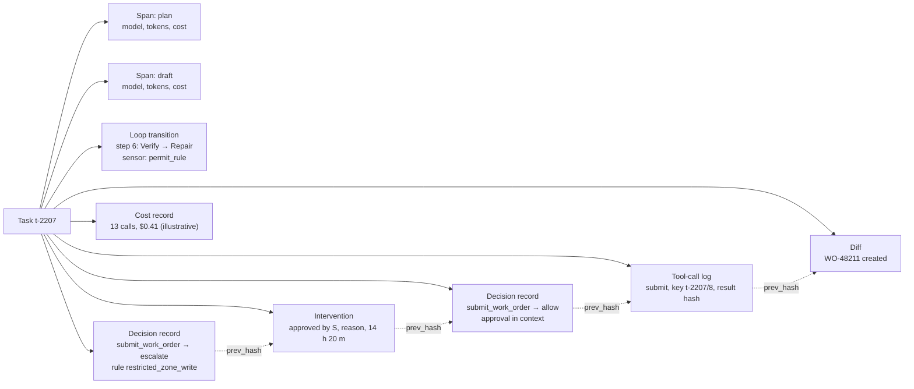
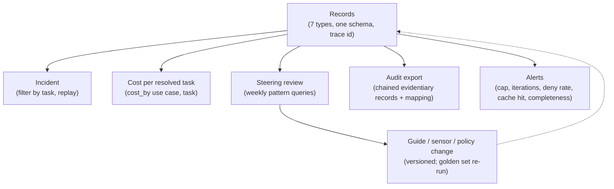

# Chapter 29 — Observability and audit

*Part II · Word budget 5,000–8,000 · Lab 29 · Verified as of September 2026 · Derived figures from `labs/ch29-observability/derive.py`*

## 29.1 Intuition

At 02:00 a work order for pump P-101 (the running scenario, ch16) appeared in the CMMS with a hot-work permit nobody remembers approving. Three people want to know what happened. The maintenance superintendent wants to know whether the agent did something it should not have. The site's data-protection officer wants to know whose request started it and which human signed off. The engineer who owns the harness wants to know which step went wrong so it does not happen again. All three questions have the same answer if — and only if — the harness wrote down what it did as it did it.

Observability is the component that writes it down. Not a summary, not a final answer, but every model call with its tokens and cost, every tool call with its arguments and its policy decision, every loop transition, every sensor verdict, every human intervention, and every change to a system of record — each with an identity, a timestamp, and a link to the one before it so the sequence cannot be quietly edited. From those records, the superintendent's question is a filter, the data-protection officer's is an export, and the engineer's is a replay.

The same records do three more jobs. They are the cost ledger: every token is attributed to a task, a step, and a team, which is what makes cost per resolved work order a query rather than an estimate (ch37). They are the raw material of the steering loop: failure clusters found in the records become guides, sensors, and policies (ch16). And they are the compliance evidence — for LGPD, for the AI Act if it applies, for the auditor — written once, at run time, rather than reconstructed under pressure. A harness that logs its final answers has thrown away all of that. This chapter is about keeping it.

## 29.2 Mechanism

### The seven records

Every component emits records; the observability component collects, links, stores, and serves them. Seven record types cover everything the questions above need.

| Record | Emitted by | Contents | Who reads it |
|---|---|---|---|
| Trace span | Model layer (ch23), tools (ch25) | One per model or tool call: operation, model and version, route, input/output/cached/reasoning tokens, latency, cost, error; parent span | Engineers; finance |
| Tool-call log | Tools (ch25), policy (ch28) | Tool, risk class, arguments hash, policy decision id, credential scope, result hash, duration | Security; audit |
| Loop transition | Agent loop (ch22), control plane (ch21) | Task, step, transition, attempt, sensor names and verdicts, tokens; re-plan and escalation causes | Engineers; steering loop |
| Decision record | Policy engine (ch28) | Request (principal, actor, tool, args, context), effect, rule, reason, obligations, bundle hash | Audit; compliance |
| Intervention | Human gate (ch31), intake (ch17) | Approval, rejection, override, clarification: identity, reason, criterion, wait time | Steering loop; adoption metrics |
| Diff | Verification & delivery (ch10) | Before/after of any artifact or record changed, with the idempotency key | Reviewers; audit |
| Cost record | Gateway (ch23) | Per call, aggregated per step, task, use case, team, environment; FOCUS-aligned | Finance |

The link between them is the **trace id**: every record for a task carries the task's id and, where it applies, the step's, so a task is reconstructable from any one record. The control plane's event history (ch21) already holds most of this by construction; the observability component adds the spans the engine does not see (inside a model call), the cost attribution, and the export.


### The record types, in depth

**Trace spans** carry the model layer's facts: which tier and version answered, at what effort, with what tokens, at what cost, in how long, and whether the call ended by stop, length cap, tool call, or content filter. Their join keys are the task and step ids. Their retention is engineering's (two years, metadata only after the text events expire). Their consumers are the routing table's review (ch23) and the cost ledger (ch37).

**Tool-call logs** carry the execution facts the spans do not: the risk class, the argument hash (arguments themselves are in the decision record, redacted per class), the decision id the policy engine issued, the token scope the executor used, the result hash, the duration, and the idempotency key for writes (ch25, ch21). They are evidentiary — a write to a system of record is reconstructed from them — and they are chained.

**Loop transitions** carry the loop's facts per step (ch22): the state entered, the attempt number, the sensor names and verdicts, the re-plan or escalation cause, the tokens spent. They are the steering loop's raw material and the per-state metrics' source.

**Decision records** carry the policy engine's request and verdict (ch28): principal, actor, tool, arguments, context, effect, rule, reason, obligations, bundle hash, and the intent-validation layer that fired if any. They are the audit's primary object and are chained and anchored.

**Interventions** carry every human touch (ch31, ch17): clarification asked and answered, approval, rejection with coded reason, override with named approver, delegation, expiry; identity, timestamp, wait time. They are calibration data (ch27) and adoption metrics (ch37) and are chained.

**Diffs** carry before-and-after for every change to a system of record or an artifact (ch10): the idempotency key, the record id, the field-level diff, the approver if gated. They are what an incident review uses to answer "what changed," and they are chained.

**Cost records** aggregate spans by the gateway's tags — task, step class, tier, use case, team, environment — in FOCUS-aligned form (ch37); they are derived from spans and reconciled against the provider's invoice monthly.

Each record type has an emitter that writes it before the action it describes completes (a tool-call log is written before the call returns, with the result hash appended after), a schema the observability component validates, and a completeness rule the nightly check enforces (29.4).
### Conventions: OpenTelemetry for generative AI

Spans follow the OpenTelemetry semantic conventions for generative AI, which standardize the attribute names on a model-call span so that traces from different harnesses and different backends can be read by the same tools (OpenTelemetry GenAI semantic conventions, Development status, primary/vendor, verified Sep 2026). The convention's core, as the harness uses it:

| Attribute | Meaning | Harness use |
|---|---|---|
| `gen_ai.operation.name` | chat, text_completion, embeddings, execute_tool | Distinguishes model calls, embedding calls, and tool executions |
| `gen_ai.provider.name` (formerly `gen_ai.system`) | The provider or serving stack | Tier attribution (ch23) |
| `gen_ai.request.model` / `gen_ai.response.model` | Requested and actual model version | Pin drift detection |
| `gen_ai.usage.input_tokens` / `gen_ai.usage.output_tokens` | Billed tokens | Cost records (ch37) |
| `gen_ai.request.temperature`, `max_tokens` | Sampling settings | Reproducibility (ch12) |
| `gen_ai.response.finish_reasons` | stop, length, tool_calls, content_filter | Cap and refusal detection |
| `gen_ai.tool.name`, `gen_ai.tool.call.id` | Tool identity per execute_tool span | Tool-call log join (ch25) |
| `gen_ai.system_instructions`, `gen_ai.input.messages`, `gen_ai.output.messages` (opt-in) | System instructions, input and output messages as structured attributes (the per-message events of earlier revisions were removed in v1.37.0) | Droppable at the collector (below) |

(Attribute names per the conventions as of September 2026. Every `gen_ai.*` attribute, span, metric, and event is still marked *Development* — none is stable; v1.37.0 renamed `gen_ai.system` to `gen_ai.provider.name` and replaced per-message events with the three message attributes; v1.42.0 moved the namespace to a dedicated GenAI repository without a tagged release yet. The harness pins the revision it emits — semantic-conventions v1.41.0 for this book's examples, with v1.44.0 the latest main-repo release checked — records it, and accepts both old and new names at the collector until libraries catch up — VERIFY, 21 Sep 2026.)

Two conventions of the harness's own extend them, as attributes in a plant namespace: `route` — which routing-table row sent the call to this model, with the table version; and `reasoning_tokens` — hidden output tokens where the provider reports them, because they are billed and must be attributed (ch09, ch37). A third, `cached_input_tokens`, is now in the conventions' usage attributes for providers that report it and is emitted where available. Span kinds: a task is a root span; each loop step is a child; each model call, tool execution, retrieval, and sensor run is a child of its step; a delegated sub-task is a linked span in the child workflow's trace with the parent's id (ch21, ch30).

The backend is a choice, not a design decision: Langfuse, Arize Phoenix, and Datadog's LLM observability ingest OpenTelemetry traces; the first two are self-hostable, which the restricted-network posture of an industrial site requires (vendor documentation, verified Sep 2026). What matters is that the spans conform, so the backend can change.


### The collector as policy point

Between the emitters and the backend sits the OpenTelemetry collector, and it is where the content-safety split is enforced rather than hoped for. The collector's processors drop or sample text events per record class and per data class, redact patterns the output-policy scanner names (ch28), attach the retention class to every record, route evidentiary records to the chained store and operational ones to the trace backend, and refuse records that lack a trace context or a schema version. Its configuration is versioned with the harness (ch18's discipline) and cited in the export, because an auditor's first question about the records is what was dropped before they were stored, and the answer is the collector's configuration at that date.

### Content-safe by construction

Token counts, model, cost, latency, and decisions are always logged. The *text* of prompts and completions is logged as span events that can be dropped, sampled, or redacted at the collector, separately from the span itself. The split is what makes retention and access policies possible: the metadata retention is years and its access is broad; the text retention is weeks and its access is narrow, because prompts contain retrieved procedure text and completions contain the names of technicians on work orders — personal data under LGPD (ch36). A trace that stores everything in one record forces one policy on two kinds of data.

The arithmetic in 29.3 shows the other reason: metadata for the scenario is tens of megabytes a month; raw text is gigabytes.

### The hash chain, in depth

Records that will be used as evidence — decisions, tool calls, interventions, diffs — are chained: each carries the SHA-256 of the previous evidentiary record's canonical serialization, so that a deleted, inserted, reordered, or altered record breaks every hash after it. The idea is the linked timestamping of Haber and Stornetta (1991, primary); the harness's implementation has four parts.

**Canonicalization.** The record is serialized with sorted keys and no volatile fields before hashing, so two writers produce the same bytes for the same record; the `hash` and `prev_hash` fields are excluded from the hashed body.

**Chaining per stream.** One chain per task is simple and verifiable in isolation; one chain per day across tasks is what the audit wants, because it proves nothing was removed *between* tasks. The harness chains per day and links each task's first evidentiary record to the previous task's last, so a task's records are a contiguous run within the day's chain.

**Anchoring.** The chain head — the day's last hash — is written at close to a store the harness's operators cannot write twice: a write-once bucket with object lock, a ledger the security function controls, or a timestamping service. Without the anchor, an operator with database access could rewrite history and re-hash; with it, the rewrite is detectable at the next verification, because the recomputed head will not match the anchored one. Anchoring monthly is the minimum; daily is the practice.

**Verification.** A scheduled job recomputes every hash from the records and compares heads to anchors; 29.3 puts a month of the scenario's records at a fraction of a second. A break is an incident with a position — the first record whose hash fails — and the record before it is the last one the harness can vouch for. Verification results are themselves recorded, unchained, with the verifier's version.

A Merkle tree over the day's records is the extension for large volumes — it lets a single record's inclusion be proven with a logarithmic-length path rather than by recomputing the day — and it is unnecessary at the scenario's 73,500 records a month (29.3, derived), where a linear chain verifies in under a second (Merkle 1987, primary, for the tree). The plant adopts it if volumes grow by orders of magnitude; the anchor and the verification job are unchanged.

### Replay and reconstruction, in depth

Replay answers "what did the agent see and do at step $n$," and the harness supports two forms with different inputs and different uses.

**Reconstruction** reproduces the record — what happened — and needs no model. Inputs: the control plane's event history (ch21), the spans, the loop transitions, the tool-call logs, the decision records, the interventions, the diffs, all joined by task and step id; the guide, sensor, policy, routing-table, and assembler versions in force (the change records, below); the chunk ids and revisions the assembler admitted (ch19, ch20); the memory facts retrieved with their provenance (ch24). Output: for each step, the assembled window as it was (rebuilt from the prefix version and the admitted ids — text events may have expired, but the ids have not), the model's output (its hash, and its text if within retention), the sensor verdicts with messages, the policy decision, the tool result hash, and the human intervention. A reconstruction is deterministic and complete when the completeness check passes; it is what an incident review reads and what an auditor is shown.

**Re-evaluation** runs the same inputs against the *current* guides, sensors, and policy bundle to ask "would this be allowed or pass today," and it is how a policy change is audited against past decisions (ch28): every decision record of the last quarter re-evaluated under the new bundle, with the set whose effect changed listed — allowed-then-denied is a tightening, denied-then-allowed is a loosening, and both are reviewed before the bundle ships. Re-evaluation with a model (re-running a step under a new model version) is the golden set's job (ch12), not the replay's, because production inputs are not stratified and their correct outputs are not labelled.

**A worked reconstruction.** Task t-2207, step seven (scenario): the window is rebuilt from prefix version 1.4.0 (hash logged), chunks PT-PTW-002#r4#3 and MP-0417#r7#1 (ids logged; text fetched from the index at those revisions), memory facts f-2201 and f-1987, the task record, and the step template; the model output's hash matches the logged hash; the permit sensor's verdict was fail with its message; the repair window differed from the first by the message alone (both hashes logged); the second output passed; the decision record for the read tools shows allow under bundle b-0913; no intervention. The reconstruction takes 49 record reads (29.3) and is a page a reviewer reads in a minute.

**Figure 29.1 — One task's records, linked.**



*Takeaway: the evidentiary records are chained; the operational ones are linked by trace id; all are one query away from any one of them.*


### Instrumenting the loop: where each record is emitted

Instrumentation is code at eleven points, and naming them is what makes completeness checkable. At intake (ch17): the task record and its confirmation intervention. At plan (ch22): a span for the planning call and a transition record with the plan version. Per step: the assembler (ch19) logs the window's composition and hash; the router (ch23) logs the tier, version, and effort in the span's attributes; the gateway logs the usage line and the cost tags; the intent validator and the policy engine (ch17, ch28) log a decision record before any execution; the executor (ch25) logs a tool-call log before the call and appends the result hash after; the sensors (ch26) log their verdicts in the transition record; the grader (ch27) logs its per-criterion verdicts with its version and κ reference. At the gate (ch31): the intervention with identity, wait, and reason. At submit: the diff with the idempotency key. At close: the episode (ch24) and the cost roll-up. The completeness sensor's rules are derived from this list — every tool-call log has a decision; every gated write has an intervention; every step has a transition; every span has a route — and a component that forgets is found nightly by the rule it broke.

### Costs, reconciled

The cost records are derived from spans and the gateway's tags, and they are wrong until reconciled. Monthly, the gateway's summed cost per provider is compared to the provider's invoice; a gap above a percent (illustrative tolerance) is investigated — a reasoning-token line the spans missed, a cache accounting the provider changed, a bypass the network policy should have prevented (ch23). The reconciled figure is the ledger's, and the FOCUS export (ch37) carries it. Per use case and per team, the cost records are showback until tag coverage has been 100% for a quarter, then chargeback (ch37); the gateway-set tags are what make the coverage a property of the system rather than of each caller's discipline.

### Privacy of the records themselves

The records are personal data where they name people, and the observability component follows the same rules it enforces for memory (ch24, ch36). Text events — prompts and completions, which contain retrieved procedure text and technicians' names — expire at thirty days and are reduced to metadata (29.2's split). Identities in decision records and interventions are retained as long as the records are, because an audit needs to know who acted, and the retention policy states the basis. Access to text events is by named engineers for named tasks under investigation, recorded (29.2's access rules), and the access log is the answer to "who looked." A subject-access request is answered from the identity index across all record types, and a deletion request retires text events and pseudonymizes identities in metadata where the law permits and the audit basis does not require the name — a decision ch36's control map records per record class.

### Reference implementation

Complete and runnable; Lab 29 emits records for simulated tasks, verifies the chain, detects tampering, replays a task, and runs the attribution query.

```python
import json, hashlib, time
from collections import defaultdict

EVIDENTIARY = {"decision", "tool_call", "intervention", "diff"}

class Ledger:
    """Collects the seven record types; chains the evidentiary ones; serves replay, export, and attribution."""
    def __init__(self):
        self.records = []; self.head = "0"

    def emit(self, kind: str, task_id: str, **fields):
        rec = {"kind": kind, "task_id": task_id, "ts": time.time(), **fields}
        if kind == "span":                       # text is a droppable event, never a span attribute
            rec["events"] = [{"name": "content", "text": fields.pop("text", "")}] if "text" in fields else []
            rec.pop("text", None)
        if kind in EVIDENTIARY:
            rec["prev_hash"] = self.head
            rec["hash"] = hashlib.sha256(json.dumps(rec, sort_keys=True).encode()).hexdigest()
            self.head = rec["hash"]
        self.records.append(rec)
        return rec

    def verify_chain(self):
        prev = "0"
        for i, r in enumerate(r for r in self.records if r["kind"] in EVIDENTIARY):
            body = dict(r); h = body.pop("hash")
            if body["prev_hash"] != prev: return False, f"record {i}: prev_hash mismatch"
            if hashlib.sha256(json.dumps(body, sort_keys=True).encode()).hexdigest() != h: return False, f"record {i}: hash mismatch"
            prev = h
        return True, "chain verified"

    def strip_text(self):
        """Collector-side redaction: drop content events, keep every attribute."""
        for r in self.records:
            if r["kind"] == "span": r["events"] = []

    def replay(self, task_id: str):
        """Reconstruction: the task's records in order, joined by step."""
        recs = sorted((r for r in self.records if r["task_id"] == task_id), key=lambda r: r["ts"])
        by_step = defaultdict(list)
        for r in recs: by_step[r.get("step", -1)].append(r)
        return dict(by_step)

    def completeness(self, task_id: str):
        """Every tool call must have a decision record and a span; report gaps."""
        recs = [r for r in self.records if r["task_id"] == task_id]
        calls = {r["step"] for r in recs if r["kind"] == "tool_call"}
        decided = {r["step"] for r in recs if r["kind"] == "decision"}
        spanned = {r["step"] for r in recs if r["kind"] == "span"}
        return {"tool_calls": len(calls), "missing_decision": sorted(calls - decided), "missing_span": sorted(calls - spanned)}

    def cost_by(self, *keys):
        """Attribution: sum cost over any combination of tag keys; report untagged share."""
        totals = defaultdict(float); untagged = 0.0; total = 0.0
        for r in self.records:
            if r["kind"] != "span": continue
            total += r.get("cost", 0.0)
            if all(k in r for k in keys): totals[tuple(r[k] for k in keys)] += r.get("cost", 0.0)
            else: untagged += r.get("cost", 0.0)
        return dict(totals), (untagged / total if total else 0.0)
```

Four properties carry the chapter. Text lives in droppable events, so `strip_text` redacts without touching a single attribute. Evidentiary records are chained and `verify_chain` detects any edit. `completeness` is the audit-completeness sensor of ch28: a tool call without a decision record is a finding. And `cost_by` reports the untagged share alongside the attribution, because attribution without that number is a claim.


### Dashboards: one page per audience

The records serve five audiences and one dashboard cannot serve them all. The **engineer's page**: per class, pass rates per step, repairs, re-plans, escalations, tokens and latency per step, sensor failures by criterion, cache hit rate, alert acknowledgements — the loop's page (ch22) joined to the control plane's (ch21). The **sponsor's page** (ch37): cost per resolved task against baseline, STP rate, rejection rate, adoption, one chart per use case. The **security page**: policy denials by rule, intent-validation denials by layer, egress denials by destination, secret-scan hits, budget-cap hits, fallback events, chain-verification results. The **compliance page**: completeness, retention compliance, access-log summary, change records in the period, the export's readiness per framework. The **steering page** (ch16): the weekly query set — failure clusters by sensor and step, the change log's last date, the assumption register's last retirement. Each is a set of queries over the same records; none is maintained by hand; and a page nobody opens for a month is removed, because the records are the source of truth and the page is a view.

### Metrics, not only records

Records answer "what happened to task t-2207"; metrics answer "how is the harness doing this week." The metrics are derived from the records by aggregation, and the ones this book uses are defined in the chapters that own them so that the definitions are single: pass^k and the two-scaffold spread (ch16); iterations, repair rate, repair success, escalation by cause, tokens per step (ch22); retry rate, budget escalations, approval wait, resume correctness (ch21); per-sensor false-positive and false-negative rates, coverage, escapes (ch26); decision latency, false-deny rate, policy coverage, audit completeness (ch28); cost per resolved task, cache-hit rate, STP and rejection rates, the seven cost lines (ch37). Observability's job is to compute them from the same records on the same schedule and to publish them on one page per use case — the page the sponsor reads (ch37) and the steering review starts from. A metric that cannot be traced back to the records that produced it is an opinion with a chart.

### Distributed context: the trace across components

A task's records come from five processes: the control plane, the model gateway, the tool sandbox, the policy engine, and the human-gate service. They are one trace because every call carries the trace context — task id, step, parent span — in its headers, and every component attaches it to what it emits (W3C Trace Context and OpenTelemetry propagation, vendor). The failure this prevents is the one incident reviews meet most: the gateway's span and the policy engine's decision for the same call cannot be joined because one of them did not carry the id. The rule is that no component accepts a call without trace context and no component emits a record without it; the completeness check (29.4) is what enforces it.

### What the model sees of its own trace

Observability is for humans and for the steering loop; it is not context for the model. Feeding the model its own trace — "here is everything you did" — is the context accumulation of ch19 by another name and grows the window without bound. What the model gets is the loop's per-step assembly (ch22): the plan, the current step, the last observation, the sensor message. The trace is where that assembly is recorded, not where it is read from. The one exception is deliberate: a summary of a prior task's outcome may enter memory through consolidation (ch24), reviewed, as a fact — never as a transcript.

### Sampling: never for evidence

Tracing systems sample to control volume. For an agent harness the rule is that sampling applies to text events and to nothing else. The arithmetic in 29.3 is the argument: at a 10% trace sampling rate, the probability that the one trace an incident needs was kept is 10%, and the probability that all five tasks of an incident were kept is effectively zero (derive.py, derived). Metadata is small enough to keep in full; text is the volume, and text is what sampling is for.

### Alerts that mean something

Observability without alerts is a dashboard nobody opens. Five alerts cover the harness's failure modes, each on a metric this chapter already records (alert set is this chapter's; practitioner): task cost above the per-task cap (ch37) — a runaway loop; iterations per task above p95 (ch22) — a stuck loop; policy-deny rate rising on benign traffic (ch28) — a policy or a bundle change gone wrong; cache-hit rate falling (ch37) — prefix drift; and audit-completeness below 100% — a component writing without recording. Each alert names the component that owns it, and the alert's own firing is recorded, because "did anyone see it" is a question the steering review asks.


### Access to the records

The records contain who asked for what, what the agent read, and what a supervisor decided; access to them is itself governed. Three roles with three scopes, enforced by the same policy engine that governs the agent (ch28): engineers read spans, transitions, and — for a named task under investigation, for a bounded time — text events; finance reads cost records aggregated above the individual task; audit and compliance read the evidentiary chain and its export. Every read of a text event is itself recorded, so the answer to "who looked at the technician's request" exists. The store the anchor is written to is writable by no role that can write the records, which is the property that makes the anchor worth anything.

### Change records for the harness itself

The steering loop changes guides, sensors, and policies; the observability component records those changes beside the task records — what changed, who approved it, the golden-set result before and after, the commit hash — so that any task can be read against the harness version that governed it. This is the same requirement the control plane places on workflow code (ch21) extended to everything the model sees: an incident review that cannot say which system prompt was in force is a review of the wrong system. The change log is also the evidence that the loop runs: a month without an entry is a harness that has stopped improving, and the steering review's first query is the change log's last date.

**Change record contents.** Component changed (guide, sensor, policy, model route, workflow code); the diff or its hash; the failure pattern that motivated it, with the query that found it; approver; golden-set pass rate and cost per task before and after, with intervals; date of deployment; the first task id governed by the new version.

### The steering loop closes here

Weekly, the records are read for patterns, not incidents: which sensors fail most, which steps repair most, which tasks escalate, which policies deny benign calls, where cost per task is drifting. Each pattern is classified — guide gap, sensor gap, policy gap, model limit (ch16) — and becomes a change in the corresponding component, versioned, re-evaluated on the golden set, and recorded in the change log. The steering review is a meeting with a fixed agenda that starts from a query; a harness whose observability does not feed a scheduled review has a log, not a loop.

### Evidence, written once

The regulations and frameworks that will ask about the agent ask for the same records under different names. The mapping below is the harness's shared-control model: each row is a record type or a report this chapter already produces; each column is where a framework asks for it. Details of the obligations are ch36's; this table is the evidence side.

| Harness record or report | NIST AI RMF (function) | ISO/IEC 42001 (clause area) | LGPD | EU AI Act (if in scope) |
|---|---|---|---|---|
| Decision records (chained, anchored) | GOVERN (accountability); MANAGE (risk treatment) | Operational control; monitoring and measurement | Art. 20 review of automated decisions | Art. 12 record-keeping (high-risk); Art. 14 oversight evidence |
| Tool-call logs and diffs | MANAGE; MEASURE | Operational planning and control | Art. 37 records of processing where personal data is written | Art. 12 logging of events |
| Interventions (approvals, rejections, overrides) | GOVERN (human oversight roles) | Roles and responsibilities; competence | Art. 20 human review | Art. 14 human oversight measures |
| Golden-set runs with intervals (ch12, ch27) | MEASURE (test, evaluation) | Performance evaluation; internal audit | — | Art. 9 risk management (testing); Art. 15 accuracy and robustness |
| Change records (guides, sensors, policies, models) | GOVERN (change management); MAP | Change control; AI system lifecycle | — | Art. 9 continuous risk management; technical documentation |
| Retention and access policy per record class; text-to-metadata reduction | GOVERN (data governance) | Data management for AI | Arts. 15–16 (minimization, retention); Art. 18 rights | Art. 10 data governance |
| Completeness and chain-verification reports | MEASURE (monitoring) | Monitoring, measurement, analysis | — | Art. 12 (logging capability demonstrated) |
| Cost records (FOCUS) | GOVERN (resource allocation) | Resources | — | — |
| Incident reconstructions | MANAGE (incident response) | Nonconformity and corrective action | Art. 48 incident communication | Art. 73 serious-incident reporting |

(Framework references at the level of functions and clause areas; article numbers as commonly cited for LGPD and the AI Act as amended, primary texts, verified Sep 2026 — ch36 carries the authoritative mapping and the deferral dates.)

Observability's contribution is structural: the records are emitted in one schema, retained on one policy per record class, exported by one function, and mapped to each framework once, so that an audit is an export with a cover sheet naming the framework's rows. A harness that produces a different evidence pack per framework has three logs and no ground truth. The export function takes a period and a framework and returns: the chained evidentiary records for the period with the verification result and the anchor references; the policy bundle hashes, guide, sensor, and routing-table versions in force; the golden-set runs in the period; the retention policy; the completeness report; and the mapping table above filtered to the framework — one pack, reproducible, in an afternoon (29.3's export arithmetic).

### The audit's questions, answered from the records

An auditor — internal, regulatory, or a customer's — asks a fixed set of questions, and the records answer each without a person reconstructing anything. *Who could act, on what, under what rule?* The policy bundle at its hash and the vault's issuance log. *What did the system do on a given day?* The day's chain, verified against its anchor. *Was a human in the loop where required?* The interventions per gated class, with wait times and identities. *How well does it perform, and how do you know?* The golden-set runs with intervals and the calibration records. *What changed, and was it tested?* The change records with their golden-set results. *What personal data does it hold, for how long?* The retention policy and the text-reduction compliance metric. *What happened in the incident of the 14th?* The reconstruction. The plant that has run this chapter's component for a quarter answers all of these from queries; the plant that has not answers them from memory, and an auditor knows the difference.

**Figure 29.2 — From records to their consumers.**



*Takeaway: five consumers, one record set; the loop back from the steering review is what makes the harness improve.*

## 29.3 Worked numbers

All figures from `derive.py` (derived); record sizes and rates are scenario estimates (illustrative).

**Records per task.** The P-101 task emits 13 spans, 11 tool-call logs, 11 decision records, 12 loop transitions, 1 intervention, and 1 diff — 49 records. At about 600 bytes of metadata each, that is 29 KB per task; the raw prompt and completion text, at 6,400 tokens per model call and roughly four characters per token, is about 333 KB — eleven times the metadata.

**Volume.** At 1,500 resolved tasks a month (ch37 scenario), metadata is 44 MB a month; text is 0.5 GB a month and 6 GB a year. Metadata for five years — the longest retention a decision record is likely to need — is under 3 GB. The metadata is always affordable; the text is the retention decision.

**Sampling.** At a trace sampling rate of 10%, the one trace an incident needs was kept with probability 0.1; all five tasks of a multi-task incident, 0.00001. At 50%, 0.5 and 0.03. Only 100% keeps evidence, which is why sampling is confined to text events.

**Attribution.** If five cost tags are each present on 95% of spans independently, all five are present on 77% — below the 80% threshold this book sets for chargeback (ch37). The lesson is that tags must be set by the gateway from the task record, not by each caller, so that presence is all-or-nothing rather than independent.

**Verification and replay.** A month of the scenario's evidentiary chain is 73,500 hashes — under a tenth of a second at a million SHA-256 operations a second (illustrative rate). Replaying one task is 49 record reads, about 49 ms at a millisecond each; exporting a month is about 74 seconds. An audit that takes weeks is a storage problem, not a volume problem.

## 29.4 Measurement

**Completeness.** For every task, every tool call has a decision record and a span; report the share of tasks at 100% (the target) and list the gaps by component. Lab 29 runs `completeness` over simulated tasks and injects a component that forgets to record, to show the finding.

**Chain integrity.** Verify nightly; report verification time and any break with its position. Anchor the head externally and record the anchor.

**Attribution coverage.** Untagged share of cost by month; the gate for chargeback is under 20% (ch37).

**Replay time** per task and **export time** per month; both are latency budgets an audit will hold the harness to.

**Alert response.** Time from alert to acknowledgement and to the steering change that closed it, per alert type.

**Text retention compliance.** Share of text events older than the retention window that still exist; the target is zero.

**Access recording.** Share of text-event reads with a recorded reader and reason; the target is 100%, and the count itself is a metric — a rising number of text reads without a rising incident count is a review of a different kind.

What to record about the records: schema version, collector configuration (what is dropped where), retention policy per record class, anchor location, backend and version.


### Reference output (Lab 29, this run)

What the lab prints when it reproduces; the plant's numbers replace these.

```text
records per task: 49 (chapter: 49)
chain: chain verified
after tampering a decision record: record 10: hash mismatch
text events before/after strip: 2600/0; attribute count unchanged: True
completeness t0: {'tool_calls': 11, 'missing_decision': [], 'missing_span': []}
completeness with a forgetful component: {'tool_calls': 11, 'missing_decision': [8], 'missing_span': []}
replay t0: 12 steps; step 6 records: ['span', 'decision', 'tool_call', 'transition', 'span', 'transition']
attribution by (use_case, team): {('maintenance', 'EA&D'): 9.44700000000009}; untagged share 0.000
after one untagged task, untagged share 0.0050 > 0: True
Lab 29: REPRODUCED
```

These measurements are the improvement loop's inputs (ch32): clusters are mined from them weekly and changes are tested against them.

## 29.5 Failure

| Failure mode | Mechanism | Detection signal | Mitigation | Owning component |
|---|---|---|---|---|
| Sampled evidence | Trace sampling applied to all records | Incident trace missing | Sample text events only; metadata at 100% | This chapter |
| Text in attributes | Prompt or completion stored as a span attribute | Redaction removes attributes; retention cannot differ | Text only in droppable events | This chapter |
| Unattributed cost | Calls bypass the gateway or lack tags | Untagged share above 20% | All calls through the gateway; tags from the task record | ch23; this chapter |
| Log without a loop | Records exist; nobody reads them on a schedule | No steering changes in the change log for a month | Weekly review with a fixed query set | ch16; this chapter |
| Chain not anchored | Operators can rewrite history and re-hash | No external anchor record | Anchor the head to a store the harness cannot write twice | This chapter |
| Component that forgets | A tool executes without a tool-call log or decision record | Completeness below 100% | Records emitted before execution; completeness sensor nightly | ch28; this chapter |
| Retention too short | Decision records purged before an audit window | Export cannot cover the requested period | Retention per record class; decisions for years, text for weeks | This chapter; ch36 |
| Retention too long for text | Personal data kept past need | Text events older than the window | Automated deletion; compliance metric | This chapter; ch36 |
| Alerts without owners | Alert fires; nobody acts | Acknowledgement time unbounded | Each alert names its component owner; firing is recorded | This chapter |
| Backend lock-in | Proprietary trace format | Cannot move backends; cannot merge with other telemetry | OpenTelemetry conventions; self-hostable backend | This chapter |
| Route unrecorded | Span lacks router decision or model version | Replay cannot say which model produced a step | `route` and version attributes on every span | ch23; this chapter |
| Secrets in records | Tool arguments logged verbatim include a credential | Secret scanner finds it in the trace store | Arguments hashed or redacted; credentials never reach the model or the log | ch28; this chapter |
| Trace context dropped | A component emits records without the task id | Joins fail; completeness finds orphan records | No call accepted or record emitted without trace context | This chapter |
| Harness version unrecorded | Task records cannot be tied to the guides and policies in force | Incident review of the wrong system prompt | Change records with the first governed task id | This chapter; ch16 |
| Unrecorded access | Text events read without a record | Cannot answer who looked at personal data | Reads of text events recorded and governed by the policy engine | This chapter; ch28 |

The recurring modes above appear, with their owning components and golden cases, in the failure catalogue (ch33).

## 29.6 The frontier

**Strongest free treatments.** The OpenTelemetry generative-AI semantic conventions define the span attributes for model calls and are the interoperability standard; they stop at the span and say nothing about decision records, interventions, chaining, or audit export. Langfuse and Arize Phoenix documentation cover tracing, cost, and evaluation dashboards for LLM applications thoroughly and stop at the product. The SRE literature on observability — logs, metrics, traces — is complete for services and predates agents (Google SRE, practitioner). Haber and Stornetta (1991) supply the chained-timestamp mechanism. NIST AI RMF, ISO/IEC 42001, LGPD, and the AI Act state what evidence is required and stop before any schema. OpenAI's Codex harness report credits observability wired into the loop for its team's outcomes and stops at that observation (OpenAI, February 2026, vendor). Darú's living book treats observability inside its evals chapter for coding agents.

**What this chapter adds.** The seven record types with their emitters and consumers; the text/metadata split as the mechanism behind retention and access policy; sampling confined to text with the arithmetic that forbids it elsewhere; the hash chain with an external anchor; replay in its two forms; a runnable ledger that redacts, verifies, reconstructs, checks completeness, and attributes; five alerts tied to owning components; the steering review as the scheduled consumer; and evidence written once for every framework. Open: no published measurement of audit-completeness or replay time for production agent harnesses; Lab 29 is the protocol.

## 29.7 Industrial application

**The 02:00 work order, answered.** The superintendent's filter returns task t-2207: the request came from technician T at 17:42 the previous day; the agent escalated the submission under `restricted_zone_write`; supervisor S approved at 08:02 with the reason "seal replacement scheduled for the day shift"; the submission was allowed with the approval in context and carried key t-2207/8; the work order was created at 08:02:04. The permit was approved; the superintendent's memory was wrong about the time, and the record is right. The data-protection officer's export returns the same task's decision and intervention records with the identities and reasons, chained and anchored. The engineer's replay shows step six repaired once on the permit rule and nothing else unusual; the steering review notes that permit-type omissions are 6% of drafts (illustrative) and adds a guide line and a sensor test.

**Retention at the site.** Decision, tool-call, intervention, and diff records: five years, metadata only, anchored monthly. Spans: two years. Text events: thirty days, then deleted, with the deletion recorded — the retrieved procedure text and the technicians' names are the reason.

**The self-hosted backend.** The site's network posture puts the collector and the backend inside the perimeter; OpenTelemetry conventions mean the choice of backend can change without touching the harness. The gateway (ch23) is the one place cost tags are set, from the task record, so attribution coverage is a property of the gateway rather than of every caller.

**OT boundary.** The records show reads from the historian through the broker and writes to the CMMS; there is no record type for a control-system action because there is no tool that could produce one (ch28, ch35). The absence in the log is itself evidence.

## 29.8 Decision aids

**Record-class retention and access.**

| Record class | Chained | Retention | Access |
|---|---|---|---|
| Decision, tool-call, intervention, diff | Yes, anchored | Years (per jurisdiction) | Audit, security, compliance |
| Span, loop transition, cost | No | 1–2 years | Engineering, finance |
| Text events | No | Days to weeks | Named engineers, for debugging; deletion recorded |

**Instrumentation checklist (before the first agent runs).** Gateway in place with cost tags from the task record; OpenTelemetry GenAI conventions on every span, plus `route` and `reasoning_tokens`; text only in span events; collector drops or samples text per policy; evidentiary records chained and anchored; completeness check scheduled; five alerts with owners; weekly steering review with its query set on the calendar; export function tested against one framework's evidence list.


**Two anti-patterns the plant will be offered.** A vendor dashboard that shows token counts and latency per model but no task, step, or decision is telemetry for the vendor's product, not observability for the plant's agent; it answers none of the three questions in 29.1. And a "full conversation log" that stores every prompt and completion as a searchable transcript, with no split between text and metadata and no chain, is a personal-data liability with a retention problem, and it can be edited. The instrumentation checklist above is the test for both (assessment is this chapter's; practitioner).

**Steering review query set (weekly).** Top sensor failures by sensor; top repair steps; escalation causes; benign denies by rule; cost per resolved task vs baseline; cache-hit rate; STP rate and rejection rate; completeness; alert acknowledgements.

**Audit export contents.** For the period: chained evidentiary records with verification result and anchor references; the policy bundle hashes in force; the guide and sensor versions in force; the framework mapping table (ch28); the retention policy; the completeness report.

## 29.9 Sources

| # | Claim or figure | Source | Tier | Verified | Link |
|---|---|---|---|---|---|
| 1 | GenAI span attributes (provider, model, token counts, operation) | OpenTelemetry semantic conventions for generative AI | primary / vendor | Sep 2026 | https://opentelemetry.io/docs/specs/semconv/gen-ai/ |
| 2 | Self-hostable LLM tracing backends ingesting OpenTelemetry | Langfuse and Arize Phoenix documentation | vendor | Sep 2026 | https://langfuse.com/docs |
| 3 | Chained timestamps | Haber & Stornetta, "How to Time-Stamp a Digital Document," 1991 | primary | Sep 2026 | https://doi.org/10.1007/BF00196791 |
| 4 | Observability wired into the loop | OpenAI, "Harness engineering," Feb 2026 | vendor | Sep 2026 | https://openai.com/index/ |
| 5 | Logs, metrics, traces; alerting practice | Google SRE book | practitioner | Sep 2026 | https://ai.google.dev/gemini-api/docs/pricing |
| 6 | Evidence mapping to LGPD, NIST AI RMF, ISO/IEC 42001, EU AI Act Art. 12 | As cited in ch28 (primary) | primary | Sep 2026 | — |
| 7 | Records per task; volumes; sampling probabilities; tag-presence arithmetic; verification, replay, export times | `labs/ch29-observability/derive.py` | derived | Sep 2026 | labs/ch29-observability/derive.py |
| 8 | 600 B per record; 4 chars/token; 1,500 tasks/month; 1 ms per record read; 10⁶ hashes/s; 6% permit omissions; retention windows | Scenario estimates | illustrative / scenario | Sep 2026 | — |
| 9 | Audit completeness and replay time on production harnesses | None published | open | Sep 2026 | — |