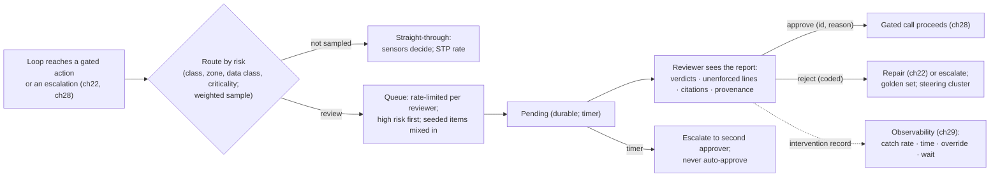
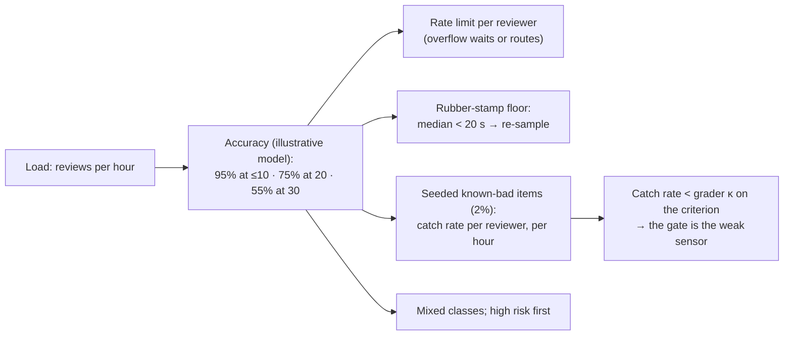

# Chapter 31 — Human-in-the-loop

*Part II · Word budget 6,000–8,000 · Lab 31 · Verified as of September 2026 · Derived figures from `labs/ch31-human-in-the-loop/derive.py`*

## 31.1 Intuition

Every chapter of this book has ended at a gate: a person who reads what the agent produced and decides whether it enters a system of record. The gate is not a concession to nervousness; it is the component that makes the rest of the harness's arithmetic honest. A sensor chain that catches 95% of defects (ch26) sends the other 5% somewhere, and the gate is where they go. A grader with κ = 0.68 (ch27) is wrong a third of the time on its uncovered criteria, and the gate is who reads those criteria. A model that guesses (ch13) reaches the plant's records only through the gate. The gate's cost — about $2.19 per task at the scenario's routing, six minutes of a planner per reviewed artifact — is the largest line in the cost anatomy after engineering (derive.py, derived; ch37), and it is also the line that shrinks as the harness matures, because every sensor added is a review not needed.

Three things make the gate an engineering problem rather than a policy. It is a *state*: a durable pause on the control plane (ch21) with a timer, a signal, and a set of transitions, not a message in someone's inbox. It is *routed*: not every artifact reaches a person, and which ones do is a risk decision with sampling rates — 100% of submissions to a restricted zone, 5% of routine notifications (illustrative policy) — that decide both the gate's cost and its coverage. And it *degrades*: a reviewer who approves thirty artifacts an hour is not reviewing them, and the harness measures the degradation and defends against it, because a gate that approves everything is a sensor that has stopped sensing.

The chapter's arithmetic is the queue's. At the scenario's volumes — 547 reviews a month, six minutes each, two reviewers — the queue is quiet: 3.4 arrivals an hour, a quarter-minute of expected wait with two reviewers, a fifty-five-hour month of review across both (derive.py, derived). The numbers say the gate is affordable and that its risk is not throughput but attention: the same two reviewers approving twenty an hour at the morning peak are the fatigue case the chapter's last mechanism exists for.

## 31.2 Mechanism

### The gate as a workflow state

An approval is a state the task enters and a signal that moves it out (ch21). Entering the state is deterministic — the policy engine's escalation obligation on a gated action (ch28), or the router's rule for a class (31.2's routing) — and the state's transitions are the six of ch21: pending, approved, rejected, expired, withdrawn, delegated. Three properties follow from putting the gate on the control plane rather than in a mailbox. The task waits durably: hours or days, across deploys and crashes, holding no process. The wait is measured: a timer per class fires an escalation to a second approver or a close-with-reason, never an auto-approval. And the signal is authenticated and single-use: an approval carries the approver's verified identity, a reason, and an approval id the policy engine checks on the gated call and refuses a second time (ch28). The record of every transition is an intervention (ch29), chained where evidentiary.


### Why a gate, and where it belongs

The gate exists for the actions the sensors cannot fully verify and the consequences the plant cannot fully reverse. That is a two-axis decision, and it places the gate precisely. On the verification axis: a criterion with a deterministic sensor needs no person; one with a calibrated grader needs a person on a sample; one with neither needs a person every time (ch26's coverage figure per class). On the consequence axis: a draft to a queue is reversible and needs no gate; a submission to a system of record is reversible with effort and is gated by class; an external communication or a restricted-zone write is not reversible and is gated always (ch25's risk classes). The gate sits where the two axes cross high — unverified criteria on irreversible actions — and sampling covers the rest. The two-axis placement is what the OpenAI guide's advice to "add human intervention for high-risk actions" becomes when the harness has a coverage number and a risk class per action (OpenAI, 2025, vendor).

### The gate's interface, designed

The report of 31.2 is rendered in a fixed layout because reviewers read fast and the layout carries meaning. **Top**: the decision the reviewer is asked for, in one line — "Approve submission of WO-48211 for P-101-U3 (zone Z3, hot-work permit)?" **Second**: the criteria table — id, text in the reviewer's language, verdict, one-line reason, source — with the unenforced rows highlighted and the failed-then-repaired rows marked. **Third**: the evidence the reviewer may want — citations with spans and one-click sources, provenance of memory facts, the plan, children's summaries, the repair history — collapsed by default. **Bottom**: the actions — approve with a reason field; reject with a code picker from the rubric and an optional sentence; delegate to a named reviewer; request a change (a coded rejection that returns to the same reviewer). The interface records time-on-page and which sections were expanded, because a reviewer who never expands a citation on high-risk items is a reviewer the seeded items will test. The layout is generated from the class's guide and rubric (ch18, ch27), so a new criterion appears in the report the day its rule is merged.

### Service levels and the calendar

The timer per class is a service level the plant commits to, and it is set from the work, not from the reviewers' convenience. A fault-report submission on a running pump has a shift's timer; a preventive-maintenance draft has a week's; an external-communication approval has a business day's. The queue orders by deadline within risk class, and the control plane's scheduler (ch21) routes tasks whose timer will fall in a reviewer's absence to the second approver before they expire, not after. Expiry is a metric with a cause: absence, overload, misrouting, or a class whose timer was set wrong — and the last is the common one in a program's first quarter, found by the expiry-by-cause report and fixed in the template (ch17).

### Routing by risk

Not every artifact reaches a person, and the rule for which do is the harness's risk classification applied to review. Each task class carries a **risk class** — from its writes (draft, system of record, external), its zone (ch28), its data class (ch36), and its criticality from the register — and each risk class carries a **review rate**: 100% for high (submissions to a system of record, restricted zones, any external communication), a sample for medium (drafts to the queue, reports), and a small sample for low (notifications, summaries). The scenario's split — a fifth of tasks high at 100%, half medium at 30%, three-tenths low at 5% — sends 547 of 1,500 tasks a month to a reviewer, 36.5%, and lets the other 63.5% through on sensors alone: the straight-through-processing rate (derive.py, derived; ch37). Two refinements. The sample is not uniform: it is weighted toward artifacts with a grader verdict below a confidence margin, a repair in their history, or an unenforced criterion — the artifacts the sensors are least sure of. And the rates are the steering loop's to move (ch16): a medium class whose sampled rejections fall below a floor for a quarter moves toward low; one whose rejections rise moves toward high; and a class whose sensors gain coverage (ch26) moves down, which is the mechanism by which the gate shrinks.

**Table — Routing by risk, scenario.**

| Risk class | What is in it | Review rate | Reviewer | Timer |
|---|---|---|---|---|
| High | Submissions to the CMMS; any write in a restricted zone; external communication | 100% | Supervisor or planner with the writer role | 24 h, then second approver |
| Medium | Drafts to the queue; consolidated reports; parts reservations | 30%, weighted to low-confidence items | Planner | 48 h |
| Low | Notifications; summaries; read-only answers | 5%, weighted | Planner, batched | Weekly batch |
| Any | Task escalated by the loop (repair cap, budget, abstention, plan conformance) | 100% | Class owner | Per class |

(Rates illustrative policy; the steering loop moves them.)

### What the reviewer sees

A gate that shows the reviewer the raw artifact and asks "approve?" is a gate that will be rubber-stamped, because six minutes is not enough to re-derive eleven criteria from a work order. The gate shows a **report**, generated from the records (ch29), in this order: the criteria with their verdicts — pass, fail, or unenforced — each with the sensor's or grader's one-line reason (ch26, ch27); the unenforced criteria the reviewer must judge, highlighted, with the rubric line beside each; the citations with their spans and one click to the source at its revision (ch20); the provenance of every fact used (ch24); the plan and, for delegated tasks, each child's summary (ch30); the repair history — which sensors failed, what changed; the policy decisions and any escalation reason; the cost and duration. The artifact itself is there, but the reviewer's work is the two or three highlighted lines, and the rest is what the sensors already did. The report is rendered from the guide's rule list (ch18), so a rule the guide states is a line the reviewer sees with a verdict beside it.

### Rejection reasons feeding repair

A rejection is data, and its value depends on its form. The reviewer rejects against a criterion — a coded reason from the rubric, not free text — and may add a sentence; the code goes three places. To the task: a rejection on a repairable criterion re-enters the loop at Repair (ch22) with the reason as the sensor message, and the repaired artifact returns to the same reviewer; a rejection on an unrepairable one (wrong asset, missing procedure) escalates. To the golden set: every rejection is a candidate item with the reviewer's label (ch12). To the steering review: rejections clustered by code are the week's failure clusters — a code that recurs is a sensor gap, a template gap, or a guide gap (ch16, ch26), and the fix is a pull request, not a note to the reviewer. Approvals carry information too: an approval with a correction — the reviewer edited a field before approving — is a diff (ch29) and a rejection in disguise, coded to the field's criterion.


### Rejection reasons in depth: the code set

The rejection codes are the rubric's criteria plus a small fixed set of non-criterion reasons (five, below; illustrative set), and the set is versioned with the guide (ch18). Criterion codes: one per rule, repairable if the rule has a sensor or a grader that can re-check the repair (schema, citation, permit rule, description accuracy). Non-criterion codes: `wrong_asset` (the task's scope was wrong — an intake failure, escalated to intake); `wrong_task` (the request meant something else — back to the requester through intake); `policy` (the reviewer believes the action should not happen regardless of the artifact — escalated to the class owner with the reason, and a candidate policy change, ch28); `unsafe` (a safety-gate concern the sensors missed — an incident, and a golden item reviewed at 100%, ch27's sample rule); `duplicate` (a work order already exists — a reference-check gap, ch26). Each code has a destination and an owner, and the weekly cluster report groups by code: criterion codes go to the sensor and guide owners, `wrong_asset` and `wrong_task` to the template owner, `policy` to the class owner, `unsafe` to the safety review. A code with no destination is free text by another name.

### Interventions as calibration data

Every approval and rejection is a label. The gate's records feed three calibrations. The grader's (ch27): the reviewer's verdict on the unenforced criteria is the human label the quarterly session compares κ against, and the override rate — reviewer disagreeing with the grader's verdict — is the leading indicator. The sensors' (ch26): a reviewer who rejects on a criterion the sensors passed has found a false negative, and the artifact is the sensor's next golden case. The intake's (ch17): `wrong_asset` and `wrong_task` rejections are the clarification rate's failures — questions intake should have asked. The reviewer's own calibration is the seeded-item catch rate. The records thus close the loop in every direction, which is why an intervention without a code, an identity, or a report version is a record the harness refuses to write.

### Straight-through processing as the goal

The gate's purpose is to shrink. The STP rate — tasks delivered with no human touch — is the number the sponsor reads (ch37), and it rises by exactly the mechanisms this book describes: a criterion moves from inferential to computational (ch26) and its review rate falls; a rejection code stops recurring and the class's sample rate drops; a grader's κ rises and its criterion leaves the highlighted lines. The steering loop moves the review rates on evidence — a quarter of sampled rejections below a floor — and records the move with the rejection data that justified it, so an auditor asking "why is this class reviewed at 10% and not 30%" (rates illustrative) reads the answer in the change log (ch29). What the STP rate must not do is rise because reviewers stopped rejecting: the seeded-item catch rate is the control that separates a gate that is needed less from one that has stopped working, and the two are reported side by side.

### Approval fatigue

A reviewer's accuracy falls with load, and the fall is silent: the approvals keep coming, faster. The mechanism is attention — the same six-minute artifact takes forty seconds at the thirtieth of the hour — and the chapter models it — an illustrative model, not a measured curve — as accuracy falling from 95% at ten reviews an hour to 75% at twenty and 55% at thirty (derive.py, illustrative). Four defences, all measured. **Rate limits**: the queue does not offer a reviewer more than a class-specific number per hour; the rest wait or route to a second reviewer, and the queue's wait metric shows the cost. **Rubber-stamp detection**: median time per approval below a floor — twenty seconds on a six-minute artifact (illustrative) — flags the session, and the flagged approvals are re-sampled by a second reviewer. **Seeded items**: 2% of the queue is known-bad artifacts from the golden set, unmarked; the reviewer's catch rate on them is their measured sensitivity, per reviewer and per hour of the day, and a falling rate is the fatigue signal that precedes the incident (derive.py: about ten seeded items a month at the scenario's volume). **Variety and rotation**: reviewers see mixed classes rather than a hundred identical drafts, and high-risk items are reviewed in the first hours of a session. The fatigue defences are the human sensor's calibration (ch26, ch27): a reviewer whose catch rate on seeded items is below the grader's κ on the same criterion is a reviewer the harness is over-relying on.


### Fatigue in depth: the evidence and the mechanism

The human-factors literature has measured what the harness defends against. Operators given a reliable automated aid come to rely on it — automation bias — and their detection of the aid's errors falls with the aid's reliability, because vigilance is not sustained against a signal that is almost always right (Parasuraman and Riley 1997, primary; the vigilance-decrement literature it summarizes). The gate is exactly that situation: a reviewer who sees 547 artifacts a month of which 43 are wrong is watching a 92% reliable aid, and the eighth-percent defect arrives after a run of correct ones. Three consequences the harness's design follows from. **Reliability that is too high is a fatigue risk in itself**: the seeded items keep the reviewer's base rate of defects above the natural one — 2% seeds on top of 8% real is a 10% signal — which is the same reason airport screeners are shown planted threats. **The order of items matters**: a run of identical routine drafts trains the reviewer to approve the next one; mixed classes and high-risk-first ordering break the run. **Measurement must be blind**: a reviewer who knows which items are seeds behaves differently on them, so seeds are drawn from real rejected artifacts, unmarked, refreshed monthly, and the catch rate is reported per reviewer without telling the reviewer which items counted.

### The reviewer's page

Each reviewer has a page the reviewer sees and the steering review reads: reviews this month by class; rejection rate by code; catch rate on seeded items with its trend; override rate against graders; median and p10 time per review by class and hour of day; expiries attributed to the reviewer's queue. The page is not a performance review; it is the calibration record of a sensor, and it serves the reviewer first — a planner who sees her Tuesday-morning catch rate falling asks for the rate limit before the steering review does. Where a reviewer's catch rate is consistently below a grader's κ on the same criterion, the honest conclusion is that the grader is the better sensor for that criterion at that hour, and the routing weights change.

### The audit of interventions

Every human touch is an intervention record (ch29): identity, timestamp, task and step, kind (clarification, approval, rejection, override, delegation, expiry), coded reason, wait time, time spent, and the report version the reviewer saw. The records answer four questions. *Was a human in the loop where the class required one?* — every gated write has an intervention with an approval id, and a gated write without one is a completeness finding (ch29). *Who approved what, on what basis?* — the identity and the report version. *Is the gate working?* — rejection rate, catch rate on seeded items, override rate against graders, time per review, all per reviewer and class, with the reviewers' ceiling (ch12) as the reference. *Is the gate shrinking?* — STP rate by class over time, and the review rates the steering loop has lowered. The audit reads interventions as it reads decision records: chained, anchored, exportable per framework (ch29's mapping to NIST's human-oversight functions, ISO 42001's roles, LGPD's Article 20 review, the AI Act's Article 14).

**Figure 31.1 — The gate, end to end.**



*Takeaway: the gate is a routed, rate-limited, measured state — not an inbox.*


### Batched review for low risk

Low-risk classes are reviewed in batches, not one at a time: a weekly session in which a planner reads twenty sampled notifications and summaries in a single sitting, with the report condensed to one line per artifact and the criteria as columns. Batching lowers the per-item cost — the artifact's context is loaded once — and raises the fatigue risk in the same motion, so the batch has its own rules: at most thirty items per session (illustrative), seeds mixed in at the same share, the session's time per item tracked, and any rejection in a batch escalating that class's sample rate for the following week. The batch is also where interleaving happens (ch12): two candidate configurations' outputs for the same request, shown side by side, the preference recorded as calibration data — a use of the reviewer's attention that pays twice.

### Overrides and break-glass

Two human actions sit outside the normal transitions and are recorded as exceptions. An **override** is a reviewer approving an artifact a sensor failed — permitted only for named criteria the class allows overriding, never for the safety gate's, always with a reason and a second approver for high risk, and reported monthly by criterion; an override rate above a floor on one criterion is a sensor that is wrong, and the sensor is fixed rather than the override normalized. **Break-glass** is a human bypassing the gate entirely — submitting by hand because the harness is down or the task is urgent — and it is recorded as an intervention with kind `break_glass`, reason, and identity, reconciled the next day against the system of record's diffs (ch29) so that a work order the harness did not produce is still in the audit. A plant without a break-glass path has one anyway, unrecorded.

### The human as a sensor

Chapter 26 placed the person last in the chain; this chapter gives the person the chain's discipline. The reviewer has a rubric — the same criteria the grader uses, so κ can be computed against them (ch27); a routing rule; a service level; a measured sensitivity (the seeded items); and a recorded output. What the reviewer is not is the harness's general-purpose fallback: a class that routes every task to a person because its sensors are weak is a class the plant should not have deployed (ch34's verifiability index), and the gate's cost per task is the number that says so. The measure of a maturing harness is the human sensor firing less often for the same defect classes while its rejection rate, when it fires, stays above zero — the STP rate rising and the catch rate holding.

### Reference implementation

A gate state machine on task records, a risk router with weighted sampling, a reviewer queue with rate limits and seeded items, coded rejections that route to repair or escalation, and the fatigue detector. Lab 31 runs a month of tasks through it with a simulated reviewer whose accuracy decays with load, and measures wait time, rejection rate, catch rate, and STP.

```python
import random
from dataclasses import dataclass, field

RISK_RATE = {"high": 1.0, "medium": 0.30, "low": 0.05}
TIMER_H = {"high": 24, "medium": 48, "low": 168}
REPAIRABLE = {"schema", "citation", "permit_rule", "description"}      # codes that re-enter Repair; others escalate

@dataclass
class Task:
    task_id: str; risk: str; confidence: float; has_defect: bool
    state: str = "submitted"; reviewer: str = None; wait_h: float = 0.0; review_s: float = 0.0
    outcome: str = None; code: str = None; seeded: bool = False

def route_batch(tasks: list, rng, low_conf: float = 0.7) -> set:
    """Fixed review budget per risk class = rate × class size; low-confidence items fill the budget first, then a random
    sample of the rest. Weighting redistributes attention within the rate; it never inflates the rate."""
    chosen = set()
    for risk, rate in RISK_RATE.items():
        group = [t for t in tasks if t.risk == risk]; budget = round(rate * len(group))
        lows = [t for t in group if t.confidence < low_conf]; rng.shuffle(lows); rest = [t for t in group if t.confidence >= low_conf]; rng.shuffle(rest)
        for t in (lows + rest)[:budget]: chosen.add(t.task_id)
    return chosen

class Reviewer:
    """Accuracy decays with reviews per hour (illustrative model); records time per review."""
    def __init__(self, name: str, base_acc: float = 0.95, decay_per_extra: float = 0.02, cap_per_hour: int = 12):
        self.name, self.base, self.decay, self.cap = name, base_acc, decay_per_extra, cap_per_hour
        self.log = []
    def accuracy(self, rate_per_hour: float) -> float: return max(0.3, self.base - self.decay * max(0, rate_per_hour - 10))
    def review(self, task: Task, rate_per_hour: float, rng) -> tuple:
        acc = self.accuracy(rate_per_hour); correct = rng.random() < acc
        verdict = ("reject" if task.has_defect else "approve") if correct else ("approve" if task.has_defect else "reject")
        secs = 360 if rate_per_hour <= 10 else max(15, 360 * 10 / rate_per_hour)
        self.log.append((task.task_id, verdict, secs, task.seeded, task.has_defect)); return verdict, secs

def gate(tasks: list, reviewers: list, rng, seeded_share: float = 0.02, rate_limit: int = 12) -> dict:
    """Run a set of tasks through routing, the queue, review, and outcomes; returns the gate's metrics."""
    chosen = route_batch(tasks, rng); queue = [t for t in tasks if t.task_id in chosen]
    for t in queue:
        if rng.random() < seeded_share: t.seeded, t.has_defect = True, True
    queue.sort(key=lambda t: (0 if t.risk == "high" else 1))                                  # high risk first
    per_hour = max(1, len(queue) / 160)                                                         # month → 160 working hours (illustrative)
    for i, t in enumerate(queue):
        r = reviewers[i % len(reviewers)]; load = min(rate_limit, per_hour * 2 if i < len(queue) * 0.2 else per_hour)   # a morning peak
        t.state = "pending"; t.wait_h = min(TIMER_H[t.risk], (i % 8) * 0.05)                    # illustrative queue position → wait
        verdict, secs = r.review(t, load, rng); t.reviewer, t.review_s = r.name, secs
        if verdict == "approve": t.state, t.outcome = "approved", "approve"
        else:
            t.code = rng.choice(sorted(REPAIRABLE)) if rng.random() < 0.8 else "wrong_asset"
            t.state, t.outcome = ("repair" if t.code in REPAIRABLE else "escalated"), "reject"
    for t in tasks:
        if t.state == "submitted": t.state, t.outcome = "straight_through", "stp"
    reviewed = [t for t in tasks if t.outcome in ("approve", "reject")]
    seeded = [t for t in reviewed if t.seeded]; caught = [t for t in seeded if t.outcome == "reject"]
    fast = [t for t in reviewed if t.review_s < 20]
    return {"tasks": len(tasks), "reviewed": len(reviewed), "stp_rate": round(1 - len(reviewed) / len(tasks), 3),
            "rejection_rate": round(sum(t.outcome == "reject" for t in reviewed) / max(1, len(reviewed)), 3),
            "seeded": len(seeded), "seeded_catch_rate": round(len(caught) / max(1, len(seeded)), 3),
            "rubber_stamp_flags": len(fast), "mean_wait_h": round(sum(t.wait_h for t in reviewed) / max(1, len(reviewed)), 3),
            "to_repair": sum(t.state == "repair" for t in tasks), "escalated": sum(t.state == "escalated" for t in tasks)}
```

The router fills a fixed per-class budget with low-confidence items first — Lab 31 found the first draft's per-item weighting inflating the review rate from 36.5% to 60% (Lab 31, derived), and the budgeted form replaced it; the reviewer's accuracy is a function of load, which is the fatigue model; seeded items measure the reviewer; fast approvals are flagged; coded rejections route to repair or escalation. The lab varies the rate limit and shows the catch rate fall when the limit is removed.

### Roles, competence, and delegation

The reviewer for a class is defined by the class: a supervisor with the writer role for submissions in restricted zones; a planner for drafts; document control for anything that cites a procedure the sensors flagged as superseded; the class owner for escalations. Competence is recorded — who may review what — and the policy engine enforces it: an approval signal from an identity outside the class's reviewer set is refused (ch28). Delegation is a transition: a reviewer names another, the identity is recorded, the timer restarts; a delegation chain longer than one is an escalation. And absence is planned: a class with one qualified reviewer is a class whose tasks expire when that person is on leave, and the timer's second-approver rule is what the plant checks before it deploys the class.

### Clarifications and the requester

The gate is not the only human touch. Intake asks the requester (ch17); the loop asks mid-task (ch22); delivery confirms (ch10). Each is an intervention with the same records and the same discipline: a question the harness generated from a template, an answer written to a field, a timer, an escalation on silence. The requester's touches are measured separately from the reviewer's — clarification rate per channel (ch17), confirmation corrections — because they are the intake's quality signal, not the gate's. A task with three clarifications and an approval has touched a person four times, and the STP definition counts it as reviewed once and clarified three times; the cost anatomy (ch37) prices both.

**Figure 31.2 — Fatigue and its defences.**



*Takeaway: the gate's accuracy is measured with the same instruments as a grader's, and defended by the queue's design.*

## 31.3 Worked numbers

All figures from `derive.py` (derived); policy rates and the fatigue model illustrative.

**Reviews per month.** 1,500 tasks: high 300 at 100%; medium 750 at 30% = 225; low 450 at 5% = 22. Total 547 — 36.5% of tasks reviewed, STP 63.5%.

**Reviewer time.** Six minutes each: 54.7 hours a month; 1.4 hours a day across two reviewers.

**Gate cost.** 54.7 hours at $60: $3,282 a month, $2.19 per task — the oversight line of ch37.

**Queue.** 3.4 arrivals an hour over a 160-hour month; service 10 an hour per reviewer. One reviewer: utilization 0.34, expected wait 3.1 minutes. Two: utilization 0.17, wait 0.2 minutes. The queue is not the constraint; attention is.

**Fatigue model.** Accuracy 95% at ten an hour or fewer; 75% at twenty; 55% at thirty (illustrative). Rubber-stamp floor 20 seconds on a six-minute artifact.

**Seeded items.** 2% of 547: about ten a month — enough to trend a reviewer's catch rate by quarter, not by week.

**Rejections.** At an 8% rejection rate (illustrative): 43 a month, each a coded reason, a golden-set candidate, and a repair or escalation.

**Timers.** Submissions 24 hours; drafts 48; low-risk weekly batch; 5% expiring to a second approver (illustrative).

## 31.4 Measurement

**Wait time** per class: pending to signal, p50 and p95; against the timer; expiries by cause.

**Rejection rate** per class and reviewer, with coded reasons; the steering review's cluster input.

**Catch rate on seeded items** per reviewer, per hour of day; the human sensor's sensitivity; compared with the grader's κ on the same criteria (ch27).

**Time per review** distribution per class; rubber-stamp flags; re-sample results.

**Override rate**: reviewers overruling a grader's verdict, per criterion — next quarter's κ signal (ch27).

**STP rate** per class over time; review rates moved by the steering loop, with the evidence.

**Completeness**: gated writes with an approval id — 100% (ch29).

**Approvals with corrections**: diffs on approved artifacts, coded to criteria — rejections in disguise.

What to record: routing policy version; reviewer roster and competence per class; queue configuration (rate limits, seeding share); intervention records; timer settings; date.


### Reference output (Lab 31, this run)

What the lab prints when it reproduces; the plant's numbers replace these.

```text
with rate limit: reviewed 547 (36.5%; chapter 36.5%), STP 0.635 (chapter 0.635); rejection rate 0.121; seeded catch 1.00 on 8; rubber-stamp flags 0; to repair 52, escalated 14; mean wait 0.174 h
no rate limit:   seeded catch 1.00; rubber-stamp flags 0; rejection rate 0.121
fatigue model: accuracy at 20/h 0.75 (chapter 0.75), at 30/h 0.55 (chapter 0.55)
seeded catch at 8/h: 0.945 (360 s each); at 25/h: 0.654 (144 s each) — below the 20 s rubber-stamp floor: True
queue: λ 3.42/h; one reviewer wait 3.1 min; two reviewers 0.2 min; gate cost $2.188/task; 54.7 h/month
Lab 31: REPRODUCED
```

These measurements are the improvement loop's inputs (ch32): clusters are mined from them weekly and changes are tested against them.

## 31.5 Failure

| Failure mode | Mechanism | Detection signal | Mitigation | Owning component |
|---|---|---|---|---|
| Gate in a mailbox | Approval as an email or chat message | No timer; no record; a process held open | Gate as a durable state with signal and timer | ch21 |
| Auto-approval on timeout | Expired timer treated as consent | Gated writes with no approval identity | Expiry escalates; never approves | This chapter; ch21 |
| Everything reviewed | 100% review on every class | Reviewer hours exceed the plan; fatigue | Routing by risk with sampling; STP rate | This chapter |
| Rubber-stamping | Fast approvals under load | Median time below the floor; seeded catch rate falling | Rate limit; re-sample; seeded items | This chapter |
| Raw artifact shown | Reviewer must re-derive every criterion | Time per review high, then collapses | Report with verdicts and highlighted unenforced lines | This chapter; ch18 |
| Free-text rejections | Reason cannot feed repair or the golden set | Repairs that change nothing; no clusters | Coded reasons from the rubric | This chapter; ch22 |
| Rejection dead-ends | Rejected task closes with no repair path | Rework by hand outside the harness | Repairable codes re-enter Repair; others escalate | ch22 |
| Reviewer not competent for the class | Any identity can approve | Approvals from outside the roster | Roster per class enforced by the policy engine | ch28 |
| Single reviewer | Class stalls on leave | Expiries cluster | Second-approver rule; roster of two | This chapter |
| Uniform sampling | Low-confidence items no more likely to be reviewed | Defects in the unsampled share | Weight the sample by grader margin, repairs, unenforced criteria | This chapter |
| Seeded items recognizable | Reviewers learn the seeds | Catch rate perfect on seeds, unchanged on real defects | Seeds drawn from real rejected artifacts, refreshed | ch12 |
| Human as the only sensor | Weak sensors, 100% review | Gate cost per task dominates; STP near zero | Verifiability index at selection; sensors first | ch34; ch26 |
| Corrections uncounted | Reviewer edits and approves | Approved artifacts differ from delivered | Diff recorded; coded as a rejection | ch29 |
| Requester touches conflated with review | Clarifications counted as gate load | STP mis-stated | Separate metrics for intake and gate | ch17 |
| Override normalized | Reviewers routinely approve past a failing sensor | Override rate high on one criterion | Fix the sensor; overrides need a second approver on high risk | ch26 |
| Break-glass unrecorded | Hand submissions outside the harness | Diffs with no task | Break-glass intervention kind; nightly reconciliation | ch29 |
| Batch too long | Forty low-risk items in one sitting | Time per item collapses mid-batch | Batch cap; seeds in batches; rejection escalates the sample rate | This chapter |
| Timer set from convenience | Week-long timers on shift-critical classes | Late submissions; expiries on urgent work | Timer from the work; second approver before expiry | This chapter; ch17 |
| Reports without a decision line | Reviewer must infer what is being asked | Time per review high; wrong action taken | One-line decision at the top of the report | This chapter |

The recurring modes above appear, with their owning components and golden cases, in the failure catalogue (ch33).

## 31.6 The frontier

**Strongest free treatments.** Temporal's documentation on signals and timers is complete on the durable-wait mechanism and stops at the engine. OpenAI's practical guide names human intervention as a guardrail for high-risk actions and stops at the advice. 12-Factor Agents states "contact humans with tool calls" and "launch, pause, resume." Managed Agents document the `input-required` state and outcomes. The human-factors literature on vigilance and automation bias — including the finding that operators over-trust automated aids and under-check them — is the evidence base for fatigue and is decades old (Parasuraman and Riley, "Humans and Automation: Use, Misuse, Disuse, Abuse," 1997, primary). Böckeler places the human as an inferential sensor. Darú's living book covers approval flows in coding agents.

**What this chapter adds.** The gate as a routed, rate-limited, measured state with six transitions; routing by risk with weighted sampling and the STP arithmetic it produces; the report as what a reviewer reads; coded rejections wired to repair, the golden set, and the steering review; approval fatigue modelled and defended with four measured mechanisms, including seeded items as the human sensor's calibration; the audit of interventions mapped to the frameworks; and a runnable gate whose lab shows the catch rate fall when the rate limit is removed. Open: measured reviewer catch rates and fatigue curves on industrial approval queues are unpublished; 31.4 is the protocol.

## 31.7 Industrial application

**The submission gate.** Step eight of the P-101 task requests submission; the policy engine escalates (restricted zone); the task enters pending with a 24-hour timer; supervisor S's queue shows the report: nine criteria passed by sensors, two unenforced — description accuracy and procedure appropriateness — with the grader's one-line verdicts beside them, the permit clause cited with its span, the spacer fact from memory with its provenance, one repair on the permit rule. S reads the two lines, opens one citation, approves with the reason "scheduled for the day shift" at 08:02 after a 14-hour wait (the night shift's queue), and the approval id lets the submit proceed (ch28). Six minutes; recorded; chained.

**The rejection.** A draft for E-212 is sampled (medium risk, low grader confidence). The planner rejects with code `description`: the description names bearing noise; the request reported a seal leak. The code re-enters Repair with the message; the repaired draft returns to the same planner; the rejection becomes a golden item (ch12) and, at the steering review, one of four `description` rejections that week — a cluster that becomes a framing sensor (ch26) the following sprint.

**The fatigue signal.** In month three, planner R's median time per approval on Tuesday mornings drops to 18 seconds and her catch rate on seeded items falls from 9 of 10 to 5 of 8 (illustrative). The queue flags the sessions; a second planner re-samples the approvals and finds two corrections; the rate limit for the drafting class is lowered from twelve to eight an hour and the morning queue is split. The seeded items found the problem before an incident did.

**What the plant tells finance.** The gate costs $2.19 per task and 55 hours a month; the STP rate is 63.5% and rising as sensors are added; the reviewers' catch rate on seeded items is the number that says the 36.5% is being reviewed and not rubber-stamped (ch37).

**OT boundary.** No gate approves a control action, because no artifact proposes one; the gate's highest risk class is a CMMS submission in a restricted zone (ch35).

## 31.8 Decision aids

**Gate configuration (per class).** Risk class; review rate and weighting; reviewer roster and competence; timer and second approver; report template (criteria, unenforced lines, citations, provenance, plan, children, repairs, decisions); rejection codes from the rubric; rate limit per reviewer; seeding share; batch or interactive.

**Routing rule.** High risk 100%; medium and low sampled, weighted by grader margin, repair history, and unenforced criteria; rates moved quarterly by the steering loop on rejection evidence; a class whose sensors gain coverage moves down.

**Fatigue defences (starting values).** Rate limit 10–12 per reviewer per hour; rubber-stamp floor 20 s on six-minute artifacts; 2% seeded items from real rejected artifacts, refreshed monthly; mixed classes; high risk first in a session.

**Rejection rule.** Coded to a criterion; repairable codes re-enter Repair with the code as the message and return to the same reviewer; unrepairable codes escalate; every rejection is a golden-set candidate; corrections on approval are coded rejections.

**Audit checklist.** Every gated write has an approval id; every intervention has identity, kind, code, wait, time spent, report version; catch rate, override rate, and time per review per reviewer; STP rate per class over time; expiries by cause.

**Report layout (fixed).** Decision line; criteria table (id, text, verdict, reason, source) with unenforced rows highlighted and repaired rows marked; evidence collapsed (citations with spans, provenance, plan, children, repairs, decisions); actions (approve + reason; reject + code; delegate; request change). Time-on-page and expansions recorded.

**Rejection code set.** Criterion codes from the rubric (repairable where a sensor or grader can re-check); `wrong_asset` → intake; `wrong_task` → requester via intake; `policy` → class owner; `unsafe` → safety review, golden at 100%; `duplicate` → reference-check gap. Every code has a destination and an owner.

**Batch rules (low risk).** Weekly; ≤ 30 items; one line per artifact; seeds mixed in; time per item tracked; any rejection raises the class's sample rate next week; interleaving comparisons run here.

**Vendor questions.** Is the approval a durable state with a timer, or a message? Does expiry escalate or approve? Can review be routed by risk with sampling? Does the reviewer see verdicts per criterion or the raw artifact? Are rejections coded and fed back? Is there any measurement of reviewer accuracy?

## 31.9 Sources

| # | Claim or figure | Source | Tier | Verified | Link |
|---|---|---|---|---|---|
| 1 | Durable waits, signals, timers | Temporal documentation (ch21) | vendor | Sep 2026 | https://docs.temporal.io/ |
| 2 | Human intervention as a guardrail for high-risk actions | OpenAI, "A Practical Guide to Building Agents," 2025 | vendor | Sep 2026 | https://cdn.openai.com/business-guides-and-resources/a-practical-guide-to-building-agents.pdf |
| 3 | Contact humans with tool calls; launch/pause/resume | HumanLayer, 12-Factor Agents | practitioner | Sep 2026 | https://github.com/humanlayer/12-factor-agents |
| 4 | `input-required` state; outcomes | Anthropic, Managed Agents documentation, 2026 | vendor | Sep 2026 | https://docs.claude.com/en/docs/agents-and-tools/managed-agents/overview |
| 5 | Automation bias; vigilance; misuse and disuse of automation | Parasuraman & Riley, Human Factors, 1997 | primary | Sep 2026 | https://doi.org/10.1518/001872097778543886 |
| 6 | Human as an inferential sensor | Böckeler, Apr 2026 | practitioner | Sep 2026 | https://martinfowler.com/articles/exploring-gen-ai/ |
| 7 | Reviews per risk class; hours; gate cost; queue waits; STP; fatigue model; seeded counts | `labs/ch31-human-in-the-loop/derive.py` | derived | Sep 2026 | labs/ch31-human-in-the-loop/derive.py |
| 8 | Review rates; 6 minutes; $60/h; accuracy decay; 20 s floor; 2% seeds; 8% rejections; timers | Illustrative | illustrative | Sep 2026 | — |
| 9 | Reviewer catch rates and fatigue curves on industrial queues | None published | open | Sep 2026 | — |