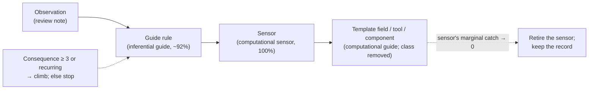
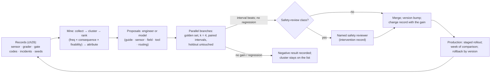

# Chapter 32 — Self-improving harnesses

*Part II · Word budget 6,000–8,000 · Lab 32 · Verified as of September 2026 · Derived figures from `labs/ch32-self-improving/derive.py`*

## 32.1 Intuition

A harness that ships at 84% and stays at 84% has been built; one that reaches 91% six months later without a new model has been engineered (the scenario's curve, derive.py, illustrative). The difference is a loop the plant runs on itself: read the failures, find their causes, change a component, measure the change, keep it or revert it, and record what was learned. Chapter 16 named it the steering loop and gave it a weekly rhythm; this chapter gives it mechanisms — how failures are mined into clusters, how a cluster becomes a change, how changes are tested in parallel and merged on evidence, which changes a person must review regardless of evidence, and how the harness's version tells an auditor what was running when.

The word *self-improving* needs its limit stated first. The model does not modify the harness. The model may propose — a guide edit from a failure cluster, a sensor from a recurring defect — and the proposal enters the same pipeline as an engineer's: a branch, a golden-set run with intervals, a review, a merge, a version. Nothing the model writes reaches production without a person's merge and the regression gate's verdict (ch27), and the components that decide safety — the policy bundle, the safety gate, the tool sets of write classes — are never merged on evidence alone. A harness that let its model rewrite its own permissions would be optimizing the wrong objective with the wrong author, and the failure literature on multi-agent and self-modifying systems is the record of what that produces (ch30, ch33).

The arithmetic is the change's expected value against the golden set's power to see it. The scenario's largest failure cluster — descriptions naming the wrong fault — accounts for 38 of 120 monthly rejections; fixing it at sensor level moves the rejection rate from 8.0% to about 5.7% (derive.py, illustrative). Detecting a three-point gain on a 300-item class set has about a 47% chance; on 1,000 items, 88% (ch12) — which is why the loop measures in the aggregate over weeks, tests candidates in parallel on the same items, and holds out a fifth of the golden set that no proposal has seen.

## 32.2 Mechanism

### Failure-cluster mining

The raw material is the observability record (ch29): sensor verdicts per step, grader verdicts per criterion, repair outcomes, escalations, gate rejections with codes (ch31), incident reconstructions, and the seeded-item misses. Mining is a weekly query with four stages. **Collect**: every failure event in the period with its keys — class, step, criterion or code, language, model version, guide version, sensor version. **Cluster**: group by (criterion or code, step, class, language); the record's structure does this without a model, and it is the first pass; a small model clusters the free-text residue — reviewers' sentences, escalation reasons — into named themes, and its output is a proposal a person confirms (ch24's rule for durable facts applies to durable clusters). **Rank**: score = frequency × consequence × fixability, where consequence comes from the criterion's class (a permit error outweighs a formatting one) and fixability is the engineer's estimate of whether a component can address it — the scenario's top clusters are description mismatch at 68, stale revision at 66, and permit type at 45, the third smaller in count and largest in consequence (derive.py, illustrative). **Attribute**: each cluster names the component that owns it — a guide rule, a sensor, a template field, a retrieval filter, a tool description, the routing table — and a cluster with no owning component is a finding about the taxonomy, not a change.

The output is the steering review's agenda: the ranked clusters, each with its owner, its proposed change, and the golden items that exhibit it.

### The promotion ladder

A cause is addressed at one of four levels, and the levels differ in reliability. An **observation** — a note in the review — changes nothing. A **guide rule** (ch18) is text the model follows at its instruction-following rate, about 92% on a well-formed rule (illustrative; the ch18 compliance measurement). A **sensor** (ch26) enforces the rule deterministically — 100% within its scope — and gives Repair a message. A **template field, tool, or component change** (ch17, ch25) removes the failure class: a symptom field at intake makes "description names the wrong fault" a schema check; a currency filter (ch20) makes "stale revision cited" impossible. The ladder is the harness's 2×2 (ch16) read as a migration path: every recurring failure starts inferential and is promoted toward computational, and the coverage figure (ch26) is the ladder's scoreboard. Promotion has a cost gradient — a rule is a sentence, a sensor is a function with tests, a field is an intake change the requester sees — and the rank's consequence weight decides how far up a cluster is worth taking: the permit-type cluster goes to a sensor and a template field in the same week; the abbreviation cluster gets a glossary line in the guide and waits.

**Table — Promotion ladder, with the scenario's clusters.**

| Level | Mechanism | Reliability | Cost | Scenario example |
|---|---|---|---|---|
| Observation | Noted in the review | 0 | Minutes | "Reviewers dislike long descriptions" |
| Guide rule | Text the model follows | ~92% (illustrative) | An hour, a compliance run | "Name the reported symptom in the description" |
| Sensor | Deterministic check with a message | 100% in scope | A day, tests, golden cases | Symptom-term check against the request |
| Template field / tool / component | Removes the failure class | 100% | A sprint, requester-facing | `symptom` field at intake; currency filter in retrieval |


### Mining in depth: the queries

The four stages are queries over the record store, and stating them makes the miner reproducible. **Collect**: sensor verdicts with `effect = fail` joined to their step and task; grader verdicts with `pass = false`; gate interventions with `kind = reject` and their codes; seeded-item misses; escalations with reasons; incident reconstructions' root-cause codes. Each row carries the versions in force. **Cluster**: `GROUP BY criterion, step_class, task_class, language` for the structured events — this is most of them — and, for free-text fields (reviewer sentences, escalation reasons), a small-model pass that assigns each to an existing theme or proposes a new one with the sentences that support it, reviewed by a person before it enters the report. **Rank**: the score, plus two flags — *new this week* (a cluster absent last week, usually a model version, a corpus change, or a new site vocabulary) and *rising* (frequency up more than a floor over four weeks). **Attribute**: a lookup from criterion to owning component in the sensor register (ch26) and the guide's rule list (ch18); clusters that fail the lookup — a failure the taxonomy does not name — are the week's first discussion, because they are the cases the harness cannot yet see.

The miner also reads what did not fail: sensors that never fire (candidates for retirement, ch26), review rates with no rejections (candidates for lowering, ch31), and assumption-register entries whose test has not run this quarter (ch16). Improvement is subtraction as often as addition.

### Attribution, worked

The description-mismatch cluster has 38 events (illustrative, as throughout this section), and attribution asks where each came from. The record shows: 21 tasks entered through chat with the symptom stated in the technician's words; the model paraphrased; the grader's description criterion flagged 15 and the reviewer 6 more (the grader's false negatives — calibration data, ch27). Owning components: intake (no symptom field, ch17), the drafting guide (no rule naming the symptom, ch18), the sensor register (no deterministic check, ch26), and the grader (κ on this criterion, ch27). Four components, four candidate changes, one cluster — which is why a branch is one change and branches run in parallel: the review wants to know which of the four moves the number, not that some combination did.

### The ladder, and when to stop climbing

Not every cluster deserves a sensor. The rule that stops the climb is the same one that starts it: consequence and recurrence. A consequence-one cluster that a guide rule reduces from 31 to 5 events a month (illustrative) has been addressed; a sensor for it would cost a day and catch 5. A consequence-five cluster at 9 events goes to a sensor and a field in the same week, because one permit error is an incident. The ladder also runs the other way: a sensor whose marginal catch has fallen to zero because a template field made its defect impossible (ch26's extended economics) is retired, and the guide rule it paired with becomes a line in the glossary. The harness gets simpler as it gets better, and the sensor register's row count is not a score.

### Parallel branches

A candidate change is a branch, and candidates for the same week run in parallel on the same golden items. Each branch is one change — a guide edit, a sensor, a routing row — against the pinned baseline of everything else; each runs the affected classes at $k = 4$ (ch27's gate) and reports pass rate, cost, latency, and sensor-failure counts with paired-bootstrap intervals against the baseline; the branches are compared on the same items, so their differences are paired too. Three branches cost about $32 to run on one class (derive.py, derived) — cheap enough that the review tests every plausible fix for a cluster rather than arguing about which is best. A branch merges when its interval beats the baseline on the affected classes and no unaffected class regresses; two branches that both merge are merged in sequence with a re-run between, because two good changes can interact (ch18's example-drift lesson; the cookbook's finding that levers do not always compound, ch15). Branches are also how the loop handles model-proposed changes: a proposal is a branch like any other, and the interval, not the author, decides.


### Branches in depth: what a branch is

A branch is a Git branch of the harness repository (ch18's discipline for guides applies to every component): one change, a description naming the cluster and the golden items that exhibit it, the branch runner's report attached by CI (ch27). The runner pins everything else — model versions, corpus snapshot, chunk ids per item, policy bundle — so the branch's only variable is its change. Three kinds of branch need care. A **guide branch** runs the compliance-per-rule measurement (ch18) as well as the pass rate, because a rule edit can move compliance on other rules. A **sensor branch** runs the sensor's own tests (seeded violation, benign twin) before the golden set, and reports its false-positive rate on correct artifacts, because a sensor that fails good drafts sends the loop into repairs that change nothing (ch22). A **routing branch** (ch23) runs the affected classes on both tiers and reports cost with the pass rate, because its purpose is the Pareto move, not the pass rate alone. Every branch reports the same five numbers — pass rate with interval, holdout with interval, cost per task, sensor failures by criterion, repairs per task — so branches for different clusters are comparable in the same review.

**Figure 32.2 — Promotion ladder and the 2×2.**



*Takeaway: promotion moves a control from the inferential cells to the computational ones; retirement keeps the harness small.*

### Model-proposed changes

The model can read the same failure clusters and draft the same fixes, and the harness lets it under three constraints. **Scope**: the model proposes guide text, sensor specifications (a scenario in Given/When/Then, ch26), example selections, and rubric wordings — the artifacts whose form is text; it does not propose policy, tool sets, or routing for gated classes. **Form**: a proposal is a pull request with the cluster it addresses, the golden items that exhibit it, and the branch's run attached — the same form an engineer's change takes, so review is the same. **Authority**: none. The proposal's merge is a person's, after the gate, and the observability record marks the change's author as the model with the reviewer who merged it (ch29). The value is speed — a proposal for every cluster by Monday morning — and the risk is the model optimizing the golden set it was shown, which the holdout (below) is designed to catch.


### Model proposals, worked

The Monday report names the description cluster and shows the model twelve exhibiting items from the development set (never the holdout). The model's proposal, as a pull request: a guide rule — "State the symptom the request reported, in the requester's words, before any diagnosis" — with a rationale citing the twelve items, two examples drawn from approved artifacts (ch18's example rule), and a compliance test. The branch runner attaches the numbers: compliance on the new rule 94%; pass rate +1.1 points (−0.3 to 2.5); holdout +0.6 (illustrative). The reviewer reads a proposal in the same form as an engineer's, sees the interval includes zero, and records a negative result; the model's proposal count and merge rate go on the quarterly page. The next week the model proposes a sensor specification instead — a Given/When/Then that an engineer implements — and that branch's interval clears. The pattern the plant learns is that the model is a good proposer of *what to check* and a mediocre proposer of *how to phrase a rule*, which is the 2×2 again: the model's proposals are worth most when they land in the computational cells.

### Improvement across use cases

The loop runs per use case and shares what it learns. A sensor built for the maintenance class — the symptom-term check — is a function in the register any class can adopt; a guide rule at the organization level (ch18's hierarchy) applies to every class; a template field at intake is per use case. The harness's composite version covers the shared components, and each use case's classes pin the shared versions they run on, so a shared sensor's change runs the golden sets of every class that uses it (ch27's affected-class rule). The second use case (ch34) therefore starts with the first's ladder already climbed for the shared clusters, which is where the harness's compounding return lives: the plant's third use case ships at a pass rate the first took six months to reach.


### Consolidation, and what it means here

The map names consolidation as part of the steering loop, and it has two senses the harness keeps apart. The first is memory's (ch24): the scheduled pass that reads episodes and proposes durable facts for a person to file — "dreaming," in the vendors' word. The second is this chapter's: the consolidation of many failure events into few causes, and of many causes into one component change. Both share a discipline — the model proposes clusters and facts, a person accepts them — and both run on the same cadence; the memory pass files knowledge about the plant, the steering pass files knowledge about the harness. A plant that runs one without the other has either an agent that learns facts but never gets better at using them, or one that gets better at its process while forgetting what it learned about the assets. The weekly review reads both passes' completion records side by side.

### Agent-generated harnesses

The vendors' agent platforms now let an agent compose its own workflow from components at run time — dynamic workflows (ch30) — and some let an agent draft the components themselves: a guide, a tool wrapper, a sensor, a routing row. The harness admits agent-generated components exactly as it admits model-proposed changes: as branches with a cluster, exhibiting items, and a report, merged by a person after the gate, and never in the safety-review classes. Two further rules apply because a generated component is larger than a wording edit. **Provenance in the artifact**: a generated sensor or guide carries a header naming the model, the version, the cluster, and the reviewer who merged it, so the observability record can attribute a later failure to a generated component and the register (ch26) can retire it as a set. **No self-reference**: an agent may not generate or modify the components that govern its own permissions, budgets, or gates — the policy bundle, the routing rows of gated classes, the review rates, the safety scanners — which is the same list as the safety-review classes, and the reason the list exists. What stays human-owned is therefore exact: the specification of acceptable (criteria, rubrics, golden cases), the merge, the safety-review classes, and the boundary (ch35); everything else the agent may propose and the golden set may decide.

### Safety review

Evidence merges most changes; some changes need a person's judgment regardless of evidence, because the golden set cannot measure what they risk. The safety-review classes: the policy bundle (ch28); the safety gate's sensors and the output-policy scanners (ch26); the tool sets of any class that writes to a system of record or communicates externally (ch25); the routing table rows of gated classes (ch23); intake templates' scope and out-of-bounds fields (ch17); the review rates of high-risk classes (ch31); anything touching the OT boundary (ch35). A change in these classes runs the branch and the gate like any other, and then waits for a named safety reviewer — the class owner and, for policy, the security function — whose approval is an intervention record (ch29). A model proposal in these classes is not accepted as a proposal; it is a note. The rule's reason is the assumption register (ch16): the golden set tests what the plant thought to test, and a change that widens a permission passes every golden item that did not anticipate it.

**Figure 32.1 — The improvement loop.**



*Takeaway: the model may propose; the golden set decides; a person merges; safety classes always get a person.*

### Measured gains

A change is worth what it measurably did, and the harness keeps two ledgers. **Per change**: the branch's interval on the affected classes at merge; the production comparison a week later (sensor pass rates, rejection rates, STP) against the incumbent's; the change record links both (ch29). **Cumulative**: the pass-rate curve per class over months, annotated with the changes that moved it; the STP curve (ch31); the coverage figure (ch26); the assumption register's retirements (ch16); the cost per resolved task (ch37). The scenario's curve — 84% to 91% pass rate and 50% to 63.5% STP over six months (derive.py, illustrative) — is a sequence of merged changes, each with its own interval, and a curve without the annotations is a claim without evidence. Two disciplines keep the ledger honest. A **weekly change budget** — at most three merges a week (illustrative) — so that a production move can be attributed to a change; ten merges in a week produce a curve nobody can read. And **negative results recorded**: a branch that did not beat the baseline is a change record too, with its interval, so the next engineer does not try it again.

### The holdout

The golden set has a fifth the loop never sees (derive.py, illustrative share): items drawn at the set's construction and refreshed with it (ch12), never shown to a proposer — human or model — and never used to rank clusters. A branch's gain on the development items is the evidence for merge; its gain on the holdout is the check that the change generalizes, run at merge and reported beside the development gain. A change whose development gain is large and whose holdout gain is inside the noise has fit the golden set — Goodhart's law in a pull request — and it is not merged. The holdout is what makes a model-proposed change safe to consider: a model that has seen the items it will be scored on will write the rule that passes them.

### Harness versioning

The harness is a composite of versioned components — guides, templates, sensors, policy bundle, routing table, assembler, loop, tools, graders, retrieval configuration — and it has a version of its own that names the composite. The version follows a rule: **patch** for changes that alter text or thresholds without adding a component (guide wording, sensor messages, sample rates); **minor** for a new component or row (a sensor, a template field, a tool, a routing row); **major** for changes to the loop's structure, the policy model, or the control plane (derive.py). Every task's record cites the harness version and the component versions in force (ch29), so a reconstruction names what ran; every release has a change record listing the merges since the last; rollback is a version pin at the composite level, which pins every component. A release is not a deploy: it governs a slice of traffic first, with a week's production comparison, then the rest (ch27's staged deployment), and a release that regresses in production is rolled back before it is investigated.

### Reference implementation

A miner that clusters and ranks failure events, a proposal record, a branch runner that scores candidates on development and holdout items with paired intervals, a merge rule with the safety-review classes, and a version bumper. Lab 32 runs a synthetic month's failure log through all of it.

```python
import numpy as np
from collections import Counter

CONSEQUENCE = {"permit_rule": 5, "zone": 5, "citation_currency": 3, "description": 2, "parts_bom": 2, "abbreviation": 1, "schema": 1}
SAFETY_REVIEW = {"policy_bundle", "safety_gate", "write_tool_set", "gated_routing", "output_policy", "scope_template"}

def mine(events: list, fixability: dict) -> list:
    """events: dicts with keys criterion, step, cls, lang. Cluster by the four keys; score = freq × consequence × fixability."""
    counts = Counter((e["criterion"], e["step"], e["cls"], e["lang"]) for e in events)
    ranked = []
    for (crit, step, cls, lang), n in counts.items():
        score = n * CONSEQUENCE.get(crit, 1) * fixability.get(crit, 0.5)
        ranked.append({"cluster": (crit, step, cls, lang), "freq": n, "consequence": CONSEQUENCE.get(crit, 1), "fixability": fixability.get(crit, 0.5), "score": round(score, 1)})
    return sorted(ranked, key=lambda r: -r["score"])

def run_branch(baseline_pass: np.ndarray, branch_pass: np.ndarray, holdout_idx: np.ndarray, iters: int = 4000, rng=None) -> dict:
    """Paired bootstrap of (branch − baseline) on development items and on the holdout, separately."""
    rng = rng or np.random.default_rng(0); n = len(baseline_pass); dev = np.setdiff1d(np.arange(n), holdout_idx)
    def ci(idx):
        d = branch_pass[idx].astype(float) - baseline_pass[idx].astype(float); m = len(d)
        boots = np.array([d[rng.integers(0, m, m)].mean() for _ in range(iters)])
        return {"diff": round(float(d.mean()), 4), "lo": round(float(np.quantile(boots, .025)), 4), "hi": round(float(np.quantile(boots, .975)), 4)}
    return {"dev": ci(dev), "holdout": ci(holdout_idx)}

def merge_decision(result: dict, component_class: str, unaffected_regressed: bool) -> dict:
    """Merge if the development interval is above zero, the holdout interval is not below zero, and nothing else regressed; safety classes wait for a person."""
    if unaffected_regressed: return {"verdict": "reject", "reason": "regression on an unaffected class"}
    if result["dev"]["lo"] <= 0: return {"verdict": "reject", "reason": "development gain not distinguishable from zero"}
    if result["holdout"]["hi"] < 0 or (result["holdout"]["diff"] <= 0 and result["dev"]["diff"] > 0.03): return {"verdict": "reject", "reason": "holdout does not confirm the gain (overfit)"}
    if component_class in SAFETY_REVIEW: return {"verdict": "safety_review", "reason": "safety-review class: named reviewer required"}
    return {"verdict": "merge", "reason": "interval beats baseline; holdout confirms"}

def bump(version: str, change_kind: str) -> str:
    major, minor, patch = (int(x) for x in version.split("."))
    return {"patch": f"{major}.{minor}.{patch+1}", "minor": f"{major}.{minor+1}.0", "major": f"{major+1}.0.0"}[change_kind]
```

The miner needs no model; the branch runner reports development and holdout separately; the merge rule refuses an overfit and routes safety classes to a person; and the version bumper is the release's arithmetic.


### What the model may and may not learn

The word *self-improving* attaches to three different things, and the harness permits one. The **model learning from production** — fine-tuning on the plant's approved outputs (ch08) — is a quarterly, reviewed, golden-set-gated change to a component (the adapter), not a continuous process; the plant never trains on unreviewed outputs, because a model trained on its own approved-with-corrections drafts learns the corrections and the confabulations alike. **Memory accumulating** (ch24) is the harness learning facts, and it is gated by review at filing. **The harness's components changing** is this chapter, gated by the golden set and a merge. What is never permitted is an online loop in which the model's outputs alter the model's inputs without a person and a measurement between — a guide the model rewrote after each task, a memory the model filed as it went, a routing table the model tuned from its own confidence. Each of those is a feedback loop with no sensor in it, and ch13's failure classes compound in such loops rather than average out.

### Rollout and rollback

A merged change becomes a release, and a release meets production in stages. The composite version governs a slice — one site, one class, ten percent of tasks (illustrative) — for a week; the observability record compares the slice's sensor pass rates, rejection rates, repairs, cost, and latency against the incumbent's on the same period; the comparison is a paired one where the slice and the incumbent saw comparable traffic, and the review reads it before widening. A regression in production — a number the branch's interval did not predict — rolls the slice back to the incumbent version first and opens an investigation second, because the plant's records are not the place to debug. Rollbacks are counted per quarter with causes; a rollback caused by an interaction between two merges is the change-budget rule's evidence; one caused by a golden set that did not represent the slice's traffic is the golden-set refresh's (ch12).

### The cost of improving

The loop has a budget line (ch37): the harness engineer's and class owners' hours in the weekly cycle; the evaluation engineer's golden-set maintenance; the branch runs — three a week on one class is about $32, on every class about $360 (derive.py; ch27's per-class cost, derived) — and the safety reviewer's time. Against it stand the gains the ledger records: rejections that stopped (reviewer hours, ch31), repairs that stopped (tokens, ch37), escalations that stopped (engineer hours), and the STP rate's rise. A loop that costs more than it recovers is one working on consequence-one clusters; the ranking's consequence weight is where the plant sets the loop's economics, and the quarterly read of the cumulative ledger against cost per resolved task is where it checks them.


### Measuring the loop itself

The loop is a component with its own metrics (ch27's "evaluating the evaluation" applied here). **Cycle time**: cluster first seen to merged fix, p50 by consequence class; a consequence-five cluster older than a fortnight is an escalation. **Yield**: merges per branch run; a yield near one means the review is not testing enough alternatives, near zero means proposals are poor or the golden set cannot see the gains. **Overfit rate**: holdout rejections over branches, by proposer. **Attribution quality**: production moves explained by a merge in the ledger, as a share of moves; unexplained moves are model, corpus, or traffic changes the assumption register should list. **Retirements**: sensors, rules, and review-rate reductions per quarter — the subtraction side. The five sit on the loop's own page and are read quarterly, and a loop whose yield, cycle time, and attribution are all poor is one that should slow down: fewer branches, better clusters, a larger golden set.

### The loop's cadence and roles

Weekly: the miner runs Sunday night; Monday's steering review reads the ranked clusters (ch16's forty-five minutes); proposals — human and model — are branches by Wednesday; branches run and are reviewed by Thursday; merges, within the budget, by Friday; the release governs a slice the following week. Roles: the harness engineer owns the miner and the branch runner; class owners own proposals in their classes; the safety reviewer owns the safety-review classes; the evaluation engineer owns the golden set and the holdout. Quarterly: the golden set is refreshed (ch12), the holdout re-drawn, the assumption register reviewed (ch16), and the cumulative ledger read against the cost per resolved task (ch37).

## 32.3 Worked numbers

All figures from `derive.py` (derived); counts and rates illustrative.

**A month's failures.** 1,500 tasks; 120 gate rejections; about 2,100 sensor events across repairs.

**Ranked clusters.** Description mismatch: 38 × 2 × 0.9 = 68.4. Stale revision cited: 22 × 3 × 1.0 = 66.0. Permit type wrong for class H: 9 × 5 × 1.0 = 45.0. Parts not in BOM: 14 × 2 × 1.0 = 28.0. Portuguese abbreviation: 31 × 1 × 0.8 = 24.8. The permit cluster is third by count and first by consequence per event.

**Expected gain.** Fixing the top cluster at sensor level: rejection rate 8.0% → 5.7%.

**Ladder reliability.** Observation 0; guide rule ~92%; sensor 100%; template field or tool 100% (class removed).

**Branch cost.** One class at $k = 4$: $10.80 per branch; three branches $32.40; five $54.00.

**Power.** Three-point gain at 85% base: 47% on 300 items; 88% on 1,000. The loop measures over weeks and pairs branches on the same items.

**Holdout.** 20% of the golden set, never shown to a proposer.

**Budget.** Three merges a week.

**Curves (illustrative).** Pass rate 84 → 86 → 87.5 → 89 → 90 → 91 over six months; STP 50 → 63.5.

## 32.4 Measurement

**Cluster inventory** weekly: count, score, owner, proposal status, age; a cluster older than a quarter with no branch is a finding about the loop.

**Branch outcomes**: run, merged, rejected (by reason: no gain, regression elsewhere, holdout), safety-reviewed; the reject-by-holdout count is the overfit rate.

**Production confirmation**: for each merge, the week-after comparison against the incumbent; merges whose production effect contradicts the branch are investigated and, often, reverted.

**Cumulative ledger**: pass rate, STP, coverage, cost per resolved task per class, annotated with merges; assumption-register retirements.

**Model-proposal statistics**: proposals per week, merge rate, holdout-reject rate; a model whose proposals overfit more than an engineer's is one being shown too much of the golden set.

**Version hygiene**: tasks citing a composite version that is not the current or the staged one (target zero outside a rollback); rollbacks per quarter with cause.

**Loop metrics** (32.2): cycle time by consequence class; yield per branch; overfit rate by proposer; attribution quality; retirements per quarter.

**Subtraction inventory**: sensors that never fired, review rates with zero rejections, assumption-register entries untested this quarter — the miner's second list.

What to record: miner version and query; ranking weights; golden-set and holdout versions; branch runs with intervals; merge decisions with reasons and reviewers; harness versions and release notes; date.


### Reference output (Lab 32, this run)

What the lab prints when it reproduces; the plant's numbers replace these.

```text
ranked clusters: [('description', 68.4), ('citation_currency', 66.0), ('permit_rule', 45.0), ('parts_bom', 28.0), ('abbreviation', 24.8)]
symptom_field (real)   dev +0.085 [+0.058,+0.113]  holdout +0.040 [+0.010,+0.080]  → merge: interval beats baseline; holdout confirms
guide_rule (overfit)   dev +0.090 [+0.062,+0.117]  holdout +0.000 [+0.000,+0.000]  → reject: holdout does not confirm the gain (overfit)
wording (neutral)      dev -0.005 [-0.020,+0.010]  holdout +0.000 [-0.030,+0.030]  → reject: development gain not distinguishable from zero
policy-bundle branch with a real gain → safety_review
versions: 1.4.0 → 1.5.0 (minor) → 1.5.1 (patch) → 2.0.0 (major)
expected gain from the top fix: rejection rate 8.0% → 5.72%; branch cost k=3 $32.4
Lab 32: REPRODUCED
```

## 32.5 Failure

| Failure mode | Mechanism | Detection signal | Mitigation | Owning component |
|---|---|---|---|---|
| Model edits production | Self-modification without merge | Change records with no reviewer | Proposals are branches; a person merges | This chapter |
| Golden-set overfit | Rule written to pass the shown items | Development gain, holdout flat | Holdout never shown; reject on holdout | ch12; this chapter |
| Ten merges a week | Attribution impossible | Curve moves; nobody knows why | Weekly change budget | This chapter |
| Rank by frequency alone | Formatting failures outrank permit failures | Consequential clusters unaddressed | Consequence and fixability in the score | This chapter |
| Cluster with no owner | Finding noted, never fixed | Age growing in the inventory | Attribute to a component or change the taxonomy | ch26 |
| Fix at the wrong level | A guide rule for a recurring consequential defect | Failure persists at ~8% | Promote to sensor or field by consequence | ch18; ch26 |
| Branches merged together | Two changes interact | Combined gain below the sum | Sequential merge with a re-run | ch27 |
| Safety class merged on evidence | Policy or tool set widened because the gate passed | Golden set did not anticipate the widening | Safety-review classes always get a person | ch28 |
| No negative results | Failed branches forgotten | Same fix retried | Negative results recorded | ch29 |
| Version not cited | Tasks without a composite version | Reconstruction cannot name what ran | Version in every record; hygiene metric | ch29 |
| Release equals deploy | Full traffic on merge | Regression found everywhere at once | Staged rollout; week of comparison; rollback | ch27 |
| Proposer sees the holdout | Holdout leaked into the cluster report | Holdout gains track development gains too well | Holdout items excluded from mining and reports | This chapter |
| Loop stops at the model | Failures attributed to the model; wait for a new one | Assumption register frozen | Every cluster names a component | ch16 |
| Online self-modification | Model rewrites guides or files memory per task | Feedback loop with no sensor; failures compound | Proposals as branches; memory filed on review; adapters quarterly | ch24; ch08 |
| Rollback after investigation | Regression debugged in production | Records polluted; damage continues | Roll back first, investigate second | ch27 |
| Shared sensor changed for one class | Other classes' golden sets not run | Regression in a sibling use case | Affected-class rule covers every class that pins the component | ch27; ch34 |
| Loop economics ignored | Effort on consequence-one clusters | Loop cost exceeds recovered hours and tokens | Consequence weight; quarterly ledger vs cost per task | ch37 |

## 32.6 The frontier

**Strongest free treatments.** OpenAI's harness-engineering report (February 2026) describes a team improving the harness — not the model — as the lever for its coding agents and stops at its own codebase. DSPy frames prompt and pipeline optimization against a metric with a train/dev split (Khattab et al., "DSPy," 2023, primary) and stops at optimizers; the automatic-prompt-engineering literature does the same. Anthropic's context-engineering and cost-optimization writing (2025–2026) gives measured lever-by-lever improvements and stops at the vendor's example. Böckeler's steering loop and Darú's living book describe the practice in coding agents. Goodhart's law and the metric-gaming literature are the caution.

**What this chapter adds.** Failure-cluster mining as a weekly query with a ranking that weighs consequence and fixability; the promotion ladder with reliability at each rung and the 2×2 as its migration path; parallel branches paired on the same items with a merge rule; model-proposed changes admitted under scope, form, and no authority; safety-review classes named; measured gains as two ledgers with a change budget and negative results; the holdout as the Goodhart check; composite versioning with a rule and rollback; and a runnable loop with a lab that rejects an overfit branch. Open: measured improvement curves on industrial harnesses are unpublished; 32.4 is the protocol.

## 32.7 Industrial application

**Week nine.** The miner's Monday report: description mismatch 38, stale revision 22, permit type 9, parts 14, abbreviation 31. Three branches by Wednesday: a symptom-term sensor (engineer), a guide rule "name the reported symptom" (model-proposed), and a `symptom` template field (engineer). Thursday's runs on the drafting class, 300 items, $k = 4$: the sensor +2.4 points (interval 0.6 to 4.2), holdout +2.1; the guide rule +1.1 (−0.3 to 2.5); the field +2.9 (1.0 to 4.8), holdout +2.7 (illustrative). The field and the sensor merge in sequence — the field first, a re-run, then the sensor, whose marginal gain after the field is small but nonzero on tasks entered before the field existed; the guide rule is recorded as a negative result. Harness version 1.4.0 → 1.5.0 (minor: a field and a sensor). Production comparison the following week: rejection code `description` down from 38 to 6 (illustrative).

**The stale-revision cluster.** Twenty-two citations to superseded revisions; the cause is a re-index latency the currency filter (ch20) does not cover between revision and re-index. The fix is in retrieval, not in the guide — an incremental ingestion trigger on the change feed — a minor version, and a cluster that disappears rather than shrinks.

**The permit cluster.** Nine events, consequence five, all in one class after a document revision raised a hazard class. Safety-review class (permit rule sensor and the class's template scope): the branch passes; the safety reviewer confirms the rule's new threshold against the revised procedure; the merge carries her intervention record.

**The model's proposals.** Over a quarter the model proposed 41 changes, 12 merged, 9 rejected on the holdout (illustrative). The overfit rate is reported beside the engineers' (2 of 19), and the proposer's window is narrowed — fewer golden items shown per cluster.

**What the plant tells the sponsor.** One curve: pass rate 84 → 91, STP 50 → 63.5 over six months, annotated with eleven merges and two rollbacks; the cost per resolved task beside it (ch37).

**OT boundary.** No branch touches a control system, because no component does; a proposal that would is a note the safety reviewer declines (ch35). The improvement loop can make the maintenance agent better at every step short of the controller, and it cannot move the boundary — that decision is the plant's, made once, outside the loop.

## 32.8 Decision aids

**Weekly loop.** Sunday: mine. Monday: review ranked clusters; assign owners. Wednesday: branches (human and model). Thursday: runs, intervals, holdout. Friday: merges within the budget; safety reviews; version bump; release to a slice.

**Cluster ranking.** Score = frequency × consequence (criterion class, 1–5) × fixability (0–1); attribute every cluster to a component; age tracked.

**Promotion rule.** Consequence ≥ 3 → sensor at least, field or component if recurring; consequence ≤ 2 → guide rule first, promote if it recurs after a compliance run.

**Merge rule.** Development interval above zero; holdout not below zero and consistent; no unaffected class regressed; sequential merges with re-runs; safety-review classes wait for a named reviewer.

**Safety-review classes.** Policy bundle; safety-gate sensors and output-policy scanners; write-class tool sets; gated-class routing; intake scope and out-of-bounds fields; high-risk review rates; anything at the OT boundary.

**Versioning.** Patch: text and thresholds. Minor: new component or row. Major: loop, policy model, control plane. Composite version in every record; staged rollout; rollback by pin.

**Branch report (five numbers, every branch).** Pass rate with interval on affected classes; holdout with interval; cost per task; sensor failures by criterion; repairs per task — plus compliance per rule for guide branches, false-positive rate for sensor branches, cost/pass Pareto for routing branches.

**Model-proposal rules.** Scope: guide text, sensor specifications, examples, rubric wording. Form: a pull request with cluster, exhibiting development items, and the branch report. Authority: none — a person merges after the gate. Safety-review classes: notes only. Report proposals, merge rate, and holdout-reject rate quarterly beside the engineers'.

**Release checklist.** Composite version bumped by rule; release notes list the merges; slice defined; week of paired comparison; widen or roll back; rollbacks counted with cause.

**Vendor questions.** Can failures be exported with criterion, step, class, language, and versions? Can candidate changes run in parallel on a pinned golden set with intervals? Is a holdout supported? Can model-proposed changes be gated behind human merge? Is the harness versioned as a composite with rollback?

## 32.9 Sources

| # | Claim or figure | Source | Tier | Verified | Link |
|---|---|---|---|---|---|
| 1 | Harness, not model, as the improvement lever | OpenAI, "Harness Engineering," Feb 2026 | vendor | Sep 2026 | https://openai.com/index/ |
| 2 | Optimization of prompts and pipelines against a metric with splits | Khattab et al., "DSPy," 2023, arXiv 2310.03714 | primary | Sep 2026 | https://arxiv.org/abs/2310.03714 |
| 3 | Measured lever-by-lever gains; levers do not always compound | Anthropic, Claude Cookbook cost optimization, Aug 2026 (ch15) | vendor | Sep 2026 | https://github.com/anthropics/claude-cookbooks |
| 4 | Steering loop; sensor/guide framing | Böckeler, Apr 2026; Darú, 2026 | practitioner | Sep 2026 | https://martinfowler.com/articles/exploring-gen-ai/ |
| 5 | Metric gaming | Goodhart, 1975; Manheim & Garrabrant, "Categorizing Variants of Goodhart's Law," 2018, arXiv 1803.04585 | primary | Sep 2026 | https://arxiv.org/abs/1803.04585 |
| 6 | Paired bootstrap; power at 300 and 1,000 items | ch12 (Efron 1979) | primary / derived | Sep 2026 | https://doi.org/10.1214/aos/1176344552 |
| 7 | Cluster scores; expected gain; branch costs; ladder; curves | `labs/ch32-self-improving/derive.py` | derived | Sep 2026 | labs/ch32-self-improving/derive.py |
| 8 | 120 rejections; 2,100 events; cluster counts; 92% compliance; 20% holdout; 3 merges/week; curves; week-nine figures | Illustrative | illustrative | Sep 2026 | — |
| 9 | Improvement curves on industrial harnesses | None published | open | Sep 2026 | — |