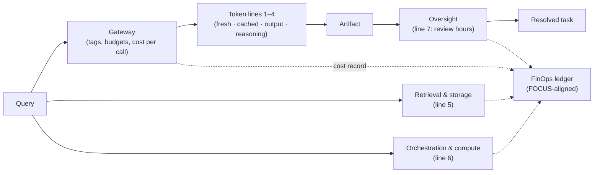
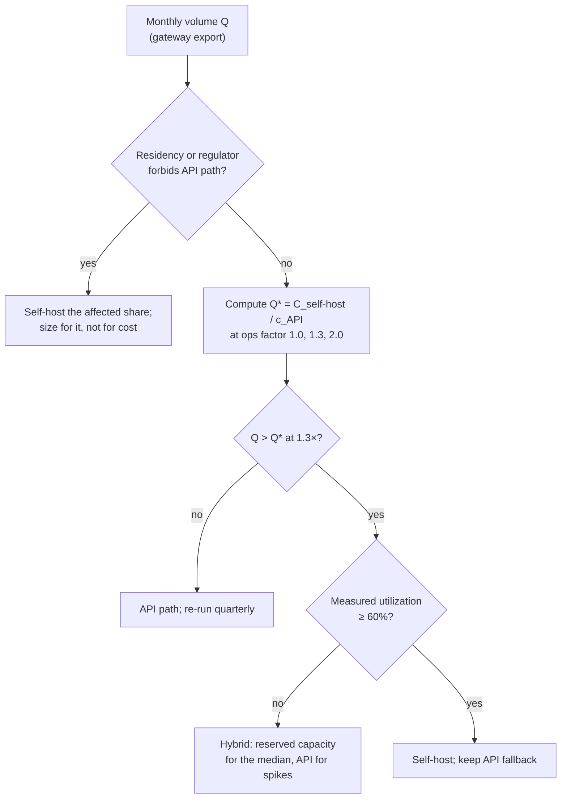

# Chapter 37 — Economics and TCO

*Part III · Word budget 6,000–8,000 · Lab 37 · Verified as of September 2026 · Every derived figure is produced by `labs/ch37-economics/derive.py`*

## 37.1 Intuition

The first cost question a plant asks about an agent is the wrong one: what does it cost per token. The maintenance agent for pump P-101 answers 2,000 queries a day (scenario, ch16), and at September 2026 list prices the whole month of tokens costs less than one day of a contractor (derive.py; contractor comparison illustrative). The costs that decide whether the program survives its first budget review are elsewhere — in the retrieval infrastructure, the orchestration, the evaluation set, and above all the hours of the people who review what the agent produces. Token spend is the line everyone can see; the anatomy below is the seven lines that matter, and the token lines are usually the smallest four.

The second wrong question is whether to self-host. The answer is arithmetic: a self-hosted model costs the same whether it serves ten queries or ten thousand, an API costs by the token, and the two lines cross at a volume the reader can compute in a minute. Below that volume, self-hosting is a data-residency decision, not a cost decision.

The third question is the one this chapter exists to answer: how to know, in a way a chief financial officer will accept, whether the agent returned anything. That needs a baseline measured before deployment, a counterfactual named in advance, and a unit of account that is an outcome — cost per resolved work order — not a token or a query.

## 37.2 Mechanism

### The four token lines

An API bill has four lines with different prices (ch15). Fresh input tokens are processed for the first time; cached input tokens are a prompt prefix the provider already holds, at roughly a 90% discount; output tokens are generated one at a time and priced 4–8× input; reasoning tokens are hidden "thinking" output billed at the output rate (vendor pricing pages, Sep 2026, vendor). The prices used throughout, per million tokens, are the September 2026 list prices for a frontier model — $1.25 fresh, $0.125 cached, $10.00 output — and a small model — $0.25, $0.025, $2.00 (OpenAI GPT-5 and GPT-5-mini list prices, vendor, verified Sep 2026). Anthropic charges a write surcharge on the first use of a cached prefix (1.25× for a five-minute lifetime, 2× for one hour); OpenAI and Google cache automatically without a surcharge; all three offer batch APIs at about 50% off for work that can wait (vendor pricing documentation, Sep 2026, vendor).

The mechanics behind the discounts are in the inference chapters (ch04 and ch10; primary mechanism): a cached prefix skips prefill because its Keys and Values already exist; output is expensive because decode is sequential and memory-bound. The design rules follow: stable content first and byte-identical so it caches; outputs as short as the task allows; reasoning effort raised only on steps that need it.

### The cost anatomy

Seven lines. The first four are the token bill; the last three are where the money goes.

| Line | Driver | How it is measured |
|---|---|---|
| Fresh input | Query and per-step retrieval size | Gateway logs, per call |
| Cached input | Stable prefix × hit rate | Gateway logs; cache-hit rate is the metric |
| Output | Artifact length | Gateway logs |
| Reasoning | Escalation rate × effort | Gateway logs (hidden tokens appear in usage) |
| Retrieval and storage | Vector index, embeddings, document pipeline, storage | Cloud or infrastructure invoices, tagged |
| Orchestration and compute | Workflow engine, sandboxes, gateway, tracing, on-site GPU | Invoices; GPU-hours × rate |
| Oversight | Reviewer and approver hours at loaded cost; evaluation-set maintenance | Time records from the approval queue (ch31) |

The instrument that makes the anatomy real is the LLM gateway (ch23): every model call passes through it, tagged with task, step, use case, and team, and it emits a cost record per call. Without it, the first four lines are a monthly total nobody can attribute; with it, cost per resolved task is a query.

**Figure 37.1 — Where the money goes.**

*Takeaway: the gateway prices four lines; the ledger prices seven; the outcome is priced once.*

### Four serving configurations

The break-even question is answered by pricing the same workload four ways:

- **A. Frontier, no caching** — the naive deployment; every token fresh.
- **B. Frontier with caching** — the prefix ordered so the stable 4,000 tokens hit the cache.
- **C. Routed with caching** — a classifier sends the routine share of queries to the small model; the hard share goes to the frontier model, which also carries all reasoning escalation.
- **D. Self-hosted open-weight** — a 70B-class model on two H100 GPUs; cost is GPU-hours regardless of volume, plus operations (configuration set from the scenario, illustrative).

Routing is the configuration with the largest claims and the largest gap between claims and measurement. RouteLLM reports cost reductions of over 85% on MT-Bench, 45% on MMLU, and 35% on GSM8K while retaining 95% of GPT-4's quality (Ong et al., RouteLLM, 2024, primary); FrugalGPT reports up to 98% (Chen et al. 2023, primary). Both are ceilings on benchmark distributions. Independent evidence on realistic traffic lands nearer 35% at under 2% quality loss (RouterArena-style evaluations, analyst). The configuration below assumes a 90/10 split as a scenario parameter, not a promise; the reader's own routing rate comes from the golden set (ch23).

### Self-hosting arithmetic

A self-hosted model's cost is hours × rate × GPUs, plus operations. On-demand H100 SXM pricing in September 2026 ranges from about $2.99 per GPU-hour on marketplaces to about $6.16 on premium clouds, with reserved capacity near $1.84–2.23 (RunPod, CoreWeave, Lambda pricing pages, vendor, verified Sep 2026). Operations — MLOps time, monitoring, redundancy, on-call — add 1.3–5× the raw GPU cost depending on maturity (analyst estimates; the chapter uses 1.3× as the low case). At low utilization the effective cost per token is many times the headline: a GPU used 10% of the time costs the same as one used 70% (arithmetic).

The break-even volume is where the fixed self-hosted cost equals the volume-proportional API cost:

$$Q^* = \frac{C_{\text{self-host, monthly}}}{c_{\text{API per query}}}.$$

### FinOps for AI: from showback to chargeback

The FinOps Foundation now treats AI spend as a formal category of its framework, and the FOCUS billing specification — the open schema that lets cloud invoices from different providers be compared — reached version 1.4 in June 2026 with support for token-denominated usage (FinOps Foundation, Framework 2026 and FOCUS 1.4, 4 Jun 2026, primary). The consequence for an operator is that LLM cost can be governed with the discipline already applied to cloud: allocate, show back, then charge back.

The sequence matters. **Allocation** requires tags on every call — use case, task, step, team, environment — and the gateway is the only place they can be applied reliably (ch23). **Showback** reports each team's attributed cost without moving money; it is the phase in which tag coverage is driven up and disputes are settled. **Chargeback** moves the cost to the consuming budget and should not begin below about 80% tag coverage, because charging teams for spend that cannot be attributed to them destroys the trust the exercise needs (practitioner threshold; the figure is a convention, not a measurement). **Budgets** are hard caps at the gateway per task and per use case; a task that exceeds its cap halts and escalates (ch21). A budget enforced by asking people to be careful is not a budget.

### Oversight is the largest line

The line finance will not see on any invoice is the one that dominates. Oversight cost per month is reviewer hours times loaded rate, and reviewer hours are a function of the harness's straight-through-processing rate:

$$\text{Oversight}_{\text{monthly}} = N_{\text{tasks}} \times (1 - \text{STP}) \times t_{\text{review}} \times r_{\text{loaded}}.$$

For the scenario — 60,000 queries resolving into, say, 1,500 work-order tasks a month, an STP rate of 20% in the first quarter, six minutes of supervisor review per gated task, and a loaded rate of $60 an hour — oversight is 1,500 × 0.8 × 0.1 h × USD 60 = USD 7,200 a month (illustrative inputs; arithmetic derived). At an STP rate of 70% the same line is USD 2,700 (derived). No token optimization moves the bill by that much; raising STP does, and STP rises only when sensors (ch26) and guides (ch18) mature enough that the approver of record can be removed from low-risk paths. That is the economic argument for the maturity model in ch39: the levels are the STP curve.

STP is measured from the approval queue, not estimated: a task counts as straight-through only if no human touched it between intake and delivery, and a task a reviewer approved in three seconds without a reason counts as touched — it is the approval-fatigue signal of ch31, not autonomy. Report STP with the rejection rate beside it; an STP rate rising while rejections fall to zero is a gate that stopped looking, not a harness that got better (definition is this chapter's; practitioner).

### Batch, semantic caching, and small models

Three further levers, each with a measured shape.

**Batch APIs** price non-interactive work at about half the list rate (vendor pricing, Sep 2026). Overnight document indexing, weekly re-evaluation of the golden set, and bulk report generation are batch work; routing them to the batch endpoint is a configuration change with a fixed 50% return.

**Semantic caching** — returning a stored answer when a new query is similar enough to a past one — is a different economy from prefix caching. It saves the whole call, not just prefill, and it introduces a failure prefix caching does not have: a false hit that returns a wrong answer to a query that only looked similar. It needs its own hit-rate and false-hit measurement on the golden set before it is trusted with anything a technician acts on; for procedure Q&A, where two queries about different pumps can be near-identical in wording, the false-hit risk is the deciding factor.

**Small models for narrow steps.** Belcak and colleagues argue that small language models under 10B parameters can serve most agent subtasks — tool-call formatting, extraction, classification, routing — at 10–30× lower cost than frontier models, while trailing badly on open-ended reasoning and multi-hop retrieval unless distilled for the task (Belcak et al., "Small Language Models are the Future of Agentic AI," NVIDIA Research, June 2025, primary). The economics are those of configuration C taken further: the routed share grows as more steps are classified as narrow, and the frontier model is reserved for planning and verification. The measurement is the same golden-set gate as routing.

**Figure 37.2 — The self-host decision.**

*Takeaway: residency decides first; arithmetic second; utilization last.*

### Contract and currency

Two costs sit outside the anatomy and inside the budget. API prices are list prices that fall over time and occasionally rise for new capabilities; a budget built on today's list without a re-verification date is stale within a quarter — every price in this chapter carries its verification month for that reason. And an operator paying in one currency for a bill denominated in another carries exchange risk on the largest lines; a program budgeted in dollars and staffed in reais, or the reverse, should hold its contingency in the currency of the exposure (practitioner rule; no figure).

### The baseline and the counterfactual

Return cannot be shown without a "before." The method: measure the process for 30–60 days before deployment — cycle time, error rate, first-pass approval, cost per transaction including labor at loaded cost; name the counterfactual (what would have been done instead: hire, outsource, or leave as is); deploy; measure the same metrics for the same period; report the difference with its uncertainty. Usage counts and generic "time saved" are not evidence; MIT's *GenAI Divide* study of 300 deployments found the vast majority stalled with little measurable P&L impact and about 5% achieving rapid revenue acceleration — a finding about measurement discipline as much as about technology (MIT Project NANDA, "The GenAI Divide," July 2025 preliminary report — 300+ initiatives, 52 organisation interviews, 153 senior-leader surveys per its own methodology page; Fortune's 18 Aug 2025 summary cites 150 interviews and 350 surveys — analyst; VERIFY 23 Sep 2026). McKinsey's 2025 survey puts high performers — more than 5% of EBIT attributable to AI — at about 6% of organizations (McKinsey, The State of AI in 2025, analyst).

### Process metrics and harness metrics

Report two sets side by side. The process the agent serves: efficiency (cycle time, throughput), quality (error rate, first-pass approval), cost (per transaction). The harness itself: autonomy (task success rate, straight-through-processing rate — the share of tasks completed with no human touch), reliability (hallucination rate, data traceability — the share of claims with a verifiable citation), cost (processing cost and tokens per task). A harness that improves its own numbers while the process numbers stand still has not delivered; a process that improves while the harness metrics degrade is borrowing from oversight hours that will not stay cheap.

### Cookbook evidence: the Pareto frontier the vendor draws

Anthropic's Applied AI team now publishes the exercise this chapter prescribes as a runnable notebook: configurations plotted by cost per ten thousand tasks against mean pass rate, the Pareto frontier as the best pass rate at or below each cost, and the dominated region named as "costlier, no better" (Anthropic, "Cost Optimization on the Claude API," Claude Cookbook, August 2026, vendor). Its takeaways are this chapter's: measure cost per completed task, not per token, because a dearer model that finishes in fewer turns can be cheaper end to end; establish the quality bar first and minimize cost under it; caching first because it changes only what tokens cost, model last because it changes what the model can do; and "changing your agent architecture is itself a lever" — the largest saving in the notebook came from restructuring the loop into a batchable single request, and the cheapest configuration came within one claim of the bar. The plant's version of the chart is 37.4's, with intervals from ch12 and the oversight line the notebook's eval did not price.

## 37.3 Worked numbers

All figures from `derive.py` (derived); inputs are the scenario parameters (ch16, illustrative) and the price sheet below. To re-run with new prices, edit these six numbers in `derive.py` and nothing else.

**Price sheet (USD per million tokens; list prices, vendor, verified September 2026).** Frontier: fresh input 1.25, cached input 0.125, output 10.00 (GPT-5). Small: 0.25, 0.025, 2.00 (GPT-5-mini). GPU: 2.99 per H100-hour on demand (RunPod).

**Workload.** 2,000 queries/day × 30 days = 60,000 queries/month. Per query: 6,000 input tokens of which 4,000 are a cacheable prefix and 2,000 fresh; 400 output tokens; 10% of queries escalate to high reasoning effort adding 2,000 reasoning tokens billed as output (scenario, illustrative).

**Table 37.1 — Monthly cost by configuration (USD; derive.py).**

| Configuration | Fresh input | Cached input | Output + reasoning | Compute | Ops (1.3×) | Total |
|---|---|---|---|---|---|---|
| A. Frontier, no caching | 450 | — | 360 | — | — | **810** |
| B. Frontier + caching | 150 | 30 | 360 | — | — | **540** |
| C. Routed 90/10 + caching | 42 | 8 | 187 | — | — | **238** |
| C′. Routed 70/30 + caching | — | — | — | — | — | **305** |
| D. Self-hosted 2× H100, ops 1.3× | — | — | — | 4,365 | 1,310 | **5,675** |
| D′. Self-hosted 2× H100, ops 2.0× | — | — | — | 4,365 | 4,365 | **8,731** |

Caching alone saves 33%; caching plus routing saves 71% at a 90/10 split and 62% at 70/30 (derive.py, derived) — the routing share is the parameter to measure on the golden set before the saving is claimed. Configuration C's output line is the interesting one: 90% of queries on the small model cost $43 of output; the 10% on the frontier model, which carry all the reasoning escalation, cost $144 — three times as much for a tenth of the traffic. Reasoning is where the output bill concentrates.

**Break-even.** Self-hosting at $5,675 per month overtakes configuration B at about 630,000 queries per month — 10.5× the scenario's volume — and configuration C at about 1.43 million, 23.9× (derive.py). At a 1.0× operations factor the crossovers fall to 8.1× and 18.3×; at 2.0× (row D′) they rise to 16.2× and 36.7× (derive.py; the reader should use their own factor). Below those volumes self-hosting is justified only by data residency or by a regulator that forbids the API path (ch36).

**Sensitivity of configuration B.**

| Driver | Values | Monthly total |
|---|---|---|
| Output tokens per query | 400 → 800 | 540 → 780 |
| Reasoning escalation rate | 0% / 10% / 30% | 420 / 540 / 780 |
| Query volume | 2,000 → 20,000 per day | 540 → 5,400 |

Output length and escalation rate each move the bill by nearly half; volume moves it linearly, which is exactly why self-hosting has a crossover and API pricing does not.

### Cost per resolved task, worked

The number the sponsor page carries is the seven lines divided by resolved tasks. For the scenario in its first quarter (all inputs illustrative; arithmetic derived): tokens $238 (configuration C); retrieval and storage $1,000; orchestration, gateway, and tracing $2,000; oversight $7,200 at a 20% STP rate — a monthly total of $10,438 over 1,500 resolved work orders, or about $7 per resolved task. The baseline is the planner's time per order at loaded cost: forty-five minutes at $60 an hour is $45 per order (illustrative). The comparison is favorable by a factor of six — and every one of those dollars is on lines the plant already knows how to audit, which is what makes the number survive finance. Raise STP to 70% and the same total falls to $5,900, under $4 per task; the token line moved by nothing.

**Reading a vendor's return claim.** Ask which of the seven lines it counts — most count the first four and omit oversight; whether the baseline was measured or estimated; whether "time saved" was converted at a loaded rate or a list rate; whether the claim is a pilot, a projection, or an audited result; and whether the workload's STP rate is stated. A claim that fails two of the five is a projection, whatever it is called (the checklist is this chapter's; practitioner).

**Multi-agent multiplier.** Anthropic's own account of its multi-agent research system reports agents using about 4× the tokens of a chat interaction and multi-agent systems about 15× (Anthropic, "How we built our multi-agent research system," 2025, vendor). Applied to configuration C, a multi-agent version of the same workload would cost about $3,600 a month in tokens — still small in absolute terms, but the 15× is the number to check before delegating (derive.py).

**The lines that dominate.** Against a token bill of $238–810, the scenario's other lines are of a different order: retrieval and storage in the hundreds to low thousands per month; orchestration and compute in the low thousands; and oversight — two reviewers spending a quarter of their time at a loaded cost of $60 an hour is about $5,000 a month (illustrative loaded cost and allocation). Oversight alone exceeds every API configuration by an order of magnitude at this volume, which is why the roadmap's measure of maturity is the override rate falling (ch39), not the token bill falling.

## 37.4 Measurement

**Stand up the gateway first.** Route every model call through a self-hosted gateway with per-call cost records tagged by use case, task, step, team, and environment; enforce a hard budget per task and per use case at the gateway, not by discipline. Target 80% tag coverage before any chargeback; until then, showback only. Emit records in a FOCUS-aligned schema so they merge with cloud invoices; FOCUS 1.4, ratified June 2026, supports token-based billing data (FinOps Foundation, FOCUS 1.4, 4 Jun 2026, primary).

**Measure the baseline before deployment.** Thirty to sixty days of the process metrics above, from the systems that already record them (the CMMS for work-order cycle time and rework; the approval queue for review hours). Name the counterfactual in writing and have the sponsor sign it.

**Measure routing on the golden set, not the benchmark.** Route the golden set through both models; report cost per task, quality retention with confidence intervals (paired bootstrap), and the share sent to each model. The published 85–98% figures are not the reader's number.

**Measure cache-hit rate weekly.** A falling hit rate means someone changed the prefix; the fix is prefix discipline (ch18), and the metric is the alarm.

**Report cost per resolved task monthly**, against the baseline, with the seven lines shown. Lab 37 reproduces Table 37.1 from the scenario parameters and re-runs it on the reader's gateway export.

These measurements are the improvement loop's inputs (ch32): clusters are mined from them weekly and changes are tested against them.

## 37.5 Failure

| Failure mode | Mechanism | Detection signal | Mitigation | Owning component |
|---|---|---|---|---|
| Runaway loop | Agent retries or re-plans without bound; each iteration resends the growing context | Cost per task far above p95; iterations climbing; discovered at invoice time | Hard step, token, cost, and time caps at the gateway and control plane | Control plane (ch21); gateway (ch23) |
| Cache miss by prefix drift | A token changed early in the prompt invalidates the cache | Cache-hit rate falls; fresh-input line rises | Stable prefix first, byte-identical; hit-rate alarm | Guides (ch18) |
| Reasoning left on high | Every step at maximum effort | Reasoning tokens dominate output line | Effort per step class; sandwich pattern | Model layer (ch23) |
| Vendor ceiling quoted as expectation | 85–98% routing savings promised; 30–40% delivered | Measured savings on golden set below plan | Measure on own traffic before committing | Model layer (ch23) |
| Utilization illusion | Self-hosted GPUs at 10% utilization priced at headline rate | Effective cost per token 10× plan | Compute break-even with real utilization; hybrid posture | This chapter |
| Untagged spend | Calls bypass the gateway or carry no tags | Monthly total with no attribution | All calls through the gateway; tag coverage metric | Observability (ch29) |
| ROI by usage count | "Queries served" reported as return | No baseline; no counterfactual | Cost per resolved task vs baseline | This chapter |
| Oversight cost hidden | Reviewer hours not counted | Token savings reported while headcount unchanged | Line 7 from the approval queue's time records | Human-in-the-loop (ch31) |

## 37.6 The frontier

**Strongest free treatments.** Vendor pricing pages are the primary source for the four token lines and are complete and current, and stop at their own products. RouteLLM (Ong et al. 2024) and FrugalGPT (Chen et al. 2023) establish routing and cascades with measured savings on benchmarks, and stop at the benchmark distribution — neither claims the numbers transfer to an operator's traffic. The FinOps Foundation's FOCUS specification defines how token billing lands in a cost ledger and stops at the ledger. MIT's *GenAI Divide* and McKinsey's *State of AI* establish that most deployments do not show measurable return and stop at the survey. Huyen's *AI Engineering* treats inference optimization and cost per token thoroughly and stops before a seven-line anatomy that includes oversight. Third-party TCO blog posts model self-hosting break-even for generic SaaS workloads and stop before industrial oversight economics.

**What this chapter adds.** One workload priced four ways from a committed script with every input visible; a break-even formula and its sensitivity to the operations factor; the seven-line anatomy in which the token lines are shown to be the smallest; the multi-agent multiplier applied; process and harness metrics side by side; and a measurement protocol with the baseline and counterfactual a finance function will accept. Open: no independent, audited cost-per-resolved-task figure for an industrial agent deployment exists in the public record (ch16A of the whitepaper; restated here), and the chapter does not invent one.

**Related chapters.** ch01 (Tokens and tokenizers); ch27 (Graders and agent evaluation); ch30 (Multi-agent systems and protocols).

## 37.7 Industrial application

**The refinery's budget review.** The maintenance program's first year is priced from the anatomy: token spend under $10,000 for the year at configuration C even with growth; retrieval infrastructure and the document pipeline in the tens of thousands; orchestration, gateway, and tracing similar; and oversight — the supervisors' approval hours and the reviewers of the golden set — the largest line by far until the override rate falls (illustrative magnitudes; the plant's own invoices replace them). The return is measured on the CMMS: work-order cycle time from request to approved order, rework rate on submitted orders, and the planner hours per order, each against the 60-day baseline.

**Data residency decides self-hosting.** At 60,000 queries a month the API path is roughly a tenth the cost of two on-site H100s. The on-site fallback exists anyway (ch04, ch35) because some queries touch data that may not leave the network and because the API path can be unavailable; it is sized for those cases, not for cost.

**What changes with scale.** If the program grows to five use cases at 20,000 queries a day, the API bill at configuration C is about $12,000 a month (derive.py at 10× volume) and the break-even for self-hosting is within reach at a 1.0–1.3× operations factor — the moment to re-run the arithmetic with measured utilization, not before.

**The monthly page to the sponsor.** Cost per resolved work order this month and at baseline; the seven lines; cache-hit rate; override rate; budget burn against the envelope. One page; the anatomy is the structure.

## 37.8 Decision aids

**Cost-anatomy worksheet (monthly, per use case).**

| Line | Amount | Source of the number | Trend vs last month |
|---|---|---|---|
| Fresh input | | Gateway | |
| Cached input | | Gateway (hit rate: __ %) | |
| Output | | Gateway | |
| Reasoning | | Gateway | |
| Retrieval and storage | | Invoices, tagged | |
| Orchestration and compute | | Invoices; GPU-hours × rate | |
| Oversight | | Approval-queue hours × loaded rate | |
| **Cost per resolved task** | | Total ÷ resolved tasks | vs baseline: |

**Self-host break-even formula.** $Q^* = C_{\text{self-host}} / c_{\text{API per query}}$, with $C_{\text{self-host}} = \text{GPUs} \times \text{rate} \times 730 \times \text{ops factor}$. Compute at ops factors 1.0, 1.3, and 2.0. If current volume is below $Q^*$ at 1.0, self-hosting is a residency decision.

**Routing go/no-go.** Measured on the golden set: routed share ≥ 50%, quality retention ≥ 98% with the lower confidence bound above 95%, cost per task reduced ≥ 25%. All three or no routing in production.

**Baseline checklist.** Thirty to sixty days measured; counterfactual named and signed; metrics from systems of record, not surveys; loaded labor cost agreed with finance; the four verdicts (adopt, adopt with conditions, park, negative result) defined before deployment (ch40).

## 37.9 Sources

| # | Claim or figure | Source | Tier | Verified | Link |
|---|---|---|---|---|---|
| 1 | Frontier $1.25 / $0.125 / $10; small $0.25 / $0.025 / $2 per M tokens | OpenAI GPT-5 and GPT-5-mini list prices | vendor | Sep 2026 | https://developers.openai.com/api/docs/pricing |
| 2 | Cache read ~90% off; Anthropic write surcharge 1.25× / 2×; batch ~50% | OpenAI, Anthropic, Google pricing documentation | vendor | Sep 2026 | https://openai.com/index/ |
| 3 | RouteLLM: >85% MT-Bench, 45% MMLU, 35% GSM8K at 95% GPT-4 quality | Ong et al., RouteLLM, 2024, arXiv 2406.18665 | primary | Sep 2026 | https://arxiv.org/abs/2406.18665 |
| 4 | FrugalGPT up to 98% | Chen, Zaharia, Zou, FrugalGPT, 2023, arXiv 2305.05176 | primary | Sep 2026 | https://arxiv.org/abs/2305.05176 |
| 5 | ~35% savings at <2% loss on realistic traffic | RouterArena-style independent evaluations | analyst | Sep 2026 | needs fetch |
| 6 | H100 on-demand $2.99 (RunPod), ~$6.16 (CoreWeave); reserved $1.84–2.23 | Vendor pricing pages | vendor | Sep 2026 | https://docs.claude.com/en/docs/about-claude/pricing |
| 7 | Operations 1.3–5× raw GPU cost | Analyst estimates | analyst | Sep 2026 | — |
| 8 | Agents ~4× chat tokens; multi-agent ~15× | Anthropic, "How we built our multi-agent research system," 2025 | vendor | Sep 2026 | https://www.anthropic.com/engineering/multi-agent-research-system |
| 9 | ~5% rapid revenue acceleration; majority stalled | MIT Project NANDA, "The GenAI Divide," Jul 2025 (300+ initiatives; 52 interviews; 153 surveys — Fortune summary Aug 2025) | analyst | Sep 2026 | https://fortune.com/2025/08/18/mit-report-95-percent-generative-ai-pilots-at-companies-failing-cfo |
| 10 | ~6% high performers (>5% EBIT) | McKinsey, The State of AI in 2025, Nov 2025 | analyst | Sep 2026 | https://www.mckinsey.com/ |
| 11 | FOCUS 1.4 ratified 4 Jun 2026; token billing supported; FinOps for AI as a framework category | FinOps Foundation | primary | Sep 2026 | https://www.finops.org/framework/ |
| 11a | SLMs serve most agent subtasks at 10–30× lower cost | Belcak et al., arXiv 2506.02153, Jun 2025 | primary | Sep 2026 | https://arxiv.org/abs/2506.02153 |
| 11b | Oversight formula inputs: 1,500 tasks, STP 20%/70%, 6 min, $60/h | This chapter | illustrative | Sep 2026 | — |
| 12 | All configuration totals, savings, break-evens, sensitivities | `labs/ch37-economics/derive.py` | derived | Sep 2026 | labs/ch37-economics/derive.py |
| 13 | Scenario volumes and token sizes; oversight loaded cost and allocation; first-year magnitudes | Scenario (ch16); illustrative | illustrative | Sep 2026 | — |
| 14 | No audited industrial cost-per-resolved-task figure in the public record | Search, Sep 2026 | open | Sep 2026 | — |
| C | Cost-optimization checklist measured on a claims agent: 10-claim eval, 2 trials per configuration | Anthropic, "Cost Optimization on the Claude API," Claude Cookbook, Aug 2026 (Lehrburger) | vendor | Sep 2026 | https://platform.claude.com/cookbook/cost-optimization-cost-optimization |